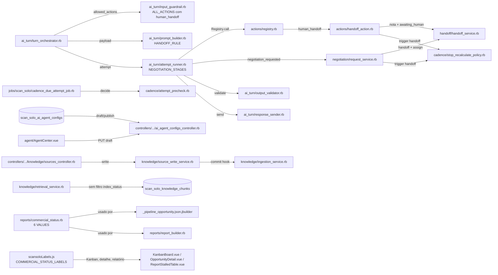
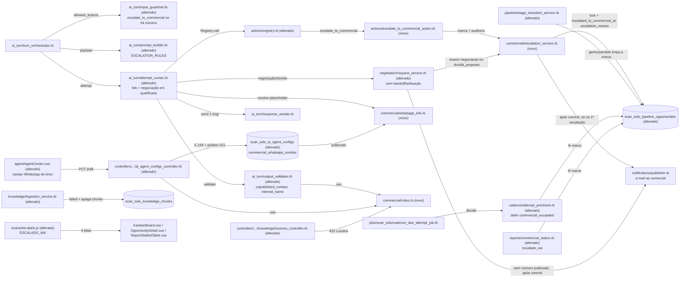

# Implementation Plan

## Request Summary
- Objective: replace the model-driven internal handoff (`human_handoff` → `awaiting_human`, AI stops) with an automatic `escalate_to_commercial` action that writes an escalation mark + `commercial.escalated` audit, keeps the AI `ai_active`, holds the cadence through a new `AttemptPrecheck` defer reason, and puts an application-built `wa.me` link to the public commercial contact "Artur" inside the single reply of the turn. The number lives only in the published agent config (`commercial_whatsapp_number`). "Luciano" is blocked on output, on knowledge writes (422) and at ingestion.
- Scope in: RF-01..RF-23, UI-01, UI-02, CT-01..CT-06, RNF-01..RNF-06 of `.spec/features/scansolo-escalacao-comercial-wame/SPEC.md` v1.3 (0 open markers; decisions in its Clarifications Log and `.handoff/clarifier-answers.md`). v1.3 delta: commercial notice e-mail on every escalation reason but only on the first escalation (RF-23, RF-12/13/14/19), and cadence held until `ganho`/`perdido` including later proposal follow-ups (RF-11).
- Scope out: proposal approval by e-mail (Fatia 4), automatic `perdido` (Fatia 3), new reports, any change to the human takeover (`ConversationListener` → `TakeoverService`), `return_to_ai`, the `HandoffService` note, the Kanban drag guard for `proposta_enviada`, sending anything to Artur over WhatsApp, any phone number in Git.
- Tier: complete
- Architecture references: `AGENTS.md` (= `CLAUDE.md`), `docs/agents/architecture.md`, `docs/agents/domain_rules.md`, `docs/agents/data_model.md`, `docs/agents/api_contracts.md`. `enterprise/` has no ScanSolo code (`docs/agents/architecture.md`, "Directory layout"), so nothing is mirrored there.

### Layering and delegation rules every task must preserve
- `docs/agents/architecture.md` "Layer responsibilities": controllers own the 404 gate, Pundit 403 and request-shape validation with 422. Services own domain rules, transactions and audit through `ScanSolo::AuditLogger`. Models own closed-vocabulary validations. Jobs own no eligibility logic. Pinia stores and API clients own no business rules. This puts the E.164 check in `AiAgentConfigsController` (T03), the "Luciano" 422 in `Knowledge::SourcesController` (T04), the closed `escalation_reason` vocabulary in `PipelineOpportunity` (T01), and the escalation mark + audit in `ScanSolo::Commercial::EscalationService` (T06). Both the action (T06) and `Negotiation::RequestService` (T12) call that service, which is also the single place that decides "first escalation" (under a row lock) and schedules the commercial notice e-mail after commit (RF-23). The stage-transition service (`StageTransitionService`, documented as the sole path that changes `stage`) clears the mark on `ganho`/`perdido` (T08).
- `docs/agents/domain_rules.md` "Agent actions": every action goes through `Actions::Registry` → `Actions::Executor`, with a closed schema (`additionalProperties: false`), a unique `idempotency_key` and a classification. Turn-scoped ids come from `TURN_SCOPED_PARAMS` and are never set by the model (T06).
- `docs/agents/domain_rules.md` "AI turn pipeline": regenerable violations get 1 regeneration and then the fixed fallback. An action exception rolls the turn back. The attempt savepoint in `AttemptRunner` is the transaction boundary for the reply, so the mark and the audit must be written inside it (T06, T13).
- `docs/agents/domain_rules.md` "Cadence engine": `AttemptPrecheck` is the single eligibility point for attempts, and `CadenceDueAttemptJob` only applies its decision. A defer keeps the attempt `scheduled` (verified at `app/jobs/scan_solo/cadence_due_attempt_job.rb:38-41`). The new reason is added only there (T08), and `StopRecalculatePolicy` is not touched.
- `docs/agents/domain_rules.md` "Eligibility gate": live turns read only `AiAgentConfig.published_for(account)`. `TurnOrchestrator` already passes the published config to `InputGuardrail`, `PromptBuilder` and `AttemptRunner` (verified at `app/services/scan_solo/ai_turn/turn_orchestrator.rb:72-79,94-104`), so every new number read uses that object (RF-02).
- `docs/agents/data_model.md` "Storage": migrations are additive only. `AGENTS.md`: enforce rules at the earliest shared entry point, validate at the request boundary with 422, no speculative guards, i18n only in `config/locales/en.yml` and `app/javascript/dashboard/i18n/locale/en/scansolo.json`, Vue `<script setup>` + Tailwind only, specs only when asked (this SPEC asks for them explicitly; RNF-03 requires paths containing `scan_solo`/`scansolo`).

## AS IS — Componentes impactados

Hoje o modelo pode pedir `human_handoff`. Essa ação e a negociação levam a conversa para `awaiting_human` e pausam a cadência com o trigger `handoff`. Não existe número comercial, link `wa.me` nem bloqueio de "Luciano" na saída ou na base. `RetrievalService#eligible_scope` só filtra `enabled` (verified at `app/services/scan_solo/knowledge/retrieval_service.rb:39-41`).

## TO BE — Componentes propostos

Novos nós e onde nascem:
- Colunas novas (T01) e regras compartilhadas `commercial/rules.rb` (T02).
- Config e publish 422 (T03), e bloqueio de "Luciano" no knowledge e na ingestão (T04).
- Ação e `EscalationService` com lock e e-mail só na 1ª escalação (T06), link `wa.me` e assunto do e-mail de aviso por motivo (T07), defer na cadência e limpeza da marca em `ganho`/`perdido` (T08) e validador (T09).
- `escalado_wa` no backend (T10), regras do prompt (T11) e negociação sem handoff (T12).
- Integração no `AttemptRunner` (T13), campo no Agent Center (T05) e rótulos no front (T15).

## Tasks

### T01 — Additive migrations, schema and model support for the commercial number and the escalation mark
- **Files**:
  - New `db/migrate/20261109100001_add_commercial_whatsapp_number_to_scan_solo_ai_agent_configs.rb`.
  - New `db/migrate/20261109100002_add_commercial_escalation_to_scan_solo_pipeline_opportunities.rb`.
  - `db/schema.rb`, `app/models/scan_solo/ai_agent_config.rb`, `app/models/scan_solo/pipeline_opportunity.rb`, `spec/db/scansolo_migrations_spec.rb`.
  - New `spec/models/scan_solo/pipeline_opportunity_escalation_spec.rb`.
- **Change**:
  - Migration 1: `add_column :scan_solo_ai_agent_configs, :commercial_whatsapp_number, :string`. Nullable, no default.
  - Migration 2: `add_column :scan_solo_pipeline_opportunities, :escalated_to_commercial_at, :datetime` and `add_column ..., :escalation_reason, :string`, both nullable. No index: the reads go through preloaded opportunities.
  - Neither migration may drop, rename or change the type of a column (RNF-02).
  - Update `db/schema.rb` (version `2026_11_09_100002`).
  - `AiAgentConfig::FIELDS` gains `commercial_whatsapp_number`, so `PublishService#snapshot_attributes` copies it into the snapshot with no change to the service.
  - `PipelineOpportunity`:
    - add `ESCALATION_REASONS = %w[duvida_sem_resposta sem_informacao_base negociacao duvida_proposta assunto_orcamento pedido_humano].freeze`;
    - add `validates :escalation_reason, inclusion: { in: ESCALATION_REASONS }, allow_nil: true`;
    - add `def escalated_to_commercial? = escalated_to_commercial_at.present? && !ganho? && !perdido?`, the single definition of "escalated" used by T08 and T10.
  - Update the schema-annotation comment blocks by hand, adding only the new columns. Do NOT run `annotaterb`: it rewrites unrelated headers and has broken the branding spec before.
  - `scansolo_migrations_spec`: count `44 → 46`, plus a comment line naming this feature's 2 additive migrations. Add 1 example asserting that both migrations use only `add_column` and that the 3 columns exist and are nullable.
  - The `config/schedule.yml` cron list is unchanged, so the cron assertion in `spec/integration/scan_solo/proposta_aprovacao_email_spec.rb:356` must stay green untouched.
- **Covers**: RF-09 (storage), RF-11/RF-17 (shared predicate), RF-01/RF-02 (column + snapshot), RNF-02
- **Tests**:
  - `spec/db/scansolo_migrations_spec.rb`: count 46, additive-only, columns nullable.
  - `spec/models/scan_solo/pipeline_opportunity_escalation_spec.rb`: `escalated_to_commercial?` is true with a mark in `negociacao`, false with no mark, false in `ganho`/`perdido`. An invalid `escalation_reason` is invalid.
- **Risk**: Low. Additive nullable columns. The only pitfall is the migration count spec and annotate side effects.
- **Dependencies**: none

### T02 — Shared commercial contact rules (E.164 and internal name)
- **Files**:
  - New `app/services/scan_solo/commercial/rules.rb`.
  - `app/controllers/api/v1/accounts/scan_solo/pipeline_opportunities_controller.rb`.
  - New `spec/services/scan_solo/commercial/rules_spec.rb`.
- **Change**:
  - Create `ScanSolo::Commercial::Rules` (compact class/module style) with:
    - `E164_PHONE_REGEXP = /\A\+[1-9]\d{1,14}\z/`, moved verbatim from `PipelineOpportunitiesController::E164_PHONE_REGEXP` (verified at `pipeline_opportunities_controller.rb:28`);
    - `INTERNAL_NAME_PATTERN = /luciano/i`;
    - `self.internal_name?(text)`, which matches `INTERNAL_NAME_PATTERN` against `I18n.transliterate(text.to_s)`, so the check ignores both case and accents (RF-08).
  - Replace the controller's constant and its single use (`pipeline_opportunities_controller.rb:132`) with `::ScanSolo::Commercial::Rules::E164_PHONE_REGEXP`. Remove the old constant (no dead code). The frontend mirror comment in `pipelineConstants.js:52` keeps pointing at "the server E.164 rule" (T05 updates the comment).
  - The regex literal is code, not a user-facing string, so RF-08's i18n/prompt constraint does not apply to it.
- **Covers**: RF-01 (shared rule), RF-07/RF-08/RF-20/RF-22 (shared matcher)
- **Tests**:
  - `spec/services/scan_solo/commercial/rules_spec.rb`: `internal_name?` is true for "luciano", "LUCIANO" and "Lucíano", and false for "Artur" and "Luci". E.164 accepts `+5511999999999` and rejects `11999999999` and `+55 11 99999-9999`.
  - The existing `spec/requests/api/v1/accounts/scan_solo/pipeline_opportunities_create_spec.rb` stays green (`invalid_phone`).
- **Risk**: Low. A pure constant move.
- **Dependencies**: none

### T03 — Agent config API: `commercial_whatsapp_number` on draft/show/publish and publish 422 when enabled without number
- **Files**: `app/controllers/api/v1/accounts/scan_solo/ai_agent_configs_controller.rb`, `app/views/api/v1/accounts/scan_solo/ai_agent_configs/_ai_agent_config.json.jbuilder`, `spec/requests/api/v1/accounts/scan_solo/ai_agent_configs_spec.rb`
- **Change**:
  - Draft validation (request boundary, CT-01):
    - in `validate_commercial_params`, when `params.key?(:commercial_whatsapp_number)`, accept only `nil` or a `String` matching `ScanSolo::Commercial::Rules::E164_PHONE_REGEXP`;
    - for anything else (integer, `""`, local format, spaces/dashes) add `@draft.errors.add(:commercial_whatsapp_number, 'must be an E.164 phone number')`. The existing `raise ActiveRecord::RecordInvalid, @draft` then returns 422 `{ message, attributes }` before `DraftUpdateService` writes anything;
    - permit `:commercial_whatsapp_number` in `draft_params`.
  - Publish rule (RF-21):
    - in `publish`, after `authorize`, if `@draft.enabled && @draft.commercial_whatsapp_number.blank?`, add an error on `:commercial_whatsapp_number` ('is required to publish an enabled agent') and raise `ActiveRecord::RecordInvalid, @draft` before calling `PublishService`. The result is 0 snapshots and 0 `ai_agent_config.published` audits;
    - placement follows the controller's existing precedent of validating against draft state (`validate_quote_inbox` reads `@draft.quote_inbox_id`, verified at `ai_agent_configs_controller.rb:61-71`). The controller is the only production caller of `PublishService` (verified by grep), so it is the earliest shared entry point. Placement confirmed by the developer (former Q2, see Assumptions).
  - jbuilder partial: add `json.commercial_whatsapp_number resource.commercial_whatsapp_number`, so draft and published both expose it in `show`, `draft` and `publish` (CT-01).
- **Covers**: RF-01, RF-21, CT-01, RF-02 (snapshot carries the number)
- **Tests**: `spec/requests/api/v1/accounts/scan_solo/ai_agent_configs_spec.rb`:
  - PUT draft with `"+5511999999999"` returns 200 and persists the value;
  - `"11999999999"`, `"+55 11 99999-9999"`, `5511999999999` (integer) and `""` each return 422 with `attributes` including `commercial_whatsapp_number`, and the draft row is unchanged (`updated_at` and value);
  - `null` returns 200 and clears the value;
  - publish with `enabled: true` and no number returns 422, with `AiAgentConfig.published.count` and the audit count unchanged;
  - `enabled: false` and no number returns 200;
  - `enabled: true` with a number returns 200, and the snapshot and the `published` JSON carry the number;
  - `GET` exposes the field for draft and published.
  - Only fictitious numbers are used (RNF-01).
- **Risk**: Medium. This tightens publishing in production: an enabled draft without the number can no longer be published, so the rollout must fill the field before the next publish.
- **Dependencies**: T01, T02

### T04 — Knowledge "Luciano" guard: 422 on source writes and failed ingestion with chunk removal
- **Files**:
  - `app/controllers/api/v1/accounts/scan_solo/knowledge/sources_controller.rb`, `app/services/scan_solo/knowledge/ingestion_service.rb`.
  - `spec/requests/api/v1/accounts/scan_solo/knowledge/sources_spec.rb`, `spec/services/scan_solo/knowledge/ingestion_service_spec.rb`, `spec/jobs/scan_solo/knowledge_ingestion_job_spec.rb`.
- **Change**:
  - Controller (RF-20, CT-06):
    - in `create`, before `SourceWriteService.create!`, if `Rules.internal_name?` matches `params[:title]` or `params[:content]`, build `::ScanSolo::KnowledgeSource.new`, add `errors.add(:base, 'must not contain the internal commercial contact name')` (attribute `title`/`content` as applicable) and raise `ActiveRecord::RecordInvalid`. Same check in `update` against `@source`;
    - this reuses the controller's existing 422 `RecordInvalid` body (`{ message, attributes }`), and nothing is written or audited;
    - the error text is an English developer message like the other RecordInvalid messages, and it must not contain the name itself.
  - IngestionService (RF-22):
    - after `source.update!(index_status: :indexing, index_error: nil)` and before chunking/embedding, if `ScanSolo::Commercial::Rules.internal_name?(source.content)`, then in one transaction run `source.knowledge_chunks.destroy_all` and `source.update!(index_status: :failed, index_error: INTERNAL_NAME_ERROR, chunk_count: 0)`, and return the source;
    - add the constant `INTERNAL_NAME_ERROR`, pt-BR text without the name, e.g. "A fonte contém o nome interno do contato comercial; remova-o e reindexe.";
    - 0 embedding calls;
    - chunk deletion is required because `RetrievalService#eligible_scope` does not filter `index_status` and the existing `fail!` keeps old chunks (verified at `retrieval_service.rb:39-41`, `ingestion_service.rb:58-61`);
    - `RetrievalService` is not changed.
- **Covers**: RF-20, RF-22, CT-06, RF-08 (KB side)
- **Tests**:
  - Request spec:
    - POST with `content` "fale com o Luciano" or `title` "LUCIANO" returns 422, with 0 new sources and 0 audit events;
    - PATCH/PUT on an existing source with the name returns 422, and its title/content and `updated_at` are unchanged;
    - the same requests without the name return 2xx.
  - Ingestion spec:
    - a source with "luciano" in its content ends `failed` with `index_error` present, a stub embedding provider receiving 0 calls, and `KnowledgeChunk.where(source:)` count 0;
    - a source previously `indexed` with 2 chunks whose content is then changed via `update_column` to include "Luciano" ends with 0 chunks after re-ingestion, and `RetrievalService.call` (stub embedding) returns 0 results from it;
    - content without the name still ends `indexed`.
  - Job spec: `KnowledgeIngestionJob.perform_now(source.id)` propagates the failure state.
- **Risk**: Medium. Chunk deletion cannot be undone, but recovery is to fix the text and reindex.
- **Dependencies**: T02

### T05 — Agent Center: commercial WhatsApp field (UI-01)
- **Files**:
  - `app/javascript/dashboard/routes/dashboard/scansolo/agent/agentCenterFields.js`, `app/javascript/dashboard/routes/dashboard/scansolo/agent/AgentCenter.vue`.
  - `app/javascript/dashboard/routes/dashboard/scansolo/pipeline/pipelineConstants.js` (comment only), `app/javascript/dashboard/i18n/locale/en/scansolo.json`.
  - `app/javascript/dashboard/routes/dashboard/scansolo/agent/specs/AgentCenter.spec.js`.
- **Change**:
  - `agentCenterFields.js`:
    - add the label key `commercialWhatsappNumber: 'SCANSOLO.AGENT_CENTER.FIELDS.COMMERCIAL_WHATSAPP_NUMBER'`;
    - add `FIELD_TYPES.PHONE = 'phone'`;
    - add the field to the `commercial` section after `quoteRecipientEmail`.
  - `AgentCenter.vue` (`<script setup>`, Tailwind only, no bare strings):
    - add `commercialWhatsappNumber: ''` to `emptyForm`;
    - add a computed inline error using `E164_PHONE_PATTERN` imported from `pipeline/pipelineConstants.js`. It applies when the value is non-empty and does not match; an empty value is valid;
    - render the PHONE field like the EMAIL one, with the inline error under it;
    - disable the save button while the error is present (`:disabled="isBusy || hasFieldErrors"`);
    - `draftPayload` sends `commercial_whatsapp_number: (form.commercialWhatsappNumber || '').trim() || null`;
    - `applyDraftToForm` maps a `null` from the server to `''`;
    - a 422 keeps going through the existing `serverErrorMessage` alert.
  - Update the comment in `pipelineConstants.js:52` to "mirrors ScanSolo::Commercial::Rules::E164_PHONE_REGEXP".
  - `scansolo.json` (pt-BR):
    - `AGENT_CENTER.FIELDS.COMMERCIAL_WHATSAPP_NUMBER` ("WhatsApp do Artur (comercial)");
    - `AGENT_CENTER.COMMERCIAL_WHATSAPP_NUMBER_ERROR` ("Informe o número no formato internacional, começando com + e o código do país.");
    - `AGENT_CENTER.COMMERCIAL_WHATSAPP_NUMBER_HINT` with no digit sequence.
    - No phone number and no "Luciano" in any of them.
- **Covers**: UI-01, CT-01 (client), RNF-01, RNF-06
- **Tests**: `AgentCenter.spec.js`:
  - typing `11999999999` shows the inline error and disables the save button;
  - typing `+5511999999999` and saving calls `updateDraft` with `commercial_whatsapp_number: '+5511999999999'`;
  - clearing the field sends `null`;
  - a rejected `updateDraft` with a 422 body shows the alert;
  - a draft from the server with `commercialWhatsappNumber: null` renders an empty input.
  - Replace the existing fixture text mentioning "Luciano" (`AgentCenter.spec.js:68`) only if it collides with the new assertions. Otherwise leave it, since it is spec data and not a product string.
- **Risk**: Low
- **Dependencies**: T03 (field name in the API)

### T06 — `escalate_to_commercial` action, `EscalationService`, registry and per-turn offering
- **Files**:
  - New `app/services/scan_solo/commercial/escalation_service.rb`, new `app/services/scan_solo/actions/escalate_to_commercial_action.rb`.
  - `app/services/scan_solo/actions/registry.rb`, `app/services/scan_solo/ai_turn/input_guardrail.rb`.
  - New `spec/services/scan_solo/commercial/escalation_service_spec.rb`, new `spec/services/scan_solo/actions/escalate_to_commercial_action_spec.rb`.
  - `spec/services/scan_solo/actions/registry_spec.rb`, `spec/services/scan_solo/ai_turn/input_guardrail_spec.rb`.
- **Change**:
  - `ScanSolo::Commercial::EscalationService.call(opportunity:, reason:, turn:)`, in this order:
    1. `opportunity.lock!` (row lock, `SELECT ... FOR UPDATE` + reload). The lock is held until the outermost transaction (the turn/attempt) commits, so two concurrent turns on the same opportunity serialize here and the second one sees the first one's mark. Callers must not hold unsaved changes on the record (Rails raises on `lock!` of a dirty record); `StageTransitionService` in T12 saves before this call;
    2. same-turn no-op: if a `commercial.escalated` event for this opportunity with `turn.correlation_id` already exists, return the existing mark (no write, no audit, no e-mail). This holds the "1 escalation per turn" rule when the model action and `RequestService` both escalate in the same attempt;
    3. `first = !opportunity.escalated_to_commercial?`, read after the lock (mark absent, or stage `ganho`/`perdido`; RF-23);
    4. writes `escalated_to_commercial_at: Time.current` (server clock, RNF-05) and `escalation_reason: reason`, overwriting both;
    - records `ScanSolo::AuditLogger.record!(subject: opportunity, event_type: 'commercial.escalated', correlation_id: turn.correlation_id, payload: { reason:, conversation_id: opportunity.conversation_id, message_id: turn.message_id, stage: opportunity.stage })`, with no phone in the payload (CT-03);
    5. when `first`, registers `ActiveRecord.after_all_transactions_commit { ScanSolo::Notifications::Publisher.call(event: 'commercial.escalated', payload: ScanSolo::Notifications::NegotiationPayload.build(opportunity: opportunity.reload, trigger_message: turn.message, correlation_id: turn.correlation_id).merge(escalation_reason: reason)) }` (RF-23). The extra `escalation_reason` key is what makes `EmailComposer.negotiation` pick the per-reason subject (developer decision, former Q7; the subject itself is built in T07). `NegotiationPayload` is not changed, so the no-number negotiation path of T12 (RF-19), which builds the payload without this key, keeps the current "Pedido de negociação #…" subject. This reuses the existing channel unchanged: `EmailAdapter` ignores `event`, `Publisher` already dedupes per `correlation_id` (`negotiation.notification_claimed`) and turns adapter failures into `negotiation.notification_failed` without raising (verified at `app/services/scan_solo/notifications/publisher.rb:24-48`). When not `first`, nothing is published;
    - runs inside the caller's transaction (the attempt savepoint), so a blocked or rolled-back attempt leaves the columns and events untouched (RF-09);
    - returns `{ escalated: true, reason:, escalated_at: <iso8601> }` (CT-02 result).
  - `ScanSolo::Actions::EscalateToCommercialAction`:
    - `CLASSIFICATION = :automatic`;
    - `SCHEMA` exactly as CT-02 (`conversation_id` integer, `reason` enum from `PipelineOpportunity::ESCALATION_REASONS`, both required, `additionalProperties: false`);
    - `self.call(params:, turn:, **)` finds `PipelineOpportunity.find_by!(conversation_id: params[:conversation_id])` and delegates to `EscalationService`. It never calls `HandoffService` or `StopRecalculatePolicy` (RF-10, RF-11) and creates no message (RF-06).
  - `Registry::HANDLERS` adds `'escalate_to_commercial'`. `HandoffAction` stays registered only so the audit trail and executions feed of past `human_handoff` executions still resolve, the same pattern as `proposal_generate`.
  - `InputGuardrail`:
    - `ALL_ACTIONS` adds `escalate_to_commercial`;
    - `allowed_actions` returns `ALL_ACTIONS - CONFIRMATION_ONLY_ACTIONS - NEVER_OFFERED_ACTIONS`, where `NEVER_OFFERED_ACTIONS = %w[proposal_generate human_handoff]` (RF-04), minus `escalate_to_commercial` when `config.commercial_whatsapp_number.blank?` (RF-19). `config` is already the published snapshot passed by `TurnOrchestrator`;
    - update the class comment.
- **Covers**: RF-03, RF-04, RF-06 (no message), RF-09, RF-10, RF-11 (no handoff trigger), RF-19 (not offered), RF-23 (incl. `escalation_reason` in the notice payload), CT-02, CT-03, RNF-05
- **Tests**:
  - Action spec through `Registry.call`:
    - `agent_actions` row with `automatic`;
    - an extra key, a missing `reason` or `reason: 'outro'` raises `InvalidParamsError`;
    - the same `idempotency_key` twice gives 1 mark write and 1 `commercial.escalated` event;
    - 0 `StopRecalculatePolicy` calls (`expect(...).not_to receive`), 0 messages, and `ai_control_state` remains `ai_active`.
  - Service spec:
    - overwrite on a second escalation from a different correlation id (reason `pedido_humano`, `travel_to` for a later time) gives 2 events and the latest reason/time;
    - the same correlation id twice gives 1 event;
    - the payload keys are exactly `reason conversation_id message_id stage`;
    - per-reason subject input (former Q7): for each of the 6 reasons on an opportunity with no mark, the payload passed to `Publisher.call` has `escalation_reason` equal to that reason and otherwise the same keys as `NegotiationPayload.build`;
    - RF-23, for each of the 6 reasons on an opportunity with no mark: after the wrapping transaction commits, `Publisher.call` is invoked once with the turn's correlation id, giving 1 `negotiation.notification_sent` with the adapter stubbed (and 1 delivered e-mail with the real adapter + an smtp-enabled quote inbox, as in the existing negotiation specs);
    - an already escalated opportunity (mark present, stage `negociacao`) escalated from another correlation id: 1 new event, columns overwritten, 0 `Publisher.call`;
    - a mark present but stage `ganho`: treated as first, 1 `Publisher.call`;
    - concurrency (deterministic): load the opportunity in memory without a mark, then write a mark to the row with `update_columns` through a second `find`; calling the service with the stale in-memory object gives 0 `Publisher.call`, proving the decision is taken after `lock!` reloads the row;
    - a wrapping transaction rolled back after the call (`raise ActiveRecord::Rollback`) gives 0 `Publisher.call`, 0 events and unchanged columns.
  - Guardrail spec: with a number, `allowed_actions` includes `escalate_to_commercial` and excludes `human_handoff`; without a number it excludes both.
  - Registry spec: the handler map includes the new id.
- **Risk**: Medium. This removes `human_handoff` from what the model can do (accepted in SPEC), and the row lock adds a short wait for concurrent turns on the same opportunity (only while an escalation is in flight).
- **Dependencies**: T01

### T07 — `wa.me` link builder, per-reason notice e-mail subjects and backend pt-BR strings
- **Files**:
  - New `app/services/scan_solo/commercial/whatsapp_link.rb`, `app/services/scan_solo/quote/email_composer.rb`, `config/locales/en.yml`.
  - New `spec/services/scan_solo/commercial/whatsapp_link_spec.rb`, `spec/services/scan_solo/quote/email_composer_spec.rb`.
- **Change**:
  - `ScanSolo::Commercial::WhatsappLink`:
    - `PLACEHOLDER = '{{LINK_ARTUR}}'.freeze`;
    - `self.build(config:, opportunity:)` returns `nil` when `config.commercial_whatsapp_number.blank?`. Otherwise it returns `"https://wa.me/#{number.delete('+')}?text=#{ERB::Util.url_encode(text)}"` (RFC 3986 percent-encoding, CT-05).
  - Text from `I18n.t('scan_solo.commercial.whatsapp_text.*')`:
    - a greeting naming Artur, plus optional lines;
    - name: lead field `nome` when not `faltante`/`nao_informado`, else `contact.name`;
    - company: `empresa`, same status rule as `_pipeline_opportunity.json.jbuilder:31-34`;
    - service: `tipo_servico`, same rule;
    - proposal: `opportunity.proposal&.current_version&.proposal_number`.
    - Each line is included only when its value is present, never as a placeholder or "não informado".
  - Reads preloaded associations only. No HTTP and no LLM (RNF-04).
  - Per-reason notice e-mail subject (developer decision, former Q7). `EmailComposer.negotiation(payload:)` (`email_composer.rb:37-48`) picks the subject key from `payload[:escalation_reason]` (set by T06):
    - present → `t("commercial.escalation_email.subjects.#{reason}", opportunity_id:, name:)`;
    - absent (no-number negotiation path of T12, RF-19) → the current `t('negotiation.email.subject', ...)` = "Pedido de negociação #%{opportunity_id} — %{name}", unchanged.
    - `name` keeps today's rule (`contact[:company].presence || contact[:name]`). The body, labels and `EmailAdapter` are unchanged. A key missing for a reason fails loudly (`I18n.t` with `raise: true`) instead of falling back, because the 6 reasons are a closed vocabulary (T01).
  - `en.yml` (pt-BR content, scope `scan_solo`):
    - `commercial.whatsapp_text.{greeting,name,company,service,proposal}`;
    - `commercial.escalation_email.subjects.{duvida_sem_resposta,sem_informacao_base,negociacao,duvida_proposta,assunto_orcamento,pedido_humano}`. Each one is distinct, differs from `negotiation.email.subject`, contains `#%{opportunity_id}` and `%{name}`, and names the commercial contact only as "Artur" when a name is used. Suggested wording:
      - `duvida_sem_resposta`: "Dúvida sem resposta encaminhada ao Artur #%{opportunity_id} — %{name}";
      - `sem_informacao_base`: "Pergunta sem informação na base #%{opportunity_id} — %{name}";
      - `negociacao`: "Negociação encaminhada ao Artur #%{opportunity_id} — %{name}";
      - `duvida_proposta`: "Dúvida sobre a proposta #%{opportunity_id} — %{name}";
      - `assunto_orcamento`: "Assunto de orçamento encaminhado ao Artur #%{opportunity_id} — %{name}";
      - `pedido_humano`: "Lead pediu atendimento humano #%{opportunity_id} — %{name}";
    - `negotiation.escalation_reply`: pt-BR text naming Artur, with `%{link}` and `%{email}`, with no value, deadline, condition or `R$`, e.g. "Para tratar valores, prazos ou condições, fale direto com o Artur, do nosso comercial, pelo WhatsApp: %{link} ou pelo e-mail %{email}.";
    - keep `negotiation.standard_reply` and `negotiation.email.subject` unchanged (RF-19).
  - No "Luciano" and no phone digits in any subject, body or link text.
- **Covers**: RF-05, RF-15 (reply text), RF-19 (no-number subject unchanged), RF-20 (no internal name in subjects), RF-23 (notice e-mail subject), CT-05, RNF-01, RNF-04, RNF-06
- **Tests**:
  - `whatsapp_link_spec.rb`:
    - for a lead with name, company, service and proposal `SS-2026-000123` (fictitious number `+5511999999999`): the URL starts with `https://wa.me/5511999999999?text=`, and `URI.decode_www_form_component` of `text` contains "Artur", the 3 values and `SS-2026-000123`;
    - without a proposal, the decoded text has no "SS-" and no proposal label;
    - with `empresa` `nao_informado`, there is no company line;
    - with no number, it returns `nil`.
  - `email_composer_spec.rb`, `.negotiation` (extends the existing RF-37 block):
    - for each of the 6 reasons, `payload.merge(escalation_reason: reason)` gives the subject `I18n.t("scan_solo.commercial.escalation_email.subjects.#{reason}", opportunity_id: 42, name: 'Solar Ltda')`, which contains `#42`;
    - the 6 subjects are pairwise distinct and none equals "Pedido de negociação #42 — Solar Ltda";
    - no subject matches `/luciano/i` (checked on the 6 rendered subjects and on the 6 raw `en.yml` values);
    - without `escalation_reason`, the subject stays exactly "Pedido de negociação #42 — Solar Ltda" (existing expectation kept);
    - the body lines are identical with and without `escalation_reason`.
- **Risk**: Low. `EmailThread.open!` opens the notice thread by subject, so each reason starts its own thread in the `comercial@` inbox; this is intended.
- **Dependencies**: T01

### T08 — Cadence hold: `commercial_escalated` defer in `AttemptPrecheck`, and mark cleared on `ganho`/`perdido`
- **Files**:
  - `app/services/scan_solo/cadence/attempt_precheck.rb`, `app/services/scan_solo/pipeline/stage_transition_service.rb`.
  - `spec/services/scan_solo/cadence/attempt_precheck_spec.rb`, `spec/jobs/scan_solo/cadence_due_attempt_job_spec.rb`, `spec/services/scan_solo/pipeline/stage_transition_service_spec.rb`.
- **Change**:
  - Add step 3c right after `return defer('human_controlled') unless ai_active?`: `return defer('commercial_escalated') if opportunity.escalated_to_commercial?`.
  - Update the order comment.
  - Enrollment status is not changed, `StopRecalculatePolicy` is not called and nothing is resumed (RF-11).
  - Enrollments created after the escalation (e.g. by `StageEntryEnroller`) hit the same check when due.
  - The job already keeps a deferred attempt `scheduled` and records `last_block_reason` (verified at `cadence_due_attempt_job.rb:38-41`).
  - This also holds the follow-ups of a proposal sent after the escalation (`Proposal::SuccessHandler` → `proposta_enviada` → `StageEntryEnroller`), until `ganho`/`perdido` (RF-11 v1.3).
  - `StageTransitionService#call` (router decision, see Assumptions): when `target_stage` is in `TERMINAL_STAGES`, the existing `opportunity.update!(stage: target_stage)` becomes `opportunity.update!(stage: target_stage, escalated_to_commercial_at: nil, escalation_reason: nil)`, in the same transaction as the `PipelineStageEvent`. The `commercial.escalated` events stay as history. Non-terminal transitions do not touch the mark. Update the header comment.
- **Covers**: RF-11, RF-23 (escalated state ends at `ganho`/`perdido`)
- **Tests**:
  - Precheck spec:
    - escalated in `proposta_enviada` → `defer`/`commercial_escalated`;
    - same with stage `ganho` → not deferred by this reason;
    - no mark → not deferred by this reason.
  - Job spec:
    - an opportunity with 1 active enrollment and 1 `scheduled` attempt is escalated; running `CadenceDueAttemptJob` with `travel_to` past `scheduled_at` inside the sending window sends 0 messages, the enrollment stays `active` and the attempt stays `scheduled` with `last_block_reason = 'commercial_escalated'`;
    - an enrollment created via `StageEntryEnroller` after escalation also sends 0;
    - an escalated opportunity whose proposal is sent after the escalation (current version `sent`, stage `proposta_enviada`) sends 0 proposal follow-up messages when its attempt is due;
    - `expect(ScanSolo::Cadence::StopRecalculatePolicy).not_to receive(:call).with(hash_including(trigger: 'handoff'))` around the escalation.
  - `stage_transition_service_spec.rb`: an escalated opportunity moved to `ganho` (and another to `perdido`) ends with `escalated_to_commercial_at` and `escalation_reason` nil and its `commercial.escalated` events kept; a move to `negociacao` keeps the mark.
- **Risk**: Medium. Every follow-up for the lead stops until `ganho`/`perdido`, including later proposal follow-ups (confirmed in SPEC v1.3, Q4).
- **Dependencies**: T01

### T09 — OutputValidator: unpublished contact and internal name violations
- **Files**: `app/services/scan_solo/ai_turn/output_validator.rb`, `spec/services/scan_solo/ai_turn/output_validator_spec.rb`
- **Change**:
  - New keyword args `commercial_link: nil` and `allowed_phone_numbers: []`.
  - `detect_violation`, after the `restricted_information` check:
    1. `:internal_name` if `ScanSolo::Commercial::Rules.internal_name?(content)`;
    2. `:unpublished_contact`, evaluated on `content` with every occurrence of `commercial_link` removed, if either of these holds:
       - it still contains `wa.me/` or `api.whatsapp.com` (case-insensitive);
       - a phone candidate's normalized digits are not in the normalized allowed set.
  - Phone candidates: `PHONE_PATTERN` matches E.164 (`\+\d{10,15}`) and Brazilian numbers with DDD, with or without `+55`, parentheses, spaces or dashes (`(?<![\d.\/])(?:\+?55[\s-]?)?\(?\d{2}\)?[\s-]?9?\d{4}[\s-]?\d{4}(?![\d.\/])`).
    - The lookarounds exclude CNPJ (`12.345.678/0001-90`), CPF (`123.456.789-09`), CEP (`01310-100`), BRL values, dates and proposal numbers (`SS-2026-000123`).
  - Normalization: keep digits, and prefix `55` to 10–11-digit numbers.
  - The allowed set is the published number plus the lead's own phones passed by the caller (confirmed by the developer, former Q1, see Assumptions).
  - Add both symbols to `REGENERABLE_VIOLATIONS`. The instructions live in `PromptBuilder::VIOLATION_INSTRUCTIONS` (T11).
  - The class stays pure: no writes, LLM or HTTP.
  - Update the header comment.
- **Covers**: RF-07, RF-08 (output), RNF-04
- **Tests**: `output_validator_spec.rb`:
  - `https://wa.me/5511000000000` blocks as `unpublished_contact`;
  - `api.whatsapp.com/send?phone=...` blocks;
  - "(11) 98888-7777" with the published `+5511999999999` blocks;
  - content whose only link is the given `commercial_link` is not blocked;
  - the published number written as "(11) 99999-9999" is not blocked;
  - a lead phone in `allowed_phone_numbers` is not blocked;
  - CNPJ, CPF, CEP, "R$ 1.234,56" (still `price` without a claim), `SS-2026-000123` and "09/11/2026" are not `unpublished_contact`;
  - "fale com o Luciano" and "LUCIANO" block as `internal_name`;
  - both symbols are included in `REGENERABLE_VIOLATIONS`.
- **Risk**: Medium. False positives in the phone regex would trigger regeneration and the fallback reply. Mitigated by the negative test table.
- **Dependencies**: T02

### T10 — `CommercialStatus` gains `escalado_wa`
- **Files**:
  - `app/services/scan_solo/reports/commercial_status.rb`, `app/services/scan_solo/reports/report_builder.rb`, `app/views/api/v1/accounts/scan_solo/pipeline_opportunities/_pipeline_opportunity.json.jbuilder`.
  - `spec/services/scan_solo/reports/commercial_status_spec.rb`, `spec/services/scan_solo/reports/report_builder_spec.rb`, `spec/requests/api/v1/accounts/scan_solo/pipeline_opportunities_spec.rb`.
- **Change**:
  - Add `escalado_wa` to `VALUES` (7 values).
  - The signature becomes `self.call(quote_request:, current_version:, escalated:)`. The keyword is required, so no caller can omit it.
  - Order:
    1. `proposta_enviada_manual` if `quote_request&.handled_manually?`;
    2. `proposta_enviada` if `current_version&.sent?`;
    3. `proposta_em_aprovacao` if `current_version&.awaiting_approval?`;
    4. `escalado_wa` if `escalated`;
    5. then the existing rows (`nao_encaminhado`, `aguardando_artur`, `resposta_recebida`).
  - Rows 1–3 must handle a nil `quote_request` before reaching row 4. The existing table is unchanged when `escalated` is false.
  - Remove the "out of scope (Fatia 2)" comment.
  - Both callers pass `escalated: opportunity.escalated_to_commercial?` (`report_builder.rb:93`, jbuilder `:40`). The attribute read adds no query. No other JSON field changes (CT-04).
  - `StallReason` is NOT changed (Q5 side effects accepted, see Assumptions).
- **Covers**: RF-17, CT-04
- **Tests**:
  - `commercial_status_spec.rb`, replacing the "never escalado_wa" example at `:77` with the 7-value list. The 7 AC rows:
    - escalated with no request → `escalado_wa`;
    - escalated with an open request → `escalado_wa`;
    - escalated with an answered request → `escalado_wa`;
    - escalated with `handled_manually` → `proposta_enviada_manual`;
    - escalated with a current `sent` version → `proposta_enviada`;
    - escalated with `awaiting_approval` → `proposta_em_aprovacao`;
    - not escalated → the existing table.
  - `report_builder_spec.rb`: a stalled escalated item reports `commercial_status: 'escalado_wa'`.
  - Request spec: `GET pipeline_opportunities/:id` of an escalated opportunity returns `commercial_status: "escalado_wa"`. The same opportunity in `perdido` does not.
- **Risk**: Low
- **Dependencies**: T01

### T11 — PromptBuilder fixed escalation rules (replace `HANDOFF_RULE`)
- **Files**: `app/services/scan_solo/ai_turn/prompt_builder.rb`, `spec/services/scan_solo/ai_turn/prompt_builder_spec.rb`
- **Change**:
  - Remove `HANDOFF_RULE` and the `human_handoff` entry of `ACTION_DESCRIPTIONS` (dead once never offered).
  - Add the code constants `COMMERCIAL_GUARD_RULES`, always emitted:
    - never negotiate value, deadline, discount, payment or commercial condition;
    - never invent an answer absent from the knowledge base.
  - Add the code constants `ESCALATION_RULES`, emitted only when `config.commercial_whatsapp_number.present?` (RF-16/RF-19):
    - the 4 triggers in precedence with their reasons:
      - (i) lead in `qualificado`/`proposta_enviada`/`negociacao` with a doubt/objection/negotiation → `duvida_proposta` or `negociacao`;
      - (ii) budget/proposal subject not resolved by the KB → `assunto_orcamento`;
      - (iii) question without an answer in the KB → `duvida_sem_resposta` or `sem_informacao_base`, never inventing;
      - (iv) explicit request for a person/human → `pedido_humano`;
    - the commercial contact is "Artur";
    - write the link only as `ScanSolo::Commercial::WhatsappLink::PLACEHOLDER` and never write a URL or phone;
    - after escalating, keep answering what the KB covers;
    - keep the transparency text of the old rule (the agent is the ScanSOLO virtual specialist; asking for a specialist is not asking for a human).
  - The section 'Critérios de transferência' becomes `"#{rules}\n#{text(config.transfer_criteria)}"` with the new rules.
  - Add the `ACTION_DESCRIPTIONS['escalate_to_commercial']` text naming the 6 reasons.
  - `VIOLATION_INSTRUCTIONS` adds:
    - `unpublished_contact` ('a resposta trouxe link de WhatsApp ou telefone que não é o contato comercial publicado');
    - `internal_name` ('a resposta citou um nome interno da equipe').
  - None of these strings contain "Luciano", `human_handoff` or a phone number.
  - The `CONTINUITY_RULES` negotiation line stays (the model still marks `negotiation_requested`).
- **Covers**: RF-04 (prompt), RF-08 (prompt), RF-12 (instruction), RF-16, RF-19 (omission)
- **Tests**: `prompt_builder_spec.rb`:
  - with a published number and empty free-text fields, the system message contains each of the 4 triggers with their reason ids, "Artur", the placeholder, and the never-negotiate and never-invent rules;
  - the same holds with `instructions` that contradict them ("negocie descontos");
  - the system message and the action list contain 0 `human_handoff` and 0 `/luciano/i`;
  - without a number: no placeholder and no `escalate_to_commercial` rule, but the never-negotiate and never-invent rules are present;
  - `correction_block` works for both new violations.
  - Update the existing examples that assert `HANDOFF_RULE`.
- **Risk**: Medium. Prompt changes alter model behavior. Mitigated by the integration specs in T14 and the operational smoke step in Rollout.
- **Dependencies**: T06 (handler schema for `actions_block`), T07 (placeholder constant), T09 (violation ids)

### T12 — `Negotiation::RequestService`: escalate instead of handoff/assignment
- **Files**: `app/services/scan_solo/negotiation/request_service.rb`, `spec/services/scan_solo/negotiation/request_service_spec.rb`
- **Change**:
  - The signature becomes `self.call(opportunity:, turn:, message:, escalation_reason:)`. `escalation_reason` is `'negociacao'` or `'duvida_proposta'`, or `nil` when the published snapshot has no number (RF-19).
  - Keep:
    - `proposta_enviada → negociacao` through `StageTransitionService` (`authorized: true`), with no stage change from `qualificado` or `negociacao` (RF-13, RF-14);
    - the `negotiation.requested` audit (add `escalation_reason` to its payload);
    - `ActiveRecord.after_all_transactions_commit` publishing through `Notifications::Publisher`, now only when `escalation_reason` is `nil` (RF-19: no number, no mark, e-mail as today).
  - When `escalation_reason` is present the service does not publish itself: `EscalationService` publishes only on the first escalation (RF-13, RF-14, RF-23), so a re-escalation sends 0 e-mails.
  - Remove:
    - `HandoffService.call`;
    - `StopRecalculatePolicy(trigger: 'handoff')`;
    - `HANDOFF_REASON`;
    - `assign_commercial_user` and its `negotiation.assignment_failed` audit (dead code).
  - When `escalation_reason` is present, call `ScanSolo::Commercial::EscalationService.call(opportunity:, reason: escalation_reason, turn:)` in the same transaction, after the stage transition (the record is saved, so `lock!` is safe).
  - Update the header comment.
- **Covers**: RF-13, RF-14 (service side), RF-19, RF-23 (no double publication)
- **Tests**: `request_service_spec.rb`:
  - from `proposta_enviada`, not escalated before: stage `negociacao`, 1 `PipelineStageEvent`, 1 mark `negociacao`, 1 `negotiation.requested`, and the publisher called once after commit, giving 1 `negotiation.notification_sent` with the existing adapter stub;
  - already escalated (mark present, stage `negociacao`): mark overwritten, 1 new `commercial.escalated`, 0 new `negotiation.notification_sent`, 0 e-mails;
  - `ai_control_state` stays `ai_active`, `assignee_id` is unchanged, there are 0 private notes and 0 `StopRecalculatePolicy` calls;
  - from `qualificado` with `duvida_proposta`, not escalated before: stage unchanged, 0 stage events, 1 mark `duvida_proposta`, 1 `negotiation.requested`, 1 `negotiation.notification_sent`; the same opportunity already escalated: 1 new `commercial.escalated`, 0 new `negotiation.notification_sent`;
  - with `escalation_reason: nil`: no mark, and the notification is still published once (as today).
  - Rewrite the existing handoff/assignment examples.
- **Risk**: Medium. Visibility for the commercial team moves from the assignment and internal note to the e-mail, the board status and the audit (accepted in SPEC).
- **Dependencies**: T06

### T13 — AttemptRunner wiring: commercial requests, link resolution and validator inputs
- **Files**: `app/services/scan_solo/ai_turn/attempt_runner.rb`, `spec/services/scan_solo/ai_turn/attempt_runner_spec.rb`
- **Change**:
  - `NEGOTIATION_STAGES = %w[qualificado proposta_enviada negociacao]`.
  - Replace `negotiation_requested?`/`request_negotiation!` with `handle_commercial_request!(evidence)`:
    - `reason` is `'negociacao'` when the evidence has `lead_state_update` with `negotiation_requested: true`, or `escalate_to_commercial` with `reason: 'negociacao'`;
    - `reason` is `'duvida_proposta'` when the evidence has `escalate_to_commercial` with `reason: 'duvida_proposta'` and the stage is `qualificado` (RF-14);
    - when `reason` is set and `opportunity.reload.stage` ∈ `NEGOTIATION_STAGES`, call `Negotiation::RequestService` with `escalation_reason: number_published? ? reason : nil`;
    - `duvida_proposta` (or any other reason) in `proposta_enviada`/`negociacao` does not run `RequestService`: the action already escalated through `EscalationService`, which sends the notice e-mail on the first escalation (RF-23, former Q6);
    - when `reason == 'negociacao'` (any stage) and a number is published, replace the reply with `I18n.t('scan_solo.negotiation.escalation_reply', link: WhatsappLink::PLACEHOLDER, email: config.quote_recipient_email)` and `asked_fields = []`. If it is not yet escalated in this attempt, call `EscalationService` with `negociacao` (no-op when already done) (RF-15);
    - when no number is published and `RequestService` ran, use the existing `standard_reply` (RF-19).
  - Then `resolve_commercial_link!`, before `validate_reply`:
    - `link = WhatsappLink.build(config:, opportunity:)` when `opportunity` is present;
    - with a link, replace the first `PLACEHOLDER` with it and remove the others;
    - if no placeholder was present and this attempt escalated (a `commercial.escalated` event with `turn.correlation_id` exists), append `"\n\n#{link}"` (RF-06);
    - without a link, remove every placeholder (RF-19: never an unresolved placeholder).
  - Order inside the savepoint: `apply_pending_updates!` → `execute_actions` → completion/fallback reply → `handle_commercial_request!` → `resolve_commercial_link!` → `validate_reply` → `ResponseSender`. The fallback attempt keeps the model actions, so the link is appended to the fixed reply too.
  - `validate_reply` passes:
    - `commercial_link: link`;
    - `allowed_phone_numbers: [config.commercial_whatsapp_number, contact.phone_number, lead_state 'telefone' value].compact_blank`.
  - Exactly 1 `ResponseSender` call (unchanged). 0 new LLM/HTTP calls and `MAX_ATTEMPTS` unchanged (RNF-04).
  - Update the header comment (step 3 and the new link step).
- **Covers**: RF-02, RF-05, RF-06, RF-07 (wiring), RF-13, RF-14, RF-15, RF-19, RF-23 (wiring), RNF-04
- **Tests**: `attempt_runner_spec.rb` (LLM result stubs, no provider):
  - an `escalate_to_commercial` action with the placeholder in the reply gives 1 outgoing `scansolo_origin: 'ai'` message with the link exactly once;
  - without the placeholder, the link is appended once;
  - with a draft number A and a published number B, the link contains B only;
  - `negotiation_requested` in `qualificado` leaves the stage unchanged, gives 1 mark, and the reply contains `https://wa.me/` and the published `quote_recipient_email` (`vendas@example.com`), not `comercial@scansolo.com.br`;
  - in `proposta_enviada` the stage moves to `negociacao`;
  - with no published number, the reply equals `standard_reply` with 0 `wa.me` and 0 `{{`, and the turn is not failed;
  - a blocked reply (unpublished `wa.me`) rolls back the mark and the audit (0 events) and publishes 0 e-mails;
  - `negotiation_requested` on an already escalated opportunity: 0 `Publisher.call`, reply still carries `wa.me` + published e-mail;
  - the price claim check still passes on the escalation reply.
  - Rewrite the existing negotiation examples that expected `awaiting_human`.
- **Risk**: High. This is the central turn path; a regression affects every AI reply. Mitigated by the full attempt-runner and orchestrator suites plus the T14 integration spec.
- **Dependencies**: T06, T07, T09, T12

### T14 — End-to-end integration spec with mocked LLM
- **Files**: new `spec/integration/scan_solo/escalacao_comercial_wame_spec.rb`
- **Change**: one integration file following the existing integration setup (`spec/integration/scan_solo/lead_state_turn_spec.rb`, `spec/support/scansolo_test_mode.rb`): published config with fictitious number `+5511999999999`, mocked LLM provider and WebMock enforcement. Examples:
  - (a) 4 triggers (RF-12), each on an opportunity not escalated before, with 1 sent reply containing the link, 1 mark with the expected reason, `ai_active` and 1 commercial notice e-mail (`negotiation.notification_sent` with the turn's correlation id):
    - `duvida_proposta` in `qualificado`;
    - `assunto_orcamento` in `em_qualificacao`;
    - `duvida_sem_resposta` with empty KB;
    - `pedido_humano`.
  - (b) RF-10: after an escalation turn, a new inbound question whose answer is in a KB chunk (stub retrieval/embedding) gets 1 AI reply, with 0 handoff private notes.
  - (c) RF-13: negotiation in `proposta_enviada` gives stage `negociacao`, 1 `negotiation.notification_sent`, `assignee_id` unchanged and 0 private notes.
  - (c2) RF-23: `duvida_proposta` in `proposta_enviada` on a non-escalated opportunity sends 1 notice e-mail; a later turn with `pedido_humano` on the same opportunity gives 1 new `commercial.escalated` and 0 new `negotiation.notification_sent`.
  - (d) RF-14 in `qualificado`.
  - (e) RF-15: a second negotiation turn after a previous escalation again carries `wa.me` and the published e-mail, and sends 0 new notice e-mails (RF-23).
  - (f) RF-07: the first model attempt with `https://wa.me/5511000000000` regenerates once; when both attempts are blocked, the fallback reply carries no unpublished number.
  - (g) RF-08: model content "fale com o Luciano" is blocked.
  - (h) RF-18: an escalated lead plus a human `User` reply without `scansolo_origin` gives `human_active`, and the next inbound message gives 0 AI replies.
  - (i) RF-19: a snapshot without a number gives `allowed_actions` without `escalate_to_commercial` and a negotiation reply equal to `standard_reply`.
  - (j) RF-11: an escalated lead's due attempt is deferred, including the follow-up of a proposal sent after the escalation; after `ganho` the mark is cleared.
  - (k) RNF-04: the LLM stub is called exactly once per approved attempt.
- **Covers**: RF-06, RF-07, RF-08, RF-10, RF-11, RF-12, RF-13, RF-14, RF-15, RF-18, RF-19, RF-23, RNF-04
- **Tests**: `spec/integration/scan_solo/escalacao_comercial_wame_spec.rb`, examples (a)–(k) plus (c2)
- **Risk**: Low (spec only)
- **Dependencies**: T08, T11, T13

### T15 — Frontend labels for `escalado_wa`, the new defer reason and the new action
- **Files**:
  - `app/javascript/dashboard/routes/dashboard/scansolo/scansoloLabels.js`, `app/javascript/dashboard/i18n/locale/en/scansolo.json`.
  - `app/javascript/dashboard/routes/dashboard/scansolo/specs/i18nCompleteness.spec.js`.
  - `app/javascript/dashboard/routes/dashboard/scansolo/pipeline/specs/KanbanBoard.spec.js`, `app/javascript/dashboard/routes/dashboard/scansolo/pipeline/specs/OpportunityDetail.spec.js`, `app/javascript/dashboard/routes/dashboard/scansolo/reports/specs/Reports.spec.js`.
- **Change**:
  - `COMMERCIAL_STATUS_LABELS.escalado_wa = 'SCANSOLO.COMMERCIAL_STATUS.ESCALADO_WA'`. It feeds the Kanban card, the filter (`COMMERCIAL_STATUSES`), the detail and the stalled table through the existing `enumLabel` calls, so no Vue change is needed.
  - `REASON_LABELS.commercial_escalated` → `SCANSOLO.LABELS.REASONS.COMMERCIAL_ESCALATED`.
  - `AI_ACTION_LABELS.escalate_to_commercial` → `SCANSOLO.LABELS.AI_ACTIONS.ESCALATE_TO_COMMERCIAL`.
  - `scansolo.json` (pt-BR):
    - `COMMERCIAL_STATUS.ESCALADO_WA` "Encaminhado ao Artur (WhatsApp)";
    - single `SCANSOLO.COMMERCIAL_STATUS` scope (`scansolo.json:708`), shared by the 4 screens;
    - `LABELS.REASONS.COMMERCIAL_ESCALATED` "Lead encaminhado ao Artur";
    - `LABELS.AI_ACTIONS.ESCALATE_TO_COMMERCIAL` "Encaminhamento ao Artur (WhatsApp)".
- **Covers**: UI-02, RNF-06
- **Tests**:
  - `i18nCompleteness.spec.js`: `COMMERCIAL_STATUS_LABELS` length `6 → 7`, every new key resolves, and the existing `/luciano/i` assertion (`:115`) stays green.
  - `KanbanBoard.spec.js`: a card with `commercialStatus: 'escalado_wa'` renders the label containing "Artur"; the filter has 1 `escalado_wa` option, and selecting it shows only those cards.
  - `OpportunityDetail.spec.js` and `Reports.spec.js` render the label.
- **Risk**: Low
- **Dependencies**: T10 (value contract), T05 (same `scansolo.json` file, so it is sequenced after)

### T16 — Regression sweep, RNF guards and full ScanSolo suite
- **Files**:
  - `spec/integration/scan_solo/operacao_centralizada_spec.rb`, `spec/services/scan_solo/ai_turn/turn_orchestrator_actions_spec.rb`, `spec/services/scan_solo/ai_turn/model_invoker_spec.rb`, `spec/services/scan_solo/executions_feed_query_spec.rb`.
  - `spec/lib/scansolo_locale_spec.rb`.
  - New `spec/lib/scansolo_no_phone_in_git_spec.rb`.
- **Change**:
  - Update the remaining specs whose expectations encode the removed behavior:
    - negotiation leading to `awaiting_human` and assignment in `operacao_centralizada_spec`;
    - `human_handoff` offered in `turn_orchestrator_actions_spec` and `model_invoker_spec` fixtures.
  - Change only what the new RIGID behavior requires. Keep the takeover specs (`conversation_listener_spec.rb`, `spec/services/scan_solo/handoff/`, `implicit_takeover_spec.rb`) unchanged and green (RF-18).
  - `scansolo_locale_spec.rb`: assert that the `scan_solo` scope of `config/locales/en.yml` has 0 `/luciano/i` (RF-08).
  - New `scansolo_no_phone_in_git_spec.rb` (RNF-01): scan the files changed by this feature (`app/services/scan_solo/commercial/**`, the 2 migrations, `en.yml` `scan_solo` scope, `scansolo.json`) for Brazilian/E.164 phone patterns. Allow-list only the fictitious `+5511999999999`/`5511999999999` in specs.
  - Run `./scripts/ralph-test.sh` and `pnpm eslint` on the touched JS. Run `bundle exec rubocop --force-exclusion` on touched Ruby. All must exit 0.
  - Confirm `spec/integration/scan_solo/proposta_aprovacao_email_spec.rb` (cron list) and `spec/db/scansolo_migrations_spec.rb` (46) are green.
- **Covers**: RF-08, RF-18, RNF-01, RNF-03
- **Tests**:
  - `spec/lib/scansolo_locale_spec.rb`: 0 matches of "luciano" in the `scan_solo` scope.
  - `spec/lib/scansolo_no_phone_in_git_spec.rb`: 0 real phone numbers in the feature's files.
  - Full `./scripts/ralph-test.sh` green.
- **Risk**: Medium. Hidden coupling to the old handoff path may surface in specs not listed here; fix only spec expectations tied to the removed behavior.
- **Dependencies**: T03, T04, T05, T08, T10, T11, T12, T13, T14, T15

## Execution Phases
| Phase | Tasks | Parallel-safe? |
|-------|-------|----------------|
| 1 — Schema, models and shared rules | T01, T02 | Yes (disjoint files) |
| 2 — Config and knowledge boundaries + Agent Center field | T03, T04, T05 | Yes (disjoint files; T05 depends only on T03's field name, so ralph runs it after T03 in the same session) |
| 3 — Domain building blocks | T06, T07, T08, T09, T10 | Yes (disjoint files; `en.yml` and `email_composer.rb` touched only by T07; `stage_transition_service.rb` only by T08; T06 only adds the `escalation_reason` payload key that T07 reads) |
| 4 — Prompt rules and negotiation service | T11, T12 | Yes (disjoint files) |
| 5 — Turn wiring | T13 | No (central integration point) |
| 6 — Integration spec and frontend labels | T14, T15 | Yes (disjoint files) |
| 7 — Regression sweep | T16 | No |

## Contracts emitted
| Artifact | Path | RFs covered | Compatibility |
|---|---|---|---|
| OpenAPI 3.1 delta | `.spec/features/scansolo-escalacao-comercial-wame/openapi.yaml` | RF-01, RF-02, RF-21, RF-20, RF-17 / CT-01, CT-04, CT-06 | Additive on GET/PUT draft (new nullable field) and on `CommercialStatus` (new enum value in a response; the only client is the in-house dashboard, updated in T15). Tightening on `POST ai_agent_config/publish` (new 422 when `enabled` without number) and on `POST/PATCH knowledge/sources` (new 422 for the internal name). Both are intentional per RF-21/RF-20 and reuse the existing `RecordInvalid` 422 body. No existing field is renamed or removed. Delta over `scansolo-solicitacao-orcamento-email/openapi.yaml`, `scansolo-production-complete/openapi.yaml` and `scansolo-relatorios-fonte-unica/openapi.yaml`. |

CT-02 (action schema), CT-03 (audit payload) and CT-05 (link format) are internal artifacts, not REST/gRPC/async interfaces. They are specified inline in T06/T07 and no `asyncapi.yaml` is emitted, because `commercial.escalated` is an audit row and not a published event.

## Risks
| Risk | Blast radius | Mitigation | Rollback |
|------|-------------|------------|----------|
| AttemptRunner regression (T13) breaks every AI reply | All AI turns of the account | Order of steps is fixed in T13. The full `attempt_runner_spec`, `turn_orchestrator*_spec`, lead-state integration specs and the T14 integration spec run in T16 | Revert the code commit; columns stay (additive) and are ignored |
| Phone regex false positives (CNPJ/CPF/CEP/values/lead's own phone) cause regenerations and fallback replies | Qualification summaries and replies with numbers | Negative test table in T09. The lead's own phones are allow-listed (confirmed, former Q1) | Remove `unpublished_contact` from detection (one constant) in a hotfix |
| Publish 422 when `enabled` without number (T03) | Admin cannot publish until the number is filled | Rollout step: fill the number in the Agent Center and publish right after the deploy. The UI shows the 422 message | Admin sets the number; code revert removes the rule |
| Between deploy and the first publish with a number, the live snapshot has no number (RF-19). Negotiation no longer hands off, and the AI sends `standard_reply` with no link | Live negotiation conversations in that window | Publish with the number immediately after the deploy (Rollout step 2) | Same as above |
| Cadence held until `ganho`/`perdido` for escalated leads, including the proposal follow-up after a later `proposta_enviada` | Follow-ups of escalated leads | Confirmed in SPEC v1.3 (RF-11). The `commercial_escalated` reason shows in the follow-ups screen (T15) | Clearing the mark on an opportunity (console) resumes sends on the next cron cycle |
| Notice e-mail only on the first escalation: later escalations of the same lead (e.g. a new negotiation after a doubt) reach the commercial team only through the board/audit | Commercial team awareness | Intended by RF-23. `escalado_wa` on the board, `commercial.escalated` history | Hotfix: drop the `first` condition in `EscalationService` |
| Concurrent turns on the same opportunity both decide "first" and send 2 e-mails | `comercial@` inbox | `lock!` before the decision in `EscalationService` (T06), with a deterministic stale-record spec | n/a (lock is the fix) |
| Row lock on the opportunity during the turn transaction delays a concurrent writer (Kanban move, cadence job) | Writes on that opportunity while an escalation turn commits | The lock lasts only until the turn commits; the turn does 0 HTTP inside the transaction (RNF-04; e-mail is after commit) | Revert T06 lock (falls back to per-correlation dedupe only) |
| Clearing the mark on `ganho`/`perdido` loses the latest reason on the row | Reports reading the columns of closed opportunities | `escalado_wa` already excludes `ganho`/`perdido`; history stays in `commercial.escalated` events | Revert the T08 `StageTransitionService` change |
| Ingestion deletes chunks of a source with the internal name | Retrieval for that source | Intended by RF-22. Manual pre-deploy check of production KB rows (operational prerequisite) | Fix the text and reindex the source |
| Removing `human_handoff` from the model means no internal note or assignment on `pedido_humano` | Team visibility | Accepted in SPEC. Visibility comes from the `commercial.escalated` audit, `escalado_wa` on the board and the notice e-mail | Revert T06/T11 |
| Migration count and annotate side effects | ScanSolo spec suite | T01 updates the count to 46. Do not run `annotaterb` (it previously injected a domain that broke the branding spec) | n/a |

### Rollout
1. Before deploy, check production KB rows manually for the internal name (operational prerequisite of RF-20). Reindex or fix the offending sources after deploy.
2. Deploy (migrations run; additive). Right after that, an administrator fills "WhatsApp do Artur (comercial)" in the Agent Center and publishes. This is the "v4" publication mentioned by the source input; it is an operational step, not code.
3. Smoke test on a test conversation:
   - an explicit human request gets a reply with the `wa.me` link;
   - the board shows "Encaminhado ao Artur";
   - the due follow-up shows `commercial_escalated`;
   - a human reply still takes over.
4. Re-run `/ai-context` afterwards, because `docs/agents/domain_rules.md` (HANDLERS, precheck table, CommercialStatus) is generated and will be stale.

## Open Questions
- None open. Former Q7 is resolved (see Assumptions).

## Assumptions
- Developer decision (former Q7, RF-23): the commercial notice e-mail has its own pt-BR subject per escalation reason (`scan_solo.commercial.escalation_email.subjects.<reason>` in `config/locales/en.yml`, each with the `#<opportunity_id>` reference). `EscalationService` adds `escalation_reason` to the payload (T06) and `EmailComposer.negotiation` picks the subject from it (T07). The no-number negotiation path (RF-19, T12) keeps "Pedido de negociação #…". Subjects and bodies name the commercial contact only as "Artur"; "Luciano" never appears (spec in T07).
- Router decision (v1.3 re-plan): when an opportunity transitions to `ganho` or `perdido`, `StageTransitionService` clears `escalated_to_commercial_at` and `escalation_reason` (T08), so a reopened lead starts un-escalated and its next escalation counts as "first" and sends the e-mail. Consistent with "escalation lasts until ganho/perdido". Note: today `StageTransitionService#validate_not_terminal!` forbids leaving a terminal stage, so a reopen is not reachable through the documented path at base `85f0c93fe1`; the clearing keeps the row consistent with RF-11/RF-17 and covers any future reopen.
- Router decision (v1.3 re-plan): the first-escalation check and the mark write are decided atomically under a row lock on the opportunity (`lock!` in `EscalationService`, T06), so two concurrent turns send at most one e-mail. `Publisher`'s per-`correlation_id` claim stays as the second, independent dedupe for the same turn.
- Confirmed by the developer (former Q1): the lead's own phones (`contact.phone_number` and lead field `telefone`) are allow-listed in the RF-07 phone check (T09/T13).
- Confirmed by the developer (former Q2): the RF-21 publish 422 lives in `AiAgentConfigsController#publish`, following the `validate_quote_inbox` precedent (T03).
- Accepted by the developer (former Q5): `MarkHandledManuallyButton.vue` stays visible only for `aguardando_artur`, and `StallReason` is unchanged, so escalated leads with an open quote request lose the button and their deferred attempts read as `followup_vencido_nao_enviado`.
- Confirmed by the developer: `human_handoff` stays registered but is never offered; one escalation per turn (same-correlation-id no-op in `EscalationService`).
- Resolved in SPEC v1.3 (former Q3, Q4, Q6): e-mail only on the first escalation (RF-23); cadence held until `ganho`/`perdido` including later proposal follow-ups (RF-11); every reason sends the notice e-mail, including `duvida_proposta` in `proposta_enviada`/`negociacao` and `pedido_humano` (RF-23).
- The notice e-mail for non-negotiation reasons reuses `NegotiationPayload` with `turn.message` as the trigger message (`AiTurn belongs_to :message`, verified at `app/models/scan_solo/ai_turn.rb:35`).
- Negotiation with a published snapshot without number (RF-19) writes no escalation mark, because no link was sent. It still records `negotiation.requested`, sends the notice e-mail on every such turn (as today, RF-23's first-escalation rule does not apply) and does no handoff (RF-13 forbids it unconditionally). Evidence: RF-19 text and AC.
- Link text "name" uses the lead field `nome` when known, else `contact.name`. "Current proposal number" is `proposal.current_version.proposal_number` whatever its status. [UNVERIFIED]: product preference on whether a not-yet-sent proposal number may appear.
- "Luciano" matching ignores case and accents (`I18n.transliterate`) everywhere. This is a superset of the `/luciano/i` in RF-20/RF-22.
- `HandoffAction` stays in `Registry::HANDLERS` and `InputGuardrail::ALL_ACTIONS` (never offered), so the executions feed and audit of historical `human_handoff` executions keep resolving (`scansoloLabels.js:87,121`). Evidence: same pattern as `proposal_generate` (`input_guardrail.rb:7-9`).
- `RetrievalService` keeps not filtering `index_status`. RF-22 is satisfied by deleting chunks, as the SPEC requires.
- No new cron job: `proposta_aprovacao_email_spec` (f) stays as is. Only `scansolo_migrations_spec` changes (44 → 46).
- `DECISOES.md` (DEC-048..054) is an external prerequisite outside this repo. [UNVERIFIED]
- The architecture references are generated docs at commit `adc19bebc4`. The code was re-verified at the cited lines during planning.
