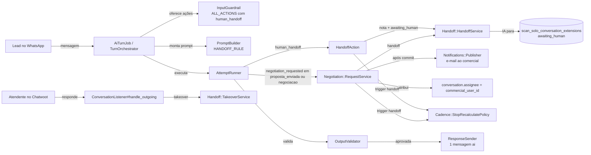
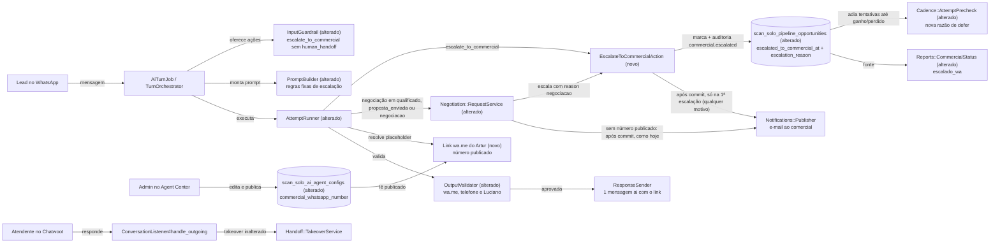

# SPEC: scansolo-escalacao-comercial-wame

## Metadata
- Source: developer description via /plan. Fonte de verdade: `.spec/inputs/scansolo-fatia2-escalacao-wame.md` (itens 1–10 de "Comportamento esperado", "Não escopo", "Testes", "Regras fixas") e os 8 critérios de aceite confirmados. Base: commit `85f0c93fe1` (produção em 09/11/2026).
- Service: ss-aiagentsystem (fork do Chatwoot, monólito Rails 7.2 + Vue 3, namespace `ScanSolo::`)
- Tier: complete
- Version: 1.3
- Architecture references: `AGENTS.md` (mesmo conteúdo de `CLAUDE.md`), `docs/agents/architecture.md`, `docs/agents/domain_rules.md`, `docs/agents/data_model.md`, `docs/agents/api_contracts.md`
- Init chain: ausente
- Enterprise overlay: `enterprise/` não tem código ScanSolo (`docs/agents/architecture.md`, "Directory layout"). Nada a espelhar.
- Pré-requisito externo ao repositório: a decisão de mexer no agente está registrada em `DECISOES.md` (DEC-048..054) do projeto, fora deste repositório (não encontrado por `find` na raiz). Não é verificável aqui e não é requisito RIGID.

### Regras de arquitetura aplicadas (citadas)
- `docs/agents/architecture.md`, "Layer responsibilities": controllers fazem gate 404, Pundit (403) e "request-shape validation", e services são donos de "Domain rules, transactions, audit (`ScanSolo::AuditLogger`)". O listener "delegates every write". Por isso a validação E.164 fica no controller do rascunho (CT-01, 422) e a marca de escalação + auditoria ficam num service chamado pela ação (RF-09).
- `docs/agents/domain_rules.md`, "Agent actions": toda ação passa pelo `Actions::Executor` com schema fechado (`additionalProperties: false`), `idempotency_key` único e classificação. A ação nova segue o mesmo caminho (RF-03).
- `docs/agents/domain_rules.md`, "AI turn pipeline": as violações em `REGENERABLE_VIOLATIONS` têm 1 regeneração e depois o fallback fixo; exceção em ação reverte o turno. A violação nova de contato não publicado entra nesse mecanismo (RF-07).
- `docs/agents/domain_rules.md`, "Cadence engine": `StopRecalculatePolicy` pausa as matrículas com `handoff`/`manual_pause`; `AttemptPrecheck` só olha `ai_active` (passo 3b). Como a IA continua `ai_active` após escalar, a pausa precisa de regra própria (RF-11).
- `docs/agents/domain_rules.md`, "Eligibility gate": `AiAgentConfig.published_for(account)` lê só a versão publicada; editar o rascunho não afeta turnos vivos. O número comercial segue a mesma regra (RF-02).
- `docs/agents/data_model.md`, "Storage": migrações aditivas; `scan_solo_ai_agent_configs` é snapshot por publicação. `AGENTS.md`, "General Guidelines": "Validate request parameters at the controller or request boundary … `422`", "When an impossible or misconfigured state would indicate a setup/deployment bug, let it fail loudly" e "Enforce eligibility and exclusivity rules at the earliest shared entry point".
- `AGENTS.md`, "Project-Specific → Translations": textos só em `config/locales/en.yml` e `app/javascript/dashboard/i18n/locale/en/scansolo.json` (pt-BR) (verified at `app/javascript/dashboard/i18n/locale/en/scansolo.json:708`).

## Context

Em último caso, o agente deve direcionar o lead ao WhatsApp do contato comercial público **Artur** com um link `wa.me` montado pela aplicação, em vez de passar a conversa a um humano e parar. Depois do link, a IA continua respondendo. "Luciano" é nome interno e nunca pode sair em mensagem externa, prompt publicado ou KB. Nenhum telefone entra no Git: o número fica só no banco, na config do Agent Center.

Estado atual verificado no código:
1. **Handoff do modelo.** `human_handoff` está em `Actions::Registry::HANDLERS` (verified at `app/services/scan_solo/actions/registry.rb:16`) e em `InputGuardrail::ALL_ACTIONS` (verified at `app/services/scan_solo/ai_turn/input_guardrail.rb:11-14`). `HandoffAction` chama `Handoff::HandoffService` (nota privada de 9 linhas + `awaiting_human`) e `StopRecalculatePolicy` com `handoff` (verified at `app/services/scan_solo/actions/handoff_action.rb:80-88`, `app/services/scan_solo/handoff/handoff_service.rb:140-149`). Com `awaiting_human`, o `TurnOrchestrator` devolve `human_controlled` (verified at `app/services/scan_solo/ai_turn/turn_orchestrator.rb:144`) e a IA para.
2. **Regra de prompt.** `PromptBuilder::HANDOFF_RULE` só permite `human_handoff` em pedido explícito de pessoa (verified at `app/services/scan_solo/ai_turn/prompt_builder.rb:45-50`). `CONTINUITY_RULES` manda marcar `negotiation_requested` e não negociar (verified at `app/services/scan_solo/ai_turn/prompt_builder.rb:40`).
3. **Negociação.** `AttemptRunner::NEGOTIATION_STAGES = %w[proposta_enviada negociacao]` (verified at `app/services/scan_solo/ai_turn/attempt_runner.rb:42`). `Negotiation::RequestService` move `proposta_enviada → negociacao`, chama `HandoffService` + `StopRecalculatePolicy('handoff')`, grava `negotiation.requested`, e após o commit publica o e-mail ao comercial e atribui a conversa ao `commercial_user_id` (verified at `app/services/scan_solo/negotiation/request_service.rb:274-313`). A resposta padrão é `scan_solo.negotiation.standard_reply` = "Vou verificar isso com nosso comercial. Só um momento." (verified at `config/locales/en.yml:838`).
4. **Config.** `AiAgentConfig::FIELDS` não tem campo de WhatsApp comercial (verified at `app/models/scan_solo/ai_agent_config.rb:51-56`); `quote_recipient_email` tem default `comercial@scansolo.com.br` (verified at `db/schema.rb:1487`). A validação do rascunho fica em `AiAgentConfigsController#validate_commercial_params` e levanta `RecordInvalid` (verified at `app/controllers/api/v1/accounts/scan_solo/ai_agent_configs_controller.rb:35-38,51-58`). O regex E.164 já existe em `PipelineOpportunitiesController::E164_PHONE_REGEXP` (verified at `app/controllers/api/v1/accounts/scan_solo/pipeline_opportunities_controller.rb:28`).
5. **Validador de saída.** `OutputValidator` bloqueia `restricted_information`, preço/proposta enviada/entrega sem claim validado e violações de estado do lead; não conhece `wa.me` nem telefone (verified at `app/services/scan_solo/ai_turn/output_validator.rb:33-43,71-79`). Nenhum `wa.me` existe no código ScanSolo (grep em `app/services/scan_solo`).
6. **Envio.** `ResponseSender` cria exatamente 1 mensagem `outgoing` com `scansolo_origin: 'ai'` por tentativa aprovada (verified at `app/services/scan_solo/ai_turn/response_sender.rb:43-55`).
7. **Situação comercial.** `Reports::CommercialStatus::VALUES` tem 6 valores e não produz `escalado_wa` (verified at `app/services/scan_solo/reports/commercial_status.rb:5,21-28`); o Kanban monta o filtro a partir de `COMMERCIAL_STATUS_LABELS` (verified at `app/javascript/dashboard/routes/dashboard/scansolo/scansoloLabels.js:254`).
8. **Takeover humano real.** `ConversationListener#handle_outgoing` trata mensagem pública de `User` sem `scansolo_origin` como takeover via `Handoff::TakeoverService`, trigger `human_reply` (verified at `app/services/scan_solo/conversation_listener.rb:95-103`).
9. **"Luciano".** Hoje aparece só em specs/fixtures de frontend (`AgentCenter.spec.js:68`, `QuoteRepliesPending.spec.js:37`); `i18nCompleteness.spec.js:115` já garante que `SCANSOLO` em `scansolo.json` não contém `luciano`.

A input cita "Publicada na versão v4 da config": não existe numeração de versão de config no código (`PublishService` cria um snapshot por publicação, `app/services/scan_solo/ai_agent/publish_service.rb:12-25`). Interpretado como passo operacional (próxima publicação em produção com o número preenchido), não como requisito de código.

## AS IS — Estado atual



Hoje o handoff do modelo e o pedido de negociação deixam a conversa em `awaiting_human`, e a IA para de responder até alguém devolver a conversa. Não existe número de WhatsApp comercial nem link `wa.me`. O takeover humano real passa pelo `ConversationListener`.

## TO BE — Estado proposto



A escalação vira uma ação automática que grava a marca e pausa a cadência sem tirar a IA de `ai_active` (RF-03, RF-09, RF-10, RF-11). O link é montado pela aplicação a partir do número publicado e entra na única resposta do turno (RF-01, RF-02, RF-05, RF-06), e o validador barra contato não publicado e "Luciano" (RF-07, RF-08). A negociação passa a escalar em vez de fazer handoff, e `CommercialStatus` passa a produzir `escalado_wa` (RF-13, RF-14, RF-17, CT-01..CT-04). O e-mail de aviso ao comercial sai em toda escalação, de qualquer motivo, mas só quando a oportunidade ainda não estava escalada (RF-23).

## Scope
- **In**:
  - Campo aditivo `commercial_whatsapp_number` (E.164) na config do agente, editável e validado no Agent Center, incluído no snapshot publicado.
  - Ação `escalate_to_commercial` (automática) com 6 motivos, substituindo `human_handoff` na lista oferecida ao modelo.
  - Link `wa.me` montado pela aplicação com texto pré-preenchido; validação de saída contra `wa.me`/telefone não publicado e contra "Luciano".
  - Marca estruturada de escalação + auditoria `commercial.escalated`; `CommercialStatus = escalado_wa`.
  - IA ativa após escalar; cadência adiada (defer no `AttemptPrecheck`) enquanto a oportunidade está escalada, até `ganho`/`perdido`.
  - Publicação com agente `enabled` exige `commercial_whatsapp_number` (422); snapshot publicado sem número não oferece a escalação.
  - Fonte de conhecimento/FAQ com "Luciano" rejeitada com 422 no controller de knowledge.
  - Regras fixas novas no `PromptBuilder` (4 gatilhos, nunca negociar valor/prazo/condição, nunca inventar).
  - `Negotiation::RequestService`: mantém `proposta_enviada → negociacao`; troca handoff + atribuição pela escalação; estende para `qualificado`.
  - E-mail de aviso ao comercial em toda escalação (qualquer motivo), só na primeira escalação da oportunidade (não escalada antes); sem número publicado, a negociação mantém o e-mail como hoje.
  - Rótulo de `escalado_wa` no Kanban, detalhe e relatórios.
- **Out**:
  - Aprovação de proposta por e-mail (Fatia 4); perdido automático (Fatia 3); relatórios novos (Fatia 1, já no ar).
  - Alterar o takeover humano real (`ConversationListener` → `TakeoverService`), o `return_to_ai` e a nota de handoff do `HandoffService`.
  - Gravar qualquer número de telefone em código, seed, fixture versionada ou spec com valor real.
  - Enviar mensagem ao Artur ou ao comercial pelo WhatsApp (o link é só para o lead).
  - Bloquear arrasto manual para `proposta_enviada` (pendência separada).

## RIGID (Non-Negotiable)

### Functional Requirements

- RF-01 [Event-Driven]: When an administrator saves the agent config draft with `commercial_whatsapp_number`, the system shall accept only a string matching E.164 (`/\A\+[1-9]\d{1,14}\z/`, verified at `app/controllers/api/v1/accounts/scan_solo/pipeline_opportunities_controller.rb:28`) or `null`, and reject any other value with 422 before the draft is written.
  - AC: `PUT .../scan_solo/ai_agent_config/draft` with `"+5511999999999"` returns 200 and persists the value; with `"11999999999"`, `"+55 11 99999-9999"`, `5511999999999` (integer) or `""` returns 422 and the draft row is unchanged.

- RF-02 [State-Driven]: While a config is published, the system shall read `commercial_whatsapp_number` only from the published snapshot (`AiAgentConfig.published_for`), never from the draft.
  - AC: with draft number A and published number B, the link built in a turn contains B and never A; after publish, the next turn contains A.

- RF-03 [Ubiquitous]: The system shall register the action `escalate_to_commercial` with classification `automatic` in the action registry and in the per-turn action vocabulary, with a closed schema of exactly `conversation_id` (integer) and `reason` ∈ `duvida_sem_resposta | sem_informacao_base | negociacao | duvida_proposta | assunto_orcamento | pedido_humano`, and shall offer it to the model on every eligible turn.
  - AC: `scan_solo_agent_actions` has row `escalate_to_commercial` with classification `automatic`; params with an extra key, a missing key or a `reason` outside the 6 values fail schema validation; a repeated `idempotency_key` does not re-run the side effect (1 marca, 1 audit event); the action id appears in `allowed_actions` of the turn's `guardrail_outcome`.

- RF-04 [Ubiquitous]: The system shall not offer `human_handoff` to the model; an explicit request for a person/human shall be handled by `escalate_to_commercial` with `reason = pedido_humano`.
  - AC: `allowed_actions` of any turn does not contain `human_handoff`; a model output requesting `human_handoff` raises `UnregisteredActionError` per the existing "not offered" rule and the turn does not move the conversation to `awaiting_human`.

- RF-05 [Event-Driven]: When a turn's reply carries the commercial link, the system (not the model) shall build it as `https://wa.me/<published number without "+">?text=<URL-encoded text>`, where the pre-filled text names the commercial contact as "Artur" and includes the lead's name, company, requested service and current proposal number only when each is known in the system, never with an invented or placeholder value.
  - AC: for a lead with name, company, service and proposal `SS-2026-000123`, the decoded `text` contains "Artur", the 3 values and `SS-2026-000123`; for a lead without proposal, the decoded text contains no proposal reference; the number in the URL equals the published value without "+"; the model output contains only the placeholder, never the URL.

- RF-06 [Ubiquitous]: The system shall send exactly 1 external reply per turn; the escalation link shall travel inside that reply and `escalate_to_commercial` shall create no outgoing message of its own.
  - AC: a turn that executes `escalate_to_commercial` produces exactly 1 non-private outgoing message with `scansolo_origin = 'ai'`, and that message contains the link exactly once; a turn that executes the action and whose model reply omits the placeholder still sends 1 message containing the link once.

- RF-07 [Unwanted]: If a reply to be sent contains a `wa.me` or `api.whatsapp.com` link different from the application-built link, or a phone number (E.164 or Brazilian format with DDD, with or without separators) that does not normalize to the published `commercial_whatsapp_number`, then the system shall block it as a regenerable violation (1 regeneration, then the existing fixed fallback).
  - AC: model content with `https://wa.me/5511000000000` (number not published) → blocked, regenerated once; content with "(11) 98888-7777" not equal to the published number → blocked; content where the only link is the application-built one → not blocked by this rule; after 2 blocked attempts the sent reply contains no unpublished number.

- RF-08 [Unwanted]: If a reply to be sent contains "Luciano" (case- and accent-insensitive), then the system shall block it; and the fixed prompt rules, the published prompt payload and every new/changed pt-BR string of this feature shall not contain "Luciano".
  - AC: content "fale com o Luciano" → blocked; a spec asserts the full `PromptBuilder` system message (fixed rules + action descriptions) has 0 matches of `/luciano/i`; the existing `i18nCompleteness.spec.js:115` assertion stays green; `config/locales/en.yml` `scan_solo` scope has 0 matches of `/luciano/i`.

- RF-09 [Event-Driven]: When `escalate_to_commercial` executes, the system shall write the escalation mark in two nullable additive columns of `scan_solo_pipeline_opportunities` — `escalated_to_commercial_at` (server clock) and `escalation_reason` — overwriting both on every new escalation, and shall record 1 audit event `commercial.escalated` per escalation carrying `reason` and the turn's `correlation_id`, in the same transaction as the turn's reply. The escalation history is the sequence of `commercial.escalated` events; the columns hold only the latest escalation.
  - AC: after an escalation turn commits, the opportunity has `escalated_to_commercial_at` set and `escalation_reason` = the reason sent; `scan_solo_audit_events` has 1 row `commercial.escalated` with that correlation id; a second escalation of the same opportunity (different turn, reason `pedido_humano`) leaves `escalation_reason = pedido_humano`, `escalated_to_commercial_at` = the second turn's time, and 2 `commercial.escalated` rows in total; a turn rolled back (blocked reply) leaves the columns unchanged and 0 new events.

- RF-10 [State-Driven]: While a lead is escalated, the system shall keep `ConversationExtension.ai_control_state = ai_active` and keep running AI turns for new inbound messages.
  - AC: after an escalation turn, `ai_control_state` is `ai_active`; a new inbound answerable question (answer present in KB) produces 1 AI reply that answers it; no handoff private note is created by the escalation.

- RF-11 [State-Driven]: While an opportunity is escalated — `escalated_to_commercial_at` present and stage not `ganho`/`perdido` — the system shall send 0 cadence attempts for it, enforced by a new defer reason in `Cadence::AttemptPrecheck` (the single shared entry point for attempts). This covers enrollments that existed at escalation and enrollments created after it, including the follow-ups of a proposal sent after the escalation. The escalation shall not use the `handoff` pausing trigger of `StopRecalculatePolicy` and shall not change enrollment status; nothing is resumed. The escalated state ends only when the opportunity reaches `ganho` or `perdido`.
  - AC: an opportunity with 1 active enrollment and 1 `scheduled` attempt → after escalation the enrollment status is unchanged, and `CadenceDueAttemptJob` run past `scheduled_at` sends 0 messages and the precheck returns `defer` with the new reason; an enrollment created after escalation (e.g. entry into `proposta_enviada` via `StageEntryEnroller`) also sends 0 messages; an escalated opportunity whose proposal is sent after the escalation (current version `sent`, stage `proposta_enviada`, stage not `ganho`/`perdido`) sends 0 proposal follow-up messages; after the opportunity moves to `ganho` or `perdido` this reason no longer defers; 0 `StopRecalculatePolicy` calls with trigger `handoff` come from the escalation; an opportunity without `escalated_to_commercial_at` is not deferred by this reason.

- RF-12 [Event-Driven]: When any of the following occurs, in this order of precedence, the model shall be instructed to call `escalate_to_commercial` and the turn shall carry the link: (i) lead in `qualificado`/`proposta_enviada`/`negociacao` with a doubt, objection or negotiation (`duvida_proposta` or `negociacao`); (ii) any budget/proposal subject the knowledge base does not resolve (`assunto_orcamento`); (iii) a question without an answer in the knowledge base (`duvida_sem_resposta` or `sem_informacao_base`), never inventing an answer; (iv) an explicit request for a person/human (`pedido_humano`).
  - AC: integration specs with mocked LLM, 1 per trigger (4 total), each end with: 1 sent reply containing the link, 1 escalation mark with the expected reason, `ai_control_state = ai_active`, and (opportunity not escalated before the turn) 1 commercial notice e-mail per RF-23.

- RF-13 [Event-Driven]: When a negotiation request is detected on an opportunity in `proposta_enviada` or `negociacao`, the system shall: move `proposta_enviada → negociacao` through `StageTransitionService` (unchanged); escalate with `reason = negociacao`; publish the commercial notice e-mail after commit only when RF-23 requires it (first escalation); and shall not call `HandoffService`, set `awaiting_human` or assign the conversation to `commercial_user_id`.
  - AC: opportunity not escalated before the turn → after the turn: stage `negociacao` with 1 `PipelineStageEvent`; 1 escalation mark `negociacao`; 1 `negotiation.notification_sent` audit; `ai_control_state = ai_active`; `conversation.assignee_id` unchanged; 0 handoff private notes. Opportunity already escalated (mark present, stage `negociacao`) → mark overwritten, 1 new `commercial.escalated` event, 0 new `negotiation.notification_sent` audits, 0 e-mails delivered.

- RF-14 [Event-Driven]: When a doubt or negotiation request is detected on an opportunity in `qualificado`, the system shall escalate (`duvida_proposta` or `negociacao`) without changing the stage, and shall publish the commercial notice e-mail after commit only when RF-23 requires it (first escalation).
  - AC: opportunity in `qualificado`, not escalated before the turn → after the turn the stage is still `qualificado`, 0 new `PipelineStageEvent`, 1 escalation mark, 1 `negotiation.requested` audit, 1 `negotiation.notification_sent` audit, 1 reply with the link, `ai_control_state = ai_active`, 0 handoff private notes; same opportunity already escalated → 1 new `commercial.escalated` event, 0 new `negotiation.notification_sent` audits, 1 reply with the link.

- RF-15 [Event-Driven]: When a turn handles a negotiation subject (value, discount, deadline, payment, commercial condition), the sent reply shall contain the commercial `wa.me` link and the published `quote_recipient_email` (read from the published snapshot; never a hardcoded literal), and shall not state any value, deadline or condition.
  - AC: every negotiation turn (first or after a previous escalation) sends 1 reply containing `https://wa.me/` + the published number and the published `quote_recipient_email`; with a published `quote_recipient_email` of `vendas@example.com`, the reply contains `vendas@example.com` and not `comercial@scansolo.com.br`; the reply passes the existing `price` claim check.

- RF-16 [Ubiquitous]: The system shall carry, as code constants that no config edit can remove or reword, fixed prompt rules stating: the 4 triggers of RF-12 and their reasons; never negotiate value, deadline or condition; never invent an answer absent from the knowledge base; the commercial contact is named "Artur"; the link is written only as the placeholder. The current `HANDOFF_RULE` text referring to `human_handoff` shall be replaced. When the published snapshot has no `commercial_whatsapp_number`, the escalation/link rules are omitted per RF-19; the "never negotiate" and "never invent" rules stay.
  - AC: a `PromptBuilder` spec finds each of the rules in the system message for a config with a published number whose free-text fields are empty and for one whose `instructions` contradicts them; the system message contains 0 occurrences of `human_handoff`.

- RF-17 [State-Driven]: While an opportunity is escalated (as defined in RF-11), `Reports::CommercialStatus.call` shall receive the escalation as an additional input and `escalado_wa` shall be part of its `VALUES`. Precedence: `proposta_enviada_manual`, `proposta_enviada` and `proposta_em_aprovacao` keep winning over `escalado_wa`; `escalado_wa` replaces `nao_encaminhado`, `aguardando_artur` and `resposta_recebida`.
  - AC: escalated + no quote request → `escalado_wa`; escalated + open quote request → `escalado_wa`; escalated + answered quote request without sent/awaiting proposal → `escalado_wa`; escalated + `handled_manually` → `proposta_enviada_manual`; escalated + current version `sent` → `proposta_enviada`; escalated + current version `awaiting_approval` → `proposta_em_aprovacao`; not escalated (no mark, or stage `ganho`/`perdido`) → never `escalado_wa`, existing table unchanged; every caller of `CommercialStatus.call` passes the new input; the existing spec "never escalado_wa" (`spec/services/scan_solo/reports/commercial_status_spec.rb:77`) is updated.

- RF-18 [Event-Driven]: When a human user sends a non-private message without `scansolo_origin` in the conversation, the system shall keep the current takeover behavior: `TakeoverService` with trigger `human_reply`, `ai_control_state = human_active`, 1 handoff note, cadence paused, and no further AI reply.
  - AC: the existing takeover specs (`spec/services/scan_solo/conversation_listener_spec.rb`, `spec/services/scan_solo/handoff/`) pass unchanged; additionally, for an escalated lead, a human reply results in `human_active` and the next inbound message produces 0 AI replies.

- RF-19 [Unwanted]: If the published snapshot has no `commercial_whatsapp_number` (e.g. published before this feature), then the system shall not offer `escalate_to_commercial` to the model, shall omit the escalation prompt rules of RF-16 that reference the link, and a negotiation request shall send the existing standard reply (`scan_solo.negotiation.standard_reply` without link) and still publish the commercial notice e-mail after commit as today (no escalation mark is written, so RF-23's first-escalation rule does not apply) — the turn does not fail.
  - AC: with a published snapshot without number: `allowed_actions` does not contain `escalate_to_commercial`; the system message contains no link placeholder; a negotiation turn sends 1 reply equal to the standard reply text with 0 `wa.me` and 0 unresolved placeholders, and the turn status is not `failed`; that negotiation turn records 1 `negotiation.notification_sent` audit and writes no escalation mark; in no case the sent reply contains a `wa.me` link without a published number or an unresolved placeholder.

- RF-21 [Event-Driven]: When an administrator publishes a config whose draft has `enabled = true` and no `commercial_whatsapp_number`, the system shall reject the publish with 422 and create no snapshot.
  - AC: `POST .../ai_agent_config/publish` with draft `enabled = true` and number `null` → 422, published snapshot count unchanged, 0 `ai_agent_config.published` audits; with `enabled = false` and number `null` → 200; with `enabled = true` and a valid number → 200 and the snapshot carries the number.

- RF-20 [Event-Driven]: When a knowledge source (any `source_type`, including `faq`) is created or updated with a `title` or `content` matching `/luciano/i`, the system shall reject the request with 422 at the knowledge controller boundary and write nothing. RF-08's output block remains in force.
  - AC: `POST`/`PUT` on `.../scan_solo/knowledge/sources` with `content` "fale com o Luciano" or `title` "LUCIANO" → 422, 0 rows created/changed; same request without the name → 2xx; RF-08 still blocks a reply containing "Luciano". Existing production KB rows are verified once manually (operational prerequisite, outside code).

- RF-22 [Event-Driven]: When knowledge ingestion (`ScanSolo::KnowledgeIngestionJob` → `ScanSolo::Knowledge::IngestionService`) runs for a source (any `source_type`, including uploaded documents) and the text it is about to chunk matches `/luciano/i`, the system shall mark the source `index_status = failed` with a non-blank pt-BR `index_error` (existing failure fields), call 0 embeddings, and leave 0 chunks of that source retrievable — including chunks from a previous successful ingestion. RF-20 (422 on typed `title`/`content`) stays as is; RF-22 covers text that reaches ingestion without passing that controller check.
  - AC: ingesting a source whose ingestion text contains "luciano" (any case) → `index_status = failed`, `index_error` present, embedding provider called 0 times, `KnowledgeChunk.where(source:)` count = 0, and `RetrievalService` returns 0 results from that source; same for a source previously `indexed` with chunks (re-ingestion after the text changes) → its old chunks count = 0; ingestion text without the name → `indexed` as today. Verified in code (base `85f0c93fe1`): `IngestionService` chunks `source.content` only (no file text extraction exists; attachment without text already fails with `ATTACHMENT_ONLY_ERROR`), `fail!` does not delete existing chunks, and `RetrievalService#eligible_scope` does not filter by `index_status` — so this RF requires removing the source's chunks on this failure.

- RF-23 [Event-Driven]: When an escalation commits for any `reason` (all 6 values of RF-03, from any trigger of RF-12, including `duvida_proposta`/`negociacao` in `proposta_enviada`/`negociacao` and `pedido_humano`) and the opportunity was not escalated immediately before it — `escalated_to_commercial_at` was `null`, or the stage was `ganho`/`perdido` (escalated state ended per RF-11) — the system shall publish 1 commercial notice e-mail after commit through the existing commercial notification channel. When the opportunity was already escalated, the escalation shall overwrite the mark and record the audit (RF-09) and shall send 0 notice e-mails.
  - AC: for each of the 6 reasons, an escalation turn on an opportunity with `escalated_to_commercial_at = null` → 1 `negotiation.notification_sent` audit with the turn's correlation id and 1 e-mail delivered; a second escalation of the same opportunity in another turn (any reason, stage not `ganho`/`perdido`) → 1 new `commercial.escalated` event, 0 new `negotiation.notification_sent` audits, 0 e-mails delivered; a turn rolled back (blocked reply) → 0 e-mails; a notification failure does not roll back the turn (existing `negotiation.notification_failed` behavior).

### UI Requirements

- UI-01 [Event-Driven]: When an administrator edits the Agent Center config, the screen shall show a field for the commercial WhatsApp number (label naming Artur, pt-BR via i18n), validate E.164 on the client with the same rule as RF-01, block save with an inline error while invalid, and send `commercial_whatsapp_number` in the draft payload.
  - AC: typing `11999999999` shows the inline error and save is disabled; typing `+5511999999999` and saving sends `commercial_whatsapp_number: "+5511999999999"`; clearing the field sends `null`; a 422 from the server shows the error message; component built with `<script setup>`, Tailwind and no bare strings.

- UI-02 [State-Driven]: While an opportunity's `commercial_status` is `escalado_wa`, the Kanban card, the opportunity detail, the Kanban commercial-status filter and the reports stalled table shall display a pt-BR label naming "Artur" from `SCANSOLO.COMMERCIAL_STATUS.ESCALADO_WA`.
  - AC: an opportunity JSON with `commercial_status: "escalado_wa"` renders the label in the 4 places; the filter has 1 option for `escalado_wa` and selecting it shows only those cards; the label contains "Artur" and not "Luciano".

### Contracts

- CT-01: `PUT /api/v1/accounts/:account_id/scan_solo/ai_agent_config/draft` (verified at `config/routes.rb:497`) accepts optional `commercial_whatsapp_number`: string E.164 or `null`. Invalid → 422 via `ActiveRecord::RecordInvalid` (same shape as the other draft fields). `GET ai_agent_config`, `PUT draft` and `POST publish` responses include `commercial_whatsapp_number` for draft and published. `POST .../ai_agent_config/publish` returns 422 when the draft has `enabled = true` and no `commercial_whatsapp_number` (RF-21).
- CT-06: `POST`/`PUT /api/v1/accounts/:account_id/scan_solo/knowledge/sources` return 422 when `title` or `content` matches `/luciano/i` (RF-20); error shape reuses the existing 422 of that controller.
- CT-02: Agent action `escalate_to_commercial`, classification `automatic`, schema:
  ```json
  {
    "type": "object",
    "properties": {
      "conversation_id": { "type": "integer" },
      "reason": { "type": "string", "enum": ["duvida_sem_resposta", "sem_informacao_base", "negociacao", "duvida_proposta", "assunto_orcamento", "pedido_humano"] }
    },
    "required": ["conversation_id", "reason"],
    "additionalProperties": false
  }
  ```
  `conversation_id` is filled from the turn (`TURN_SCOPED_PARAMS`), never by the model. Side-effect result: `{ escalated: true, reason: <reason>, escalated_at: <ISO 8601> }`.
- CT-03: Audit event `commercial.escalated`: `subject` = opportunity, `correlation_id` = turn correlation id, `payload` = `{ reason, conversation_id, message_id, stage }`. The payload contains no phone number.
- CT-04: Opportunity JSON (`_pipeline_opportunity.json.jbuilder`) field `commercial_status` gains the value `escalado_wa`. No other field changes.
- CT-05: Outgoing link format: `https://wa.me/<digits>?text=<RFC 3986 percent-encoded UTF-8 text>`; `<digits>` = published E.164 without "+".

### Non-Functional Requirements

- RNF-01: Zero phone numbers in Git: no real phone in code, migrations, seeds, versioned fixtures or i18n. Specs use fictitious numbers only (e.g. `+5511999999999` pattern).
- RNF-02: Migrations only additive (new nullable column(s) or new table); 0 column drops, renames or type changes. If a migration is added, `scansolo_migrations_spec` is updated in the same change.
- RNF-03: All new/changed specs live under a path containing `scan_solo`/`scansolo`; `./scripts/ralph-test.sh` exits 0.
- RNF-04: The turn's extra work (link build + validator checks) adds 0 LLM calls and 0 HTTP calls; the turn keeps `MAX_ATTEMPTS = 2`.
- RNF-05: The LLM never controls time: `escalated_to_commercial_at` comes from the server clock, never from model output.
- RNF-06: i18n only in `config/locales/en.yml` and `app/javascript/dashboard/i18n/locale/en/scansolo.json` (pt-BR content); every new user-facing string uses "Artur".

## Clarifications Log

Resolvido pelo desenvolvedor em 2026-11-09 (v1.1, `.handoff/clarifier-answers.md`, opção A em Q-01..Q-04):

- [RESOLVED] M1 (Q-01) — Duas colunas nullable aditivas em `scan_solo_pipeline_opportunities`: `escalated_to_commercial_at` e `escalation_reason`; cada nova escalação sobrescreve as duas; histórico = 1 evento `commercial.escalated` por escalação. → RF-09.
- [RESOLVED] M2 (Q-01) — Estado escalado dura até `ganho`/`perdido`. Cadência retida por nova razão de defer no `Cadence::AttemptPrecheck` (ponto único; cobre matrículas criadas depois; nada a retomar). Não reutilizar o trigger `handoff`. → RF-11.
- [RESOLVED] M3 (Q-02) — Em `qualificado`: etapa permanece `qualificado`, lead escalado e o e-mail de aviso ao comercial (caminho `negotiation.requested`) continua sendo enviado. → RF-14.
- [RESOLVED] M4 (Q-02) — E-mail citado nas respostas = `quote_recipient_email` publicado (default `comercial@scansolo.com.br`), não literal fixo. → RF-15.
- [RESOLVED] M5 (Q-03) — Publicar com `enabled = true` exige `commercial_whatsapp_number` (422 no publish). Snapshot publicado sem número: ação e regras de escalação não são oferecidas; negociação envia a resposta padrão existente, sem falha. → RF-19, RF-21, CT-01.
- [RESOLVED] M6 (Q-04) — Escrita de fonte de conhecimento/FAQ com /luciano/i → 422 no controller de knowledge; bloqueio de saída do RF-08 mantido. Linhas de KB já em produção: verificação manual única, fora do código (pré-requisito operacional). → RF-20, CT-06.
- [RESOLVED] M7 (Q-01) — Estados de proposta mantêm precedência (`proposta_enviada_manual`, `proposta_enviada`, `proposta_em_aprovacao`); `escalado_wa` substitui `nao_encaminhado`, `aguardando_artur`, `resposta_recebida`. `CommercialStatus.call` ganha a entrada de escalação. → RF-17.
- [ACCEPTED] Premissas do especificador aceitas como escritas: `human_handoff` retirado das ações oferecidas ao modelo (efeito colateral: sem nota interna/atribuição em `pedido_humano`/negociação; visibilidade via auditoria, status no board e e-mail de aviso); 1 regeneração em `wa.me`/telefone não publicado via `REGENERABLE_VIOLATIONS` existente; `DECISOES.md` é pré-requisito externo.
- [RESOLVED] Ponto residual do RF-20 (arquivos enviados) — resolvido pelo desenvolvedor em 2026-11-09 (v1.2): FALHAR A INGESTÃO. Após obter o texto a indexar no job/serviço de ingestão, se casar `/luciano/i` a fonte vai para `failed` com `index_error` (campos existentes) e nenhum chunk dela fica recuperável. O 422 do controller para `title`/`content` digitados é mantido. → RF-22. Observação de código: hoje a ingestão só lê `source.content` (não há extração de texto de arquivo) e a recuperação não filtra por `index_status`; por isso o RF-22 exige apagar os chunks da fonte nessa falha.

Resolvido pelo desenvolvedor em 2026-11-09 na revisão do plano (v1.3):

- [RESOLVED] Q3 — E-mail de aviso ao comercial só na primeira escalação: oportunidade não escalada (`escalated_to_commercial_at` nulo, ou estado escalado encerrado por `ganho`/`perdido`). Escalações seguintes de lead já escalado sobrescrevem a marca + auditoria, sem e-mail. → RF-23, RF-13, RF-14.
- [RESOLVED] Q6 — O e-mail de aviso sai para todo motivo/gatilho de escalação (inclusive dúvida de proposta em `proposta_enviada`/`negociacao` e `pedido_humano`), sujeito à regra de Q3. Sem número publicado (escalação impossível), a negociação continua enviando o e-mail como hoje. → RF-23, RF-12, RF-19.
- [RESOLVED] Q4 (confirmado) — Cadência retida até `ganho`/`perdido`, inclusive follow-ups de proposta enviada depois da escalação. → RF-11.

## Marcadores abertos

0 marcadores.

## FLEXIBLE (Implementation Suggestions)

- Ação em `app/services/scan_solo/actions/escalate_to_commercial_action.rb` (`ScanSolo::Actions::EscalateToCommercialAction`, `CLASSIFICATION = :automatic`), delegando a marca + auditoria a um service, ex. `ScanSolo::Commercial::EscalationService`, reutilizado por `Negotiation::RequestService`.
- Link num objeto puro, ex. `ScanSolo::Commercial::WhatsappLink.build(config:, opportunity:)` usando `ERB::Util.url_encode`; placeholder sugerido `{{LINK_ARTUR}}`, resolvido no `AttemptRunner` antes do `OutputValidator`, para que o validador veja o conteúdo final.
- Pausa de cadência: nome sugerido da razão de defer no `AttemptPrecheck`: `commercial_escalated` (checagem antes ou junto do passo 3b `ai_active`).
- Manter `HandoffAction` registrado em `HANDLERS` só para trilha de auditoria (como `proposal_generate`) e retirá-lo de `allowed_actions`; ou removê-lo se nada mais o referencia (CLAUDE.md "Remove dead/unreachable/unused code").
- `OutputValidator`: novas violações `unpublished_contact` e `internal_name` em `REGENERABLE_VIOLATIONS` e `VIOLATION_INSTRUCTIONS`; o padrão de telefone deve ignorar CNPJ/CPF/CEP e valores monetários para evitar falso positivo.
- `NEGOTIATION_STAGES` passa a incluir `qualificado`; `scan_solo.negotiation.standard_reply` passa a interpolar `%{link}` e `%{email}`.
- Agent Center: reaproveitar o padrão de `quoteRecipientEmail` em `agentCenterFields.js:26` e `AgentCenter.vue:186-195`; constante E.164 compartilhada no front.
- Constante de backend do regex E.164 extraída de `PipelineOpportunitiesController` para reuso entre os dois controllers.
- Specs: `spec/services/scan_solo/actions/escalate_to_commercial_action_spec.rb`, `spec/services/scan_solo/ai_turn/output_validator_spec.rb`, `.../prompt_builder_spec.rb`, `.../attempt_runner_spec.rb` (LLM mockado), `spec/services/scan_solo/negotiation/request_service_spec.rb`, `spec/controllers/.../scan_solo/ai_agent_configs_controller_spec.rb`, `AgentCenter.spec.js`.

## Acceptance Criteria Summary
| ID | Criterion | Testable? |
|----|-----------|-----------|
| RF-01 | Draft aceita só E.164 ou null; inválido → 422 sem gravar | Sim (request spec) |
| RF-02 | Link usa número publicado, nunca o rascunho | Sim |
| RF-03 | Ação registrada `automatic`, schema fechado, 6 motivos, idempotente, oferecida | Sim |
| RF-04 | `human_handoff` fora de `allowed_actions`; pedido humano → `pedido_humano` | Sim |
| RF-05 | Link montado pela app; texto com Artur e só dados conhecidos | Sim |
| RF-06 | 1 resposta externa por turno com o link 1 vez | Sim |
| RF-07 | `wa.me`/telefone não publicado bloqueado e regenerado | Sim |
| RF-08 | "Luciano" bloqueado na saída e ausente de prompt/i18n | Sim |
| RF-09 | Colunas na oportunidade sobrescritas + 1 `commercial.escalated` por escalação, mesma transação | Sim |
| RF-10 | IA continua `ai_active` e responde nova dúvida cabível | Sim (LLM mockado) |
| RF-11 | Defer no `AttemptPrecheck` até `ganho`/`perdido`, inclusive matrículas novas e follow-ups de proposta enviada após a escalação | Sim |
| RF-12 | 4 gatilhos escalam (4 specs), com e-mail de aviso na 1ª escalação | Sim (LLM mockado) |
| RF-13 | Negociação: transição mantida, e-mail só na 1ª escalação, sem handoff/atribuição | Sim |
| RF-14 | `qualificado` escala sem mudar etapa; e-mail só na 1ª escalação | Sim |
| RF-15 | Negociação sempre cita `wa.me` + `quote_recipient_email` publicado | Sim |
| RF-16 | Regras fixas no prompt, sem `human_handoff` | Sim |
| RF-17 | `escalado_wa` com precedência abaixo dos estados de proposta | Sim |
| RF-18 | Takeover humano inalterado (regressão) | Sim |
| RF-19 | Snapshot sem número: sem ação de escalação, resposta padrão, e-mail como hoje, sem falha | Sim |
| RF-20 | Fonte/FAQ com "Luciano" → 422 no controller de knowledge | Sim (request spec) |
| RF-21 | Publish com `enabled` sem número → 422, sem snapshot | Sim (request spec) |
| RF-22 | Ingestão com "Luciano" no texto → `failed` + `index_error`, 0 embeddings, 0 chunks recuperáveis (inclusive antigos) | Sim (service/job spec) |
| RF-23 | E-mail de aviso em todo motivo, só na 1ª escalação; reescalação sem e-mail | Sim |
| UI-01 | Campo E.164 no Agent Center com validação | Sim (Vitest) |
| UI-02 | Rótulo `escalado_wa` em 4 lugares, com Artur | Sim (Vitest) |
| RNF-01 | 0 telefone real no Git | Sim (grep) |
| RNF-02 | Migrações só aditivas; spec de contagem atualizado | Sim |
| RNF-03 | Specs com `scan_solo` no caminho; `ralph-test.sh` verde | Sim |
| RNF-04 | 0 chamadas LLM/HTTP extras; `MAX_ATTEMPTS = 2` | Sim |
| RNF-05 | Timestamp do servidor | Sim |
| RNF-06 | i18n só nos 2 arquivos; "Artur" | Sim |

## Distribution by Repo
| Repo | RFs | Contracts |
|------|-----|-----------|
| ss-aiagentsystem (backend Rails) | RF-01..RF-23 | CT-01..CT-06 |
| ss-aiagentsystem (frontend Vue) | UI-01, UI-02 | CT-01, CT-04 |
