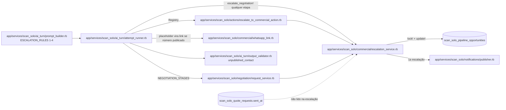
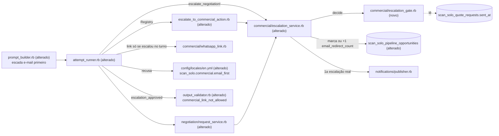

# Implementation Plan

## Request Summary
- Objective: filtrar a escalação ao comercial (Artur). A aplicação, e não o LLM, passa a decidir quando o link `wa.me` é entregue. A regra: etapa qualificada (`qualificado`/`proposta_enviada`/`negociacao`), pedido de orçamento enviado (`QuoteRequest.sent_at`) e insistência depois de 1 orientação por e-mail (`email_redirect_count >= 1`). Fora disso, a resposta é a orientação por e-mail e, antes de `qualificado`, a qualificação é retomada. O placeholder `{{LINK_ARTUR}}` só vira link quando houve escalação real no turno. O `OutputValidator` bloqueia o link comercial fora do gate. O e-mail de aviso ao comercial só sai na 1ª escalação real.
- Scope in: RF-01..RF-16, CT-01..CT-03, RNF-01..RNF-05 de `.spec/features/scansolo-escalacao-filtrada/SPEC.md` v1.1 (0 marcadores). Inclui a aprovação bloqueante da redação (Q-06) com registro da nova DEC, a migração aditiva, as specs pedidas na seção "Testes" da descrição e a atualização documental como item próprio.
- Scope out: reverter a marca dos leads já marcados (Daiane, Alexandre, Azanis): é ação manual, pós-deploy, com autorização do Leo. Também ficam de fora: takeover humano real, política de pausa de cadência (`AttemptPrecheck`), classificador `Reports::CommercialStatus` e front, e o comportamento sem `commercial_whatsapp_number` publicado.
- Tier: complete
- Architecture references: `AGENTS.md` (= `CLAUDE.md`), `docs/agents/architecture.md`, `docs/agents/domain_rules.md`, `docs/agents/data_model.md`, `docs/agents/api_contracts.md`. `enterprise/` não tem código ScanSolo (`docs/agents/architecture.md` › Directory layout), então nada é espelhado lá.

### Regras de camada e delegação que toda task preserva
- `docs/agents/architecture.md` › Layer responsibilities: os services são donos de regra de domínio, transição e auditoria, com "one sole writer per concern". `ScanSolo::Commercial::EscalationService` continua o **único escritor** da marca de escalação e passa a ser também o único escritor de `email_redirect_count` (T04). A decisão de elegibilidade fica num módulo puro, `ScanSolo::Commercial::EscalationGate` (T03), chamado **só** pelo `EscalationService`. É o ponto de entrada compartilhado pelos 3 caminhos (ação, `Negotiation::RequestService`, `AttemptRunner#escalate_negotiation!`), conforme `AGENTS.md`: "Enforce eligibility and exclusivity rules at the earliest shared entry point". Nenhuma guarda repetida na ação, no `RequestService` nem no `AttemptRunner`.
- `docs/agents/architecture.md`: `Actions::Registry` + `Executor` mapeiam ações; não decidem o que é oferecido (`InputGuardrail`, que fica inalterado). O schema de entrada de `escalate_to_commercial` não muda (CT-01).
- `docs/agents/domain_rules.md` › AI turn guardrails: o savepoint do `AttemptRunner` é a fronteira transacional. Marca, contador e audits são escritos dentro dele, e um attempt bloqueado ou regenerado desfaz tudo. O máximo continua `TurnOrchestrator::MAX_ATTEMPTS = 2` (RNF-01).
- `docs/agents/domain_rules.md` › Output validator: estender via `detect_violation` e `REGENERABLE_VIOLATIONS` (T05). Toda violação regenerável precisa de entrada em `PromptBuilder::VIOLATION_INSTRUCTIONS`, porque `correction_block` usa `fetch` (T07).
- `docs/agents/data_model.md` + `AGENTS.md`: migrações só aditivas; i18n só em `config/locales/en.yml` (conteúdo pt-BR); nenhum telefone real no Git (só o fictício `+5511999999999` em specs); "Luciano" nunca em string de produto, prompt ou KB; não rodar `annotaterb` (anotação editada à mão).

## AS IS — Componentes impactados

Hoje os 3 caminhos chegam ao `EscalationService` sem checar etapa nem `sent_at`. O `AttemptRunner` monta o link sempre que o número está publicado, e o validador aceita o link comercial publicado em qualquer turno.

## TO BE — Componentes propostos

T02 adiciona a coluna `email_redirect_count`. T03 cria o `EscalationGate`, e T04 o pluga no `EscalationService` e na ação. T05 cria a violação `commercial_link_not_allowed`, T06 adiciona os textos aprovados em T01 e T07 reescreve o prompt. T08 alinha o `Negotiation::RequestService`. T09 refaz a fiação no `AttemptRunner` (link condicionado, resposta e-mail primeiro, entrada do validador).

## Tasks

### T01 — Aprovação bloqueante da redação da orientação por e-mail (Q-06) e registro da nova DEC
- **Files**:
  - `.spec/features/scansolo-escalacao-filtrada/APROVACAO.md` (novo)
  - `DECISOES.md` externo ao repositório (registro feito pelo Leo; localização [UNVERIFIED])
- **Change**:
  - Apresentar ao Leo a proposta de redação abaixo (chaves sob `scan_solo.commercial.email_first`) e registrar em `APROVACAO.md`:
    - o texto final aprovado por chave;
    - o id da nova DEC (escalação filtrada: e-mail primeiro, `wa.me` só para quem insiste);
    - a data;
    - a linha literal `Aprovado por: Leo`.
  - Proposta de redação (pt-BR, `%{email}` = `quote_recipient_email` publicado, `%{fields}` = rótulos dos campos elegíveis):
    - `before_qualified`: "Os valores e prazos vêm na proposta que o nosso comercial envia por e-mail assim que eu concluir o seu cadastro. Se quiser, pode escrever para %{email}."
    - `before_qualified_ask`: "Os valores e prazos vêm na proposta que o nosso comercial envia por e-mail assim que eu concluir o seu cadastro. Se quiser, pode escrever para %{email}. Para seguir, me informe: %{fields}."
    - `quote_pending` (qualificado, orçamento ainda não enviado): "Seu pedido de orçamento segue para o Artur, do nosso comercial. Valores e prazos chegam na proposta por e-mail; se quiser, pode escrever para %{email}."
    - `quote_sent` (qualificado + orçamento enviado, 1º pedido): "Seu pedido de orçamento já está com o Artur, do nosso comercial. Valores e prazos chegam na proposta por e-mail; você pode responder direto àquele e-mail ou escrever para %{email}."
    - Entrega do link (insistência elegível): reutiliza `scan_solo.negotiation.escalation_reply`, sem mudança.
  - Sem aprovação registrada, nenhuma fase seguinte é executada: o ROADMAP veta mexer no agente sem DEC.
- **Covers**: RF-01, RF-03, RF-04, RF-10 (redação), RNF-05
- **Tests**: n/a. Verificação manual: `APROVACAO.md` contém as 4 chaves, o id da DEC e `Aprovado por: Leo`.
- **Risk**: High. É bloqueio humano: atraso aqui atrasa a feature inteira.
- **Dependencies**: none

### T02 — Migração aditiva `email_redirect_count` e suporte no modelo
- **Files**:
  - `db/migrate/20261116100001_add_email_redirect_count_to_scan_solo_pipeline_opportunities.rb` (novo)
  - `db/schema.rb`
  - `app/models/scan_solo/pipeline_opportunity.rb` (anotação de schema editada à mão)
  - `spec/db/scansolo_migrations_spec.rb`
  - `spec/models/scan_solo/pipeline_opportunity_escalation_spec.rb`
- **Change**:
  - `add_column :scan_solo_pipeline_opportunities, :email_redirect_count, :integer, null: false, default: 0`. Só `add_column`: nenhuma coluna existente alterada ou removida, nenhum backfill (os leads já marcados ficam com 0).
  - `db/schema.rb`: a coluna e o `version` atualizados.
  - `PipelineOpportunity`: `validates :email_redirect_count, numericality: { only_integer: true, greater_than_or_equal_to: 0 }`.
  - `scansolo_migrations_spec`: contagem 46 → 47.
- **Covers**: CT-02, RNF-02
- **Tests**:
  - `spec/db/scansolo_migrations_spec.rb`: contagem 47 e aditividade (só `add_column`).
  - `spec/models/scan_solo/pipeline_opportunity_escalation_spec.rb`: default 0; valor negativo invalida.
  - `db:migrate` + `db:rollback` + `db:migrate` no banco de teste sem erro.
- **Risk**: Low. A coluna tem default e não é lida por código existente.
- **Dependencies**: T01

### T03 — `ScanSolo::Commercial::EscalationGate` (decisão pura) e spec da matriz
- **Files**:
  - `app/services/scan_solo/commercial/escalation_gate.rb` (novo)
  - `spec/services/scan_solo/commercial/escalation_gate_spec.rb` (novo)
- **Change**:
  - Módulo puro, sem escrita, LLM ou HTTP, sem ler output do modelo:
    - assinatura: `EscalationGate.decide(stage:, quote_sent:, email_redirect_count:, commercial_request:, previously_escalated:)`;
    - `QUALIFIED_STAGES = AttemptRunner::NEGOTIATION_STAGES` (mesmo conjunto; definir a constante no gate e fazer o `AttemptRunner` reutilizá-la em T09 para não duplicar);
    - retorno: `:none` (sem pedido comercial), `:approved`, ou o símbolo de recusa `:etapa_nao_qualificada` | `:orcamento_nao_enviado` | `:primeiro_pedido_email`.
  - Regra, em ordem:
    1. sem pedido → `:none`;
    2. etapa fora de `QUALIFIED_STAGES` → `:etapa_nao_qualificada`;
    3. `quote_sent` falso → `:orcamento_nao_enviado`;
    4. contador 0 → `:primeiro_pedido_email`;
    5. senão → `:approved`.
  - `previously_escalated` não muda a decisão quando há pedido. Pela definição "Elegível ao link", todo pedido comercial do turno posterior ao link é pedido explícito (RF-08). O parâmetro entra para tornar a matriz de RF-11 explícita.
  - `EscalationGate.quote_sent?(opportunity)` = `opportunity.quote_request&.sent_at.present?`.
- **Covers**: RF-01, RF-03, RF-04, RF-05, RF-08, RF-11, RNF-03
- **Tests**: `spec/services/scan_solo/commercial/escalation_gate_spec.rb`:
  - matriz completa: 8 etapas × `quote_sent` (sim/não) × contador (0/≥1) × pedido (sim/não) × link anterior (sim/não) = 128 combinações;
  - `:approved` só em etapa qualificada + enviado + contador ≥1 + pedido;
  - cada recusa no caso esperado;
  - cada combinação avaliada 2 vezes com o mesmo resultado (RNF-03);
  - `quote_sent?`: false sem `QuoteRequest`, false com `sent_at` nulo, true com `sent_at`.
- **Risk**: Low. É código puro.
- **Dependencies**: T01

### T04 — `EscalationService` passa pelo gate: recusa estruturada, contador e decisão única por turno
- **Files**:
  - `app/services/scan_solo/commercial/escalation_service.rb`
  - `app/services/scan_solo/actions/escalate_to_commercial_action.rb` (só o comentário de cabeçalho; a chamada não muda)
  - `spec/services/scan_solo/commercial/escalation_service_spec.rb`
  - `spec/services/scan_solo/actions/escalate_to_commercial_action_spec.rb`
- **Change**:
  - Depois do `lock!`, a decisão é **uma por turno** (`correlation_id`):
    - já existe audit `commercial.escalated` do turno → devolve o resultado aprovado (como hoje);
    - já existe o novo audit `commercial.escalation_refused` do turno → devolve a mesma recusa, sem incrementar de novo.
  - Isso evita que um 2º caminho no mesmo turno (ex.: ação `negociacao` + `escalate_negotiation!`) leia o contador recém-incrementado como insistência. Se o attempt é bloqueado, o savepoint desfaz os audits e o contador.
  - Primeira decisão do turno: `EscalationGate.decide(stage:, quote_sent:, email_redirect_count:, commercial_request: true, previously_escalated: opportunity.escalated_to_commercial_at.present?)`.
  - `:approved` → comportamento atual:
    - sobrescreve `escalated_to_commercial_at`/`escalation_reason`;
    - grava 1 audit `commercial.escalated`;
    - publica o aviso após o commit só se `!escalated_to_commercial?` antes (RF-12; reenvio RF-08 sem aviso).
  - Recusa:
    - `:primeiro_pedido_email` → `increment!(:email_redirect_count)`, só nesse caso (RF-04);
    - grava 1 audit `commercial.escalation_refused`, payload `{ refusal, stage, email_redirect_count, reason, conversation_id, message_id }`, sem telefone;
    - nenhum `Publisher`;
    - devolve `{ escalated: false, refusal: '<símbolo>', email_redirect_count: <int> }` (CT-01);
    - nunca levanta exceção.
  - `EscalationService` é o único escritor de `email_redirect_count`.
- **Covers**: RF-01, RF-03, RF-04, RF-05, RF-08, RF-11, RF-12, CT-01
- **Tests**:
  - `escalation_service_spec.rb`:
    - recusa por etapa: 0 escrita, contador inalterado, 0 `Publisher`;
    - recusa por orçamento: mesmo resultado;
    - 1º pedido: contador +1, 0 `Publisher`, payload CT-01;
    - 2ª chamada no mesmo `correlation_id`: mesma recusa, contador +1 só uma vez;
    - aprovado: marca, 1 audit, 1 `Publisher`;
    - reenvio já escalado: marca sobrescrita, 1 novo audit, 0 `Publisher`;
    - o `lock!` continua (spec de concorrência existente).
  - `escalate_to_commercial_action_spec.rb`: a ação devolve o hash de recusa sem levantar exceção e a `AgentExecution` fica com sucesso.
- **Risk**: Medium. Muda o único escritor da marca; os 3 caminhos herdam o comportamento.
- **Dependencies**: T02, T03

### T05 — `OutputValidator`: violação `commercial_link_not_allowed`
- **Files**:
  - `app/services/scan_solo/ai_turn/output_validator.rb`
  - `spec/services/scan_solo/ai_turn/output_validator_spec.rb`
- **Change**:
  - Novo parâmetro `escalation_approved: false`.
  - `disclosure_violation`: logo depois de `unpublished_contact`, `:commercial_link_not_allowed` quando `commercial_link` está presente e:
    - (a) `!escalation_approved` e o conteúdo contém `commercial_link`; ou
    - (b) `escalation_approved` e `commercial_link` aparece mais de 1 vez (RF-05 "exatamente 1").
  - `unpublished_contact` fica inalterado: ele continua removendo as ocorrências de `commercial_link` antes de procurar outro `wa.me`/telefone, e o `AttemptRunner` passa a enviar `commercial_link` sempre que o número está publicado (T09). Com isso a nova violação é alcançável e tem rótulo próprio; reaproveitar só `unpublished_contact` não daria o rótulo exigido pelo AC de RF-09.
  - `:commercial_link_not_allowed` entra em `REGENERABLE_VIOLATIONS`. Atualizar o comentário de cabeçalho.
- **Covers**: RF-09, RF-05, CT-03
- **Tests**: `output_validator_spec.rb`:
  - link publicado + `escalation_approved: false` → `blocked: true`, violação `commercial_link_not_allowed`;
  - `escalation_approved: true` com 1 ocorrência → `blocked: false`;
  - com 2 ocorrências → bloqueado;
  - `wa.me` de outro número → continua `unpublished_contact`;
  - `REGENERABLE_VIOLATIONS` inclui o símbolo.
- **Risk**: Low. A mudança é aditiva no validador.
- **Dependencies**: T01

### T06 — Textos aprovados da orientação por e-mail em `en.yml`
- **Files**:
  - `config/locales/en.yml`
  - `spec/lib/scansolo_locale_spec.rb`
- **Change**:
  - Adicionar `scan_solo.commercial.email_first.{before_qualified,before_qualified_ask,quote_pending,quote_sent}` com o texto **exatamente** como aprovado em `APROVACAO.md` (T01).
  - `scan_solo.negotiation.escalation_reply` inalterado.
  - Nenhuma string nova em `en.json`: não há mudança de front.
- **Covers**: RF-01, RF-02, RF-03, RF-04, RF-14, RNF-05
- **Tests**: `spec/lib/scansolo_locale_spec.rb`:
  - as 4 chaves existem e interpolam `%{email}` (e `%{fields}` em `before_qualified_ask`);
  - 0 `/luciano/i` no escopo `scan_solo`.
- **Risk**: Low. A task só adiciona strings.
- **Dependencies**: T01

### T07 — `PromptBuilder`: regras fixas da escada e-mail primeiro
- **Files**:
  - `app/services/scan_solo/ai_turn/prompt_builder.rb`
  - `spec/services/scan_solo/ai_turn/prompt_builder_spec.rb`
- **Change**:
  - Substituir `ESCALATION_RULES` (continua constante de código, emitida só com número publicado) pela escada:
    1. em qualquer etapa, todo pedido de preço, prazo, cotação, locação, negociação, dúvida sem resposta na base ou pedido de pessoa/humano/atendente chama `escalate_to_commercial` com o `reason` adequado. Isso só sinaliza o pedido; quem decide é a aplicação (RF-11);
    2. antes de `qualificado`: orientar que valores e prazos vêm na proposta por e-mail, informar o e-mail publicado e voltar à próxima pergunta pendente sem repetir o que já foi respondido;
    3. em etapa qualificada: orientar por e-mail primeiro (responder ao e-mail da proposta ou escrever para o e-mail publicado);
    4. nunca escrever URL, link de WhatsApp ou telefone; o contato do Artur só via `{{LINK_ARTUR}}` e só é entregue pela aplicação;
    5. depois do contato entregue, não repeti-lo em cortesias ("ok", "obrigado") e seguir respondendo o que a base cobre;
    6. manter a regra do especialista virtual e a transparência de IA.
  - O e-mail vem de `config.quote_recipient_email`, interpolado na regra. É dado publicado, não edição de regra.
  - Remover os textos dos gatilhos 2), 3) e 4) atuais.
  - `ACTION_DESCRIPTIONS['escalate_to_commercial']` vira "sinalizar um pedido comercial ou de atendimento humano (a aplicação decide o encaminhamento ao Artur)", com a mesma lista de `reason`.
  - `VIOLATION_INSTRUCTIONS['commercial_link_not_allowed']` = "a resposta trouxe o contato do comercial sem encaminhamento aprovado; oriente por e-mail".
  - Atualizar o comentário de cabeçalho. Texto externo nomeia só "Artur".
- **Covers**: RF-10, RF-11, RF-14, CT-03
- **Tests**: `prompt_builder_spec.rb`:
  - com número publicado, o system message contém as 6 regras novas e o `quote_recipient_email` publicado;
  - não contém os textos antigos "assunto de orçamento ou proposta que a base de conhecimento não resolve", "pergunta sem resposta na base de conhecimento:" nem "pedido explícito para falar com uma pessoa ... reason pedido_humano" como gatilho;
  - mudar `instructions`/`transfer_criteria` da config não remove as regras;
  - `Commercial::Rules.internal_name?` falso no system message;
  - `correction_block` com `commercial_link_not_allowed` não levanta `KeyError`.
- **Risk**: Medium. A mudança altera o comportamento do LLM. A queda de chamadas de `escalate_to_commercial` antes de `qualificado` não traz risco, porque o gate recusa de qualquer forma.
- **Dependencies**: T01

### T08 — `Negotiation::RequestService` alinhado ao gate
- **Files**:
  - `app/services/scan_solo/negotiation/request_service.rb`
  - `spec/services/scan_solo/negotiation/request_service_spec.rb`
- **Change**:
  - Manter a transição `proposta_enviada → negociacao` e o audit `negotiation.requested` antes e independentemente do gate (RF-13).
  - Com `escalation_reason` (número publicado), delegar ao `EscalationService`, que agora aplica o gate. Recusa → nenhum `Publisher`, nem `commercial.escalated` nem `negotiation.requested` (RF-12).
  - Sem número: inalterado (Scope Out).
  - Devolver o resultado do `EscalationService` (CT-01) para o `AttemptRunner` escolher a resposta.
  - Atualizar o comentário de cabeçalho. Nenhuma guarda de etapa repetida aqui.
- **Covers**: RF-12, RF-13
- **Tests**: `request_service_spec.rb`:
  - `proposta_enviada` + `sent_at` + contador 0: 1 stage event `proposta_enviada -> negociacao`, 1 `negotiation.requested`, marca nula, contador 1, 0 `Publisher`;
  - `proposta_enviada` sem `QuoteRequest`: stage event + audit, marca nula, contador 0;
  - `qualificado` + enviado + contador 1: marca + 1 `Publisher` `commercial.escalated`;
  - sem número: `negotiation.requested` publicado como hoje.
- **Risk**: Medium. O service é o único caminho automático para `negociacao`.
- **Dependencies**: T04

### T09 — `AttemptRunner`: link só com escalação real, resposta e-mail primeiro e entrada do validador
- **Files**:
  - `app/services/scan_solo/ai_turn/attempt_runner.rb`
  - `spec/services/scan_solo/ai_turn/attempt_runner_spec.rb`
- **Change**:
  - `commercial_request_reason`: ler o `reason` de `escalate_to_commercial` nos params do modelo (`result.actions`), não no resultado da ação. O resultado recusado (CT-01) não traz `reason`, e a negociação em `proposta_enviada` precisa mover a etapa mesmo recusada (RF-13). `negotiation_requested` continua vindo do resultado de `lead_state_update`.
  - `escalate_negotiation!`: chama o `EscalationService` e usa `escalation_reply` só quando o turno está aprovado.
  - Novo passo `apply_commercial_outcome!`, depois de `handle_commercial_request!`. Ele lê a decisão do turno pelos audits do `correlation_id` (`commercial.escalated` = aprovado; `commercial.escalation_refused` = recusa e o símbolo no payload):
    - **aprovado**: resposta = `scan_solo.negotiation.escalation_reply` com o placeholder e o e-mail publicado, `asked_fields = []`. O link é inserido 1 vez (RF-05, RF-08).
    - **`etapa_nao_qualificada`**: mantém a resposta do modelo se ela contiver o `quote_recipient_email` publicado e, quando há campo elegível com qualificação `em_andamento`, `asked_fields` não vazio, e não for fallback. Senão, usa o texto fixo `before_qualified_ask` com os campos elegíveis (`em_bloco` → `relevant_pending_keys`; progressivo → `eligible_keys.first(1)`) e `asked_fields` = esses campos, ou `before_qualified` quando não há campo (RF-01, RF-02).
    - **`orcamento_nao_enviado`**: texto fixo `quote_pending`, `asked_fields = []`. Prevalece sobre o `completed_reply` quando o turno conclui a qualificação (RF-03).
    - **`primeiro_pedido_email`**: texto fixo `quote_sent`, `asked_fields = []` (RF-04, itens a/b/c).
  - `resolve_commercial_link!`:
    - `@commercial_link` é sempre montado com número publicado, para o validador;
    - substitui o 1º placeholder e acrescenta 1 vez sem placeholder **só** se `escalated_in_attempt?`;
    - em qualquer outro caso remove todo `{{LINK_ARTUR}}` (RF-06, RF-07).
  - `validate_reply` passa `commercial_link:` e `escalation_approved: escalated_in_attempt?` (RF-09).
  - Reusar `EscalationGate::QUALIFIED_STAGES` no lugar de `NEGOTIATION_STAGES` (ou alias). Atualizar o comentário de cabeçalho (passos 3 e 4).
  - 0 chamadas extras ao LLM (RNF-01).
- **Covers**: RF-01, RF-02, RF-03, RF-04, RF-05, RF-06, RF-07, RF-08, RF-09, RF-13, RF-14, RNF-01
- **Tests**: `attempt_runner_spec.rb`:
  - `em_contato` + `escalate_to_commercial`: sem marca, sem `wa.me/`, contém e-mail;
  - `em_qualificacao` com campos faltantes: `asked_fields` ⊆ faltantes e não vazio;
  - placeholder sem escalação → removido;
  - aprovado → exatamente 1 `https://wa.me/5511999999999`;
  - modelo escreve o link literal sem aprovação → `blocked`, `commercial_link_not_allowed`, savepoint desfeito (contador e audits revertidos);
  - `proposta_enviada` + `negotiation_requested` recusado → etapa `negociacao` e resposta `quote_sent`.
- **Risk**: High. É o ponto central de toda resposta da IA.
- **Dependencies**: T04, T05, T06, T07, T08

### T10 — Integração com LLM mockado: os 4 casos reais
- **Files**: `spec/integration/scan_solo/escalacao_filtrada_spec.rb` (novo)
- **Change**:
  - Turnos reais via `TurnOrchestrator` + `ScanSolo::TestMode::MockLlmProvider`, WebMock bloqueando HTTP, número fictício `+5511999999999`, `EmailAdapter` stubado (mesmo setup de `escalacao_comercial_wame_spec.rb`), estado limpo. Cenários:
    - **Daiane**: `em_contato`, "qual o valor da locação?" + `escalate_to_commercial assunto_orcamento`. Sem marca, contador 0, mensagem com e-mail e sem `wa.me/`. Variante com o link literal no output do modelo: 0 mensagens com `wa.me/` (RF-09).
    - **Alexandre**: `em_qualificacao`, faltando profundidade e prazo, "qual o custo aproximado?". Sem marca, `asked_fields` ⊆ faltantes, não vazio, sem campo `confirmado` (RF-02).
    - **Azanis**: `em_qualificacao` com e-mails coletados, pedido de previsão, cada um dos 6 `reason` e `negotiation_requested`. Sem marca, contador inalterado, 0 `commercial.escalated` (RF-01).
    - **CSI**: `qualificado` com `QuoteRequest.sent_at`:
      - 1º pedido de prazo → `quote_sent`, contador 1, sem link (RF-04);
      - 2º pedido → marca, 1 `commercial.escalated`, 1 `Publisher`, exatamente 1 `wa.me/` (RF-05);
      - "Ok" e "obrigado" sem ação → 1 mensagem cada, sem `wa.me/`, 0 novos eventos (RF-07);
      - novo pedido explícito → marca sobrescrita, 1 novo audit, 1 `wa.me/`, 0 `Publisher` (RF-08).
    - **Qualificado sem orçamento** (RF-03) e **`proposta_enviada` + negociação** com e sem `sent_at` (RF-13).
  - Em todos os cenários (RF-14): exatamente 1 mensagem outgoing por turno; `Commercial::Rules.internal_name?` falso na mensagem e no system message; nenhum telefone fora de `allowed_phone_numbers`.
  - RF-15: depois da orientação de Alexandre, `Cadence::AttemptPrecheck` não devolve `commercial_escalated`.
  - RF-16: ao fim, só CSI tem `commercial_status = escalado_wa` (`Reports::CommercialStatus` via o serializer/consulta usado pelo Kanban); os demais `nao_encaminhado` ou o status do pedido.
  - RF-12: 0 `Publisher` em RF-01/03/04; 1 na 1ª escalação; 0 no reenvio.
- **Covers**: RF-01..RF-09, RF-12, RF-13, RF-14, RF-15, RF-16
- **Tests**: o próprio arquivo.
- **Risk**: Medium. Fixtures do mock precisam refletir o novo prompt.
- **Dependencies**: T09

### T11 — Regressão: specs que codificam o comportamento antigo, relatórios e suíte completa
- **Files**:
  - `spec/integration/scan_solo/escalacao_comercial_wame_spec.rb`
  - `spec/services/scan_solo/ai_turn/turn_orchestrator_actions_spec.rb` (se afetado)
  - `spec/services/scan_solo/cadence/attempt_precheck_spec.rb`
  - `spec/services/scan_solo/reports/commercial_status_spec.rb`, `spec/services/scan_solo/reports/report_builder_spec.rb`
  - `spec/requests/api/v1/accounts/scan_solo/pipeline_opportunities_spec.rb` (se afetado)
- **Change**:
  - Reescrever só as expectativas que codificam escalação fora da etapa qualificada ou sem insistência. Em `escalacao_comercial_wame_spec`:
    - (a) gatilhos em `em_contato` passam a esperar orientação por e-mail;
    - (b), (c2) e (e) partem de `qualificado`/`proposta_enviada` com `sent_at` e contador ≥1 onde esperam link.
  - Specs de takeover humano (`conversation_listener_spec.rb`, `spec/services/scan_solo/handoff/`, `implicit_takeover_spec.rb`) e de cadência ficam **sem alteração** (RF-15, RNF-04).
  - `attempt_precheck_spec`: exemplo de lead `em_qualificacao` com `email_redirect_count = 1` e sem marca → não defer.
  - Relatórios: confirmar verde sem relaxar asserções; o classificador não muda.
  - Rodar `./scripts/ralph-test.sh` (suíte completa) e `bundle exec rubocop --force-exclusion` nos arquivos Ruby tocados.
- **Covers**: RF-15, RF-16, RNF-04
- **Tests**: `./scripts/ralph-test.sh` com 0 falhas; rubocop com 0 ofensas nos arquivos tocados.
- **Risk**: Medium. Pode haver acoplamento oculto com o comportamento antigo; corrigir só expectativas ligadas a ele.
- **Dependencies**: T10

### T12 — Atualização documental (item próprio)
- **Files**:
  - `docs/agents/domain_rules.md`
  - `docs/agents/data_model.md`
  - `docs/agents/architecture.md`
  - `.spec/features/scansolo-escalacao-filtrada/DOCS-EXTERNOS.md` (novo)
- **Change**:
  - `domain_rules.md`:
    - › Commercial escalation: gate, contador, decisão única por turno, recusa CT-01, link só com escalação real;
    - › Output validator: linha `commercial_link_not_allowed`, regenerável;
    - › Negotiation routing: recusa sem marca e sem aviso.
  - `data_model.md`: coluna `email_redirect_count` e contagem de migrações.
  - `architecture.md`: `EscalationGate` no macro flow do turno.
  - `DOCS-EXTERNOS.md`: checklist para o Leo dos arquivos fora do repositório: `DECISOES.md` (DEC registrada em T01), `STATUS_ATUAL.md`, `claude/FUNCIONAMENTO_ATUAL_*.md`, `CHANGELOG.md`, `claude/AGENTE_CONFIG_V4.md` (novo texto das regras do prompt) e `BACKLOG.md` (correção manual pós-deploy de Daiane/Alexandre/Azanis, com autorização). Para cada um, o conteúdo a incluir.
  - Os `docs/agents/*.md` têm alterações locais não commitadas e são gerados por `/ai-context`: editar sobre o estado atual do working tree e não reverter nada.
- **Covers**: Scope (entregável documental), RF-10 (texto publicado)
- **Tests**: n/a. Verificação: `grep -n 'email_redirect_count' docs/agents/data_model.md docs/agents/domain_rules.md` e `grep -n 'commercial_link_not_allowed' docs/agents/domain_rules.md` retornam linhas; `DOCS-EXTERNOS.md` lista os 6 arquivos.
- **Risk**: Low. A task só mexe em documentação.
- **Dependencies**: T09

## Execution Phases
| Phase | Tasks | Parallel-safe? |
|-------|-------|----------------|
| 1 — Aprovação da redação e DEC (gate humano) | T01 | No (bloqueante) |
| 2 — Schema e gate puro | T02, T03 | Yes (arquivos disjuntos) |
| 3 — Blocos de domínio | T04, T05, T06, T07 | Yes (arquivos disjuntos: `escalation_service.rb`+ação; `output_validator.rb`; `en.yml`; `prompt_builder.rb`. T07 só depende do nome do símbolo CT-03) |
| 4 — Negociação | T08 | No (depende do comportamento de T04) |
| 5 — Fiação no turno | T09 | No (ponto central) |
| 6 — Integração e documentação | T10, T12 | Yes (spec nova vs. docs) |
| 7 — Regressão e suíte completa | T11 | No |

## Risks
| Risk | Blast radius | Mitigation | Rollback |
|------|-------------|------------|----------|
| Regressão no `AttemptRunner` (T09) quebra respostas da IA | Todos os turnos com IA | `attempt_runner_spec`, `turn_orchestrator*_spec`, integração T10 e suíte completa T11 | Reverter o commit de código; a coluna fica (aditiva) e é ignorada |
| Duplo incremento do contador no mesmo turno vira "insistência" falsa e entrega link no 1º pedido | Leads qualificados com orçamento enviado | Decisão única por `correlation_id` via audit `commercial.escalation_refused` (T04), spec dedicada | Hotfix no `EscalationService` |
| Resposta do modelo sem o e-mail publicado em turno recusado | Turnos antes de `qualificado` | Texto fixo aprovado substitui a resposta (T09); prompt instrui o e-mail (T07) | Ajustar os textos em `en.yml` |
| Leads já marcados (Daiane, Alexandre, Azanis, CSI) seguem `escalado_wa` e com cadência em defer | 3–4 oportunidades em produção | Fora de escopo; correção manual pós-deploy com autorização do Leo, registrada em `DOCS-EXTERNOS.md`/BACKLOG | n/a |
| Lead legado já escalado tem contador 0: o próximo pedido recebe orientação por e-mail antes de novo link | CSI e similares | Comportamento aceito pela regra (1ª orientação incrementa) | n/a |
| Validador mais rígido gera mais regenerações/fallbacks | Custo e latência do turno (máx. 2 chamadas mantido) | Violação regenerável com instrução clara (T07); fallback usa os textos fixos | Remover `commercial_link_not_allowed` de `detect_violation` |
| Aprovação de T01 atrasa | Feature inteira | Fase 1 isolada; nada de código antes | n/a |
| `docs/agents/*.md` são gerados e têm alterações locais não commitadas | Documentação | Editar sobre o working tree; re-rodar `/ai-context` depois | `git checkout` dos docs |
| Migração | Tabela de oportunidades | `add_column` com default (Postgres 11+ não reescreve a tabela); `db:rollback` testado | `db:rollback` remove só a coluna nova |

### Rollout
1. T01 aprovado e DEC registrada antes de qualquer merge.
2. Deploy (migração aditiva roda). Não é preciso republicar o agente: as regras do prompt são constantes de código, e o número e o e-mail continuam os publicados.
3. Smoke test numa conversa de teste:
   - `em_contato` pedindo valor → e-mail sem link;
   - `qualificado` com orçamento enviado: 1º pedido → e-mail; 2º → link 1 vez; "ok" → sem link.
4. Pós-deploy, com autorização do Leo: correção manual pontual dos leads marcados indevidamente (fora do escopo deste PLAN).
5. Atualizar os documentos externos listados em `DOCS-EXTERNOS.md`.

## Open Questions
- Q-06 (bloqueante, tratado em T01): redação final dos 4 textos `scan_solo.commercial.email_first.*`. Impacto: T06, T09 e T10 usam o texto aprovado literalmente; sem aprovação, as fases 2+ não executam.
- Localização de `DECISOES.md` e demais documentos externos: não encontrados neste repositório nem em `/home/leonardool/projetos/*` (até 3 níveis). Impacto: T01 e T12 só registram o checklist; a edição é do Leo.

## Assumptions
- "Orçamento enviado" = `QuoteRequest.sent_at` presente (verified at `app/services/scan_solo/quote/request_service.rb:62`; `has_one :quote_request` at `app/models/scan_solo/pipeline_opportunity.rb:67`). Não é criada marca nova.
- O mesmo `correlation_id` vale para todos os attempts de um turno. Como o attempt bloqueado faz rollback do savepoint, os audits de decisão não vazam entre attempts (verified: `ActiveRecord::Base.transaction(requires_new: true)` + `raise ActiveRecord::Rollback` at `attempt_runner.rb:78-86`).
- Na aprovação, a resposta é sempre `escalation_reply`, para todos os `reason`, e não o texto do modelo. Isso garante "exatamente 1 link" e o e-mail junto. É decisão de planejamento a partir de RF-05 e do FLEXIBLE "reaproveitar `escalation_reply`".
- O texto `quote_pending` substitui o `completed_reply` quando o mesmo turno conclui a qualificação e traz pedido comercial. RF-03 exige o e-mail na resposta. [UNVERIFIED] preferência de produto.
- A escolha de campos para retomar a qualificação reaproveita a lógica de `fallback_keys` sem o filtro `BUDGET_INTENTS`, porque RF-02 exige pergunta sempre que houver campo elegível (verified at `attempt_runner.rb:219-225`).
- O audit novo `commercial.escalation_refused` não exige mudança de modelo: `AuditEvent` só valida presença de `event_type`/`correlation_id` (verified at `app/models/scan_solo/audit_event.rb:28-29`).
- Sem contrato emitido: CT-01 (resultado da ação), CT-02 (migração) e CT-03 (violação) são internos. Nenhuma superfície REST/gRPC/assíncrona nova; `email_redirect_count` não é exposto no JSON da oportunidade (verified at `app/views/api/v1/accounts/scan_solo/pipeline_opportunities/_pipeline_opportunity.json.jbuilder:42`).
- A contagem atual do `scansolo_migrations_spec` é 46 (verified at `spec/db/scansolo_migrations_spec.rb:64`).
