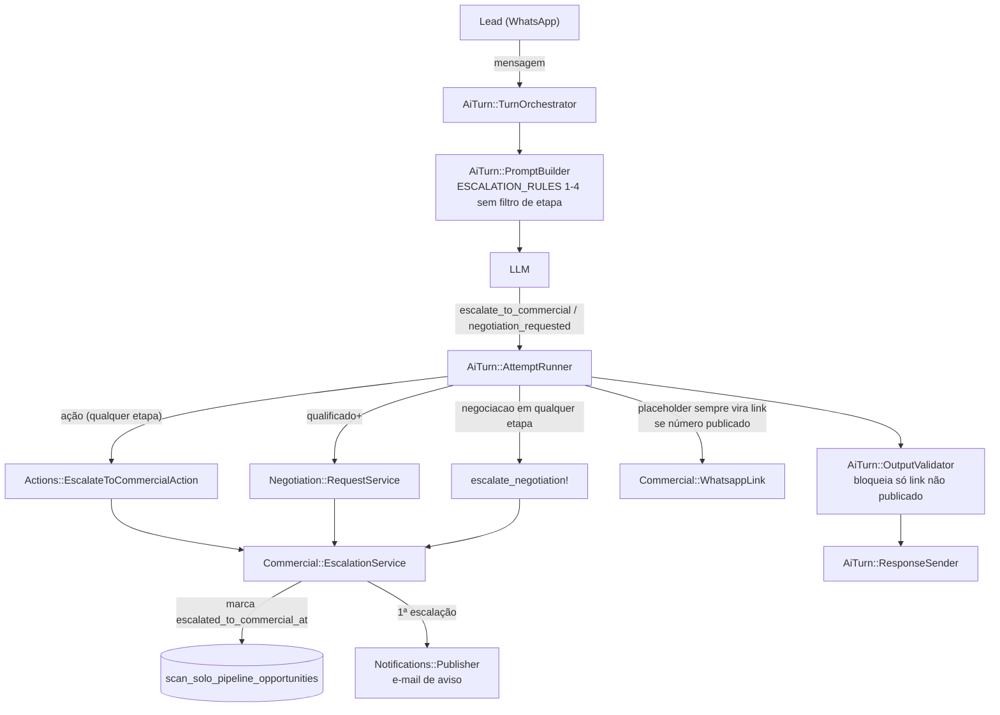
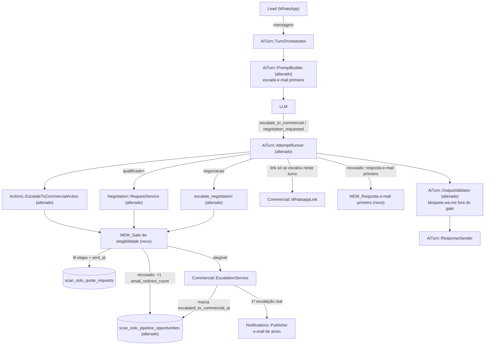

# SPEC: scansolo-escalacao-filtrada

## Metadata
- Source: developer description via /plan (`.spec/inputs/scansolo-fatia2b-escalacao-filtrada.md`)
- Service: ss-aiagentsystem (fork do Chatwoot, monólito Rails + Vue 3, namespace `ScanSolo::`)
- Tier: complete (reclassificado de standard: 16 RFs; confirmado pelo desenvolvedor)
- Version: 1.1
- Base: `feat/scansolo-escalacao-wame` @ `7fbf336e55` (= produção). Corrige a Fatia 2 (`.spec/features/scansolo-escalacao-comercial-wame/`).
- Architecture references: `AGENTS.md` (mesmo conteúdo de `CLAUDE.md`), `docs/agents/architecture.md`, `docs/agents/domain_rules.md`, `docs/agents/data_model.md`
  - Regras aplicadas: (a) camada de serviços é dona das regras de domínio, "one sole writer per concern" com `EscalationService` como único escritor da marca de escalação (`docs/agents/architecture.md`, tabela Layer responsibilities); (b) `Actions::Registry` + `Executor` mapeiam ações do modelo, mas **não** decidem o que é oferecido (`InputGuardrail`); (c) `AGENTS.md`: "Enforce eligibility and exclusivity rules at the earliest shared entry point" e "migrações só aditivas"; (d) `docs/agents/domain_rules.md` › Output validator: estender via `detect_violation` + `REGENERABLE_VIOLATIONS`.

## Context

Desde 10/11/2026 o agente entregou o link `wa.me` do comercial (nome público **Artur**) 4 vezes, só 1 dentro da regra de negócio: Daiane (conv. 122, Em Contato, link na 2ª mensagem ao perguntar valor de locação), Alexandre (conv. 120, Em Qualificação, link ao perguntar "custo aproximado" no meio da coleta), Azanis (conv. 86, Em Qualificação, link ao perguntar previsão da cotação) e CSI (conv. 111, Qualificado com orçamento encaminhado, link ao perguntar prazo e **reenviado em resposta a "Ok"**).

Achados no código (AS IS) que explicam o problema:

1. **Nenhum gate de elegibilidade na aplicação.** `ScanSolo::Actions::EscalateToCommercialAction.call` chama `ScanSolo::Commercial::EscalationService` direto, qualquer que seja a etapa (verified at `app/services/scan_solo/actions/escalate_to_commercial_action.rb:19-22`). O `EscalationService` só deduplica por `correlation_id` do turno (verified at `app/services/scan_solo/commercial/escalation_service.rb:45-55`).
2. **Três caminhos escrevem a marca**: a ação acima; `ScanSolo::Negotiation::RequestService` quando recebe `escalation_reason` (verified at `app/services/scan_solo/negotiation/request_service.rb:41-42`); e `AttemptRunner#escalate_negotiation!`, chamado quando `negotiation_requested`/reason `negociacao` aparece **em qualquer etapa** com número publicado (verified at `app/services/scan_solo/ai_turn/attempt_runner.rb:147-158`).
3. **O prompt manda escalar em qualquer etapa**: os gatilhos 2) assunto de orçamento, 3) sem resposta na base e 4) pedido de humano de `ESCALATION_RULES` não têm restrição de etapa; só o 1) exige `qualificado+` (verified at `app/services/scan_solo/ai_turn/prompt_builder.rb:54-67`).
4. **O link é montado sempre que o número está publicado**: `AttemptRunner#resolve_commercial_link!` troca o placeholder `{{LINK_ARTUR}}` pelo link mesmo sem escalação no turno (verified at `app/services/scan_solo/ai_turn/attempt_runner.rb:178-191`; placeholder verified at `app/services/scan_solo/commercial/whatsapp_link.rb:8`). Isso explica o reenvio no "Ok" da CSI.
5. **O `OutputValidator` só bloqueia link que não seja o comercial publicado** (`unpublished_contact`); o link legítimo passa em qualquer etapa (verified at `app/services/scan_solo/ai_turn/output_validator.rb:112-118`).
6. **Não existe contador de orientação por e-mail.** `scan_solo_pipeline_opportunities` tem só `escalated_to_commercial_at` e `escalation_reason` (verified at `db/schema.rb:1691-1692`).

Pontos a confirmar da descrição, resolvidos pelo código:
- **"Pedido de orçamento enviado"**: já existe estado estruturado. `ScanSolo::Quote::RequestService` grava `request_message_id` e `sent_at` no `ScanSolo::QuoteRequest` (1 por oportunidade) quando o e-mail de solicitação sai (verified at `app/services/scan_solo/quote/request_service.rb:62`). Não é preciso criar marca nova.
- **Intenção do turno**: hoje ela é extraída por ação do modelo, não por um classificador separado: a chamada a `escalate_to_commercial` (com `reason`) e `lead_state_update` com `negotiation_requested: true` (verified at `app/services/scan_solo/ai_turn/attempt_runner.rb:160-169`). O campo persistente `lead_state.intent` (catálogo `ScanSolo::LeadState::INTENTS`) descreve a intenção geral do lead, não a do turno. A regra de insistência reaproveita esses dois sinais.
- **Texto exato da orientação por e-mail**: decisão de produto. O conteúdo mínimo obrigatório fica no RIGID (UI não se aplica); a redação é proposta no PLAN para aprovação do Leo (ver FLEXIBLE).

## AS IS — Estado atual

Hoje três caminhos escrevem a marca de escalação sem checar etapa nem pedido de orçamento, e o `{{LINK_ARTUR}}` vira link sempre que o número está publicado. O validador aceita o link do comercial em qualquer situação, o que permite o link no Em Contato e o reenvio em "Ok".

## TO BE — Estado proposto

Todo caminho que escreve a marca passa pelo novo gate de elegibilidade (RF-01, RF-02, RF-03, RF-04, RF-09), que lê a etapa e o `sent_at` do pedido de orçamento e incrementa o novo `email_redirect_count` ao recusar (RF-05, CT-02). O link só é montado quando houve escalação real no turno (RF-06), o validador bloqueia qualquer `wa.me` fora disso (RF-07, RF-08), o prompt passa a descrever a escada (RF-10, RF-11) e o e-mail de aviso só sai em escalação real (RF-12).

## Scope
- **In**:
  - Gate de elegibilidade na aplicação para toda escrita da marca de escalação comercial (ação do modelo, negociação e `escalate_negotiation!`).
  - Novo contador aditivo `email_redirect_count` por oportunidade (1 oportunidade por conversa, índice único em `conversation_id`).
  - Escada de resposta e-mail primeiro, por etapa, incluindo pedido explícito de humano antes de `qualificado`.
  - Montagem do link condicionada à escalação real no turno; antirrepetição.
  - Nova regra de bloqueio no `OutputValidator`.
  - Reescrita das regras fixas de escalação do `PromptBuilder` (texto externo sempre "Artur"; e-mail = `quote_recipient_email` publicado).
  - Alinhamento de `Negotiation::RequestService` e do e-mail de aviso ao comercial.
  - Specs: matriz do gate, validador, prompt, integração com LLM mockado nos 4 casos reais, Negotiation, relatórios; suíte completa via `./scripts/ralph-test.sh` (verified at `scripts/ralph-test.sh`).
- **Out**:
  - Reverter a marca dos leads já marcados (Daiane, Alexandre, Azanis): ação pontual, só após deploy e com autorização do Leo; nunca em lote automático; não retroativo.
  - Takeover humano real (atendente responde no Chatwoot): comportamento inalterado.
  - Mudança na política de pausa de cadência para escalados (`AttemptPrecheck`, verified at `app/services/scan_solo/cadence/attempt_precheck.rb:47`).
  - Mudança no classificador `ScanSolo::Reports::CommercialStatus` e no front (rótulos existentes).
  - Configuração sem `commercial_whatsapp_number` publicado, incluindo a publicação atual de `negotiation.requested` por `Negotiation::RequestService` nessa configuração (comportamento mantido; ver RF-12).
  - Atualização de `DECISOES.md`, `STATUS_ATUAL.md`, `CHANGELOG.md`, `BACKLOG.md`, `claude/*.md`: entregável documental exigido pela descrição, mas os arquivos não estão na raiz deste repositório (`DECISOES.md` não encontrado); o PLAN DEVE rastreá-lo como item próprio e registrar a nova DEC antes das fases que alteram o agente.

## Definições

- **Etapa qualificada**: `stage` ∈ {`qualificado`, `proposta_enviada`, `negociacao`} (mesmo conjunto de `AttemptRunner::NEGOTIATION_STAGES`, verified at `app/services/scan_solo/ai_turn/attempt_runner.rb:54`).
- **Orçamento enviado**: a oportunidade tem `ScanSolo::QuoteRequest` com `sent_at` preenchido (verified at `app/services/scan_solo/quote/request_service.rb:62`).
- **Pedido comercial do turno**: no turno atual, o modelo chamou `escalate_to_commercial` (qualquer `reason` de `PipelineOpportunity::ESCALATION_REASONS`) **ou** `lead_state_update` com `negotiation_requested: true`.
- **Insistência**: pedido comercial do turno com `email_redirect_count >= 1`.
- **Elegível ao link**: etapa qualificada **e** orçamento enviado **e** insistência **e** (`escalated_to_commercial_at` nulo **ou** o turno é um pedido comercial explícito posterior ao link).
- **Orientação por e-mail**: resposta externa que (a) diz que valores e prazos vêm na proposta enviada por e-mail pelo comercial e (b) informa o `quote_recipient_email` publicado (default `comercial@scansolo.com.br`, verified at `db/schema.rb:1487`); na etapa qualificada com orçamento enviado, também (c) orienta responder ao e-mail da proposta.

## RIGID (Non-Negotiable)

### Functional Requirements

- RF-01 [Unwanted]: SE o lead estiver em `novo_lead`, `em_contato` ou `em_qualificacao` E o turno for um pedido comercial (preço, prazo, cotação, locação, negociação, dúvida sem resposta na base ou pedido explícito de falar com pessoa/humano/atendente), ENTÃO o sistema NÃO DEVE gravar `escalated_to_commercial_at`/`escalation_reason`, NÃO DEVE incluir `wa.me`/`api.whatsapp.com` na resposta, NÃO DEVE incrementar `email_redirect_count` e DEVE responder com a orientação por e-mail. O contador só é incrementado em etapa qualificada com orçamento enviado (RF-04).
  - AC: Para cada uma das 3 etapas × cada um dos 6 `reason` de `ScanSolo::PipelineOpportunity::ESCALATION_REASONS` (verified at `app/models/scan_solo/pipeline_opportunity.rb:36`) e `negotiation_requested: true`, após o turno `escalated_to_commercial_at` permanece nulo, `email_redirect_count` inalterado, 0 eventos `commercial.escalated` com o `correlation_id` do turno, e a mensagem enviada contém o `quote_recipient_email` publicado e nenhum `wa.me/`.

- RF-02 [Conditional]: SE RF-01 se aplicar E a qualificação estiver `em_andamento` com ao menos 1 campo elegível (faltante), ENTÃO a mesma resposta DEVE retomar a qualificação perguntando o(s) próximo(s) campo(s) elegível(is), respeitando as regras atuais (limite de 2 campos no modo progressivo; campos relevantes pendentes no modo `em_bloco`) e nunca perguntando campo `confirmado`.
  - AC: No caso Alexandre (Em Qualificação, faltando profundidade e prazo, pergunta "qual o custo aproximado?"), a resposta enviada tem `asked_fields` ⊆ campos faltantes, não vazio, sem nenhum campo `confirmado`, e passa no `OutputValidator` sem violação.

- RF-03 [Conditional]: SE o lead estiver em etapa qualificada E o orçamento NÃO estiver enviado, ENTÃO um pedido comercial do turno NÃO DEVE gerar marca de escalação nem link, e a resposta DEVE ser a orientação por e-mail; `email_redirect_count` NÃO DEVE ser incrementado.
  - AC: Oportunidade `qualificado` sem `QuoteRequest` (ou com `sent_at` nulo) + `escalate_to_commercial`: `escalated_to_commercial_at` nulo, `email_redirect_count` inalterado, resposta sem `wa.me/` e com o `quote_recipient_email`.

- RF-04 [Event-Driven]: QUANDO o lead em etapa qualificada com orçamento enviado fizer um pedido comercial com `email_redirect_count = 0`, o sistema DEVE responder com a orientação por e-mail (itens a, b e c), sem link, sem marca de escalação, e DEVE incrementar `email_redirect_count` em exatamente 1.
  - AC: Caso CSI, 1º pedido de prazo: após o turno `email_redirect_count = 1`, `escalated_to_commercial_at` nulo, resposta sem `wa.me/`.

- RF-05 [Event-Driven]: QUANDO o lead elegível ao link (definição acima) fizer um pedido comercial, o sistema DEVE gravar a marca (`escalated_to_commercial_at`, `escalation_reason`) via o único escritor de escalação e DEVE entregar o link `wa.me` do número publicado exatamente 1 vez na resposta do turno.
  - AC: Caso CSI, 2º pedido (contador = 1): `escalated_to_commercial_at` preenchido, 1 evento `commercial.escalated` com o `correlation_id` do turno, a mensagem enviada contém exatamente 1 ocorrência de `https://wa.me/<dígitos do número publicado>`.

- RF-06 [Unwanted]: SE nenhuma escalação real ocorrer no turno, ENTÃO todo placeholder `{{LINK_ARTUR}}` DEVE ser removido da resposta e nenhum link `wa.me` DEVE ser montado, mesmo com número publicado.
  - AC: Turno em que o modelo escreve `{{LINK_ARTUR}}` sem escalação aprovada pelo gate: a mensagem enviada não contém `{{LINK_ARTUR}}` nem `wa.me/`.

- RF-07 [State-Driven]: ENQUANTO `escalated_to_commercial_at` estiver preenchido, o sistema NÃO DEVE reenviar o link em turnos sem pedido comercial (ex.: "ok", "obrigado", "valeu") e DEVE continuar respondendo com a IA ativa (`ai_active`) as dúvidas cobertas pela base.
  - AC: Caso CSI após o link, mensagens "Ok" e "obrigado" sem `escalate_to_commercial`/`negotiation_requested`: resposta enviada (1 mensagem) sem `wa.me/`, `escalated_to_commercial_at` inalterado, 0 novos eventos `commercial.escalated`.
  - Limitação conhecida: separar uma cortesia ("ok") de um pedido comercial depende de o LLM não sinalizar pedido comercial no turno. A garantia de não reenvio em cortesia vem da regra de prompt (RF-10) somada à remoção do placeholder sem escalação real (RF-06) e ao bloqueio do validador (RF-09); se o LLM sinalizar pedido comercial indevidamente, aplica-se RF-08.

- RF-08 [Event-Driven]: QUANDO, depois do link, o lead pedir explicitamente o contato de novo (pedido comercial do turno), o sistema DEVE tratar o reenvio como escalação real: sobrescrever `escalated_to_commercial_at`/`escalation_reason`, registrar 1 novo audit `commercial.escalated` e reenviar o link 1 vez naquele turno, sem novo e-mail de aviso ao comercial.
  - AC: Oportunidade já escalada e elegível + `escalate_to_commercial` no turno: `escalated_to_commercial_at` atualizado para o horário do turno, `escalation_reason` = `reason` do turno, exatamente 1 novo audit `commercial.escalated` com o `correlation_id` do turno, mensagem com exatamente 1 `wa.me/`, 0 publicações em `ScanSolo::Notifications::Publisher` no turno.

- RF-09 [Unwanted]: SE a resposta final do turno contiver `wa.me/` ou `api.whatsapp.com` E o turno não tiver escalação real aprovada pelo gate, ENTÃO o `OutputValidator` DEVE bloquear a resposta (rollback do attempt), mesmo que o link seja o do número publicado.
  - AC: Spec do validador: conteúdo com o link comercial publicado e sem escalação no attempt → `blocked: true` com a nova violação; com escalação aprovada no attempt → `blocked: false`. Integração: modelo mockado devolvendo o link literal em `em_contato` → 0 mensagens com `wa.me/` enviadas.

- RF-10 [Ubiquitous]: O `PromptBuilder` DEVE emitir regras fixas (constantes de código, não editáveis por config) que descrevam a escada: antes de `qualificado`, qualquer pedido comercial ou de humano recebe orientação por e-mail e volta à próxima pergunta pendente sem repetir respostas já dadas; em etapa qualificada, orientação por e-mail primeiro; o link só via placeholder e só é entregue pela aplicação; depois do link, não repetir o contato em respostas de cortesia. As regras atuais de gatilho por etapa (assunto de orçamento, sem resposta na base e pedido de humano escalando em qualquer etapa) DEVEM ser removidas.
  - AC: Spec do prompt: o system message com número publicado contém as novas regras e não contém os textos dos gatilhos 2), 3) e 4) atuais; nenhuma config publicada altera essas regras.

- RF-11 [Ubiquitous]: O sistema DEVE continuar chamando a ação de escalação pelo pedido comercial em qualquer etapa (o LLM só sinaliza a intenção do turno), e a decisão de entregar o link DEVE ser exclusivamente da aplicação.
  - AC: Spec do gate: a matriz etapa (8) × orçamento enviado (sim/não) × `email_redirect_count` (0/≥1) × pedido comercial (sim/não) × link anterior (sim/não) produz marca + link apenas nas combinações elegíveis; o resultado não depende de nenhum campo do output do modelo além da presença do pedido comercial.

- RF-12 [Event-Driven]: QUANDO a escalação real ocorrer pela primeira vez na oportunidade, o sistema DEVE publicar o e-mail de aviso ao comercial (evento `commercial.escalated`) após o commit; pedidos recusados pelo gate NÃO DEVEM publicar aviso nem notificação `negotiation.requested` com número publicado.
  - AC: Nos cenários de RF-01, RF-03 e RF-04, 0 publicações em `ScanSolo::Notifications::Publisher`; no cenário de RF-05 (1ª escalação), exatamente 1 publicação `commercial.escalated`; no cenário de RF-08 (reenvio), 0 publicações.
  - Resolvido (v1.1): sem `commercial_whatsapp_number` publicado, a publicação de `negotiation.requested` por `Negotiation::RequestService` (verified at `app/services/scan_solo/negotiation/request_service.rb:43-45`) continua como hoje; fora de escopo (ver Scope > Out).

- RF-13 [Conditional]: SE um pedido de negociação ocorrer em `proposta_enviada`, ENTÃO a transição para `negociacao` e o evento `negotiation.requested` DEVEM continuar acontecendo como hoje, independentemente do gate; só a marca de escalação, o link e o aviso seguem RF-04/RF-05/RF-12.
  - AC: `proposta_enviada` com `QuoteRequest.sent_at` preenchido + `negotiation_requested: true` com `email_redirect_count = 0`: 1 stage event `proposta_enviada -> negociacao`, 1 audit `negotiation.requested`, `escalated_to_commercial_at` nulo, `email_redirect_count = 1`.
  - AC: `proposta_enviada` sem `QuoteRequest` (ou com `sent_at` nulo) + `negotiation_requested: true` com `email_redirect_count = 0`: 1 stage event `proposta_enviada -> negociacao`, 1 audit `negotiation.requested`, `escalated_to_commercial_at` nulo, `email_redirect_count` inalterado (0).

- RF-14 [Ubiquitous]: A resposta externa do turno DEVE ser única, DEVE nomear o contato comercial apenas como "Artur", NUNCA conter o nome interno (padrão `/luciano/i`, verified at `app/services/scan_solo/commercial/rules.rb:8`) e só conter telefone/link do número publicado.
  - AC: Em todos os cenários de integração: exatamente 1 mensagem outgoing por turno; `Commercial::Rules.internal_name?` falso para a mensagem e para o system message; nenhum telefone fora de `allowed_phone_numbers`.

- RF-15 [State-Driven]: ENQUANTO a oportunidade não tiver marca de escalação, o sistema DEVE manter a cadência normal (sem defer `commercial_escalated`); takeover humano real DEVE continuar pausando IA e cadências como hoje.
  - AC: Lead `em_qualificacao` que recebeu orientação por e-mail (RF-01): `AttemptPrecheck` não retorna `commercial_escalated`; spec existente de takeover humano verde sem alteração.

- RF-16 [State-Driven]: ENQUANTO a marca só for gravada por escalação real, `ScanSolo::Reports::CommercialStatus` DEVE classificar como `escalado_wa` apenas oportunidades escaladas pelo gate.
  - AC: Integração com os 4 casos reais (Daiane, Alexandre, Azanis, CSI) partindo de estado limpo: apenas CSI (após insistência) termina com `commercial_status = escalado_wa`; os demais `nao_encaminhado` ou status do pedido de orçamento.

### Contracts

- CT-01: Resultado da ação `escalate_to_commercial` (schema de entrada inalterado: `conversation_id`, `reason` ∈ `ESCALATION_REASONS`). Saída:
  - aprovada: `{ escalated: true, reason: <string>, escalated_at: <ISO8601> }` (formato atual, verified at `app/services/scan_solo/commercial/escalation_service.rb:78-80`);
  - recusada: `{ escalated: false, refusal: <one of "etapa_nao_qualificada" | "orcamento_nao_enviado" | "primeiro_pedido_email">, email_redirect_count: <integer> }` (`primeiro_pedido_email` = recusa de RF-04, a única que incrementa o contador). Recusa nunca levanta exceção nem gera mensagem extra ao lead; o turno não é falho por causa dela.
- CT-02: Migração aditiva em `scan_solo_pipeline_opportunities`: coluna `email_redirect_count` integer, `null: false`, `default: 0`. Nenhuma coluna existente alterada ou removida.
- CT-03: Nova violação do `OutputValidator` (símbolo proposto `commercial_link_not_allowed`), regenerável (entra em `REGENERABLE_VIOLATIONS`), avaliada logo após `unpublished_contact`. Parâmetro de entrada novo: indicação de escalação real aprovada no attempt.

### Non-Functional Requirements

- RNF-01: 0 chamadas adicionais ao LLM por turno para classificar intenção ou decidir elegibilidade (máximo continua `TurnOrchestrator::MAX_ATTEMPTS = 2`).
- RNF-02: Migração apenas aditiva (1 coluna com default); `db:migrate` e `db:rollback` executam sem perda de dados existentes.
- RNF-03: Gate determinístico e puro em relação ao LLM: mesma entrada (etapa, `sent_at`, contador, pedido comercial, marca) → mesma decisão em 100% das execuções da matriz de RF-11.
- RNF-04: `./scripts/ralph-test.sh` (suíte completa) termina com 0 falhas; specs existentes de takeover humano, cadências, `Negotiation::RequestService` e relatórios passam sem relaxar asserções, exceto as que codificam o comportamento corrigido (escalação fora da etapa qualificada), que são reescritas.
- RNF-05: i18n de textos novos só em `config/locales/en.yml` (pt-BR, verified: chaves `scan_solo.negotiation.*` em `config/locales/en.yml:853-854`); nenhum telefone versionado no Git.

## FLEXIBLE (Implementation Suggestions)

- Gate no ponto de entrada compartilhado: `ScanSolo::Commercial::EscalationService` já é o único escritor e recebe os 3 caminhos; colocar a checagem ali (ou num `ScanSolo::Commercial::Eligibility` chamado só por ele) evita repetir guardas na ação, no `RequestService` e no `AttemptRunner`, conforme `AGENTS.md`. O incremento de `email_redirect_count` fica no mesmo lugar, sob o `lock!` já existente.
- `AttemptRunner#escalate_negotiation!` hoje escala em qualquer etapa; passa a respeitar o resultado do gate e só usa `scan_solo.negotiation.escalation_reply` quando aprovado; recusado → resposta de orientação por e-mail.
- Pedido comercial antes de `qualificado` (RF-02): deixar o modelo escrever a resposta seguindo o prompt e validar; no fallback, compor texto fixo de orientação + `fallback_reply.ask` com os campos elegíveis (mesma lógica de `fallback_keys`).
- `resolve_commercial_link!`: substituir `elsif content.include?(PLACEHOLDER)` por "só se `escalated_in_attempt?`".
- Validador: passar `commercial_link` só quando o attempt escalou; com isso a regra existente `unpublished_contact` já bloqueia o link publicado fora do gate, e a violação CT-03 pode virar só um rótulo mais claro. Avaliar no PLAN se basta reaproveitar `unpublished_contact`.
- Proposta de textos (item de aprovação **bloqueante** do Leo no PLAN; as respostas de orientação não são implementadas sem a redação aprovada):
  - antes de qualificado: "Os valores e prazos vêm na proposta que o nosso comercial envia por e-mail assim que eu concluir o seu cadastro. Se quiser, pode escrever para %{email}. Para seguir: %{pergunta}"
  - qualificado, 1º pedido: "Seu pedido de orçamento já está com o Artur, do nosso comercial. Valores e prazos chegam na proposta por e-mail; você pode responder direto àquele e-mail ou escrever para %{email}."
- Reaproveitar `scan_solo.negotiation.escalation_reply` para a entrega do link.
- Novas regras de prompt substituem `ESCALATION_RULES`, mantendo a regra do especialista virtual e a transparência de IA.

## Acceptance Criteria Summary

| ID | Criterion | Testable? |
|----|-----------|-----------|
| RF-01 | Antes de qualificado, nenhum pedido comercial/humano gera marca, `wa.me` ou incremento do contador; resposta com e-mail | Sim |
| RF-02 | Pedido antes de qualificado retoma qualificação sem repetir campo confirmado | Sim |
| RF-03 | Qualificado sem orçamento enviado: sem link, contador inalterado | Sim |
| RF-04 | Qualificado + orçamento enviado, 1º pedido: e-mail, contador = 1 | Sim |
| RF-05 | Insistência elegível: marca + exatamente 1 `wa.me` | Sim |
| RF-06 | Sem escalação real, placeholder removido e link não montado | Sim |
| RF-07 | Após link, "ok"/"obrigado" sem reenvio | Sim |
| RF-08 | Pedido explícito após link: escalação real (marca sobrescrita, 1 audit), reenvio 1 vez, sem novo aviso | Sim |
| RF-09 | Validador bloqueia `wa.me` sem escalação aprovada | Sim |
| RF-10 | Prompt com escada; gatilhos 2-4 antigos removidos | Sim |
| RF-11 | Matriz do gate determinística, decisão só na aplicação | Sim |
| RF-12 | Aviso ao comercial só na 1ª escalação real | Sim |
| RF-13 | Negociação em `proposta_enviada` segue movendo etapa; contador só com orçamento enviado | Sim |
| RF-14 | 1 resposta por turno, só "Artur", só número publicado | Sim |
| RF-15 | Cadência normal sem marca; takeover humano inalterado | Sim |
| RF-16 | `escalado_wa` só para escalação legítima (4 casos reais) | Sim |
| RNF-01..05 | 0 LLM extra, migração aditiva, determinismo, suíte verde, i18n | Sim |
