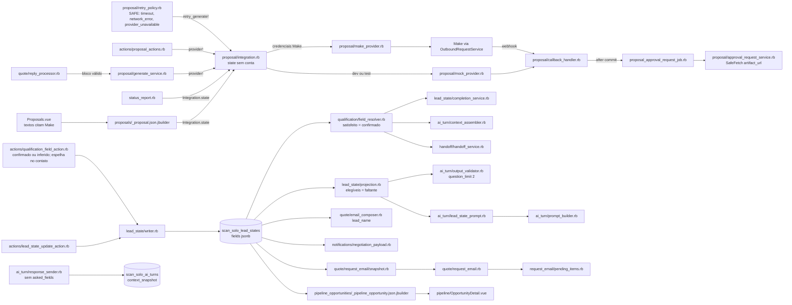
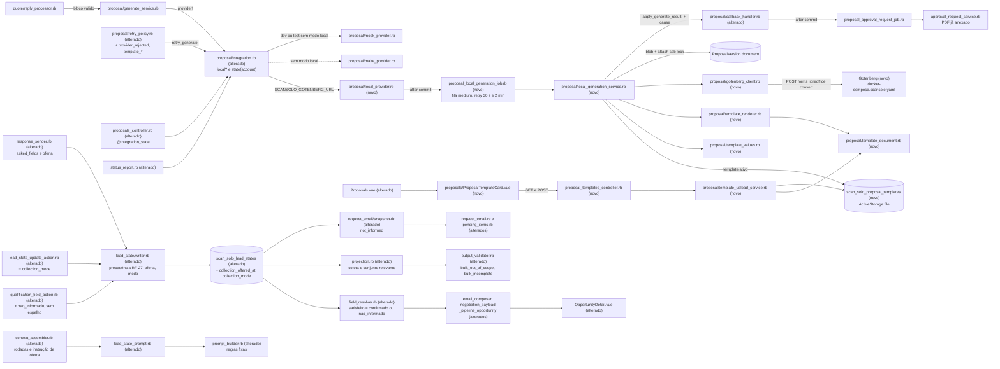

# Implementation Plan

## Request Summary
- Objective: (Parte A) dar ao agente o status de campo `nao_informado` (o lead disse que não sabe, não tem, não definiu ou não se aplica), que conta como resposta válida, encerra as perguntas infinitas, conclui a qualificação, aparece de forma neutra no e-mail de solicitação, na tela e nos leitores, e nunca é espelhado como dado; mais a UX da coleta (explicação inicial, coleta progressiva, 1 oferta única de coleta em bloco gravada pelo sistema, modo `em_bloco` restrito ao conjunto relevante pendente, `asked_fields` no `context_snapshot`). (Parte B) trocar a geração da proposta pelo Make por um provider local: template `.docx` por conta no ActiveStorage, render determinístico dos 16 placeholders do CT-03, conversão no Gotenberg, PDF anexado em `ProposalVersion#document` com SHA-256 e resultado aplicado pelo `CallbackHandler` existente; aprovação, entrega, retry e auditoria reaproveitados.
- Scope in: RF-01..RF-39, UI-01..UI-03, CT-01..CT-10, RNF-01..RNF-09 (RNF-10 é prova local com Gotenberg real → `OPERADOR.md`).
- Scope out: tudo da seção **Out** do SPEC — segundo fluxo/tabela/aprovação de proposta; mudanças em `MakeProvider`, `OutboundRequestService`, webhook do Make, `CallbackVerifier`, `CallbackApplicationService`, `MakeRequest`, `ApproveService`, `RejectService`, `DeliveryService`, `SuccessHandler`, `LeadNoticeService`, `FollowUpService`, `OC/CT-04` e parser; LLM na geração; template real no Git; download/histórico/edição de template; sweeper de `generating`; mudança de `required_qualification_fields`; merge, deploy, migração em produção e qualquer ação no Make.
- Tier: complete
- SPEC: v1.4 (0 marcadores; D-01 é decisão provisória a confirmar pelo operador, não bloqueia). Decisões em `.handoff/clarifier-answers.md`.
- Architecture references: `AGENTS.md` (= `CLAUDE.md`), `docs/agents/architecture.md`, `docs/agents/domain_rules.md`, `docs/agents/api_contracts.md`, `docs/agents/data_model.md`, `docs/architecture/SCANSOLO_DEPLOYMENT.md`. Contratos base: `.spec/features/scansolo-proposta-aprovacao-email/openapi.yaml` (v1.0.0) e `.spec/features/scansolo-agent-lead-state/openapi.yaml` (v1.5.0).

### Regras de arquitetura preservadas (valem para todas as tasks)
- Base de comparação da feature: o commit `docs(spec)` que adiciona este plano; até ele existir, `44884e058b`. Todo `git diff <base>` das tasks usa esse commit.
- `docs/agents/architecture.md` "Layer responsibilities":
  - Services (`services/scan_solo/*`) donos de toda escrita e regra. `ScanSolo::LeadState::Writer` continua o **único** escritor de `scan_solo_lead_states`/`scan_solo_lead_state_events` (inclusive das 2 colunas novas, RF-39). `ScanSolo::Proposal::CallbackHandler` continua o **único** escritor de `value`/`currency`/`artifact_url`/`artifact_sha256`/status de geração (verified at `app/services/scan_solo/proposal/callback_handler.rb:1-8,25-46`). `ScanSolo::Proposal::LocalGenerationService` (novo) concentra a regra da geração local (revalidação RF-03, template, render, conversão, anexo, mapeamento de falha); `ScanSolo::Proposal::TemplateUploadService` (novo) é o único caminho que cria/ativa template.
  - Jobs (`jobs/scan_solo/*`) só fronteira assíncrona e retry: `ScanSolo::ProposalLocalGenerationJob` (novo, fila `medium`) chama o service e declara `retry_on`; a elegibilidade (RF-03) fica no service ("Jobs … Does NOT own: Eligibility logic"). Isso ajusta o FLEXIBLE do SPEC (que punha a lógica no job) à arquitetura.
  - Controllers: gate 404 `scansolo_enabled` e 403 Pundit herdados do `Api::V1::Accounts::ScanSolo::BaseController` (verified at `base_controller.rb:5,11-24`); validação do upload na fronteira do request com 422 (`AGENTS.md`).
  - jbuilder: só forma do JSON. O `integration_state` por conta é calculado 1 vez no controller (`@integration_state`), não por proposta dentro do partial ("jbuilder views: Does NOT own queries beyond preloads").
  - Puros (0 escrita, 0 HTTP, 0 LLM): `TemplateDocument`, `TemplateRenderer`, `TemplateValues`, `LeadState::Projection`, `AiTurn::OutputValidator`, `AiTurn::LeadStatePrompt`.
- `docs/agents/domain_rules.md` "Proposal lifecycle": só o callback do provider escreve valor; ≤ 1 versão não terminal por solicitação (índice `one_open_per_quote_request`, verified at `app/models/scan_solo/proposal_version.rb:67`); aprovação sempre humana; ≤ 1 pedido de aprovação por versão. "Proposal retry and dead letter": 5xx → `provider_unavailable`, 4xx → `provider_rejected`, toda falha audita `proposal.generation_failed`.
- RNF-02 (`AP/RNF-01` estendido): 0 HTTP ao Gotenberg dentro de transação aberta — `GotenbergClient` levanta `CustomExceptions::ScanSolo::DeliveryInsideTransaction` quando `ActiveRecord::Base.connection.current_transaction.joinable?` (mesmo padrão de `approval_request_service.rb:30`); enfileiramento a partir de escrita via `ActiveRecord.after_all_transactions_commit` (padrão de `callback_handler.rb:41`).
- `AGENTS.md`: reuso de dependências (`rest-client` para multipart, `pdf-reader` para validar o PDF, Nokogiri para XML, `rubyzip` — única gem nova); exceções customizadas em `lib/custom_exceptions/scan_solo.rb`; falha alta em configuração impossível (sem modo local e sem Make em produção continua `ProposalIntegrationNotConfigured`); sem helpers de uso único; specs com `let` e setup por exemplo; `with_modified_env` para ligar o modo local; comparar `error.class.name` em specs de erro.
- `AGENTS.md` Enterprise: não há arquivo ScanSolo em `enterprise/` (verificado no SPEC); T27 confere `git diff <base> --stat -- enterprise/` vazio.
- i18n: backend só em `config/locales/en.yml` (textos pt-BR, como o resto do módulo); frontend só em `app/javascript/dashboard/i18n/locale/en/scansolo.json`. Sem strings soltas.
- Estilo (`docs/agents/coding_guidelines.md`): `class ScanSolo::…` compacta, 1 classe por arquivo, ≤ 150 colunas, header comment com RF/CT/RNF. Vue com `<script setup>`, Tailwind, `components-next/`, sem CSS próprio.
- RNF-04/RNF-05 (repositório público): nenhum `.docx`/`.pdf` de template real no Git; fixtures `.docx` montadas em memória na spec (helper `spec/support/scan_solo_docx_fixture.rb`, T15) com texto sintético; o PDF de resposta do Gotenberg stubado é `spec/fixtures/files/sample.pdf` (já existe, 1 página, verified at `head -c 8` = `%PDF-1.4`). 0 HTTP real (WebMock; `spec_helper` usa `disable_net_connect!(allow_localhost: true)`, por isso a URL de teste é `http://gotenberg.test:3000`, nunca `localhost`), 0 Make, 0 LLM, 0 SMTP real (ActionMailer `:test` + `set_delivery_method` stubado, padrão de `spec/integration/scan_solo/proposta_aprovacao_email_spec.rb:38-49`). Nada em log/auditoria leva conteúdo de template, bytes de PDF, valores renderizados ou palavras do lead.
- Specs existentes só mudam de expectativa por requisito do SPEC, citado no diff (ex.: `CONTINUITY_RULES` do `prompt_builder_spec.rb` por RF-26/RF-38 d; textos do `scansolo.json` por UI-02). 0 `skip`/`pending`/`xit` novos (RNF-08).
- Gate 2 do ralph (`scripts/ralph-test.sh`) só roda specs cujo caminho contém `scan_solo` ou termina em `scansolo*_spec.rb`, e Vitest em caminhos com `scansolo`: toda spec nova desta feature fica num desses caminhos.
- Validação (stack Docker local; `DC="docker compose -f docker-compose.yaml -f local/docker-compose.override.yml"`):
  - Specs Ruby: `$DC exec -T -e RAILS_ENV=test rails bundle exec rspec <paths>`. Rubocop: `$DC exec -T rails bundle exec rubocop --force-exclusion <paths>`.
  - Migrações (T01): `$DC exec -T rails bundle exec rails db:migrate` (development local) para regenerar `db/schema.rb`; o banco de teste é recriado pelo `db:test:prepare` do `ralph-test.sh`. Nunca rodar nada contra produção.
  - Gotcha do annotate (memória do projeto): depois do `db:migrate`, `git diff --stat` e reverter com `git checkout -- <arquivo>` todo arquivo tocado pelo annotate fora da lista da task (o annotate injeta hostnames e `spec/lib/scansolo_branding_spec.rb` proíbe `scansolo.com.br` em `app/`); em `db/schema.rb` manter só os blocos das 2 mudanças e a versão.
  - Gem nova (T02): `$DC exec -T rails bundle install` e `$DC exec -T vite bundle install`, para o Gate 2 continuar funcionando.
  - Vitest: `$DC exec -T -e TZ=UTC vite pnpm exec vitest run <paths>`. ESLint: `pnpm eslint <arquivos>` com os `.vue` explícitos (a varredura por diretório ignora `.vue`).
  - Gate de regressão: `./scripts/ralph-test.sh`.
- Commits: só locais, Conventional Commits (`feat(scansolo): …`, `test(scansolo): …`, `docs(agents): …`), sem referência ao Claude. Sem push, deploy ou merge.

### Componentes reaproveitados
- Proposta: `Proposal::GenerateService` (cria a versão e chama `provider!` depois do commit, verified at `generate_service.rb:33-41`), `Proposal::RetryPolicy` (`retry_generate!`, verified at `retry_policy.rb:111-117`), `Actions::ProposalActions` (`AfterCommitProvider`, verified at `proposal_actions.rb:41`), `Proposal::CallbackHandler.apply_generate_result!`, `ProposalApprovalRequestJob` → `ApprovalRequestService#store_document` (não baixa quando `document.attached?`, verified at `approval_request_service.rb:51-52`), `checksum_matches?` (`:62-68`), `ApproveService`, `DeliveryService`, `ProposalVersion#proposal_number`/`#audit_correlation_id`, `Quote::AmountInWords`, `AuditLogger`, `ChatwootExceptionTracker`.
- Qualificação: `Qualification::FieldResolver` (`CATALOG`, `contact_value`, `canonical_key`), `LeadState::Writer`, `LeadState::Projection`, `LeadState::CompletionService` (conclui por `missing_labels.empty?`, verified at `completion_service.rb:58-62`), `AiTurn::OutputValidator`, `AiTurn::PromptBuilder`, `AiTurn::LeadStatePrompt`, `AiTurn::ResponseSender#record_evidence!`, `Quote::RequestEmail` (+ `Snapshot`, `PendingItems`, `Settings`, `ServiceLabel`, `Subject::CITY_UF`/`UF`).
- Frontend: padrão `FormData` do `KnowledgeCenter.vue:72-77`, `ApiClient` (`scansoloKnowledgeSources.js`), `useScanSoloRole().isAdministrator`, `REASON_LABELS`/`FIELD_STATUS_LABELS` de `scansoloLabels.js`, `useAlert`, `serverErrorMessage`.

### Compatibilidade com o agente publicado (garantia do desenvolvedor, 2026-10-13)

- O runtime do agente é o mesmo (`AiTurnJob` → `TurnOrchestrator` → `AttemptRunner` → `PromptBuilder`/`ModelInvoker`/`OutputValidator` → `ResponseSender`); nenhum runtime paralelo.
- A configuração publicada (`ScanSolo::AiAgentConfig.published_for(account)`, editada na tela do agente e publicada por `PublishService`) continua sendo a única fonte de: instruções/prompt (`role`, `objective`, `persona`, `tone`, `instructions`, `service_rules`, `qualification_playbook`, `restricted_information`, `forbidden_subjects`, `transfer_criteria`, `response_limits`, `service_hours`), modelo/provider (`model_provider`, `model_selection`), `enabled`, `allowed_inbox_ids`, `required_qualification_fields`, `opt_out_keywords`, `quote_inbox_id`, `quote_recipient_email`, `quote_email_validation_mode`, `require_proposal_approval`, `commercial_user_id`.
- A feature só acrescenta comportamento sobre a qualificação existente: status `nao_informado`, estado da oferta de coleta (`collection_offered_at`/`collection_mode` em `scan_solo_lead_states`), regras novas do `OutputValidator` e regras fixas adicionais no prompt, anexadas às regras fixas que já existem em código (`PromptBuilder::CONTINUITY_RULES`), sem substituir nem reescrever as instruções publicadas.
- Proibido nesta feature: tabela/modelo/tela de configuração de agente paralela; coluna nova ou mudança em `scan_solo_ai_agent_configs`, `AiAgentConfig::FIELDS`, `PublishService`, `AiAgentConfigsController`, `AgentCenter.vue`/`agentCenterFields.js`; seed, migração, rake ou job que crie/atualize/publique `AiAgentConfig`; hardcode de qualquer valor hoje configurável na tela (a lista de obrigatórios vem sempre da config publicada; o conjunto relevante do modo em bloco = obrigatórios publicados `faltante` ∪ itens do serviço do arquivo versionado já existente `config/scan_solo/quote_request_email.yml`).
- Deploy não toca a config: migrações só aditivas fora de `scan_solo_ai_agent_configs`; nenhum passo do OPERADOR publica ou edita o agente. Se algum dia for preciso mudar prompt/config publicada, é gate humano separado (OPERADOR §0): comparar draft × published, mostrar o diff exato e só publicar com autorização do desenvolvedor.
- `required_qualification_fields`: as regras novas valem com a lista vazia e preenchida. Regra existente preservada (LS/RF-04): lista vazia nunca conclui a qualificação (logo nunca dispara solicitação automática); com lista vazia não há campo elegível, então nada é perguntado repetidamente, `nao_informado` ainda é gravado, e o modo em bloco usa só os itens do serviço. Com lista preenchida, conclui quando todos estão `confirmado` ou `nao_informado`.

## AS IS — Componentes impactados

Hoje a geração depende do Make (ou do mock em dev/test), o estado da integração não depende da conta e a tela cita o Make. Na qualificação, só existem `confirmado | inferido | faltante`: "não sei" vira texto livre `confirmado` ou deixa o campo `faltante` (perguntado de novo e qualificação nunca conclui). O `asked_fields` não é persistido, então não há como contar rodadas de coleta.

## TO BE — Componentes propostos

T01 cria a tabela `scan_solo_proposal_templates` e as 2 colunas de coleta; T02 a gem `rubyzip`. Parte A: T03 (`LeadState`, `LeadStateEvent`, `Writer`), T04 (`FieldResolver` e leitores, `_pipeline_opportunity`), T05 (`OpportunityDetail.vue`, rótulo), T06 (`QualificationFieldAction`), T07 (`LeadStateUpdateAction`), T08 (`Snapshot`, `RequestEmail`, `PendingItems`), T09 (`Projection`), T10 (`ContextAssembler`, `LeadStatePrompt`, `PromptBuilder`), T11 (`OutputValidator`, `AttemptRunner`), T12 (`ResponseSender`). Parte B: T14 (model do template), T15 (`TemplateDocument`), T16 (`GotenbergClient`), T17 (`CallbackHandler`, `RetryPolicy`), T18 (serviço `gotenberg` no Compose), T19 (`TemplateRenderer`), T20 (`TemplateValues`), T21 (`LocalGenerationService` + job), T22 (`LocalProvider`, `Integration`, `StatusReport`, `ProposalsController`, partial), T23 (API e upload), T24 (`ProposalTemplateCard.vue`, `Proposals.vue`).

## Tasks

### T01 — Migrações aditivas: tabela de templates e colunas de coleta
- **Files**: `db/migrate/20261013100001_create_scan_solo_proposal_templates.rb` (novo), `db/migrate/20261013100002_add_collection_to_scan_solo_lead_states.rb` (novo), `db/schema.rb`, `spec/db/scansolo_migrations_spec.rb`, `spec/db/scan_solo_proposta_template_local_migrations_spec.rb` (novo)
- **Change**:
  - 100001 (CT-06): `create_table :scan_solo_proposal_templates` com `account_id` (bigint, not null, FK `accounts`), `uploaded_by_id` (bigint, null, FK `users` com `on_delete: :nullify`), `filename` (string, not null), `byte_size` (bigint, not null), `sha256` (string, not null), `active` (boolean, not null, default false), timestamps. Índices: `add_index :scan_solo_proposal_templates, :account_id, unique: true, where: 'active', name: 'index_scan_solo_proposal_templates_one_active_per_account'` e `[:account_id, :created_at]`. O arquivo é ActiveStorage (`file`), sem coluna.
  - 100002 (CT-10, RF-39): `add_column :scan_solo_lead_states, :collection_offered_at, :datetime` e `add_column :scan_solo_lead_states, :collection_mode, :string` (anuláveis, sem default, sem índice, sem backfill).
  - `db:migrate` local (development) para regenerar `db/schema.rb`; aplicar o gotcha do annotate (ver regras). 0 colunas novas em `scan_solo_proposal_versions` (RNF-08).
  - `spec/db/scansolo_migrations_spec.rb`: contagem 40 → 42, comentário citando as 2 migrações.
- **Covers**: CT-06, CT-10, RF-39, RNF-08
- **Tests**: `scan_solo_proposta_template_local_migrations_spec.rb`: 2 templates `active: true` na mesma conta → `ActiveRecord::RecordNotUnique`; 2 ativos em contas diferentes e 2 inativos na mesma conta → aceitos; `scan_solo_lead_states` tem as 2 colunas anuláveis com `default` nulo; um lead state criado sem elas lê `nil`/`nil`. `scansolo_migrations_spec.rb`: 42 arquivos e o teste "only additive" continua verde.
- **Risk**: Low — só aditivo; atenção ao annotate.
- **Dependencies**: none

### T02 — Gem `rubyzip` e bundle nos containers
- **Files**: `Gemfile`, `Gemfile.lock`
- **Change**: `gem 'rubyzip', '~> 2.4', require: 'zip'` no `Gemfile` (perto de `pdf-reader`, com comentário `# ScanSolo: leitura/escrita do template .docx (RF-05, RF-17)`). Rodar `$DC exec -T rails bundle install` **e** `$DC exec -T vite bundle install` (o Gate 2 usa os 2 containers; sem isso o `ralph-test.sh` quebra no boot). Nenhum código usa a gem ainda.
- **Covers**: RF-22 (gem)
- **Tests**: `$DC exec -T rails bundle exec rails runner "require 'zip'; puts Zip::VERSION"` imprime a versão; `$DC exec -T vite bundle exec ruby -e "require 'zip'"` sai 0; `./scripts/ralph-test.sh` passa o boot.
- **Risk**: Low — gem madura; lock só ganha `rubyzip`.
- **Dependencies**: none

### T03 — Parte A: `nao_informado`, precedência do `Writer` e estado da coleta
- **Files**: `app/models/scan_solo/lead_state.rb`, `app/models/scan_solo/lead_state_event.rb`, `app/services/scan_solo/lead_state/writer.rb`, `spec/models/scan_solo/lead_state_spec.rb`, `spec/models/scan_solo/lead_state_event_spec.rb`, `spec/services/scan_solo/lead_state/writer_spec.rb`, `spec/services/scan_solo/lead_state/projection_spec.rb`
- **Change**:
  - `LeadState::FIELD_STATUSES = %w[confirmado inferido faltante nao_informado]` (RF-25); `COLLECTION_MODES = %w[em_bloco progressiva]` e `validates :collection_mode, inclusion: { in: COLLECTION_MODES }, allow_nil: true` (CT-10). Comentário de schema/annotate das 2 colunas.
  - `LeadStateEvent` aceita `subject` ∈ `field | intent | next_action | collection_mode`.
  - `Writer.applicable?(current_status:, new_status:)` com a tabela do RF-27: recusa `inferido` ou `nao_informado` sobre `confirmado`, e `inferido` sobre `nao_informado`; aceita o resto (`confirmado` sobre `nao_informado`, `nao_informado` sobre `faltante`/`inferido`). Escrita recusada → 0 mudança e 0 evento (retorno `:kept_confirmed` para `confirmado`, `:kept_not_informed` para `nao_informado`). `apply_field!` continua ignorando valor em branco (o `nao_informado` exige as palavras do lead). A `Projection#pending_overlay` já usa `Writer.applicable?` (verified at `projection.rb:63`), então a sobreposição em memória segue a mesma regra sem mudança de código.
  - `Writer#record_collection_offer!(at:, source_message_id:)`: `lock!`; só quando `collection_offered_at` é nulo grava o instante e 1 evento `subject: 'collection_mode'`, `key: 'collection_offered_at'`, `new_value: at.iso8601(6)`; senão `:unchanged` (RF-36).
  - `Writer#set_collection_mode!(mode:, source_message_id:)`: `lock!`; só com `collection_offered_at` preenchido e `collection_mode` nulo grava o modo e 1 evento `key: 'collection_mode'`; senão `:ignored` (RF-37). Modo fora de `COLLECTION_MODES` → `ArgumentError` (o schema da ação já filtra).
  - Header comment do `Writer` cita RF-27, RF-36, RF-37, RF-39.
- **Covers**: RF-25, RF-27, RF-36 (escrita), RF-37 (escrita), RF-39, CT-10
- **Tests**: `writer_spec.rb` — as 6 transições do RF-27 (1 exemplo por linha do AC, contando eventos); `record_collection_offer!` 2 vezes → 1 evento e o 1º instante preservado; `set_collection_mode!` antes da oferta → `:ignored`, 0 eventos; depois → `em_bloco` + 1 evento; 2ª escolha `progressiva` → continua `em_bloco`, 0 eventos. `lead_state_spec.rb` — `collection_mode: 'rapido'` inválido; estado antigo (colunas nulas) válido; `FIELD_STATUSES` exato. `lead_state_event_spec.rb` — `subject: 'collection_mode'` válido, `'foo'` inválido. `projection_spec.rb` — extração `inferido` pendente sobre campo `nao_informado` não sobrepõe.
- **Risk**: Medium — o `Writer` é o único escritor do estado do lead, usado por todo turno; a mudança é só na tabela de precedência e em 2 métodos novos.
- **Dependencies**: T01

### T04 — Parte A: satisfação no `FieldResolver` e leitores tratam `nao_informado` como ausente
- **Files**: `app/services/scan_solo/qualification/field_resolver.rb`, `app/services/scan_solo/quote/email_composer.rb`, `app/services/scan_solo/notifications/negotiation_payload.rb`, `app/views/api/v1/accounts/scan_solo/pipeline_opportunities/_pipeline_opportunity.json.jbuilder`, `app/services/scan_solo/handoff/handoff_service.rb` (só comentário), `config/locales/en.yml`, `spec/services/scan_solo/qualification/field_resolver_spec.rb`, `spec/services/scan_solo/qualification/consumer_consistency_spec.rb`, `spec/services/scan_solo/quote/email_composer_spec.rb`, `spec/services/scan_solo/notifications/negotiation_payload_spec.rb`, `spec/services/scan_solo/handoff/handoff_service_spec.rb`, `spec/services/scan_solo/ai_turn/context_assembler_spec.rb`, `spec/requests/api/v1/accounts/scan_solo/pipeline_opportunities_lead_state_spec.rb`, `spec/services/scan_solo/proposal/generate_service_spec.rb`
- **Change**:
  - `FieldResolver#fields`: `satisfied: %w[confirmado nao_informado].include?(status)` (RF-28); `#resolve`: chave com status `nao_informado` no estado do lead → `[nil, 'lead_state']` sem consultar o contato (RF-33); `#collected`: campos satisfeitos, com valor `I18n.t('scan_solo.qualification.not_informed_by_client')` (= `não informado pelo cliente`) para `nao_informado` (RF-33 a — alimenta o contexto do turno e a nota de handoff sem mudar `ContextAssembler`/`HandoffService`); `#make_qualification` omite a chave (RF-33 b, sai do `compact_blank`); `proposal_gate_missing_labels` inalterado no código (com `concluida` só `faltante` bloqueia; em `em_andamento` usa a satisfação nova, D-02).
  - `EmailComposer#lead_name` e `NegotiationPayload.contact`: `empresa` com status `faltante` **ou** `nao_informado` → ausente (`lead_name` = só o nome do contato; `company: nil`) (RF-33 b, c).
  - `_pipeline_opportunity.json.jbuilder`: `company`/`service`/`city_uf` = `nil` quando o status é `faltante` ou `nao_informado`; o `lead_state` (Projection) continua expondo `status: "nao_informado"` com o `value` gravado (RF-33 d, sem mudança no partial `_lead_state`).
  - `HandoffService#qualification_fields`: só o comentário passa a citar `nao_informado` (o texto vem do `collected`).
  - `en.yml`: `scan_solo.qualification.not_informed_by_client: não informado pelo cliente`.
- **Covers**: RF-28, RF-29 (elegíveis continuam só `faltante`, verified at `projection.rb:106-110`), RF-33 (a–d), RF-24 (gate D-02)
- **Tests**: `field_resolver_spec.rb` — AC do RF-28 (config `Empresa` + `Profundidade de investigação`; `nao_informado` satisfaz, `inferido` não) e do RF-33 (`collected` exato; `make_qualification` sem `profundidade`); contato com `custom_attributes['profundidade'] = 'não sei'` e estado `nao_informado` → `resolve` nulo. `generate_service_spec.rb` — gate em `em_andamento` com `profundidade` `nao_informado` não bloqueia. `email_composer_spec.rb` — `lead_name` = `Ana` com `empresa` `nao_informado` "não tenho". `negotiation_payload_spec.rb` — `company: nil`. `handoff_service_spec.rb` — nota com `Profundidade de investigação: não informado pelo cliente`. `context_assembler_spec.rb` — `collected_fields` com o texto neutro. `pipeline_opportunities_lead_state_spec.rb` — cartão `company: null` e `lead_state` com `status: "nao_informado"`, `value: "não tenho"`. `consumer_consistency_spec.rb` — 0 ocorrências de `não sei`/`não tenho` no payload Make, no de negociação e no `lead` do `EmailComposer`.
- **Risk**: Medium — muda a regra de satisfação lida por conclusão, gate de proposta, contexto e e-mail; coberto pelas specs existentes dos consumidores.
- **Dependencies**: T01

### T05 — Parte A: rótulo "Não informado pelo cliente" na tela da oportunidade (UI-03)
- **Files**: `app/javascript/dashboard/routes/dashboard/scansolo/scansoloLabels.js`, `app/javascript/dashboard/routes/dashboard/scansolo/pipeline/OpportunityDetail.vue`, `app/javascript/dashboard/i18n/locale/en/scansolo.json`, `app/javascript/dashboard/routes/dashboard/scansolo/pipeline/specs/OpportunityDetail.spec.js`
- **Change**: `FIELD_STATUS_LABELS.nao_informado = 'SCANSOLO.LABELS.FIELD_STATUSES.NAO_INFORMADO'` e a chave no `scansolo.json` = `Não informado pelo cliente`; `FIELD_STATUSES` (lista usada no agrupamento, verified at `OpportunityDetail.vue:104`) ganha `nao_informado`; `fieldText` de um campo `nao_informado` = `t('SCANSOLO.PIPELINE_BOARD.FIELD_NOT_INFORMED', { label })` (`<rótulo>: Não informado pelo cliente`), nunca o `value`.
- **Covers**: UI-03, RF-33 (d)
- **Tests**: `OpportunityDetail.spec.js` — oportunidade com `profundidade` `{status: 'nao_informado', value: 'não sei'}` → grupo "Não informado pelo cliente" com `Profundidade de investigação: Não informado pelo cliente` e `não sei` ausente do HTML; `i18nCompleteness.spec.js` continua verde.
- **Risk**: Low.
- **Dependencies**: none

### T06 — Parte A: ação `qualification_field` aceita `nao_informado` e não espelha no contato
- **Files**: `app/services/scan_solo/actions/qualification_field_action.rb`, `spec/services/scan_solo/actions/qualification_field_action_spec.rb`
- **Change**: `SCHEMA` → `status` enum `%w[confirmado inferido nao_informado]` (forma curta string continua `confirmado`) (RF-26, LS/CT-03 aditivo). Campo aplicado com status `nao_informado` → escrito pelo `Writer` com a mensagem do turno como origem e **não** espelhado no `Contact` (nem coluna nativa nem `custom_attributes`) (RF-32). Escrita recusada pela precedência (T03) continua reportada em `not_applied_fields` como hoje. Header comment cita RF-26 e RF-32.
- **Covers**: RF-26 (schema), RF-32
- **Tests**: `qualification_field_action_spec.rb` — AC do RF-26 (`{profundidade: {value: 'não sei', status: 'nao_informado'}}` sobre `faltante` → status/valor + 1 `LeadStateEvent` com o id da mensagem; `status: 'desconhecido'` → recusado pelo schema, 0 escritas); AC do RF-32 (contato sem `custom_attributes['profundidade']`; `nome` `nao_informado` com `name` vazio → continua vazio; depois `{profundidade: '3 m'}` → espelha `3 m`).
- **Risk**: Low.
- **Dependencies**: T03

### T07 — Parte A: ação `lead_state_update` registra `collection_mode`
- **Files**: `app/services/scan_solo/actions/lead_state_update_action.rb`, `app/services/scan_solo/ai_turn/prompt_builder.rb` (só `ACTION_DESCRIPTIONS['lead_state_update']`), `spec/services/scan_solo/actions/lead_state_update_action_spec.rb`
- **Change**: `SCHEMA['properties']['collection_mode'] = { 'type' => 'string', 'enum' => ScanSolo::LeadState::COLLECTION_MODES }` (`additionalProperties: false` mantido; **não** existe `collection_offered`, Round 4). `call`: `writer.set_collection_mode!(mode:, source_message_id: turn.message_id)` quando presente; resultado repete `collection_mode` aplicado e traz `collection_mode_ignored: true` quando o `Writer` devolveu `:ignored` (RF-37, CT-10). `ACTION_DESCRIPTIONS['lead_state_update']` ganha "…; collection_mode quando o cliente responder à oferta de coleta em bloco (em_bloco se aceitou, progressiva se recusou)".
- **Covers**: RF-37, CT-10
- **Tests**: `lead_state_update_action_spec.rb` — AC do RF-37 (antes da oferta → nulo, 0 eventos, `collection_mode_ignored: true`; depois → `em_bloco`, 1 evento; 2ª `progressiva` → continua `em_bloco`; `rapido` → recusado pelo schema); AC do RF-36 (`collection_offered: true` → recusado pelo schema).
- **Risk**: Low.
- **Dependencies**: T03

### T08 — Parte A: e-mail de solicitação com "Não informado pelo cliente" (RF-31)
- **Files**: `app/services/scan_solo/quote/request_email/snapshot.rb`, `app/services/scan_solo/quote/request_email.rb`, `app/services/scan_solo/quote/request_email/pending_items.rb`, `config/locales/en.yml`, `spec/services/scan_solo/quote/request_email_spec.rb`, `spec/services/scan_solo/quote/request_email/pending_items_spec.rb`, `spec/services/scan_solo/quote/request_email/snapshot_spec.rb`
- **Change**:
  - `Snapshot#field`: chave `nao_informado` → `{ 'value' => nil, 'inferred' => false, 'not_informed' => true }`, sem consultar o contato e sem as palavras do lead (RF-31 d). A chave `not_informed` só entra quando verdadeira, para snapshots sem `nao_informado` ficarem byte a byte iguais aos de antes (não muda o digest da atualização do SO/RF-14). `missing_labels` (já sem os `nao_informado`, T04) + nova lista `not_informed` (`[{ 'key', 'label' }]`, rótulo da config quando obrigatório, senão do catálogo).
  - `RequestEmail`: a linha de um campo `not_informed` (inclusive opcional, exceção ao SO/RF-05) é `<rótulo>: Não informado pelo cliente` (RF-31 a).
  - `PendingItems`: novo `ITEM_FIELDS = { 1 => %w[area metragem], 2 => %w[profundidade], 3 => %w[integracao_seguranca], 4 => %w[restricoes_acesso documentacoes_necessarias], 5 => %w[prazo_desejado data_desejada], 8 => %w[condicoes_especiais] }` (mesmo mapa do `INFORMED_WHEN`, verified at `pending_items.rb:11-20`, que passa a usá-lo nos itens de campo); recebe `not_informed_keys`; item fixo que falha contando `nao_informado` como ausente e passaria contando-o como presente → listado com o sufixo ` (cliente não soube informar)` (RF-31 b); campo `nao_informado` não coberto por item fixo → `<rótulo> (cliente não soube informar)` depois dos itens fixos, sem repetição, na ordem do SO/RF-08 (RF-31 c).
  - `en.yml`: `scan_solo.quote.request_email.not_informed_by_client: Não informado pelo cliente` e `scan_solo.quote.request_email.not_informed_suffix: ' (cliente não soube informar)'`.
- **Covers**: RF-31, RNF-01 (e-mail determinístico)
- **Tests**: `request_email_spec.rb` — AC do RF-31 completo (8 itens; `Profundidade de investigação: Não informado pelo cliente`; exatamente 1 `Profundidade-alvo de investigação (cliente não soube informar);`; 0 `não sei`; `area` `nao_informado` com/sem `metragem`; `condicoes_especiais` opcional; 2 renders iguais). `pending_items_spec.rb` — sufixo no item fixo e no rótulo. `snapshot_spec.rb` — `not_informed: true`, sem valor; snapshot sem `nao_informado` igual ao de antes (sem a chave). `request_email_flow_spec.rb` existente continua verde.
- **Risk**: Medium — o e-mail vai ao comercial real; texto e ordem cobertos por spec; digest preservado.
- **Dependencies**: T04

### T09 — Parte A: `Projection` com estado da coleta e conjunto relevante pendente
- **Files**: `app/services/scan_solo/lead_state/projection.rb`, `spec/services/scan_solo/lead_state/projection_spec.rb`
- **Change**: `Result` ganha `collection` (`{ mode:, offered_at:, mode_source_message_id: }`, este último = `source_message_id` do evento `key: 'collection_mode'`) e `relevant_pending_keys` = (obrigatórios publicados `faltante`) ∪ (chaves de `PendingItems::ITEM_FIELDS` dos itens configurados para o serviço em `RequestEmail::Settings.load.pending_indexes(service_key)`, com `service_key` de `RequestEmail::ServiceLabel` sobre `tipo_servico`/`tecnologia`, só itens cuja condição de "informado" falha e só chaves `faltante`), na ordem do catálogo; itens 6/7 (anexos) fora; nunca o catálogo inteiro. `eligible_keys`: com `collection_mode == 'em_bloco'` e `em_andamento` → `relevant_pending_keys`; senão regra atual (só `faltante`, obrigatórios primeiro; `[]` com `concluida`). Puro: 0 escrita, 0 HTTP. O partial `_lead_state.json.jbuilder` não muda (LS/CT-01 só ganha o status, T03).
- **Covers**: RF-38 (d, conjunto), RF-29, RF-39 (leitura)
- **Tests**: `projection_spec.rb` — serviço `GeoRadar` com os 8 itens, `area`/`metragem`/`profundidade`/`integracao_seguranca` `faltante` e o resto informado → `relevant_pending_keys` = `["area", "metragem", "profundidade", "integracao_seguranca"]` (subconjunto exato; nunca `cnpj`); `profundidade` `nao_informado` → fora do conjunto e de `eligible_keys`; `em_bloco` → `eligible_keys == relevant_pending_keys`; modo nulo → regra atual; estado antigo (colunas nulas) → `collection` com `nil`.
- **Risk**: Low — leitura pura.
- **Dependencies**: T03, T08

### T10 — Parte A: rodadas, instruções de coleta no prompt e regras fixas
- **Files**: `app/services/scan_solo/ai_turn/context_assembler.rb`, `app/services/scan_solo/ai_turn/lead_state_prompt.rb`, `app/services/scan_solo/ai_turn/prompt_builder.rb`, `spec/services/scan_solo/ai_turn/context_assembler_spec.rb`, `spec/services/scan_solo/ai_turn/lead_state_prompt_spec.rb` (novo), `spec/services/scan_solo/ai_turn/prompt_builder_spec.rb`
- **Change**:
  - `ContextAssembler#lead_state_context` ganha `collection_rounds` = nº de `ScanSolo::AiTurn` da conversa da oportunidade com `created_at >= lead_state.created_at`, `invocation_status` `succeeded`, `response_message_id` presente e `jsonb_array_length(context_snapshot->'asked_fields') > 0` (RF-35, D-05; turnos sem a chave não contam); `collection_intro` = `em_andamento` ∧ intenção ∈ {`orcamento`, `convite_cotacao`} (D-06) ∧ 0 rodadas (RF-34); `collection_offer_instructed` = `em_andamento` ∧ intenção de orçamento ∧ `collection_offered_at` nulo ∧ rodadas ≥ 2 (RF-36). O hash de contexto do turno ganha a chave de 1º nível `collection_offer_instructed` (booleano), que o `TurnOrchestrator` já grava em `context_snapshot` (verified at `turn_orchestrator.rb:86`) — sem mudar o orquestrador.
  - `LeadStatePrompt#lead_state_block`: linhas condicionais com constantes de código: `COLLECTION_INTRO` (sentido de "Para preparar seu orçamento corretamente, preciso coletar algumas informações rápidas sobre o serviço.", antes da 1ª pergunta), `COLLECTION_OFFER` (sentido de "Se preferir, posso te mandar de uma vez todas as informações que ainda preciso e você responde tudo junto. Quer assim?", 1 vez; registrar a resposta em `lead_state_update.collection_mode`) e, com `em_bloco` ∧ `em_andamento`, `COLLECTION_BULK` (peça todos os campos elegíveis numa única mensagem e avise que o cliente pode responder "não sei", "não tenho" ou "não se aplica").
  - `PromptBuilder::CONTINUITY_RULES`: nova regra literal do RF-26 ("Se o cliente disser que não sabe, não tem, ainda não definiu ou não se aplica, registre o campo com status nao_informado e não pergunte de novo."); a regra "no máximo 2 campos" ganha a ressalva "(exceto no modo de coleta em bloco indicado no Estado do lead)" (RF-38 d). `VIOLATION_INSTRUCTIONS` ganha `bulk_out_of_scope` ("a resposta em bloco perguntou campo fora dos campos elegíveis") e `bulk_incomplete` ("a resposta em bloco não perguntou todos os campos elegíveis") (RF-38 e).
- **Covers**: RF-26 (regra fixa), RF-34, RF-35 (contagem), RF-36 (instrução e marca no snapshot), RF-38 (d, e — textos)
- **Tests**: `lead_state_prompt_spec.rb` — AC do RF-34 (instrução com `orcamento`/`em_andamento`/0 rodadas; ausente com 1 rodada, `duvida` ou `concluida`); oferta presente só com ≥ 2 rodadas e `offered_at` nulo; bloco `em_bloco` com o aviso "não sei / não tenho / não se aplica". `context_assembler_spec.rb` — 3 turnos com `asked_fields` `["area"]`, `[]`, `["profundidade"]` → 2 rodadas; turno `suppressed`/falho e turno sem a chave não contam; `collection_offer_instructed` no contexto. `prompt_builder_spec.rb` — regra do RF-26 caractere a caractere em toda tentativa; expectativas de `CONTINUITY_RULES` atualizadas citando RF-26/RF-38 d.
- **Risk**: Medium — muda o prompt de todo turno; as instruções novas são condicionais e as regras fixas continuam constantes de código (LS/RF-17).
- **Dependencies**: T09

### T11 — Parte A: `OutputValidator` no modo em bloco
- **Files**: `app/services/scan_solo/ai_turn/output_validator.rb`, `app/services/scan_solo/ai_turn/attempt_runner.rb`, `spec/services/scan_solo/ai_turn/output_validator_spec.rb`, `spec/services/scan_solo/ai_turn/attempt_runner_spec.rb`
- **Change**: `OutputValidator.call(..., bulk_started: false)`. Ordem: `qualification_closed`; com `lead_state.collection[:mode] == 'em_bloco'` e `em_andamento`: `bulk_out_of_scope` se `asked_fields - relevant_pending_keys` não vazio, `bulk_incomplete` se `bulk_started` e `relevant_pending_keys - asked_fields` não vazio, e **sem** `question_limit`; senão `question_limit` (> 2) como hoje; depois `confirmed_field_question` e `field_not_missing` em todos os modos (RF-38 a–c, RF-29). `REGENERABLE_VIOLATIONS` ganha `bulk_out_of_scope` e `bulk_incomplete` (RF-38 e). `AttemptRunner#validate_reply` passa `bulk_started: lead_state.collection[:mode_source_message_id] == message.id` (o turno que gravou `em_bloco` nesta tentativa).
- **Covers**: RF-38 (a, b, c, e), RF-29
- **Tests**: `output_validator_spec.rb` — AC do RF-38 (conjunto `{area, metragem, profundidade, integracao_seguranca}`: 4 no turno do aceite → aceito; 3 → `bulk_incomplete`; 4 + `cnpj` → `bulk_out_of_scope`; turno seguinte com `["profundidade"]` → aceito; `progressiva`/nulo com 3 → `question_limit`); AC do RF-29 (`profundidade` `nao_informado` perguntado → `field_not_missing`). `attempt_runner_spec.rb` — `bulk_incomplete` regenera 1 vez.
- **Risk**: Medium — validador é a barreira antes do envio; regras novas só valem com `em_bloco`.
- **Dependencies**: T09

### T12 — Parte A: evidência do turno (`asked_fields`) e oferta gravada pelo sistema
- **Files**: `app/services/scan_solo/ai_turn/response_sender.rb`, `spec/services/scan_solo/ai_turn/response_sender_spec.rb`
- **Change**: `record_evidence!` grava `context_snapshot: turn.context_snapshot.merge('asked_fields' => Array(result.asked_fields))` (resposta efetivamente enviada; a resposta padrão de negociação já chega com `[]`, verified at `attempt_runner.rb:106`) (RF-35). Na mesma transação, quando `turn.context_snapshot['collection_offer_instructed']` é verdadeiro, chama `ScanSolo::LeadState::Writer.new(lead_state: opportunity.lead_state).record_collection_offer!(at: Time.current, source_message_id: turn.message_id)` — qualquer que seja a saída do modelo (RF-36, Round 4). Turno não enviado nunca chega aqui (sem escrita). Oportunidade por `ScanSolo::PipelineOpportunity.find_by(conversation_id: message.conversation_id)` (mesmo acesso do `turn_orchestrator.rb:181-182`).
- **Covers**: RF-35, RF-36 (gravação)
- **Tests**: `response_sender_spec.rb` — `asked_fields: ["area", "profundidade"]` → snapshot com a lista; snapshot com `collection_offer_instructed: true` e modelo sem ações → `collection_offered_at` preenchido + 1 evento `key: 'collection_offered_at'`; 2º turno instruído → 0 eventos novos; falha simulada no `messages.create!` → `collection_offered_at` nulo (rollback).
- **Risk**: Medium — escrita nova dentro da transação de envio; rollback conjunto com a mensagem.
- **Dependencies**: T03, T10 (chave CT-10 `collection_offer_instructed`; a spec monta o snapshot direto)

### T13 — Parte A: provas ponta a ponta da qualificação e da coleta
- **Files**: `spec/integration/scan_solo/qualificacao_nao_informado_spec.rb` (novo)
- **Change**: spec de integração com o modelo stubado (padrão de `spec/integration/scan_solo/lead_state_turn_spec.rb`, sem LLM real, WebMock): (1) cenário de 4 turnos do RF-30 (config `Empresa` + `Profundidade de investigação`, `empresa` `confirmado`, intenção `orcamento`) — "não sei" → `nao_informado`, `concluida`, 1 `lead_state.qualification_completed`, exatamente 1 `QuoteRequestJob`; turno 3 pergunta de novo → `qualification_closed` e regeneração, 0 perguntas enviadas; turno 4 "3 metros" → `confirmado`, 0 jobs novos. (2) RF-34: a instrução inicial aparece só no payload do 1º turno que pergunta campos (4 turnos). (3) RF-36: 8 turnos enviados com ≥ 2 rodadas e modelo sem ações → exatamente 1 turno com a instrução de oferta e 1 evento `collection_offered_at`; turno instruído com envio falho → instrução volta no seguinte. (4) RF-38: aceite em bloco → 1 mensagem com os 4 pendentes relevantes; resposta "área 800 m², profundidade não sei" → `area` `confirmado`, `profundidade` `nao_informado`, sem nova pergunta de `profundidade`; recusa → nunca > 2 campos. (5) RF-39: estado antigo com colunas nulas e 2 rodadas recebe a oferta; `grep` no spec: só o `Writer` escreve as 2 colunas. Compatibilidade com o agente publicado: os cenários rodam com a config publicada do spec (instruções, `model_selection`, `allowed_inbox_ids`, `opt_out_keywords` próprios) e provam que o payload do modelo contém as instruções publicadas inalteradas e as regras novas apenas anexadas, que o provider/modelo usados são os da config publicada, que inbox fora de `allowed_inbox_ids` e `enabled: false` continuam sem turno, e que nenhuma linha de `scan_solo_ai_agent_configs` é criada/alterada (count e `updated_at` iguais antes/depois); cenário extra com `required_qualification_fields: []` → "não sei" grava `nao_informado`, nenhum campo é perguntado repetidamente, qualificação continua `em_andamento` e 0 `QuoteRequestJob` (LS/RF-04 preservado), e com a lista preenchida conclui como acima.
- **Covers**: RF-26, RF-29, RF-30, RF-34, RF-35, RF-36, RF-37, RF-38, RF-39, RNF-09 (Parte A)
- **Tests**: o próprio spec; `grep -rnE "collection_offered_at|collection_mode" app --include=*.rb | grep -E "update(_column|_columns|!)?\(|\.collection_(offered_at|mode) ="` só acha `app/services/scan_solo/lead_state/writer.rb`.
- **Risk**: Low — só spec.
- **Dependencies**: T06, T07, T10, T11, T12

### T14 — Parte B: model `ScanSolo::ProposalTemplate`
- **Files**: `app/models/scan_solo/proposal_template.rb` (novo), `spec/models/scan_solo/proposal_template_spec.rb` (novo)
- **Change**: `self.table_name = 'scan_solo_proposal_templates'`; `belongs_to :account`; `belongs_to :uploaded_by, class_name: 'User', optional: true`; `has_one_attached :file`; validações: `filename`, `byte_size`, `sha256` presentes, `sha256` `/\A\h{64}\z/`, `file` anexado; `scope :active`; `def self.active_for(account) = active.find_by(account: account)` (RF-21: sempre por conta); `def template_version = "#{id}:#{sha256}"` (RF-10, CT-07). Sem `dependent` de exclusão: inativos nunca são apagados (CT-06). Header comment com CT-06, RF-17, RF-21.
- **Covers**: CT-06, RF-21
- **Tests**: `proposal_template_spec.rb` — validações (sha inválido, sem arquivo); `active_for(account_b)` não devolve o ativo da conta A; `template_version` = `<id>:<64 hex>`.
- **Risk**: Low.
- **Dependencies**: T01

### T15 — Parte B: `TemplateDocument` (leitura e validação do `.docx`) e fixture sintética
- **Files**: `app/services/scan_solo/proposal/template_document.rb` (novo), `lib/custom_exceptions/scan_solo.rb`, `spec/support/scan_solo_docx_fixture.rb` (novo), `spec/services/scan_solo/proposal/template_document_spec.rb` (novo)
- **Change**:
  - `ScanSolo::Proposal::TemplateDocument` (puro): `PLACEHOLDERS` = os 16 nomes do CT-03 (ordem da tabela); `PATTERN = /\{\{([A-Z_]+)\}\}/`; `TEXT_PARTS = %r{\Aword/(document|header\d*|footer\d*)\.xml\z}`; `MAX_UNCOMPRESSED_BYTES = 100 MB` (ZIP bomb). `TemplateDocument.new(bytes)` abre com `Zip::File.open_buffer`, recusa sem `word/document.xml`, com XML malformado (Nokogiri `strict`) ou acima do limite descompactado → `CustomExceptions::ScanSolo::ProposalTemplateInvalid.new('invalid_docx')`. `#validate!` (RF-17 c–f): por parágrafo (`w:p`), concatena o texto dos `w:t` para achar placeholders; placeholder cuja ocorrência atravessa 2+ `w:t` → `split_placeholders`; ausentes → `missing_placeholders`; fora da lista → `unknown_placeholders` (com nomes ordenados, sem duplicata, sem chaves). Ordem de checagem igual ao CT-05. `#parts` expõe `{ nome => Nokogiri::XML::Document }` para o renderer (T19).
  - `lib/custom_exceptions/scan_solo.rb` (todas as exceções novas da Parte B, numa task só para evitar conflito no arquivo): `ProposalTemplateInvalid` (`attr_reader :code, :placeholders`), `ProposalRenderFailed` (`attr_reader :placeholders`), `GotenbergUnavailable`, `GotenbergRejected`, `GotenbergInvalidPdf`, todas `< StandardError`, com mensagens só com código, nomes de placeholder ou status HTTP, nunca conteúdo (RNF-04).
  - `spec/support/scan_solo_docx_fixture.rb`: módulo `ScanSoloDocxFixture#scan_solo_docx(paragraphs:, header: nil, footer: nil, split: [])` que monta em memória (`Zip::OutputStream.write_buffer`) um `.docx` mínimo válido (`[Content_Types].xml`, `_rels/.rels`, `word/document.xml`, `word/_rels/document.xml.rels`, cabeçalho/rodapé opcionais), com texto sintético; `split:` quebra o placeholder em 2 `w:t`; `scan_solo_docx_valid` = todos os 16 placeholders. Incluído via `RSpec.configure { |c| c.include ScanSoloDocxFixture }` (helper justificado: reusado por ~8 specs, AGENTS.md).
- **Covers**: RF-17 (c–f), RF-08 (estrutura), RNF-04, RNF-06 (limite descompactado), CT-03 (lista), CT-05 (códigos)
- **Tests**: `template_document_spec.rb` — válido (16 placeholders, um no cabeçalho) → sem erro; sem `{{VALOR_EXTENSO}}` → `missing_placeholders` `["VALOR_EXTENSO"]`; `{{XYZ}}` → `unknown_placeholders`; `{{PROFUNDIDADE}}` → `unknown_placeholders`; placeholder em 2 `w:t` → `split_placeholders`; `sample.pdf` renomeado → `invalid_docx`; ZIP sem `word/document.xml` → `invalid_docx`; erros comparados por `error.class.name`.
- **Risk**: Medium — parser de arquivo enviado por usuário; limite descompactado e XML estrito.
- **Dependencies**: T02

### T16 — Parte B: `GotenbergClient` (CT-04, RNF-02, RNF-03)
- **Files**: `app/services/scan_solo/proposal/gotenberg_client.rb` (novo), `spec/services/scan_solo/proposal/gotenberg_client_spec.rb` (novo)
- **Change**: `ScanSolo::Proposal::GotenbergClient.convert!(docx:, filename:)`: levanta `CustomExceptions::ScanSolo::DeliveryInsideTransaction` se `current_transaction.joinable?` (RNF-02); `RestClient::Request.execute(method: :post, url: "#{ENV.fetch('SCANSOLO_GOTENBERG_URL')}/forms/libreoffice/convert", payload: { multipart: true, files: <IO nomeado filename> }, open_timeout: 5, read_timeout: 60)` (RNF-03; sem `SafeFetch`, host interno fixo); classifica: timeout, erro de conexão (`RestClient::Exceptions::Timeout`, `Errno::ECONNREFUSED`, `SocketError`, `RestClient::ServerBrokeConnection`) e 5xx → `GotenbergUnavailable`; 4xx → `GotenbergRejected`; 200 cujo corpo não começa com `%PDF` ou que o `PDF::Reader` não abre com ≥ 1 página → `GotenbergInvalidPdf`; sucesso → bytes do PDF. Exceções `CustomExceptions::ScanSolo::Gotenberg*` criadas em T15; mensagens só com status HTTP (nunca corpo, RNF-04).
- **Covers**: RF-09, RF-11 (classificação), CT-04, RNF-02, RNF-03, RNF-04
- **Tests**: `gotenberg_client_spec.rb` (WebMock, `with_modified_env(SCANSOLO_GOTENBERG_URL: 'http://gotenberg.test:3000')`) — 200 com `sample.pdf` → bytes; multipart com campo `files` e nome `SS-2026-000123.docx`; 200 `<html>` → `GotenbergInvalidPdf`; 503 → `GotenbergUnavailable`; `to_timeout` → `GotenbergUnavailable`; 400 → `GotenbergRejected`; chamada dentro de `ActiveRecord::Base.transaction` → `DeliveryInsideTransaction` e 0 requisições.
- **Risk**: Low.
- **Dependencies**: T15 (exceções)

### T17 — Parte B: `cause`/`placeholders` na auditoria de falha e motivos reprocessáveis
- **Files**: `app/services/scan_solo/proposal/callback_handler.rb`, `app/services/scan_solo/proposal/retry_policy.rb`, `spec/services/scan_solo/proposal/callback_handler_spec.rb`, `spec/services/scan_solo/proposal/retry_policy_spec.rb`
- **Change**: `CallbackHandler.apply_generate_result!` ganha `cause: nil, placeholders: nil` (opcionais), gravados só no payload de `proposal.generation_failed` (`compact`, CT-07); sucesso inalterado. `RetryPolicy::SAFE_RETRYABLE_REASONS = %w[timeout network_error provider_unavailable provider_rejected template_unavailable template_render_failed]` (RF-13, M-03 a); header comment "(b) … regenerated through the active provider (local or Make)". Nenhuma outra mudança (dead letter continua lendo `MakeRequest`, que no modo local não existe → 0).
- **Covers**: RF-13, RF-20, CT-07
- **Tests**: `callback_handler_spec.rb` — falha com `cause: 'template', placeholders: ['XYZ']` → payload com os 2; falha sem eles → payload igual ao de hoje. `retry_policy_spec.rb` — `failed`/`template_unavailable`, `template_render_failed`, `provider_rejected` → `retryable?` verdadeiro; com `provider` double, `retry!` → mesma versão `generating`, novo `generate_correlation_id`, `proposal.retry_requested`, `request_generation` chamado 1 vez; `provider_rejected` com credenciais Make e sem modo local → `retryable?` verdadeiro.
- **Risk**: Medium — `provider_rejected` passa a ser reprocessável também no Make (decisão registrada no SPEC, AP/RF-15 alterado).
- **Dependencies**: none

### T18 — Parte B: serviço `gotenberg` no Compose e variável no `.env.example`
- **Files**: `docker-compose.scansolo.yaml`, `.env.example`, `spec/lib/scansolo_production_compose_spec.rb`
- **Change**: overlay ganha `gotenberg:` com `image: gotenberg/gotenberg:8.37.0`, `restart: always`, `logging: *scansolo_logging`, sem `ports`, sem `profiles`, `healthcheck` em `GET http://localhost:3000/health` (`test: ['CMD', 'curl', '--fail', '--silent', 'http://localhost:3000/health']`, intervalos iguais aos do `rails`), na rede default (RF-22). `.env.example`, no bloco "## ScanSolo production": comentário `# Modo local de geração de proposta (RF-01): URL interna do Gotenberg. Produção: SCANSOLO_GOTENBERG_URL=http://gotenberg:3000. Vazio = Make/mock como antes.` seguido de `SCANSOLO_GOTENBERG_URL=` **vazio** (exigência de `spec/lib/scansolo_secret_hygiene_spec.rb:15-18`; ver Open Questions Q1). Nada em `local/docker-compose.override.yml` (o ralph não sobe Gotenberg; specs stubam).
- **Covers**: RF-22, CT-09, RNF-04 (sem porta)
- **Tests**: `scansolo_production_compose_spec.rb` — novo exemplo estático (sem depender do docker): `YAML.safe_load(File.read('docker-compose.scansolo.yaml'), aliases: true)['services']['gotenberg']` com `image` `gotenberg/gotenberg:8.37.0`, sem `ports`, com `healthcheck` contendo `/health` e `restart: always`; exemplos existentes ("publishes ports only on the loopback", "pins every pulled image", "every compose variable empty") continuam verdes. `spec/lib/scansolo_secret_hygiene_spec.rb` verde. `grep -n SCANSOLO_GOTENBERG_URL .env.example` → 1 comentário + 1 atribuição vazia.
- **Risk**: Low — overlay aditivo; o deploy é do operador (HG-T2).
- **Dependencies**: none

### T19 — Parte B: `TemplateRenderer` determinístico (RF-05, RF-06, RF-08)
- **Files**: `app/services/scan_solo/proposal/template_renderer.rb` (novo), `spec/services/scan_solo/proposal/template_renderer_spec.rb` (novo)
- **Change**: `ScanSolo::Proposal::TemplateRenderer.call(template_bytes:, values:)` (puro, 0 HTTP, 0 LLM): `TemplateDocument.new(template_bytes)`; em cada parte de texto, troca cada `{{NOME}}` dentro de um `w:t` pelo valor: remove caracteres de controle exceto quebra de linha (RF-06 b), escapa XML pelo Nokogiri (texto, nunca markup; RF-06 a), divide em `\r\n|\r|\n` gerando `w:t xml:space="preserve"` + `w:br` no mesmo `w:r`, preservando o `w:rPr` do run (RF-06 c, d). Depois do render: qualquer `{{NOME}}` restante no texto das partes → `CustomExceptions::ScanSolo::ProposalRenderFailed.new(placeholders: [...])`; `.docx` resultante sem `word/document.xml` bem formado → `ProposalRenderFailed` (RF-08). Reescreve o ZIP na mesma ordem de entradas, com `mtime` fixo (`Zip::DOSTime.new(2000, 1, 1)` ou equivalente) para bytes estáveis (RF-05, RNF-01). Retorna os bytes do `.docx`.
- **Covers**: RF-05, RF-06, RF-08, RNF-01
- **Tests**: `template_renderer_spec.rb` — `scope` `Item A <b>&</b>\nItem B` → XML com `Item A &lt;b&gt;&amp;&lt;/b&gt;`, 1 `w:br` e `Item B`, Nokogiri sem erros; `\u0007` removido; negrito do run preservado; 2 renders iguais → partes XML idênticas byte a byte; `{{XYZ}}` no fixture (sem passar pela validação do upload) → `ProposalRenderFailed` com `placeholders: ["XYZ"]`; WebMock sem stub e `ScanSolo::AiTurn::ModelInvoker` com `expect(...).not_to receive` passam.
- **Risk**: Medium — manipulação de XML do Word; coberta por spec de escape e estabilidade.
- **Dependencies**: T15

### T20 — Parte B: `TemplateValues` (os 16 valores do CT-03) e textos fixos
- **Files**: `app/services/scan_solo/proposal/template_values.rb` (novo), `app/services/scan_solo/quote/request_email.rb` (extração da regra de bairro), `config/locales/en.yml`, `spec/services/scan_solo/proposal/template_values_spec.rb` (novo), `spec/services/scan_solo/quote/request_email_spec.rb`
- **Change**:
  - `ScanSolo::Proposal::TemplateValues.call(proposal_version:, generated_at:)` → hash `{ 'NUMERO_PROPOSTA' => …, … }` com as 16 chaves de `TemplateDocument::PLACEHOLDERS`, pelas regras do CT-03: datas por extenso pt-BR no fuso `ScanSolo::Cadence::SendingWindow::ZONE` com os meses de `scan_solo.proposal.months` (`DATA_PROPOSTA` = `generated_at`; `DATA_SOLICITACAO` = `quote_request.created_at`, D-01 provisória — 1 linha, comentada com "D-01"); qualificação = estado do lead `confirmado`/`inferido` → `FieldResolver.contact_value` (coluna nativa → `custom_attributes`), com `nao_informado` = ausente sem consultar o contato (CT-03); `NOME_EMPRESA` (`empresa` → `nome`), `NOME_CONTATO`, `PROJETO_CLIENTE_FINAL` (`cliente_final` → `empresa` → `nome`), `ENDERECO_OBRA` (`endereco_obra` + `bairro` pela regra do SO/CT-02), `CIDADE_ESTADO` (`Cidade – UF` com U+2013 quando casa `RequestEmail::Subject::CITY_UF` e UF válida), `RUA_CIDADE_ESTADO` (4 combinações), textos neutros `Não informado`/`localidade não informada` do `en.yml`; `TRECHO_PROFUNDIDADE` (`profundidade` → `profundidade_intervencao`; `scan_solo.proposal.depth_excerpt` = `, com foco até %{value} de profundidade`; ausente/`nao_informado` → `''`); `DESCRICAO_ESCOPO`/`PRAZO_CRONOGRAMA`/`CONDICOES_PAGAMENTO`/`OBSERVACOES_COMERCIAIS` só de `quote_request.commercial` (`notes` ausente → `''`); `VALOR_NUMERICO` (`12.500,00`, sem `R$`) e `VALOR_EXTENSO` (`Quote::AmountInWords.call(BigDecimal(total_value))`). Nenhum valor é calculado/ajustado; nada falha por qualificação (RF-07, RF-24). Não chama `FieldResolver#missing_labels`, `#proposal_gate_missing_labels` nem `CompletionService` (RF-24).
  - `RequestEmail`: a regra "bairro no fim quando não contido no endereço, sem caixa e acento" vira método de classe público `ScanSolo::Quote::RequestEmail.address_with_district(street, district)`, usado pelo e-mail e pelo `TemplateValues` (1 regra só, AGENTS.md "Don't write multiple versions"); saída do e-mail inalterada.
  - `en.yml`: `scan_solo.proposal.{months (12), not_informed: Não informado, location_not_informed: localidade não informada, depth_excerpt}`.
- **Covers**: CT-03, RF-05, RF-07, RF-24, RF-33 (e), D-01, RNF-07
- **Tests**: `template_values_spec.rb` — AC do RF-07 (todos ausentes → `Não informado` ×5, `localidade não informada`, `TRECHO_PROFUNDIDADE` vazio; `profundidade` `nao_informado` "não sei" com o contato tendo `custom_attributes['profundidade'] = 'não sei'` → vazio e 0 `não sei`; `confirmado` "3 m" → `, com foco até 3 m de profundidade`); `12500.00` → `12.500,00` e `doze mil e quinhentos reais`; `cidade_uf` `Cuiabá/MT` → `Cuiabá – MT`; 4 casos de `RUA_CIDADE_ESTADO`; `DATA_SOLICITACAO` com `quote_request.created_at` 2026-10-13 03:00 UTC → `13 de outubro de 2026`; `notes` ausente → `''`; expectativa `not_to receive(:missing_labels)`. `request_email_spec.rb` existente verde (endereço inalterado).
- **Risk**: Low — puro.
- **Dependencies**: T15 (constante `PLACEHOLDERS`)

### T21 — Parte B: `LocalGenerationService` e `ProposalLocalGenerationJob`
- **Files**: `app/services/scan_solo/proposal/local_generation_service.rb` (novo), `app/jobs/scan_solo/proposal_local_generation_job.rb` (novo), `spec/services/scan_solo/proposal/local_generation_service_spec.rb` (novo), `spec/jobs/scan_solo/proposal_local_generation_job_spec.rb` (novo)
- **Change**:
  - `LocalGenerationService.call(proposal_version_id:, correlation_id:)`:
    1. RF-03: versão existe, `generating`, `generate_correlation_id == correlation_id`, `generate_callback_applied_at` nulo, sem `document` anexado; senão retorna sem efeito (0 HTTP, 0 anexo, 0 auditoria).
    2. RF-04/RF-21: `ProposalTemplate.active_for(version.proposal.opportunity.account)` nulo → falha `template_unavailable` (`cause: 'template'`).
    3. RF-07: versão sem `quote_request` ou sem `commercial` → `template_render_failed` (`template`).
    4. `TemplateValues` + `TemplateRenderer` (`ProposalRenderFailed` → `template_render_failed`, `template`, com `placeholders` quando houver).
    5. `GotenbergClient.convert!(docx:, filename: "#{proposal_number}.docx")` fora de transação: `GotenbergUnavailable` **propaga** (retry do job); `GotenbergRejected` → `provider_rejected` (`conversion`); `GotenbergInvalidPdf` → `template_render_failed` (`conversion`).
    6. RF-10: `sha = Digest::SHA256.hexdigest(pdf)`; `blob = ActiveStorage::Blob.create_and_upload!(io: StringIO.new(pdf), filename: "#{proposal_number}.pdf", content_type: 'application/pdf')` fora de transação; `version.with_lock { revalida o passo 1; anexa o blob; CallbackHandler.apply_generate_result!(success: true, value: BigDecimal(commercial['total_value']), currency: 'BRL', artifact_url: nil, artifact_sha256: sha, valid_until: Time.use_zone('America/Sao_Paulo') { Time.zone.today + 90 }, template_version: template.template_version) }`; revalidação falhou → nada anexado/aplicado e `blob.purge` depois do lock.
    7. RF-12: qualquer outra exceção depois do passo 1 → `ChatwootExceptionTracker.new(e).capture_exception`, `blob&.purge`, falha `template_render_failed` (`exception`).
    - Falhas sempre por `CallbackHandler.apply_generate_result!(success: false, correlation_id:, failure_reason:, cause:, placeholders:)` (CT-07). `LocalGenerationService.exhausted!(proposal_version_id:, correlation_id:)` aplica `provider_unavailable` (`conversion`).
  - `ScanSolo::ProposalLocalGenerationJob < ApplicationJob`, `queue_as :medium`, `perform(proposal_version_id, correlation_id)` (CT-02); `retry_on CustomExceptions::ScanSolo::GotenbergUnavailable, attempts: 3, wait: ->(executions) { [30.seconds, 2.minutes].fetch(executions - 1) } do |job, _error| LocalGenerationService.exhausted!(proposal_version_id: job.arguments[0], correlation_id: job.arguments[1]) end` (RF-11; cada tentativa revalida pelo passo 1).
- **Covers**: RF-03, RF-04, RF-07, RF-08, RF-09, RF-10, RF-11, RF-12, RF-14 (PDF), RF-20, RF-21, RF-24, CT-02, CT-07, RNF-02, RNF-03
- **Tests**: `local_generation_service_spec.rb` (WebMock + `with_modified_env`, fixture docx no `ActiveStorage`) — sucesso: `awaiting_approval`, `document.filename == "#{proposal_number}.pdf"`, `content_type` `application/pdf`, `artifact_sha256 == Digest::SHA256.hexdigest(document.download)`, `value`, `BRL`, `artifact_url` nulo, `valid_until` +90 dias, 1 `proposal.generated` com `template_version` `/\A\d+:\h{64}\z/`; executar 2 vezes → 1 requisição e 1 `document`; correlation antigo e versões `awaiting_approval`/`failed`/`rejected` → 0 efeitos; conta sem template e template só de outra conta → `template_unavailable`, `cause: 'template'`, 0 HTTP; sem `quote_request` → `template_render_failed`, 0 HTTP; `{{XYZ}}` no storage → `placeholders: ["XYZ"]`, 0 HTTP; 200 `<html>` → `cause: 'conversion'`, 0 anexos, 0 blobs novos; 400 → `provider_rejected`; exceção em `create_and_upload!` e no `attach` → `template_render_failed`, `cause: 'exception'`, tracker 1 vez, 0 `document`, `value` nulo, 0 blobs de PDF restantes; perdedor concorrente (stub que aplica o resultado entre upload e lock, ou versão `failed` por Reprocessar nesse intervalo) → 0 anexos e blob purgado; todos os motivos do CT-07 → `status != 'generating'`, sem `document`, `value` nulo; `qualification` toda `faltante` → `awaiting_approval` e 0 `generation_failed` (RF-24). `proposal_local_generation_job_spec.rb` — fila `medium`; 5xx sempre → 3 requisições, reagendamentos em 30 s e 2 min, `failed`/`provider_unavailable`, 1 `generation_failed`; 5xx e depois 200 → `awaiting_approval`, 0 `generation_failed`; 400 → 1 requisição.
- **Risk**: High — coração da geração: transação, lock, blob e falhas; mitigado pela revalidação sob lock, `CallbackHandler` idempotente e specs de todas as falhas.
- **Dependencies**: T14, T16, T17, T19, T20

### T22 — Parte B: `LocalProvider`, seleção do modo local e estado da integração por conta
- **Files**: `app/services/scan_solo/proposal/local_provider.rb` (novo), `app/services/scan_solo/proposal/integration.rb`, `app/services/scan_solo/status_report.rb`, `app/controllers/api/v1/accounts/scan_solo/proposals_controller.rb`, `app/views/api/v1/accounts/scan_solo/proposals/_proposal.json.jbuilder`, `spec/services/scan_solo/proposal/local_provider_spec.rb` (novo), `spec/services/scan_solo/proposal/integration_spec.rb`, `spec/services/scan_solo/status_report_spec.rb`, `spec/lib/tasks/scansolo_rake_spec.rb`, `spec/requests/api/v1/accounts/scan_solo/status_spec.rb`, `spec/requests/api/v1/accounts/scan_solo/proposals_spec.rb`
- **Change**:
  - `LocalProvider.request_generation(proposal_version:, correlation_id:, **)`: só `ActiveRecord.after_all_transactions_commit { ScanSolo::ProposalLocalGenerationJob.perform_later(proposal_version.id, correlation_id) }`; 0 HTTP, 0 render, 0 escrita (RF-02, CT-01). Não implementa `request_send`.
  - `Integration`: `local?` = `ENV['SCANSOLO_GOTENBERG_URL'].present?`; `provider!` testa `local?` antes das credenciais Make (RF-01); `state(account)` = no modo local `ProposalTemplate.active_for(account) ? 'configured' : 'blocked'`, senão o cálculo atual (CT-08). `configured?` (credenciais Make) inalterado.
  - `StatusReport#proposal_integration` → `Integration.state(account)` (smoke e `GET .../scan_solo/status`, RF-19). `ProposalsController#index`/`#show`: `@integration_state = ::ScanSolo::Proposal::Integration.state(Current.account)`; `_proposal.json.jbuilder`: `json.integration_state @integration_state` (1 cálculo por request, regra jbuilder).
- **Covers**: RF-01, RF-02, RF-16, RF-19, RF-21, CT-01, CT-08, CT-09
- **Tests**: `integration_spec.rb` — 3 casos do RF-01 (variável + credenciais → `LocalProvider`; sem variável + credenciais → `MakeProvider`; sem ambos em `production` → `ProposalIntegrationNotConfigured`, comparando `error.class.name`); `state` A `configured`, B `blocked`. `local_provider_spec.rb` — `GenerateService` no modo local → 1 job `medium` com `[version.id, correlation_id]`, 0 HTTP, versão `generating`; dentro de transação revertida → 0 jobs. `status_report_spec.rb`/`scansolo_rake_spec.rb` — modo local + template → `PASS proposal_integration`; sem template → `FAIL`. `status_spec.rb` — `proposal_integration` `configured`/`blocked`. `proposals_spec.rb` — `integration_state` por conta; `POST .../proposals/generate` no modo local → 200 e 0 requisições ao Gotenberg; modo local com credenciais Make → 0 `ScanSolo::MakeRequest` e 0 requisições ao `scenario_url` (RF-16).
- **Risk**: Medium — troca a seleção de provider; sem a variável o comportamento é idêntico (specs do Make inalteradas).
- **Dependencies**: T14, T21

### T23 — Parte B: API do template (`GET`/`POST proposal_template`) e upload validado
- **Files**: `app/services/scan_solo/proposal/template_upload_service.rb` (novo), `app/controllers/api/v1/accounts/scan_solo/proposal_templates_controller.rb` (novo), `app/policies/scan_solo/proposal_template_policy.rb` (novo), `app/views/api/v1/accounts/scan_solo/proposal_templates/show.json.jbuilder` (novo), `config/routes.rb`, `spec/services/scan_solo/proposal/template_upload_service_spec.rb` (novo), `spec/requests/api/v1/accounts/scan_solo/proposal_templates_spec.rb` (novo), `spec/policies/scan_solo/proposal_template_policy_spec.rb` (novo)
- **Change**:
  - Rota `resource :proposal_template, only: [:show, :create]` dentro de `namespace :scan_solo` (perto de `resource :ai_agent_config`) (CT-05).
  - `ProposalTemplatePolicy`: `show?` true; `create?` `administrator?`.
  - Controller (fronteira, 422): `show` → `@template = ProposalTemplate.active_for(Current.account)`; `create` → `authorize`; `params[:file]` ausente → 422 `file_required`; `file.size > 15 * 1024 * 1024` → 422 `file_too_large` antes de ler o ZIP (RNF-06); senão `TemplateUploadService.call(account: Current.account, actor: Current.user, file:)`; `rescue_from CustomExceptions::ScanSolo::ProposalTemplateInvalid` → 422 `{ error: code, placeholders: }` (`placeholders` só nos 3 códigos de placeholder). 403 e 404 herdados.
  - `TemplateUploadService`: lê os bytes, `TemplateDocument.new(bytes).validate!` (antes de qualquer escrita), `sha256`; numa transação com `lock` nos templates da conta: ativo anterior → `active: false`; cria o novo `active: true` com `file` anexado (`io`, `filename` original, `content_type` do `.docx`), `uploaded_by: actor`, `byte_size`, `filename`; audita `proposal_template.uploaded` (subject = template, ator = usuário, payload `{ template_id, filename, byte_size, sha256, previous_template_id }`, CT-07). Inativos nunca apagados.
  - `show.json.jbuilder`: `{ template: { id, filename, byte_size, sha256, uploaded_by: { id, name } | null, uploaded_at } | null }`, sem URL de blob (RF-18).
- **Covers**: RF-17, RF-18, RF-21, CT-05, CT-07, RNF-06
- **Tests**: `proposal_templates_spec.rb` — AC do RF-17 (válido → 200, ativo novo, anterior `active: false` existente; sem `{{VALOR_EXTENSO}}` → 422 `missing_placeholders` `["VALOR_EXTENSO"]` e ativo com o mesmo `id`; 2 `w:t` → `split_placeholders`; `{{XYZ}}` → `unknown_placeholders`; `sample.pdf` como `.docx` → `invalid_docx`; arquivo de 15 × 1024 × 1024 + 1 bytes (gerado na spec) → `file_too_large`; sem arquivo → `file_required`; agente → 403 `forbidden`; `scansolo_enabled` falso → 404); AC do RF-18 (6 campos; sem template → `{ "template": null }`; corpo sem `rails/active_storage`); AC do RF-21 (admin da conta B só vê/troca o de B). `template_upload_service_spec.rb` — 1 `proposal_template.uploaded` com `previous_template_id`; inválido → 0 registros, 0 blobs, 0 auditorias. `proposal_template_policy_spec.rb` — admin/agente.
- **Risk**: Medium — upload de arquivo de usuário; validação antes de qualquer escrita, admin-only, limite de tamanho e de descompactação.
- **Dependencies**: T14, T15

### T24 — Parte B: cartão de template e textos neutros na tela de Propostas
- **Files**: `app/javascript/dashboard/api/scansoloProposalTemplate.js` (novo), `app/javascript/dashboard/routes/dashboard/scansolo/proposals/ProposalTemplateCard.vue` (novo), `app/javascript/dashboard/routes/dashboard/scansolo/proposals/Proposals.vue`, `app/javascript/dashboard/routes/dashboard/scansolo/scansoloLabels.js`, `app/javascript/dashboard/i18n/locale/en/scansolo.json`, `app/javascript/dashboard/routes/dashboard/scansolo/proposals/specs/ProposalTemplateCard.spec.js` (novo), `app/javascript/dashboard/routes/dashboard/scansolo/proposals/specs/Proposals.spec.js`
- **Change**:
  - API: `ScanSoloProposalTemplateAPI extends ApiClient` (`'scan_solo/proposal_template'`, `accountScoped`), `show()` (GET) e `upload(formData)` (POST multipart, campo `file`).
  - `ProposalTemplateCard.vue` (`<script setup>`, Tailwind, `components-next/` — ex.: `Button`): carrega o template no `onMounted`; mostra nome, data, quem enviou e `sha256.slice(0, 12)`, ou `SCANSOLO.PROPOSALS.TEMPLATE.NONE` ("Nenhum template ativo"); só com `useScanSoloRole().isAdministrator` mostra `<input type="file" accept=".docx">` e botão Enviar (padrão `FormData` do `KnowledgeCenter.vue:72-77`); 422 → `useAlert` com o texto do mapa `PROPOSAL_TEMPLATE_ERROR_LABELS[code]` + nomes de `placeholders`; sucesso → atualiza o cartão, `useAlert` de sucesso e `emit('uploaded')`.
  - `Proposals.vue`: cartão acima da lista, visível mesmo sem propostas; `@uploaded="loadProposals"` (estado da integração pode mudar, RF-19).
  - `scansoloLabels.js`: `REASON_LABELS` ganha `template_unavailable`/`template_render_failed`; novo `PROPOSAL_TEMPLATE_ERROR_LABELS` com os 6 códigos do CT-05.
  - `scansolo.json`: `SCANSOLO.PROPOSALS.TEMPLATE.*` (título, nenhum template, enviado por/em, hash, selecionar, enviar, sucesso, 6 erros); `SCANSOLO.PROPOSALS.INTEGRATION_BLOCKED` e `SCANSOLO.LABELS.REASONS.PROVIDER_UNAVAILABLE` sem "Make" (ex.: "A geração de propostas ainda não está configurada…", "Serviço de geração indisponível"); `REASONS.TEMPLATE_UNAVAILABLE` ("Template de proposta indisponível") e `REASONS.TEMPLATE_RENDER_FAILED` ("Falha ao montar o documento da proposta"). O botão Reprocessar já aparece por status `failed` (verified at `Proposals.vue:332`).
- **Covers**: UI-01, UI-02, RF-17, RF-18, RF-19, RNF-07
- **Tests**: `ProposalTemplateCard.spec.js` — agente vê o cartão sem seletor; admin envia → 1 `POST` multipart com `file`; 422 `missing_placeholders` → alerta com o texto do i18n e `VALOR_EXTENSO`; sem template → "Nenhum template ativo". `Proposals.spec.js` — cartão visível com 0 propostas; versões `failed`/`template_unavailable` e `failed`/`template_render_failed` mostram o rótulo novo e Reprocessar; textos de `INTEGRATION_BLOCKED`/`PROVIDER_UNAVAILABLE` sem `Make`. ESLint `vue/no-bare-strings-in-template` 0 erros; `i18nCompleteness.spec.js` verde.
- **Risk**: Low.
- **Dependencies**: contrato CT-05 (`openapi.yaml`); runtime: T23

### T25 — Parte B: prova ponta a ponta resposta → PDF → aprovação → entrega
- **Files**: `spec/integration/scan_solo/proposta_template_local_spec.rb` (novo)
- **Change**: spec de integração (`type: :request`) no padrão de `spec/integration/scan_solo/proposta_aprovacao_email_spec.rb` (ActionMailer `:test`, `allow_any_instance_of(ConversationReplyMailer).to receive(:set_delivery_method)`, inbox de e-mail `smtp_enabled`, 360dialog stubado, `perform_enqueued_jobs`), com `with_modified_env(SCANSOLO_GOTENBERG_URL: 'http://gotenberg.test:3000')`, credenciais Make **presentes** (stub) e Gotenberg stubado com `sample.pdf`; fixture docx sintética enviada por `POST .../proposal_template`. Cenários: (1) resposta válida do comercial (`QuoteReplyJob`) → exatamente 1 `ProposalVersion`, `awaiting_approval`, `document` com SHA-256 = `artifact_sha256`, 1 e-mail ao comercial com `<proposal_number>.pdf` anexado, 0 chamadas ao `SafeFetch`, 0 e-mails ao lead; (2) só depois de `POST .../approve` → 1 e-mail ao lead com o **mesmo** blob (`blob.checksum` igual) e `DeliveryService` consumindo o artefato local; aprovação continua obrigatória (sem approve → 0 entregas mesmo com `require_proposal_approval: false`); (3) `QuoteReplyJob` reexecutado e job de geração reexecutado → 1 versão, 1 `document`, 1 requisição ao Gotenberg; (4) sem template → `failed`/`template_unavailable`, upload, `GET .../scan_solo/status` `configured`, `retry` com `confirm_reprocess: false` → mesma versão `generating`, job → `awaiting_approval` e 1 `document`; busca de auditoria pelo `correlation_id` da solicitação → `proposal.generation_failed`, `proposal.retry_requested`, `proposal.generated` nessa ordem (RF-20); (5) Gotenberg 5xx ×3 → `failed`/`provider_unavailable`, nunca `awaiting_approval`, 0 e-mails, depois Reprocessar → sucesso; (6) em todos: 0 `ScanSolo::MakeRequest` e `a_request(:any, /make/)` 0 vezes (RF-16); nenhum payload de auditoria contém o texto do template nem `%PDF` (RNF-04).
- **Covers**: RF-10, RF-13, RF-14, RF-15, RF-16, RF-20, RF-24, RNF-02, RNF-04, RNF-05, RNF-09 (Parte B)
- **Tests**: o próprio spec; specs existentes de `ApproveService`, `DeliveryService`, `ApprovalRequestService`, `SuccessHandler`, `make_provider_spec.rb` e `spec/requests/webhooks/scan_solo/make_spec.rb` verdes sem mudança de expectativa (RF-15, RF-16, RNF-08).
- **Risk**: Low — só spec.
- **Dependencies**: T21, T22, T23

### T26 — Documentação de arquitetura, contratos e deploy (RF-23)
- **Files**: `docs/agents/architecture.md`, `docs/agents/domain_rules.md`, `docs/agents/api_contracts.md`, `docs/agents/data_model.md`, `docs/architecture/SCANSOLO_DEPLOYMENT.md`, `spec/lib/scansolo_deployment_doc_spec.rb`
- **Change**: `architecture.md` — "Macro flow: quote to proposal" com o ramo `LocalProvider → ProposalLocalGenerationJob → LocalGenerationService → Gotenberg → CallbackHandler`, "External integration points" com Gotenberg (`rest-client`, 5 s/60 s, rede interna, sem porta). `domain_rules.md` — regra "Provider" (modo local com precedência; linha 351), motivos `template_unavailable`/`template_render_failed`, `cause`, `SAFE_RETRYABLE_REASONS` novos, template por conta (16 placeholders, ≤ 1 ativo, histórico), status `nao_informado` e regra de separação qualificação × template (RF-24), UX da coleta (oferta única pelo sistema, `em_bloco`). `api_contracts.md` — CT-05 com ponteiro para `.spec/features/scansolo-proposta-template-local/openapi.yaml`, `integration_state` por conta, `FieldStatus` com `nao_informado`. `data_model.md` — tabela `scan_solo_proposal_templates` (CT-06) e as 2 colunas de `scan_solo_lead_states` (CT-10), `context_snapshot` com `asked_fields`/`collection_offer_instructed`. `SCANSOLO_DEPLOYMENT.md` — serviço `gotenberg` e `SCANSOLO_GOTENBERG_URL` no passo de diff do `.env`; dentro do "Step 8 — Run the smoke check", antes do comando `scansolo:smoke[`, o subpasso "upload do template v3 pela tela de Propostas" (sem novo `### Step`: a spec exige exatamente 9 passos, ver Open Questions Q2). `scansolo_deployment_doc_spec.rb` — novo exemplo: o texto do Step 8 menciona o upload do template antes de `scansolo:smoke[` e o doc cita `gotenberg` e `SCANSOLO_GOTENBERG_URL`.
- **Covers**: RF-23
- **Tests**: `grep -l "SCANSOLO_GOTENBERG_URL\|LocalProvider\|modo local\|local mode" docs/agents/architecture.md docs/agents/domain_rules.md docs/agents/api_contracts.md docs/agents/data_model.md docs/architecture/SCANSOLO_DEPLOYMENT.md` lista os 5; `scansolo_deployment_doc_spec.rb` verde (9 passos preservados).
- **Risk**: Low.
- **Dependencies**: T22, T23

### T27 — Gates de qualidade e regressão
- **Files**: nenhum arquivo novo; só correções residuais nos arquivos já alterados.
- **Change**: rubocop nos `.rb` alterados (`git diff --name-only <base> -- '*.rb' | xargs $DC exec -T rails bundle exec rubocop --force-exclusion`); `pnpm eslint` nos `.js`/`.vue` alterados listados explicitamente; `./scripts/ralph-test.sh`; greps: (a) `git diff <base> --stat -- app/services/scan_solo/proposal/make_provider.rb app/services/scan_solo/make app/controllers/webhooks app/services/scan_solo/proposal/approve_service.rb app/services/scan_solo/proposal/reject_service.rb app/services/scan_solo/proposal/delivery_service.rb app/services/scan_solo/proposal/success_handler.rb app/services/scan_solo/proposal/approval_request_service.rb app/services/scan_solo/quote/response_block_parser.rb app/services/scan_solo/quote/reply_processor.rb app/models/scan_solo/make_request.rb config/schedule.yml` vazio (RNF-08, RF-15, RF-16); (b) `git diff <base> -- db/schema.rb | grep -E "^\+.*scan_solo_proposal_versions"` vazio; (c) `grep -rnE "\b(xit|skip|pending)\b" <specs novos/alterados>` vazio; (d) `git ls-files | grep -iE "\.(docx|pdf)$"` sem arquivo novo (só `spec/fixtures/files/sample.pdf` existente) (RNF-04); (e) `grep -rn "Make" app/javascript/dashboard/i18n/locale/en/scansolo.json` sem `INTEGRATION_BLOCKED`/`PROVIDER_UNAVAILABLE` (UI-02); (f) `git diff <base> --stat -- enterprise/` vazio; (g) `grep -rn "scansolo.com.br" app/` sem ocorrência nova (branding). Não-regressão da config do agente: sem diff em `app/models/scan_solo/ai_agent_config.rb`, `app/services/scan_solo/ai_agent/publish_service.rb`, `app/controllers/api/v1/accounts/scan_solo/ai_agent_configs_controller.rb`, `AgentCenter.vue`, `agentCenterFields.js` e nenhuma migração nova referenciando `scan_solo_ai_agent_configs`; `grep -rnE "AiAgentConfig.*(create|update|publish)|PublishService" app lib db --include=*.rb` sem ocorrência nova fora dos arquivos que já existiam na base.
- **Covers**: RNF-01, RNF-04, RNF-05, RNF-08, RNF-09
- **Tests**: os comandos acima.
- **Risk**: Low.
- **Dependencies**: T01–T26

## Execution Phases
| Phase | Tasks | Parallel-safe? |
|-------|-------|----------------|
| 1 — Fundação de dados e dependência | T01, T02 | Yes (`db/` × `Gemfile`; arquivos disjuntos) |
| 2 — Parte A: estado `nao_informado`, leitores e rótulo | T03, T04, T05 | Yes (model/Writer × FieldResolver/leitores/`en.yml` × frontend; disjuntos) |
| 3 — Parte A: ações do modelo e e-mail de solicitação | T06, T07, T08 | Yes (2 ações × e-mail; só T08 toca `en.yml`; T07 só toca `ACTION_DESCRIPTIONS` do `prompt_builder.rb`) |
| 4 — Parte A: coleta na `Projection` | T09 | No (única; fixa `collection`/`relevant_pending_keys` usados por T10–T12) |
| 5 — Parte A: prompt, validador em bloco e evidência do turno | T10, T11, T12 | Yes (context/prompt × validador/attempt_runner × response_sender; disjuntos; T12 usa a chave literal do CT-10) |
| 6 — Parte A: provas ponta a ponta da qualificação | T13 | No (única; depende de T06–T12) |
| 7 — Parte B: fundação (template, documento e exceções, auditoria, Compose) | T14, T15, T17, T18 | Yes (model × documento/`lib/custom_exceptions` × CallbackHandler/RetryPolicy × Compose/`.env.example`; disjuntos) |
| 8 — Parte B: cliente Gotenberg, render e valores | T16, T19, T20 | Yes (cliente × renderer × valores/`en.yml`/`request_email.rb`; disjuntos; todos sobre as exceções de T15) |
| 9 — Parte B: geração local (service + job) | T21 | No (única; integra T14–T20) |
| 10 — Parte B: seleção do provider, API e tela | T22, T23, T24 | Yes (provider/integração/`proposals_controller` × controller/rota/policy novos × frontend) |
| 11 — Provas ponta a ponta da Parte B e documentação | T25, T26 | Yes (spec × docs) |
| 12 — Gates de qualidade | T27 | No (depende de todo o código) |

## Contracts emitted
| Artifact | Path | RFs covered | Compatibility |
|---|---|---|---|
| OpenAPI 3.1 (delta), v1.0.0 sobre aprovacao v1.0.0 e lead-state v1.5.0 | `.spec/features/scansolo-proposta-template-local/openapi.yaml` | CT-05 → RF-17, RF-18, RF-21, UI-01 (`GET`/`POST /scan_solo/proposal_template`); `retry` causa (b) → RF-13; `Proposal.integration_state` → RF-19, CT-08; `ProposalVersion.failure_reason` → RF-04, RF-07..RF-12; `FieldStatus` + `LeadStateHistoryEntry` → RF-25, RF-39, CT-10 | Aditivo: 2 operações novas; `FieldStatus` e `subject` ganham valores; `failure_reason` continua `string \| null`; `integration_state` mantém o enum (semântica por conta só no modo local, sinalizada no `info`). Mudança intencional sinalizada: `provider_rejected` passa a ser reprocessável também no modo Make (AP/RF-15 alterado pelo SPEC). Nenhum campo existente muda nome ou tipo. |

Validação cruzada:
- Rastreabilidade: cada operação cita CT/RF na `description`; os 6 códigos 422 do CT-05 estão no enum `ProposalTemplateUploadError.error`; `placeholders` só nos 3 códigos de placeholder; 403 `forbidden` e 404 herdados do `BaseController`.
- Nenhum tipo genérico: `ProposalTemplate`, `ProposalTemplateEnvelope`, `ProposalTemplateUploadRequest` e `ProposalTemplateUploadError` com `additionalProperties: false`.
- Não emitidos (justificativa): CT-04 é a API externa do Gotenberg (não é contrato do repo; documentado em T16/T26); CT-02 (job), CT-07 (auditoria) e CT-10 (schemas das ações do modelo) são internos — as auditorias não têm schema formal no `asyncapi.yaml` da aprovacao (verified: só descrição em `scansolo-proposta-aprovacao-email/asyncapi.yaml:87`), então não há AsyncAPI a quebrar; ficam nos docs (T26).
- Nenhum campo sem RF: todos os campos do `ProposalTemplate` vêm do CT-05.

## Risks
| Risk | Blast radius | Mitigation | Rollback |
|------|-------------|------------|----------|
| Geração local deixa versão presa ou marca sucesso indevido | Propostas de todas as contas no modo local | Revalidação RF-03 em toda execução e sob lock; toda falha passa pelo `CallbackHandler` (idempotente por `correlation_id`); `retry_on` só para indisponibilidade com esgotamento → `provider_unavailable`; specs de todos os motivos do CT-07 (T21) | Remover `SCANSOLO_GOTENBERG_URL` do `.env` e reiniciar rails/sidekiq: volta ao Make/`ProposalIntegrationNotConfigured` sem deploy |
| Blob órfão ou PDF duplicado em corrida (2 jobs, Reprocessar no meio) | Storage e anexos da versão | Upload fora de transação + anexo/aplicação sob lock + `purge` do perdedor; guarda "sem `document` anexado" | Purge manual dos blobs sem attachment (`ActiveStorage::Blob.unattached`) |
| Template malicioso (ZIP bomb, XML externo) no upload | Processo rails | Admin-only, 15 MB antes do ZIP, limite descompactado 100 MB, Nokogiri sem rede/DTD | Reverter T23 (sem upload, sem modo local útil) |
| `provider_rejected` reprocessável também no Make | Versões Make com rejeição | Decisão explícita do SPEC (M-03 a); reprocesso é ação humana | Tirar o motivo da constante |
| Parte A muda a satisfação e o prompt de todo turno | Qualificação de todos os leads | Precedência explícita (RF-27), regras fixas em código, validador com regeneração; E2E de 4 e 8 turnos (T13) | Reverter os commits das fases 2–6 (sem migração destrutiva; colunas ficam nulas) |
| `asked_fields` e oferta gravados na transação de envio | Envio da resposta do agente | Mesma transação do `ResponseSender` (rollback conjunto); escrita idempotente | Reverter T12 |
| `.env` local com `SCANSOLO_GOTENBERG_URL` faz specs do Make rodarem no modo local | Gate 2 no ambiente do dev | Specs do modo local ligam a variável por `with_modified_env`; `.env.example` vazio; OPERADOR pede para tirar a variável do `.env` local depois da prova RNF-10 | Remover a variável do `.env` local |
| Annotate injeta hostnames nos models | `scansolo_branding_spec.rb` | Reverter hunks não relacionados (regra T01) | `git checkout --` dos arquivos |
| Imagem `gotenberg/gotenberg:8.37.0`/healthcheck `curl` não verificáveis no repo | Deploy | Prova local RNF-10 e `docker compose config` pelo operador antes do deploy (OPERADOR) | Ajustar tag/healthcheck no overlay |

Rollout:
1. Ralph executa as fases 1–12 (local, sem push).
2. Operador (`OPERADOR.md`): confirmar D-01; prova local RNF-10 com Gotenberg real e template sintético; aprovar visualmente o template v3 (HG-T1).
3. Deploy (HG-T2, só pelo desenvolvedor): migração, serviço `gotenberg`, `SCANSOLO_GOTENBERG_URL=http://gotenberg:3000` no `.env` da VPS, restart rails/sidekiq.
4. HG-T3: upload do v3 pela tela de Propostas, `scansolo:smoke[<account_id>]` com `PASS proposal_integration`, só então processar uma resposta real. Ler `required_qualification_fields` publicados em produção para conferir o efeito do `nao_informado` (operador).

## Open Questions
- Q1 (SPEC × código, RF-22): o RF-22 manda "documentar `SCANSOLO_GOTENBERG_URL=http://gotenberg:3000`" no `.env.example`, mas `spec/lib/scansolo_secret_hygiene_spec.rb:15-18` exige que toda atribuição do bloco "## ScanSolo production" seja vazia (e `scansolo_production_compose_spec.rb:83-88` faz o mesmo para variáveis do Compose). O plano segue o código: `SCANSOLO_GOTENBERG_URL=` vazio + linha de comentário com o valor de produção (o AC "1 linha comentada com o propósito" é atendido). Confirmar; a alternativa (valor preenchido) exige mudar uma spec de higiene.
- Q2 (SPEC × código, RF-23): o RF-23 pede "1 passo de upload do template antes do smoke" no roteiro, mas `spec/lib/scansolo_deployment_doc_spec.rb:11-24` exige exatamente 9 `### Step` com títulos fixos. O plano coloca o upload como subpasso do "Step 8 — Run the smoke check", antes do comando `scansolo:smoke[`, e acrescenta uma expectativa na spec. Confirmar se prefere um passo numerado novo (mudaria a spec de 9 para 10 passos).
- Q3 (FLEXIBLE × arquitetura): o FLEXIBLE põe revalidação/render/conversão no job; `docs/agents/architecture.md` diz que jobs não donos de elegibilidade. O plano usa job fino + `ScanSolo::Proposal::LocalGenerationService`. Sem impacto em requisito; registrar se preferir o desenho do FLEXIBLE.
- Q4 (rate limit do upload, FLEXIBLE): não incluído (endpoint só de administrador; adicionar variável `RATE_LIMIT_*` exigiria nova entrada vazia no `.env.example` e na spec de rate limits). Pode entrar depois sem mudar contrato.

## Assumptions
- `rubyzip` `~> 2.4` expõe `Zip::File.open_buffer`, `Zip::OutputStream.write_buffer` e `Zip::DOSTime` [UNVERIFIED — gem ainda não instalada; T02 registra a versão resolvida e T15/T19 ajustam a chamada se a API divergir].
- A imagem `gotenberg/gotenberg:8.37.0` tem `curl` para o healthcheck e responde `GET /health` e `POST /forms/libreoffice/convert` com campo `files` [UNVERIFIED — contrato externo declarado no input; prova local RNF-10 no OPERADOR].
- `spec/fixtures/files/sample.pdf` abre no `pdf-reader` com ≥ 1 página (verified: começa com `%PDF-1.4` e tem 1 objeto `/Type /Page`) [abertura pelo `PDF::Reader` UNVERIFIED; se falhar, T16 gera um PDF mínimo de 1 página dentro da spec].
- A transação de fixtures do RSpec não é `joinable` (padrão do Rails), então os guards `DeliveryInsideTransaction` não disparam nos specs que chamam o service fora de `transaction` — mesmo pressuposto das specs atuais de `ApprovalRequestService` (verified: `config.use_transactional_fixtures = true` e o guard já existe em `approval_request_service.rb:30`).
- "Turno que grava `em_bloco`" (RF-38 c) = `source_message_id` do evento `collection_mode` igual ao `message_id` do turno (o `Writer` grava a mensagem do turno como origem, T07); suficiente porque `scan_solo_ai_turns.message_id` é único (verified at `db/schema.rb`, índice `index_scan_solo_ai_turns_on_message_id` unique).
- O `TurnOrchestrator` grava o hash de contexto inteiro em `context_snapshot` (verified at `turn_orchestrator.rb:86`), então a chave de 1º nível `collection_offer_instructed` produzida pelo `ContextAssembler` (T10) chega ao snapshot sem mudar o orquestrador.
- `ScanSolo::AuditLogger.record!` aceita qualquer registro como `subject` (usado com `ProposalVersion`, `LeadState`, oportunidade) [UNVERIFIED para `ProposalTemplate`; T23 confirma].
- O e-mail `en.json`/`en.yml` deste projeto guarda textos em pt-BR (verified: `scansolo.json:358,569`, `en.yml` `scan_solo.amount_in_words`).
- D-01 (`DATA_SOLICITACAO` = `quote_request.created_at`) é aplicada como está; a confirmação é do operador e a troca é 1 linha em `TemplateValues` (T20).
