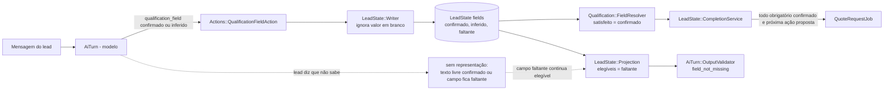

# SPEC: scansolo-proposta-template-local

## Metadata
- Source: developer description via /plan. Fonte de verdade: `.spec/features/scansolo-proposta-template-local/.handoff/input.md` (pedido de 2026-10-13, auditoria AS IS no HEAD `3953f9f176`, decisões do desenvolvedor, 9 decisões de desenho propostas, ACs 1–8 confirmados e ACs 9–10 em rascunho).
- Service: ss-aiagentsystem (fork do Chatwoot, monólito Rails 7.2 + Vue 3, namespace `ScanSolo::`). Há requisitos operacionais na VPS de produção (Docker Compose) e no template `.docx`, preparado fora do repositório.
- Tier: complete
- Version: 1.2
- Changelog:
  - 1.0 (2026-10-13): versão inicial com 3 marcadores em aberto (M-01..M-03).
  - 1.1 (2026-10-13): respostas do desenvolvedor (`.handoff/clarifier-answers.md`). Premissa corrigida: qualificação do agente ≠ validação do template. Entra a Parte A (status `nao_informado` na qualificação, RF-24..RF-31) separada da Parte B (geração local, RF-01..RF-23). M-01 e M-02 substituídos pela premissa (nenhum campo de qualificação bloqueia a geração; `{{TRECHO_PROFUNDIDADE}}`; textos neutros). M-03 resolvido (a). Q-04 (`cause`/`placeholders` na auditoria), Q-05 (blob fora da transação), Q-07 (16 placeholders do v3) e Q-08 (AC do upload depois de `template_unavailable`) aplicados. Q-06 aplicado como decisão provisória D-01. 0 marcadores.
  - 1.2 (2026-10-13): Round 2 do clarifier. D-02, D-03 e D-04 decididos. Novos RF-32 (valor `nao_informado` não é espelhado no contato), RF-33 (todo leitor trata `nao_informado` como ausente para fins de valor) e UI-03 (rótulo do status na tela). RF-31 alterado (itens fixos do `SO/CT-07` com sufixo). D-01 continua a única decisão a confirmar. 0 marcadores.
- Respostas do desenvolvedor: `.spec/features/scansolo-proposta-template-local/.handoff/clarifier-answers.md`.
- Features relacionadas (prefixos usados aqui):
  - **OC** = `.spec/features/scansolo-operacao-centralizada/SPEC.md` (bloco de resposta `OC/CT-04`, payload Make `OC/CT-05`, número da proposta `OC/RF-26`, valor por extenso `OC/RF-47`).
  - **AP** = `.spec/features/scansolo-proposta-aprovacao-email/SPEC.md` (aprovação, entrega, retry, auditoria de geração).
  - **SO** = `.spec/features/scansolo-solicitacao-orcamento-email/SPEC.md` (regras de endereço/bairro e cidade/UF reaproveitadas; renderização dos campos no e-mail de solicitação).
  - **LS** = `.spec/features/scansolo-agent-lead-state/SPEC.md` (estado do lead: status de campo, satisfação, elegibilidade, conclusão da qualificação, ação `qualification_field`).
  - Os ids sem prefixo são desta feature.
- Architecture references: `AGENTS.md` (idêntico a `CLAUDE.md`), `docs/agents/architecture.md`, `docs/agents/domain_rules.md`, `docs/agents/api_contracts.md`, `docs/agents/data_model.md`, `docs/architecture/SCANSOLO_DEPLOYMENT.md`
- Init chain: ausente
- Restrição de publicação: o repositório é público. Nenhum template real, dado bancário, CNPJ real ou segredo entra no Git, em fixture, em log ou em payload de auditoria (RNF-04).

### Requisitos de outras features alterados ou preservados

| Id | Situação | Onde |
|---|---|---|
| Regra "Provider" de `docs/agents/domain_rules.md:351` (Make quando há credenciais; `MockProvider` em dev/test; senão `ProposalIntegrationNotConfigured`) | **Alterada.** Entra o modo local, que tem precedência sobre o Make. Sem a variável do modo local, a seleção atual fica igual. | RF-01, CT-09 |
| `OC/CT-04` (bloco de resposta) e `ResponseBlockParser` | **Preservados sem mudança.** A resposta comercial continua sendo a única fonte de valor, prazo, escopo, pagamento e observações. | RF-05, CT-03 |
| `OC/CT-05` (request `proposal.generate` ao Make) e `AP/CT-08` (callback) | **Preservados no código e não emitidos no modo local.** `MakeProvider`, o webhook `webhooks/scan_solo/make` e `MakeRequest` não mudam de comportamento. | RF-16 |
| `OC/RF-26` (número da proposta gerado pelo Rails) | **Preservado.** `proposal_number` continua gerado no `after_create`, antes do provider (verified at `app/models/scan_solo/proposal_version.rb:99,145`). | CT-03 |
| `OC/RF-47` (valor por extenso determinístico) | **Preservado e reaproveitado** em `{{VALOR_EXTENSO}}` (`ScanSolo::Quote::AmountInWords`, verified at `app/services/scan_solo/quote/amount_in_words.rb:10`). | CT-03 |
| `AP/RF-01`, `AP/RF-02` (resultado de sucesso → `awaiting_approval` → PDF no ActiveStorage → e-mail de aprovação) | **Preservados.** No modo local o PDF já está anexado quando o resultado é aplicado, então o `ApprovalRequestService` não baixa nada (verified at `app/services/scan_solo/proposal/approval_request_service.rb:52`). | RF-10, RF-15 |
| `AP/RF-04`..`AP/RF-14` (aprovação humana, entrega por e-mail, `sent`, aviso, estágio, follow-up) | **Preservados sem mudança.** | RF-15 |
| `AP/RF-15(b)` (retry de falha de geração "regenerar pelo Make") | **Alterado.** O retry regenera pelo provider ativo (local quando o modo local está ligado). `template_unavailable`, `template_render_failed` e `provider_rejected` entram em `SAFE_RETRYABLE_REASONS`. Como a constante é única, `provider_rejected` também passa a ser reprocessável no modo Make. | RF-13 |
| `AP/RF-20` (auditoria `proposal.generation_failed`) | **Preservado e estendido** aos motivos novos do modo local. O payload ganha `cause` e, quando houver, `placeholders` (só nomes). | RF-11, RF-12, CT-07 |
| `LS/RF-07` (status pela origem; `inferido` nunca substitui `confirmado`) e `LeadState::FIELD_STATUSES` (`confirmado \| inferido \| faltante`, verified at `app/models/scan_solo/lead_state.rb:8`) | **Alterado.** Entra o status `nao_informado` e a precedência do RF-27 no `Writer` (verified at `app/services/scan_solo/lead_state/writer.rb:9-11`). | RF-25, RF-27 |
| `LS/RF-08` (satisfeito ⇔ `confirmado` no `FieldResolver`, inclusive o gate de proposta) | **Alterado.** Satisfeito ⇔ `confirmado` ou `nao_informado`. `inferido` continua não satisfeito (`LS/RF-04` preservado). O gate de proposta do `GenerateService` continua existindo e usa a regra nova (D-02, decidido). | RF-28 |
| `LS/RF-12` e `OutputValidator` (`field_not_missing`: chave perguntada fora do catálogo ou não `faltante`, verified at `app/services/scan_solo/ai_turn/output_validator.rb:76`) e elegíveis = só `faltante` (verified at `app/services/scan_solo/lead_state/projection.rb:109`) | **Preservados no código; efeito novo.** Um campo `nao_informado` não é elegível e perguntá-lo é `field_not_missing` (regenera a resposta). | RF-29 |
| `LS/RF-21` (conclusão quando todo obrigatório está `confirmado`; `QuoteRequestJob` com próxima ação `proposta`) | **Alterado no gatilho.** Conclui quando todo obrigatório está `confirmado` ou `nao_informado`. O resto do `LS/RF-21` não muda. | RF-30 |
| `LS/CT-03` (schema da ação `qualification_field`: status `confirmado \| inferido`, verified at `app/services/scan_solo/actions/qualification_field_action.rb`) | **Alterado (aditivo).** Status `confirmado \| inferido \| nao_informado`. | RF-26 |
| `LS/CT-01` (`lead_state` exposto na API da oportunidade) | **Alterado (aditivo).** O campo `status` pode valer `nao_informado`. | RF-25 |
| `LS/RF-17` regras fixas de continuidade (`PromptBuilder::CONTINUITY_RULES`, verified at `app/services/scan_solo/ai_turn/prompt_builder.rb:26-34`) | **Alterado (aditivo).** Entra 1 regra fixa sobre `nao_informado`. | RF-26 |
| `SO/RF-05`, `SO/RF-06` (linha opcional sem valor omitida; valores citados como estão; `inferido` → "(a confirmar)") e `SO/RF-08`/`SO/CT-07` (INFORMAÇÕES AINDA NÃO CONFIRMADAS) | **Alterados.** Um campo `nao_informado` mostra "<rótulo>: Não informado pelo cliente" na linha (inclusive opcional) e entra na lista com o sufixo "(cliente não soube informar)", como item fixo do `SO/CT-07` que ele cobriria ou pelo rótulo. | RF-31 |
| `LS/RF-08` decisão M6-b (todo valor aplicado pela ação `qualification_field` é espelhado no `Contact`, verified at `app/services/scan_solo/actions/qualification_field_action.rb:113-140`) | **Alterado.** Um valor `nao_informado` não é espelhado (nem coluna nativa nem `custom_attributes`). | RF-32 |
| `FieldResolver#resolve`/`#collected`/`#make_qualification` (verified at `field_resolver.rb:181-183,201-205,222-226`) e seus leitores `AiTurn::ContextAssembler#pipeline_context` (verified at `app/services/scan_solo/ai_turn/context_assembler.rb:145-146`) e `Handoff::HandoffService#qualification_fields` (verified at `app/services/scan_solo/handoff/handoff_service.rb:108-116`) | **Alterados.** `nao_informado` é ausente como valor: `collected`, contexto do turno e nota de handoff mostram "<rótulo>: não informado pelo cliente"; `make_qualification` (`OC/CT-05`) omite a chave. | RF-33 |
| `Quote::EmailComposer#lead_name` (verified at `email_composer.rb:122-125`) e `Notifications::NegotiationPayload.contact` (verified at `negotiation_payload.rb:25-28`, `OC/CT-07`) | **Alterados.** `empresa` `nao_informado` é ausente: `lead_name` fica só com o nome do contato e `company` é `null`. | RF-33 |
| Partial `_pipeline_opportunity.json.jbuilder` (cartão: `company`, `service`, `city_uf`, verified at `:26-33`; `lead_state` do `LS/CT-01`) e `OpportunityDetail.vue`/`FIELD_STATUS_LABELS` (verified at `OpportunityDetail.vue:112-119`, `scansoloLabels.js:195-197`) | **Alterados.** O `lead_state` expõe `status: "nao_informado"` com o `value` (auditoria); o cartão trata o campo como ausente (`null`); a tela mostra o rótulo neutro. | RF-33, UI-03 |
| `AP/RF-25` (`artifact_sha256` e `template_version`) | **Preservado.** O modo local sempre preenche os 2 campos. | RF-10, RF-20 |
| `AP/RNF-01` (0 e-mails, downloads e HTTP ao Make dentro de transação) | **Preservado e estendido** à chamada ao Gotenberg. | RNF-02 |

### Regras de arquitetura aplicadas (citadas)
- `docs/agents/architecture.md`, "Layer responsibilities": `services/scan_solo/*` são donos de "Every write and business rule; one 'sole path' service per state change"; `jobs/scan_solo/*` são donos de "Async boundary, locking"; os controllers são donos do gate `scansolo_enabled` (404), do Pundit (403) e da "request-boundary 422 validation". Por isso a conversão roda num job (fronteira assíncrona), o resultado é aplicado só pelo `ScanSolo::Proposal::CallbackHandler` (único escritor de valor/artefato, verified at `app/services/scan_solo/proposal/callback_handler.rb:1-8,25-46`) e o upload do template valida o arquivo no controller e devolve 422.
- `docs/agents/architecture.md`, "Macro flow: quote to proposal": `valid block ─> GenerateService ─> MakeProvider ─> OutboundRequestService ─> Make` e `CallbackHandler (… awaiting_approval) ─after commit─> ProposalApprovalRequestJob ─> ApprovalRequestService`. Esta feature troca só o trecho `MakeProvider ─> … ─> Make ─> webhook` por um provider local, e entra de novo no fluxo pelo mesmo `CallbackHandler`.
- `docs/agents/domain_rules.md`, "Proposal lifecycle": "Only the provider callback writes commercial `value`", "Per version: ≤ 1 approval request", "Versions: … ≤ 1 non-terminal version per quote request (partial unique index)" e "The approval is always required". O RF-10 escreve valor e artefato só pelo `CallbackHandler`; o RF-14 se apoia nos índices existentes.
- `docs/agents/domain_rules.md:380`, "Proposal retry and dead letter": "HTTP 5xx maps to `provider_unavailable` and 4xx to `provider_rejected`" e "Every generation failure … audits `proposal.generation_failed`". O RF-11 aplica o mesmo mapeamento às respostas do Gotenberg.
- `AGENTS.md`, "General Guidelines": "Prefer existing repo dependencies/client libraries" (cliente HTTP `rest-client`, verified at `Gemfile:21`; leitura de PDF `pdf-reader`, verified at `Gemfile:39`), "Validate request parameters at the controller or request boundary … `422`" (RF-17) e "When an impossible or misconfigured state would indicate a setup/deployment bug, let it fail loudly" (RF-01: sem modo local e sem Make em produção continua `ProposalIntegrationNotConfigured`).
- `AGENTS.md`, "Enterprise Edition Notes": não há arquivo ScanSolo de proposta em `enterprise/` (verificado: `enterprise/app/services` sem `scan_solo`). Nenhum override é necessário.

## Context
Hoje a geração da proposta é feita pelo Make. Quando a resposta do comercial traz um bloco `OC/CT-04` válido, o `ScanSolo::Quote::ReplyProcessor` chama o `ScanSolo::Proposal::GenerateService` (verified at `app/services/scan_solo/quote/reply_processor.rb:84-98`). Ele cria a `ProposalVersion` dentro de uma transação e, depois do commit, chama `provider.request_generation` (verified at `app/services/scan_solo/proposal/generate_service.rb:33-41`). O provider vem de `ScanSolo::Proposal::Integration.provider!` (verified at `app/services/scan_solo/proposal/integration.rb:12-17`): `MakeProvider` com as credenciais `scan_solo.make.*`, `MockProvider` em test/dev e, fora disso, `ProposalIntegrationNotConfigured` (422 `proposal_integration_not_configured`, verified at `app/controllers/api/v1/accounts/scan_solo/base_controller.rb:7-9`). O Make devolve o resultado pelo webhook, e o `CallbackHandler.apply_generate_result!` leva a versão a `awaiting_approval`. Depois do commit, o `ApprovalRequestService` baixa o PDF de `artifact_url` para `ProposalVersion#document` e envia o e-mail de aprovação ao comercial. A aprovação humana (`ApproveService`) e o envio ao lead (`DeliveryService`) já existem e não chamam o Make.

O Make vai ser abandonado para geração: o Google Workspace será cancelado, e o cenário `ScanSOLO_Proposta_Entrada` está desligado. Esta feature cria um provider local que faz a mesma responsabilidade (dados → documento → PDF → artefato). Ele renderiza de forma determinística um template `.docx` enviado pelo sistema e guardado no ActiveStorage, converte o resultado em PDF no Gotenberg (LibreOffice), anexa o PDF à versão e entrega o resultado ao mesmo `CallbackHandler`. Todo o resto do fluxo (aprovação, entrega, aviso, estágio, follow-up, retry, auditoria) é reaproveitado sem um segundo fluxo, tabela de proposta ou sistema de aprovação.

Achados do código usados no SPEC:
- O contrato do provider é o método de classe `request_generation(proposal_version:, correlation_id:, actor: nil, retry_count: 0, **)`, e o retorno é ignorado. Quem chama: `GenerateService` (verified at `generate_service.rb:41`), `RetryPolicy#retry_generate!` (verified at `app/services/scan_solo/proposal/retry_policy.rb:111-117`) e `Actions::ProposalActions` com um wrapper pós-commit (verified at `app/services/scan_solo/actions/proposal_actions.rb:35-43`).
- `CallbackHandler.apply_generate_result!` aplica o resultado sob lock só quando o `correlation_id` é igual ao `generate_correlation_id` e `generate_callback_applied_at` está vazio. No sucesso, grava `value`, `currency`, `artifact_url`, `valid_until` e `artifact_sha256`, audita `proposal.generated` (com `template_version`) e enfileira `ProposalApprovalRequestJob` depois do commit. Na falha, marca `failed` com `failure_reason` e audita `proposal.generation_failed` (verified at `callback_handler.rb:25-46`).
- `ApprovalRequestService#store_document` não baixa nada se `document.attached?` (fora do redownload). `checksum_matches?` compara o SHA-256 do documento com `artifact_sha256` quando ele existe (verified at `approval_request_service.rb:51-69`).
- Uma exceção dentro de um provider hoje deixa a versão presa em `generating`. Não há sweeper, e o `RetryPolicy` só aceita `failed` com `SAFE_RETRYABLE_REASONS = %w[timeout network_error provider_unavailable]` (verified at `retry_policy.rb:31-40`).
- A contagem de retry e o dead letter vêm do `MakeRequest` da versão (`ProposalVersion#make_request`, verified at `proposal_version.rb:112-114`, lido em `retry_policy.rb:73-79`). No modo local não existe `MakeRequest`, então a contagem fica 0 e o dead letter nunca se aplica.
- Uma versão `failed` bloqueia nova geração para a mesma solicitação: `QuoteRequest#generation_open?` só é verdadeiro quando todas as versões estão `rejected` (verified at `app/models/scan_solo/quote_request.rb:64-66`). Uma falha não reprocessável deixa a solicitação sem caminho de geração (por isso o RF-13 torna reprocessáveis todos os motivos do modo local).
- `QuoteRequest#commercial` (jsonb) tem `total_value`, `schedule`, `scope` e `payment_terms` obrigatórios, e `notes` opcional (verified at `app/services/scan_solo/quote/response_block_parser.rb:23,40-43`).
- Os dados de qualificação seguem a precedência do `FieldResolver` (lead state não `faltante` → coluna nativa do contato → `custom_attributes`). As chaves `empresa`, `nome`, `cliente_final`, `endereco_obra`, `bairro`, `cidade_uf`, `profundidade` e `profundidade_intervencao` existem no catálogo (verified at `app/services/scan_solo/qualification/field_resolver.rb:26,36-39,44-45`).
- `Integration.state` hoje não depende da conta. Ele alimenta o check `proposal_integration` do smoke e do endpoint de status (verified at `app/services/scan_solo/status_report.rb:52-54,71`, `app/views/api/v1/accounts/scan_solo/status/show.json.jbuilder:8`, `lib/tasks/scansolo.rake:41-47`) e o `integration_state` de cada proposta (verified at `app/views/api/v1/accounts/scan_solo/proposals/_proposal.json.jbuilder:5`). A tela de Propostas desabilita Gerar e Reprocessar quando o estado é `blocked` (verified at `app/javascript/dashboard/routes/dashboard/scansolo/proposals/Proposals.vue:62-66,258,335`).
- O texto do aviso e o rótulo `PROVIDER_UNAVAILABLE` citam o Make (verified at `app/javascript/dashboard/i18n/locale/en/scansolo.json:358,569`).
- O Gotenberg não existe no projeto. Não há `rubyzip` nem biblioteca de `.docx` no `Gemfile.lock`. A variável `SCANSOLO_GOTENBERG_URL` e a tabela `scan_solo_proposal_templates` não existem (verificado por grep em `app`, `lib`, `config`, `db/schema.rb`, `.env.example` e `docker-compose*.yaml`). São literais novos desta feature.
- O padrão de upload existente é `KnowledgeCenter.vue` com `FormData` (verified at `app/javascript/dashboard/routes/dashboard/scansolo/knowledge/KnowledgeCenter.vue:72-77`), com escrita só por administrador (`ScanSolo::KnowledgeSourcePolicy#create?`).
- Produção: Docker Compose (`docker-compose.production.yaml` + `docker-compose.scansolo.yaml`). Rails e Sidekiq leem `.env` (verified at `docker-compose.production.yaml:9`). O ActiveStorage é `local`, no volume `storage_data` (verified at `.env.example:148`, `docs/architecture/SCANSOLO_DEPLOYMENT.md:38`).

## AS IS — Estado atual

```mermaid
flowchart LR
  RP["Quote::ReplyProcessor"] -->|"bloco OC/CT-04 válido"| GS["Proposal::GenerateService"]
  RTY["Proposal::RetryPolicy"] -->|"retry_generate!"| SEL
  GS -->|"provider!"| SEL["Proposal::Integration"]
  SEL -->|"credenciais Make"| MP["Proposal::MakeProvider"]
  SEL -->|"dev ou test"| MOCK["Proposal::MockProvider"]
  MP --> ORS["Make::OutboundRequestService"]
  ORS -->|"proposal.generate OC/CT-05"| MAKE["Make - cenário Entrada"]
  MAKE -->|"POST webhook AP/CT-08"| CV["Make::CallbackVerifier"]
  CV --> CAS["Make::CallbackApplicationService"]
  CAS --> CH["Proposal::CallbackHandler"]
  MOCK --> CH
  CH -->|"after commit"| ARJ["ProposalApprovalRequestJob"]
  ARJ --> ARS["Proposal::ApprovalRequestService"]
  ARS -->|"SafeFetch artifact_url"| DOC[("ProposalVersion document<br/>ActiveStorage")]
  ARS -->|"e-mail AP/CT-05 com PDF"| LUC["Comercial"]
  LUC -->|"Aprovar na tela"| APS["Proposal::ApproveService"]
  APS -->|"after commit"| DS["Proposal::DeliveryService"]
  DS -->|"e-mail AP/CT-06 com PDF"| LEAD["Lead"]
```

Hoje o Make gera o documento a partir do payload `OC/CT-05` e devolve a URL do PDF pelo webhook. O `CallbackHandler` leva a versão a `awaiting_approval`, e o `ApprovalRequestService` baixa o PDF para o ActiveStorage antes do e-mail de aprovação. Aprovação e entrega já não dependem do Make.

### AS IS — Qualificação do agente (auditoria de 2026-10-13, HEAD `3953f9f176`)

Achados verificados no código:
- Catálogo fechado de 34 chaves em `ScanSolo::Qualification::FieldResolver::CATALOG` (verified at `app/services/scan_solo/qualification/field_resolver.rb:24-59`).
- Obrigatórios = lista por conta `required_qualification_fields` da config publicada, com rótulos levados à chave canônica por alias (verified at `field_resolver.rb:164`). O valor de produção não está no repositório. A profundidade só é obrigatória se estiver nessa lista; o código não a força.
- Status de campo: só `confirmado | inferido | faltante` (verified at `app/models/scan_solo/lead_state.rb:8`). `Writer#apply_field!` ignora valor em branco (verified at `app/services/scan_solo/lead_state/writer.rb:22-23`) e só recusa `inferido` sobre `confirmado` (verified at `writer.rb:9-11`). O schema da ação `qualification_field` aceita só `confirmado`/`inferido` (verified at `app/services/scan_solo/actions/qualification_field_action.rb`, `SCHEMA`).
- Satisfeito = `confirmado` (verified at `field_resolver.rb:173`). O `CompletionService` conclui quando todo obrigatório está satisfeito e só então, com próxima ação `proposta`, enfileira o `QuoteRequestJob` depois do commit (verified at `app/services/scan_solo/lead_state/completion_service.rb:37-49,60-75`). O gate de proposta do `GenerateService` usa `proposal_gate_missing_labels`: com qualificação `concluida`, bloqueia só obrigatório `faltante` (verified at `field_resolver.rb:192-196`, `app/services/scan_solo/proposal/generate_service.rb:69-71`).
- Elegíveis para pergunta = só `faltante` (verified at `app/services/scan_solo/lead_state/projection.rb:106-110`). O `OutputValidator` marca `field_not_missing` quando a resposta pergunta campo não `faltante` e regenera a tentativa (verified at `app/services/scan_solo/ai_turn/output_validator.rb:36,76`). A regra "Nunca pergunte novamente informação já presente …" é só instrução de prompt (verified at `app/services/scan_solo/ai_turn/prompt_builder.rb:26-34`).
- Não existe representação de "não sei / não tenho / ainda não definido / não se aplica". O modelo grava um texto livre como `confirmado` (não instruído, não determinístico) ou deixa `faltante`; nesse caso o campo continua elegível, pode ser perguntado de novo sem fim e a qualificação nunca conclui. `PromptBuilder::NOT_INFORMED` é só texto de exibição (verified at `prompt_builder.rb:20`).
- Consumidores que leem o estado do lead com a regra "status ≠ `faltante` → usa o valor": `FieldResolver#resolve` (verified at `field_resolver.rb:224`), `Quote::RequestEmail::Snapshot#field` (verified at `app/services/scan_solo/quote/request_email/snapshot.rb:58-59`), `Quote::EmailComposer#lead_name` (verified at `app/services/scan_solo/quote/email_composer.rb:124`), `Notifications::NegotiationPayload.contact` (verified at `app/services/scan_solo/notifications/negotiation_payload.rb:27`) e o partial da oportunidade (verified at `app/views/api/v1/accounts/scan_solo/pipeline_opportunities/_pipeline_opportunity.json.jbuilder:32`). O rótulo de status na tela vem de `FIELD_STATUSES` (verified at `app/javascript/dashboard/routes/dashboard/scansolo/scansoloLabels.js:195-197`).
- Um rótulo obrigatório fora do catálogo fica sempre `faltante` (verified at `field_resolver.rb:212`) e não pode ser gravado no estado do lead. Esse comportamento atual não muda nesta feature.

## TO BE — Estado proposto

```mermaid
flowchart LR
  RP["Quote::ReplyProcessor"] -->|"bloco OC/CT-04 válido"| GS["Proposal::GenerateService"]
  RTY["Proposal::RetryPolicy (alterado)"] -->|"retry_generate!"| SEL
  GS -->|"provider!"| SEL["Proposal::Integration (alterado)"]
  SEL -->|"SCANSOLO_GOTENBERG_URL definida"| NEW_LP["Provider local (novo)"]
  SEL -.->|"sem modo local e credenciais Make"| MP["Proposal::MakeProvider"]
  SEL -->|"dev ou test sem modo local"| MOCK["Proposal::MockProvider"]
  MP -.-> MAKE["Make - inalterado e não chamado no modo local"]
  NEW_LP -->|"enfileira após commit"| NEW_JOB["Job de geração local (novo)<br/>fila medium"]
  NEW_JOB -->|"lê template ativo da conta"| NEW_TPL[("Template docx da conta (novo)<br/>ActiveStorage")]
  NEW_JOB -->|"render determinístico CT-03"| NEW_RND["Render docx (novo)"]
  NEW_RND -->|"POST forms libreoffice convert CT-04"| NEW_GOT["Gotenberg (novo)<br/>rede interna"]
  NEW_JOB -->|"anexa PDF"| DOC[("ProposalVersion document<br/>ActiveStorage")]
  NEW_JOB -->|"apply_generate_result!"| CH["Proposal::CallbackHandler"]
  MOCK --> CH
  CH -->|"after commit"| ARJ["ProposalApprovalRequestJob"]
  ARJ --> ARS["Proposal::ApprovalRequestService"]
  ARS -->|"PDF já anexado - sem download"| DOC
  ARS -->|"e-mail AP/CT-05 com PDF"| LUC["Comercial"]
  LUC -->|"Aprovar na tela"| APS["Proposal::ApproveService"]
  APS -->|"after commit"| DS["Proposal::DeliveryService"]
  DS -->|"e-mail AP/CT-06 com PDF"| LEAD["Lead"]
  NEW_CARD["Cartão de template em Proposals.vue (novo)"] -->|"POST proposal_template CT-05"| NEW_API["API de template (novo)"]
  NEW_API -->|"valida e ativa"| NEW_TPL
```

No estado proposto, a seleção do provider passa a ter o modo local com precedência sobre o Make (RF-01, CT-09). O provider local só enfileira um job (RF-02). O job revalida a versão (RF-03), lê o template ativo da conta (RF-04, CT-06), renderiza os 16 placeholders de forma determinística (RF-05 a RF-08, CT-03), converte no Gotenberg (RF-09, CT-04), anexa o PDF e entrega o resultado ao `CallbackHandler` existente (RF-10). As falhas sempre terminam em `failed` (RF-11, RF-12, CT-07). O template é enviado e validado pela API e pelo cartão novo da tela de Propostas (RF-17, RF-18, UI-01, CT-05). Do `CallbackHandler` em diante, nada muda (RF-15). Nenhum campo de qualificação bloqueia esse fluxo: dado ausente vira texto neutro ou omissão de trecho (RF-07, CT-03).

### TO BE — Qualificação com ausência explícita (Parte A)

```mermaid
flowchart LR
  MSG["Mensagem do lead"] --> TURN["AiTurn - modelo<br/>regra fixa nova de prompt"]
  TURN -->|"qualification_field confirmado, inferido ou nao_informado (alterado)"| ACT["Actions::QualificationFieldAction (alterado)"]
  ACT --> WR["LeadState::Writer (alterado)<br/>precedência RF-27"]
  WR --> LS[("LeadState fields<br/>+ nao_informado (alterado)")]
  LS --> FR["Qualification::FieldResolver (alterado)<br/>satisfeito = confirmado ou nao_informado"]
  FR --> CS["LeadState::CompletionService"]
  CS -->|"todo obrigatório satisfeito e próxima ação proposta"| QRJ["QuoteRequestJob - 1 vez"]
  QRJ --> SOE["E-mail de solicitação (alterado)<br/>Não informado pelo cliente"]
  LS --> PRJ["LeadState::Projection<br/>elegíveis = só faltante"]
  PRJ --> OV["AiTurn::OutputValidator<br/>perguntar nao_informado = field_not_missing"]
  SOE -.->|"resposta OC/CT-04 válida"| PB["Parte B - geração local<br/>não valida qualificação"]
```

A Parte A muda só a qualificação do agente: o lead pode responder que não sabe, não tem, ainda não definiu ou que não se aplica, e isso conta como resposta válida (RF-25 a RF-33, UI-03). As palavras do lead ficam só no estado do lead, para auditoria: nenhum leitor as usa como dado (RF-32, RF-33). A Parte B só renderiza o que a Parte A e a resposta comercial entregaram (RF-24).

## Scope
- **In**:
  - Parte A: status de campo `nao_informado` (ausência explícita declarada pelo lead) no estado do lead, na ação `qualification_field`, no `Writer`, na satisfação do `FieldResolver`, na regra fixa de prompt, no e-mail de solicitação de orçamento, no espelho no contato (não espelha), nos leitores do estado do lead (contexto do turno, handoff, payloads Make e de negociação, cartão da oportunidade) e no rótulo da tela. Sem migração (`fields` é jsonb).
  - Parte B: modo local de geração selecionado por `SCANSOLO_GOTENBERG_URL`, com precedência sobre o Make.
  - Provider local que segue o contrato `request_generation` e só enfileira um job assíncrono.
  - Job de geração: revalidação idempotente, leitura do template ativo da conta, render determinístico do `.docx`, conversão no Gotenberg, validação do PDF, anexo em `ProposalVersion#document` e aplicação do resultado pelo `CallbackHandler`.
  - Tratamento de falhas sem deixar a versão em `generating`, com motivos novos `template_unavailable` e `template_render_failed`.
  - `template_unavailable`, `template_render_failed` e `provider_rejected` como motivos seguros de retry no `RetryPolicy` existente.
  - Tabela pequena de templates por conta (não é tabela de proposta), API de leitura e upload com validação, e cartão na tela de Propostas.
  - `Integration.state` por conta e smoke `proposal_integration` no modo local.
  - Serviço `gotenberg` no overlay `docker-compose.scansolo.yaml`, variável documentada no `.env.example` e nova gem `rubyzip`.
  - Textos de UI neutros (sem "Make") no aviso de integração e no rótulo de indisponibilidade, mais rótulos dos motivos novos.
  - Atualização de `docs/agents/architecture.md`, `docs/agents/domain_rules.md`, `docs/agents/api_contracts.md`, `docs/agents/data_model.md` e `docs/architecture/SCANSOLO_DEPLOYMENT.md`.
- **Out**:
  - Segundo fluxo, tabela, sistema de aprovação ou pipeline de proposta; chamadas paralelas ao Make e ao provider local.
  - Mudanças em `MakeProvider`, `OutboundRequestService`, webhook `webhooks/scan_solo/make`, `CallbackVerifier`, `CallbackApplicationService` e `MakeRequest`. A remoção do código do Make fica para outra feature.
  - Mudanças em `ApproveService`, `RejectService`, `DeliveryService`, `SuccessHandler`, `LeadNoticeService`, `FollowUpService`, no bloco `OC/CT-04` e no parser.
  - LLM em qualquer ponto da geração (preço, desconto, condição, texto).
  - Commit do template real, de dados bancários ou de CNPJ real; preparação do template v3 (feita fora do repositório, HG-T1).
  - Download, exclusão ou tela de histórico de templates; edição do template no sistema.
  - Sweeper de versões presas em `generating` por processo morto (Sidekiq encerrado no meio do job). Esse comportamento atual não muda.
  - Versões que já estão em `generating` pelo Make no momento da troca de modo.
  - Mudar a lista `required_qualification_fields` de qualquer conta, migrar ou reclassificar estados de lead antigos e tratar rótulos obrigatórios fora do catálogo.
  - Qualquer validação de qualificação no template ou no provider local.
  - Merge, deploy, migração em produção, envio de proposta real, alteração de segredos e qualquer ação no Make durante a implementação (decisão do desenvolvedor).

## RIGID (Non-Negotiable)

### Functional Requirements

Os ids foram preservados da versão 1.0 para rastreabilidade: a Parte B usa RF-01..RF-23 e a Parte A usa RF-25..RF-33 e UI-03. O RF-24 é a regra de separação entre as duas.

#### Regra de separação (premissa do desenvolvedor)

- RF-24 [Ubíquo] (premissa corrigida em 2026-10-13): A qualificação do agente (Parte A) e a geração da proposta (Parte B) DEVEM ser separadas. O template e o provider local NUNCA DEVEM validar, completar ou reinventar a qualificação, e nenhum campo de qualificação, ausente ou `nao_informado`, DEVE bloquear ou falhar a geração. Na Parte B, só bloqueiam a geração: (1) a validade da resposta comercial (valor total, prazo/cronograma, escopo/atividades e condições de pagamento), já garantida pelo `OC/CT-04` e pelo `ResponseBlockParser` antes de a versão existir, e uma versão sem `commercial` (RF-07); (2) falhas técnicas: template indisponível (RF-04), template ou render inválido (RF-08), conversão (RF-09, RF-11) e exceção (RF-12). O gate de campos obrigatórios que já existe no `GenerateService` antes da criação da versão (`LS/RF-08`) não faz parte da Parte B, continua existindo e segue a regra de satisfação do RF-28 (D-02, decidido).
  - AC: spec. Versão com resposta comercial válida e todos os campos de qualificação `faltante` ou `nao_informado` no estado do lead e vazios no contato → job local → `awaiting_approval`, PDF anexado e 0 `proposal.generation_failed`. O código da Parte B não chama `FieldResolver#missing_labels`, `#proposal_gate_missing_labels` nem `CompletionService`.

### Parte A — Qualificação com ausência explícita (agente)

- RF-25 [Ubíquo] (premissa, item 2; altera `LS/RF-07` e `LeadState::FIELD_STATUSES`): O estado de um campo de qualificação DEVE ter um destes 4 status: `confirmado`, `inferido`, `faltante` ou `nao_informado`. `nao_informado` significa que o lead declarou explicitamente que não sabe, não tem, ainda não definiu ou que o campo não se aplica, e conta como resposta válida. O valor de um campo `nao_informado` são as palavras do lead (não vazio, `strip`), gravadas pelo `ScanSolo::LeadState::Writer` com 1 evento de histórico e a mensagem de origem, como os outros status. Não há migração: estados gravados antes continuam válidos sem mudança, e `nao_informado` aparece no `status` do `lead_state` da API (`LS/CT-01`, aditivo).
  - AC: spec. `ScanSolo::LeadState::FIELD_STATUSES` = `%w[confirmado inferido faltante nao_informado]`. Um estado gravado antes com `{status: 'confirmado'}` continua lido igual. Após o RF-26, o `lead_state` da oportunidade na API mostra `status: "nao_informado"` para o campo.

- RF-26 [Evento] (premissa, item 2; altera `LS/CT-03` e `LS/RF-17`): QUANDO a mensagem do lead disser explicitamente que ele não sabe, não tem, ainda não definiu ou que não se aplica uma informação de um campo do catálogo, O SISTEMA DEVE permitir que o modelo registre o campo pela ação `qualification_field` com `{value: <palavras do lead>, status: "nao_informado"}`. O schema da ação DEVE aceitar o status `confirmado | inferido | nao_informado`, e a forma curta só com string continua sendo `confirmado`. As regras fixas de continuidade do `PromptBuilder` (código, não editáveis pela config) DEVEM incluir a regra: "Se o cliente disser que não sabe, não tem, ainda não definiu ou não se aplica, registre o campo com status nao_informado e não pergunte de novo."
  - AC: spec. Ação com `{profundidade: {value: "não sei", status: "nao_informado"}}` sobre `profundidade` `faltante` → status `nao_informado`, valor `não sei`, 1 `LeadStateEvent` com o id da mensagem do turno. Ação com `status: "desconhecido"` → recusada pelo schema, 0 escritas. O payload do turno tem a regra fixa acima, igual caractere a caractere, em toda tentativa.

- RF-27 [Ubíquo] (premissa; altera `LS/RF-07`): O `Writer` DEVE aplicar esta precedência entre o status atual e o novo, e manter as outras transições como hoje: `confirmado` substitui `nao_informado` (o lead informou depois); `nao_informado` substitui `faltante` e `inferido`; `nao_informado` NUNCA substitui `confirmado`; `inferido` NUNCA substitui `nao_informado` nem `confirmado`. Uma escrita recusada não muda valor, status nem histórico. A mesma regra vale para a sobreposição em memória da `LeadState::Projection` (verified at `projection.rb:63`, que usa `Writer.applicable?`).
  - AC: spec (1 exemplo por linha). `nao_informado` "não sei" + `confirmado` "3 m" → `confirmado` "3 m", 1 evento novo. `faltante` + `nao_informado` → `nao_informado`. `inferido` "2 m" + `nao_informado` "não sei" → `nao_informado`. `confirmado` "3 m" + `nao_informado` "não sei" → continua `confirmado` "3 m", 0 eventos. `nao_informado` + `inferido` "2 m" (ação ou extração de anexo) → continua `nao_informado`, 0 eventos. `confirmado` + `inferido` → continua `confirmado` (regra atual).

- RF-28 [Ubíquo] (premissa, item 3; altera `LS/RF-08`): O `FieldResolver` DEVE considerar satisfeito um campo com status `confirmado` ou `nao_informado`. `inferido` e `faltante` continuam não satisfeitos (`LS/RF-04` preservado). A regra vale para todos os consumidores do resolvedor: `fields`/`missing_labels` (conclusão, contexto do turno, detector de resposta da cadência, pendências do e-mail de solicitação) e `proposal_gate_missing_labels` (gate do `GenerateService`). Com a qualificação `concluida`, o gate continua bloqueando só obrigatório `faltante`.
  - AC: spec. Config exige `Empresa` e `Profundidade de investigação`; `empresa` `confirmado` e `profundidade` `nao_informado` → `missing_labels` vazio. `profundidade` `inferido` → `missing_labels` = `["Profundidade de investigação"]`. Gate com qualificação `em_andamento` e `profundidade` `nao_informado` → não bloqueia por esse campo.

- RF-29 [Indesejado] (premissa, item 2: não perguntar indefinidamente; `LS/RF-12`): SE a resposta do modelo perguntar um campo `nao_informado` (em `asked_fields`), ENTÃO O SISTEMA DEVE rejeitá-la com `field_not_missing` e regenerar a tentativa pelo caminho existente (`LS/RF-11a`). Um campo `nao_informado` nunca está entre os campos elegíveis para pergunta.
  - AC: spec. Qualificação `em_andamento` (outro obrigatório ainda `faltante`) e `profundidade` `nao_informado` → `eligible_keys` sem `profundidade`; `OutputValidator` com `asked_fields: ["profundidade"]` → `{blocked: true, violation: :field_not_missing}`; a tentativa regenerada não pergunta `profundidade`.

- RF-30 [Evento] (premissa, item 3; altera o gatilho do `LS/RF-21`): QUANDO, depois das ações de uma tentativa, todos os campos obrigatórios estiverem `confirmado` ou `nao_informado` pela primeira vez, O SISTEMA DEVE concluir a qualificação pelo `CompletionService` existente, com todos os efeitos do `LS/RF-21` (etapa, próxima ação, auditoria e, com próxima ação `proposta`, 1 `QuoteRequestJob` depois do commit). Uma lista de obrigatórios vazia continua sem concluir.
  - AC: spec ponta a ponta do turno (modelo stubado, sem LLM real). Config exige `Empresa` e `Profundidade de investigação`; `empresa` `confirmado`; intenção `orcamento`. Turno 1: o agente pergunta a profundidade. Turno 2: o lead responde "não sei" e o modelo registra `nao_informado` → `profundidade` `nao_informado` com valor `não sei`, qualificação `concluida`, 1 `lead_state.qualification_completed` e exatamente 1 `QuoteRequestJob` enfileirado. Turno 3: uma resposta do modelo que pergunta a profundidade de novo → violação `qualification_closed` (verificada antes das outras, verified at `output_validator.rb:73`) e regeneração, 0 perguntas sobre profundidade enviadas ao lead e 0 `QuoteRequestJob` novos. Turno 4: o lead informa "3 metros" e o modelo registra `confirmado` → `profundidade` `confirmado` "3 metros", qualificação continua `concluida` e 0 `QuoteRequestJob` novos.

- RF-31 [Ubíquo] (premissa; D-03 decidido; altera `SO/RF-05`, `SO/RF-06`, `SO/RF-08` e `SO/CT-07`): No e-mail de solicitação de orçamento, de forma determinística e sem LLM, com textos fixos do `en.yml`:
  (a) a linha de um campo `nao_informado` DEVE aparecer como "<rótulo>: Não informado pelo cliente", inclusive quando a linha é opcional (exceção ao `SO/RF-05`), e nunca com as palavras do lead;
  (b) um item fixo do `SO/CT-07` configurado para o serviço cuja condição de "informado" falha contando os campos `nao_informado` como ausentes, mas passaria contando-os como presentes, DEVE continuar listado com o sufixo " (cliente não soube informar)";
  (c) um campo `nao_informado` que não foi coberto por um item fixo do (b) DEVE entrar na lista como "<rótulo> (cliente não soube informar)", com o rótulo da config quando o campo é obrigatório e o rótulo do catálogo nos demais. A lista continua sem repetição e na ordem do `SO/RF-08` (itens fixos, depois os rótulos);
  (d) o snapshot do e-mail DEVE guardar o status `nao_informado` do campo, sem as palavras do lead como valor.
  - AC: spec. Serviço com os 8 itens do `SO/CT-07`; config exige `Profundidade de investigação`; `profundidade` `nao_informado` "não sei" e o resto informado → o texto tem `Profundidade de investigação: Não informado pelo cliente`, a lista tem exatamente 1 item `Profundidade-alvo de investigação (cliente não soube informar);` e 0 ocorrências de `não sei`. `area` `nao_informado` e `metragem` ausente → item 1 com o sufixo; `area` `nao_informado` e `metragem` `confirmado` "200 m" → item 1 ausente e `Área (cliente não soube informar);` presente. `condicoes_especiais` opcional `nao_informado` → linha `Condições especiais: Não informado pelo cliente` presente. 2 renders do mesmo snapshot → texto e HTML iguais.

- RF-32 [Indesejado] (Round 2, Q-new-1; altera `LS/RF-08` decisão M6-b): SE a ação `qualification_field` aplicar um campo com status `nao_informado`, ENTÃO O SISTEMA NÃO DEVE espelhar o valor no `Contact` (nem coluna nativa nem `custom_attributes`). O contato guarda só dado real. Um valor `confirmado` gravado depois continua espelhado como hoje.
  - AC: spec. Contato sem `custom_attributes`; ação com `{profundidade: {value: "não sei", status: "nao_informado"}}` → `contact.custom_attributes` sem a chave `profundidade`. Ação com `{nome: {value: "não sei", status: "nao_informado"}}` sobre contato com `name` vazio → `name` continua vazio. Depois, `{profundidade: "3 m"}` → `custom_attributes['profundidade']` = `3 m`.

- RF-33 [Ubíquo] (Round 2, Q-new-2): Todo leitor do estado do lead DEVE tratar um campo `nao_informado` como ausente para fins de valor, sem consultar o contato para essa chave, e nunca DEVE usar as palavras do lead como dado:
  (a) `FieldResolver#collected`, o contexto do turno (`collected_fields`) e a nota de handoff DEVEM mostrar o campo como "<rótulo>: não informado pelo cliente" (o agente sabe que a pergunta já foi respondida);
  (b) `FieldResolver#make_qualification` (`OC/CT-05`) e `NegotiationPayload.contact` DEVEM omitir a chave (`company: null`);
  (c) `EmailComposer#lead_name` DEVE cair no próximo fallback (só o nome do contato, sem `— <empresa>`);
  (d) no partial da oportunidade, o `lead_state` (`LS/CT-01`) DEVE expor `status: "nao_informado"` com o `value` gravado (auditoria na tela), e os campos de cartão `company`, `service` e `city_uf` DEVEM ser `null`;
  (e) o template da Parte B segue o CT-03.
  - AC: spec. Config exige `Empresa` e `Profundidade de investigação`; `empresa` `confirmado` "ACME" e `profundidade` `nao_informado` "não sei" → `collected` = `{"Empresa" => "ACME", "Profundidade de investigação" => "não informado pelo cliente"}`; nota de handoff com `Profundidade de investigação: não informado pelo cliente`; `make_qualification` sem a chave `profundidade`. `empresa` `nao_informado` "não tenho" e contato "Ana" → `lead_name` = `Ana`, `NegotiationPayload` com `company: null`, cartão com `company: null` e o `lead_state` com `status: "nao_informado"` e `value: "não tenho"`. 0 ocorrências de `não sei`/`não tenho` no payload do Make, no payload de negociação e no campo `lead` montado pelo `EmailComposer` (verified at `email_composer.rb:57`).

### Parte B — Geração local da proposta (template)

#### Seleção e disparo (AC1, AC8)

- RF-01 [Estado] (AC8; altera a regra "Provider" de `domain_rules.md:351`): ENQUANTO a variável de ambiente `SCANSOLO_GOTENBERG_URL` (nova, não secreta) estiver definida e não vazia no processo, `ScanSolo::Proposal::Integration.provider!` DEVE devolver o provider local, mesmo com as credenciais `scan_solo.make.*` presentes. Sem a variável, a seleção atual fica igual (Make com as 3 credenciais; `MockProvider` em dev/test; senão `ProposalIntegrationNotConfigured`, verified at `integration.rb:12-17`). Os 3 pontos de chamada (`GenerateService`, `RetryPolicy`, `Actions::ProposalActions`) usam a mesma seleção.
  - AC: com a variável definida e as credenciais Make presentes, `provider!` devolve o provider local. Sem a variável e com as credenciais, devolve `MakeProvider`. Sem a variável e sem credenciais em `production`, levanta `ProposalIntegrationNotConfigured`.

- RF-02 [Evento] (AC1; decisão de desenho 1): QUANDO o provider local receber `request_generation(proposal_version:, correlation_id:, actor: nil, retry_count: 0, **)`, O SISTEMA DEVE só enfileirar 1 job assíncrono na fila `medium` (fila existente, verified at `config/sidekiq.yml:20`) com o id da versão e o `correlation_id`, e voltar sem fazer HTTP, render nem escrita na versão. O job só pode ser executado depois do commit da transação que criou ou reabriu a versão. Render e conversão nunca rodam dentro do `QuoteReplyJob` nem de um request HTTP.
  - AC: spec. `GenerateService` com o modo local → 1 job enfileirado na fila `medium` com `[version.id, correlation_id]`, 0 requisições HTTP (WebMock) e a versão em `generating`. O request `POST .../proposals/generate` responde sem nenhuma requisição ao Gotenberg.

- RF-03 [Evento] (AC2): QUANDO o job de geração local executar, O SISTEMA DEVE, antes de qualquer render ou HTTP, conferir que a versão existe, está em `generating`, tem `generate_correlation_id` igual ao `correlation_id` do job e tem `generate_callback_applied_at` vazio. Se alguma condição falhar, o job termina sem efeito: 0 requisições ao Gotenberg, 0 anexos, 0 mudanças na versão e 0 auditorias.
  - AC: spec. Job executado 2 vezes com o mesmo par → a 2ª execução faz 0 requisições ao Gotenberg e a versão tem 1 único `document`. Job com `correlation_id` antigo (depois de um Reprocessar) → 0 efeitos. Job para versão `awaiting_approval`, `failed` ou `rejected` → 0 efeitos.

#### Template e render (AC3, AC4)

- RF-04 [Evento] (AC4): QUANDO o job passar pelo RF-03, O SISTEMA DEVE usar o template ativo da conta da oportunidade da versão (CT-06) no momento da execução. SE a conta não tiver template ativo, ENTÃO a versão DEVE ir para `failed` com `template_unavailable` (CT-07), sem requisição ao Gotenberg.
  - AC: spec. Conta sem template ativo → versão `failed`/`template_unavailable`, 1 auditoria `proposal.generation_failed` com esse motivo e `cause: "template"`, e 0 requisições HTTP. Um template ativo de outra conta nunca é usado (RF-21).

- RF-05 [Ubíquo] (AC3; decisões do desenvolvedor): O render DEVE ser 100% determinístico. Cada um dos 16 placeholders do CT-03 é trocado pelo valor da fonte definida no CT-03, calculado só a partir da versão, da solicitação de orçamento (`commercial`), da oportunidade e dos campos de qualificação pela precedência do `FieldResolver`. Nenhum LLM, nenhuma fonte externa e nenhuma requisição HTTP entram no render. Valor, prazo/cronograma, escopo/atividades, condições de pagamento e observações vêm só de `commercial` (`OC/CT-04`). Nenhum preço, desconto ou condição é calculado, ajustado ou completado.
  - AC: spec. Com o mesmo estado de entrada e a mesma data de geração, 2 renders produzem as partes XML do `.docx` idênticas byte a byte. Uma spec com um double de LLM que falha se chamado e WebMock sem stub passa no render.

- RF-06 [Ubíquo] (AC3): Cada valor inserido no template DEVE: (a) ser escapado para XML (`&`, `<`, `>`, `"`, `'`), sem nenhuma marcação vinda do valor ser interpretada; (b) ter os caracteres de controle (exceto quebra de linha) removidos; (c) ter cada quebra de linha (`\r\n`, `\r` ou `\n`) convertida em quebra de linha do Word, de modo que o PDF mostre o texto em linhas separadas; (d) manter a formatação do trecho do template em que o placeholder está.
  - AC: spec. `scope` = `Item A <b>&</b>\nItem B` gera no XML renderizado o texto escapado `Item A &lt;b&gt;&amp;&lt;/b&gt;`, 1 quebra de linha do Word e `Item B`, e o `.docx` resultante abre como XML válido (Nokogiri sem erros). Um valor com `\u0007` não leva esse caractere ao XML.

- RF-07 [Ubíquo] (AC4; decisão de desenho 7; premissa itens 4–7; RF-24): O render NÃO DEVE inventar, inferir nem completar nenhum valor. Um dado de qualificação ausente (sem valor pela regra do CT-03) ou `nao_informado` DEVE virar a representação neutra do CT-03 ("Não informado", "localidade não informada" ou omissão do trecho de profundidade) e NUNCA DEVE falhar a geração nem imprimir as palavras do lead. `{{OBSERVACOES_COMERCIAIS}}` sem `commercial.notes` fica vazio. A única falha de dados do render é a versão sem solicitação de orçamento ou sem `commercial` (versão legada, fora do caminho do `OC/CT-04`): a versão vai para `failed` com `template_render_failed` (`cause: "template"`, CT-07), sem requisição ao Gotenberg.
  - AC: spec. Versão sem `quote_request` → `failed`/`template_render_failed` e 0 requisições HTTP. `commercial.notes` ausente → `{{OBSERVACOES_COMERCIAIS}}` vira texto vazio e a geração segue. `empresa`, `nome`, `cliente_final`, `endereco_obra`, `bairro`, `cidade_uf`, `profundidade` e `profundidade_intervencao` todos ausentes (estado do lead `faltante`, contato com `name` vazio e sem `custom_attributes`) → `awaiting_approval` e o texto do `.docx` renderizado tem `{{NOME_EMPRESA}}`, `{{NOME_CONTATO}}`, `{{PROJETO_CLIENTE_FINAL}}`, `{{ENDERECO_OBRA}}` e `{{CIDADE_ESTADO}}` = `Não informado`, `{{RUA_CIDADE_ESTADO}}` = `localidade não informada` e `{{TRECHO_PROFUNDIDADE}}` = texto vazio. `profundidade` `nao_informado` "não sei" e `profundidade_intervencao` ausente → `{{TRECHO_PROFUNDIDADE}}` vazio e 0 ocorrências de `não sei` no `.docx`. `profundidade` `confirmado` "3 m" → `{{TRECHO_PROFUNDIDADE}}` = `, com foco até 3 m de profundidade`.

- RF-08 [Indesejado] (AC4): SE, depois do render, alguma parte de texto do `.docx` (corpo, cabeçalhos e rodapés) ainda tiver um trecho no formato `{{NOME}}`, ou o `.docx` resultante não for um ZIP válido com `word/document.xml` bem formado, ENTÃO a versão DEVE ir para `failed` com `template_render_failed` (`cause: "template"` e, no caso de placeholder residual, `placeholders` com os nomes, CT-07), sem requisição ao Gotenberg.
  - AC: spec. Um template com um placeholder desconhecido `{{XYZ}}` inserido depois do upload (fixture montado direto no storage) → `failed`/`template_render_failed`, 0 requisições HTTP e 1 `proposal.generation_failed` com `cause: "template"` e `placeholders: ["XYZ"]`.

#### Conversão, sucesso e falha (AC3, AC4)

- RF-09 [Evento] (AC3): QUANDO o render terminar sem falha, O SISTEMA DEVE converter o `.docx` em PDF pelo Gotenberg conforme o CT-04, com timeout explícito, fora de qualquer transação de banco aberta. O retorno só é aceito como PDF se o conteúdo começar com `%PDF` e for aberto pelo `pdf-reader` com pelo menos 1 página. Fora disso, a versão vai para `failed` com `template_render_failed` (`cause: "conversion"`).
  - AC: spec (WebMock). Resposta 200 com um PDF válido de 1 página → aceito. Resposta 200 com corpo `<html>` → `failed`/`template_render_failed`, `cause: "conversion"`, 0 anexos e 0 blobs novos.

- RF-10 [Evento] (AC3, AC5, AC7; Q-05 a): QUANDO o PDF for aceito, O SISTEMA DEVE (0) primeiro gravar os bytes do PDF num blob do ActiveStorage (`ActiveStorage::Blob.create_and_upload!`) com o nome `<proposal_number>.pdf` e o tipo `application/pdf`, fora de qualquer transação de banco aberta e antes do lock; e depois, numa única operação protegida pelo lock da versão e só se o RF-03 ainda valer: (1) anexar esse blob em `ProposalVersion#document`; (2) chamar `ScanSolo::Proposal::CallbackHandler.apply_generate_result!` com `success: true`, `value` = `commercial.total_value` como decimal, `currency: 'BRL'`, `artifact_url: nil`, `artifact_sha256` = SHA-256 hexadecimal do PDF anexado, `valid_until` = data da geração em `America/Sao_Paulo` + 90 dias e `template_version` = `"<id do template>:<sha256 do template>"`. Sob o lock só há revalidação, anexo do blob já gravado e aplicação do resultado (0 upload e 0 HTTP). Se o RF-03 não valer mais no momento do lock, nada é anexado, nada é aplicado e o blob gravado em (0) é apagado (`purge`), sem deixar blob órfão. Uma falha ao gravar o blob em (0) segue o RF-12. Um documento já anexado a outra geração da mesma versão nunca é substituído por um job concorrente ou repetido. Depois disso o fluxo existente segue sem mudança: `awaiting_approval`, `proposal.generated` e `ProposalApprovalRequestJob` após o commit. O `ApprovalRequestService` encontra o documento anexado, não baixa nada e o checksum confere (verified at `approval_request_service.rb:52,63-65`).
  - AC: spec. Sucesso → versão `awaiting_approval`, `document.attached?`, `document.filename` = `SS-2026-000123.pdf` (para essa versão), `content_type` `application/pdf`, `artifact_sha256` = `Digest::SHA256.hexdigest(document.download)`, `value` = `commercial.total_value`, `currency` `BRL`, `artifact_url` nulo, `valid_until` = data + 90 dias, 1 auditoria `proposal.generated` com `template_version` no formato `<id>:<64 hex>`. Executando o `ProposalApprovalRequestJob`: 0 chamadas ao `SafeFetch`, 1 e-mail de aprovação com o PDF e a versão continua `awaiting_approval`. 2 jobs concorrentes com o mesmo par (spec de concorrência) → 1 `document`, 1 `proposal.generated` e 1 `ActiveStorage::Blob` de PDF para a versão (o blob do perdedor é apagado). Versão que passa a `failed` (Reprocessar ou outra falha) entre o upload e o lock → 0 anexos, 0 resultados aplicados e 0 blobs novos restantes. O guard de transação do RNF-02 aplicado ao upload do blob não dispara.

- RF-11 [Indesejado] (AC4; decisão de desenho 3; `domain_rules.md:380`): SE a chamada ao Gotenberg der timeout, erro de conexão ou HTTP 5xx, ENTÃO O SISTEMA DEVE tentar de novo pelo próprio job no máximo 2 vezes, 30 s e 2 min depois de cada falha (no máximo 3 tentativas no total), com a versão em `generating` nesse intervalo. Esgotadas as tentativas, a versão DEVE ir para `failed` com `provider_unavailable`. SE o Gotenberg responder HTTP 4xx, ENTÃO a versão DEVE ir para `failed` com `provider_rejected`, sem nova tentativa. Toda falha é aplicada por `CallbackHandler.apply_generate_result!(success: false, failure_reason: …)` com o `correlation_id` do job, o que grava 1 `proposal.generation_failed` (`AP/RF-20`) com `cause: "conversion"`. Cada nova tentativa passa de novo pelo RF-03.
  - AC: spec (WebMock + `perform_enqueued_jobs`). 5xx em todas as tentativas → exatamente 3 requisições, novas tentativas agendadas a 30 s e 2 min, versão `failed`/`provider_unavailable`, 1 `proposal.generation_failed`, 0 anexos. 5xx na 1ª e 200 na 2ª → versão `awaiting_approval`, 0 `proposal.generation_failed`. 400 → 1 requisição, `failed`/`provider_rejected`.

- RF-12 [Indesejado] (AC4; Q-05 a): SE qualquer outra exceção acontecer no job depois do RF-03 (render, leitura do template, validação do PDF, gravação do blob do RF-10 (0) ou anexo), ENTÃO a versão DEVE ir para `failed` com `template_render_failed` (`cause: "exception"`) pelo `CallbackHandler`, a exceção DEVE ser reportada ao `ChatwootExceptionTracker` e um blob já gravado por essa execução DEVE ser apagado. Em nenhum caso de falha a versão fica em `generating` depois da última tentativa, é marcada como sucesso, recebe valor ou fica com PDF parcial ou anterior anexado.
  - AC: spec. Exceção simulada em `ActiveStorage::Blob.create_and_upload!` → versão `failed`/`template_render_failed`, 0 `document`, `value` nulo, 1 `proposal.generation_failed` com `cause: "exception"` e 1 chamada ao tracker. Exceção simulada no anexo depois do upload → mesmo resultado e 0 blobs de PDF novos restantes. Para todos os motivos do CT-07, depois do job: `status` ≠ `generating`, `document.attached?` falso e `value` nulo.

#### Retry e idempotência (AC1, AC2)

- RF-13 [Evento] (AC2; altera `AP/RF-15(b)`): QUANDO um usuário autorizado (administrador ou `commercial_user_id` publicado, regra existente) acionar Reprocessar (`POST .../proposals/:id/retry`, verified at `config/routes.rb:488`) na versão vigente `failed` por `provider_unavailable`, `provider_rejected`, `template_unavailable` ou `template_render_failed`, O SISTEMA DEVE usar o caminho existente do `RetryPolicy` na mesma versão: novo `generate_correlation_id`, `generating`, auditoria `proposal.retry_requested` e `request_generation` no provider ativo, que no modo local enfileira o job (RF-02). `template_unavailable`, `template_render_failed` e `provider_rejected` DEVEM entrar em `SAFE_RETRYABLE_REASONS` (M-03 resolvido: a). Como a constante é única, `provider_rejected` também passa a ser reprocessável no modo Make (altera `AP/RF-15`). Jobs ainda pendentes da geração anterior ficam sem efeito (RF-03). No modo local não há `MakeRequest`, então a contagem de retry fica 0 e o dead letter não se aplica.
  - AC: request spec (Q-08 a). Versão `failed`/`template_unavailable` (resposta comercial válida processada sem template ativo); template enviado depois → `GET .../scan_solo/status` com `proposal_integration` `configured` e a proposta com `integration_state` `configured` (Reprocessar habilitado); `retry` com `confirm_reprocess: false` → 200, mesma versão (`id` igual), `generating`, novo `generate_correlation_id`, 1 job enfileirado e 0 `MakeRequest`. Executando o job → `awaiting_approval` e 1 `document`. Versões `failed`/`template_render_failed` e `failed`/`provider_rejected` → `RetryPolicy.retryable?` verdadeiro e `retry` → 200 e `generating`. No modo Make, `failed`/`provider_rejected` → `retryable?` verdadeiro.

- RF-14 [Ubíquo] (AC1, AC2): Uma resposta comercial válida DEVE gerar exatamente 1 `ProposalVersion` e no máximo 1 PDF por geração aplicada, mesmo com o job repetido, o `QuoteReplyJob` reexecutado ou o Reprocessar. A garantia continua sendo a existente: `generation_open?` e o índice parcial único `one_open_per_quote_request` para a versão (verified at `proposal_version.rb:67` da anotação e `quote_request.rb:64-66`), mais o RF-03 e o RF-10 para o PDF.
  - AC: spec. 1 resposta válida processada 2 vezes pelo `QuoteReplyJob` → 1 `ProposalVersion` e 1 job de geração. Job reexecutado → 1 `document` (1 `ActiveStorage::Attachment` com `name: 'document'` para a versão). Reprocessar depois de `template_unavailable` → 1 versão e 1 `document`.

#### Fluxo posterior preservado (AC5, AC6, AC7, AC8)

- RF-15 [Ubíquo] (AC5, AC6, AC7): Depois do RF-10, o fluxo existente DEVE seguir sem nenhuma mudança de código ou de comportamento: e-mail de pedido de aprovação com o PDF (`AP/CT-05`), aprovação sempre humana pelo botão Aprovar (`ApproveService`, só em `awaiting_approval`), entrega ao lead só depois de `approved` (`DeliveryService`, que exige `document.attached?`), `sent` pelo `DeliveryReconciler`, estágio `proposta_enviada`, aviso WhatsApp e follow-up. A versão gerada localmente nunca vai a `approved` nem a `sent` sem a ação Aprovar.
  - AC: spec ponta a ponta (WebMock no Gotenberg, ActionMailer `:test`). Resposta válida → job → versão `awaiting_approval`, 1 e-mail ao comercial com `<proposal_number>.pdf` anexado e 0 e-mails ao lead. Só depois de `POST .../approve` → 1 e-mail ao lead com o mesmo blob do PDF. As specs existentes de `ApproveService`, `DeliveryService`, `ApprovalRequestService` e `SuccessHandler` passam sem mudar expectativas.

- RF-16 [Indesejado] (AC8; decisão de desenho 9): SE o modo local estiver ativo, ENTÃO nenhum caminho de geração, retry ou reprocessamento DEVE criar `ScanSolo::MakeRequest` nem fazer requisição HTTP ao Make. `MakeProvider`, `OutboundRequestService`, o webhook `webhooks/scan_solo/make` (verified at `config/routes.rb:757`) e `MakeRequest` continuam no código sem mudança de comportamento.
  - AC: spec com as credenciais Make configuradas e o modo local ativo. Geração, falha e Reprocessar → 0 `MakeRequest` novos e 0 requisições ao host do `scenario_url` (WebMock). As specs atuais do Make passam sem mudança de expectativa.

#### Template (AC9)

- RF-17 [Evento] (AC9, rascunho): QUANDO um administrador da conta enviar um template pela API (CT-05), O SISTEMA DEVE validar o arquivo na fronteira do request antes de gravar qualquer coisa: (a) arquivo presente; (b) tamanho ≤ 15 × 1024 × 1024 bytes; (c) ZIP válido com `word/document.xml`; (d) cada um dos 16 placeholders do CT-03 aparece pelo menos 1 vez nas partes de texto (corpo, cabeçalhos ou rodapés); (e) cada ocorrência de placeholder está inteira dentro de um único elemento de texto do Word (`<w:t>`); (f) nenhum trecho `{{NOME}}` fora da lista do CT-03. Um arquivo inválido DEVE ser recusado com 422 e o código do CT-05, sem criar registro e sem mudar o template ativo. Um arquivo válido DEVE virar o template ativo da conta, guardado no ActiveStorage com o SHA-256 do arquivo, o nome, o usuário que enviou e a data. O anterior fica inativo e é preservado (histórico), e 1 `AuditEvent` `proposal_template.uploaded` é gravado (CT-07). Usuário não administrador → 403. Conta com `scansolo_enabled` desligado → 404.
  - AC: request spec com `.docx` sintéticos montados na spec. Válido → 200, 1 template ativo novo, o anterior `active: false` e ainda existente. Sem `{{VALOR_EXTENSO}}` → 422 `missing_placeholders` com `["VALOR_EXTENSO"]`, e o template ativo continua o mesmo (`id` igual). Placeholder quebrado em 2 `<w:t>` → 422 `split_placeholders`. `{{XYZ}}` → 422 `unknown_placeholders`. PDF renomeado para `.docx` → 422 `invalid_docx`. 16 MB → 422 `file_too_large`. Agente → 403.

- RF-18 [Evento] (UI-01): QUANDO um usuário da conta consultar o template (CT-05, `GET`), O SISTEMA DEVE devolver os metadados do template ativo da conta (id, nome do arquivo, tamanho, SHA-256, quem enviou e quando), ou `null` sem template ativo. O conteúdo do arquivo nunca é devolvido nem tem link de download nesta feature.
  - AC: request spec. Com template → os 6 campos do CT-05. Sem template → `{ "template": null }`. A resposta não tem URL de blob.

#### Estado da integração e operação (AC10)

- RF-19 [Estado] (AC10, rascunho): ENQUANTO o modo local estiver ativo, o estado da integração de proposta DEVE ser calculado por conta: `configured` quando a conta tem template ativo, `blocked` quando não tem. Esse estado alimenta o check `proposal_integration` do `scansolo:smoke[account_id]`, o campo `proposal_integration` do `GET .../scan_solo/status` e o `integration_state` de cada proposta da conta. Sem o modo local, o cálculo atual (credenciais Make) fica igual.
  - AC: spec. Modo local + template ativo → smoke `PASS proposal_integration` e status `configured`. Modo local sem template → `FAIL proposal_integration`, status `blocked` e `integration_state` `blocked` nas propostas da conta. Template ativo na conta A e não na B → A `configured`, B `blocked`.

- RF-20 [Ubíquo] (AC3, AC4): A trilha de auditoria DEVE registrar, com o `correlation_id` da solicitação de orçamento (`ProposalVersion#audit_correlation_id`, verified at `proposal_version.rb:119-121`): `proposal.generated` com `template_version` (RF-10), `proposal.generation_failed` com o motivo, a `cause` e, quando houver, os nomes de `placeholders` do CT-07 e o `generate_correlation_id`, e `proposal.retry_requested` no Reprocessar (existente). Nenhum payload leva conteúdo do template, bytes do PDF, valores renderizados, valores de qualificação ou dados bancários.
  - AC: depois de 1 falha `template_unavailable`, 1 Reprocessar e 1 sucesso, a busca pelo `correlation_id` da solicitação devolve 1 `proposal.generation_failed`, 1 `proposal.retry_requested` e 1 `proposal.generated`, nessa ordem.

- RF-21 [Ubíquo] (decisões do desenvolvedor: isolamento por conta): O template usado, a leitura (RF-18), o upload (RF-17) e o estado (RF-19) DEVEM ser sempre da conta da oportunidade ou da conta da rota. Nenhum template de uma conta é lido, usado ou exposto para outra.
  - AC: request spec. Admin da conta B não consegue ler nem substituir o template da conta A pela rota da conta B (resposta só com dados de B). Uma versão da conta B com só a conta A tendo template → `failed`/`template_unavailable`.

- RF-22 [Ubíquo] (decisão de desenho 8): O overlay `docker-compose.scansolo.yaml` DEVE ter o serviço `gotenberg` com a imagem `gotenberg/gotenberg:8.37.0` (versão declarada no input e usada na validação local; não verificável no repo), sem `ports` publicados, `restart: always`, healthcheck em `GET /health` e o logging `*scansolo_logging` (verified at `docker-compose.scansolo.yaml:17-21`), na rede default do Compose. `.env.example` DEVE documentar `SCANSOLO_GOTENBERG_URL=http://gotenberg:3000` junto das variáveis ScanSolo (verified at `.env.example:342-354`), lida por rails e sidekiq pelo `env_file: .env` existente. A gem `rubyzip` entra no `Gemfile`.
  - AC: `docker compose -f docker-compose.production.yaml -f docker-compose.scansolo.yaml config` mostra o serviço `gotenberg` sem `ports` e com healthcheck. `grep SCANSOLO_GOTENBERG_URL .env.example` acha 1 linha comentada com o propósito.

- RF-23 [Ubíquo]: Os documentos `docs/agents/architecture.md` (macro fluxo e integrações externas), `docs/agents/domain_rules.md` (provider, motivos de falha, retry, template, status `nao_informado` e regra de separação qualificação × template), `docs/agents/api_contracts.md` (CT-05), `docs/agents/data_model.md` (CT-06) e `docs/architecture/SCANSOLO_DEPLOYMENT.md` (serviço `gotenberg`, variável, upload do template e smoke no roteiro) DEVEM refletir esta feature.
  - AC: cada um dos 5 arquivos cita o modo local, e o roteiro de deploy tem 1 passo de upload do template antes do smoke.

### UI Requirements

- UI-01 [Ubíquo] (AC9, RF-17, RF-18): A tela de Propostas (`Proposals.vue`, verified at `app/javascript/dashboard/routes/dashboard/scansolo/proposals/Proposals.vue`) DEVE ter 1 cartão de template visível mesmo sem nenhuma proposta, acima da lista. O cartão mostra o template ativo (nome do arquivo, data de envio, quem enviou e os 12 primeiros caracteres do SHA-256) ou o texto "Nenhum template ativo". Só para administradores (`useScanSoloRole().isAdministrator`), o cartão mostra 1 seletor de arquivo `.docx` e 1 botão Enviar, seguindo o padrão `FormData` do `KnowledgeCenter.vue`. Um 422 mostra a mensagem do i18n do código (CT-05), incluindo a lista de placeholders quando houver. No sucesso, o cartão mostra o novo template e as propostas são recarregadas (o estado da integração pode mudar, RF-19). Componente com `<script setup>`, Tailwind e `components-next/`, sem CSS próprio.
  - AC: spec Vitest. Agente vê o cartão sem o seletor. Administrador envia → 1 `POST` multipart com o campo `file`. Resposta 422 `missing_placeholders` → alerta com o texto do i18n e os nomes. 0 strings soltas (ESLint `vue/no-bare-strings-in-template`).

- UI-02 [Ubíquo] (RF-11, RF-04): Os textos da tela de Propostas DEVEM ser neutros em relação ao provider: o aviso `SCANSOLO.PROPOSALS.INTEGRATION_BLOCKED` e o rótulo `SCANSOLO.LABELS.REASONS.PROVIDER_UNAVAILABLE` deixam de citar o Make (verified at `scansolo.json:358,569`). Os motivos novos `template_unavailable` e `template_render_failed` ganham rótulos em `REASON_LABELS` e no `en.json`. O botão Reprocessar aparece para `failed` com `template_unavailable`, `template_render_failed` ou `provider_rejected` (regra atual por status `failed`, verified at `Proposals.vue:332`).
  - AC: spec Vitest. Versões `failed`/`template_unavailable` e `failed`/`template_render_failed` mostram o rótulo novo e o botão Reprocessar.

- UI-03 [Ubíquo] (Round 2, Q-new-3; RF-25, RF-33 d): `FIELD_STATUS_LABELS` em `scansoloLabels.js` DEVE ter o status `nao_informado` com a chave `SCANSOLO.LABELS.FIELD_STATUSES.NAO_INFORMADO` = "Não informado pelo cliente", só no `en.json` (regra do projeto). Na `OpportunityDetail.vue`, os campos `nao_informado` DEVEM aparecer no grupo desse rótulo como "<rótulo>: Não informado pelo cliente" (texto do i18n), nunca com o `value` gravado (as palavras do lead ficam só na API, para auditoria).
  - AC: spec Vitest. Oportunidade com `profundidade` `{status: "nao_informado", value: "não sei"}` → o grupo "Não informado pelo cliente" aparece com `Profundidade de investigação: Não informado pelo cliente` e o texto `não sei` não aparece na tela. 0 strings soltas (ESLint `vue/no-bare-strings-in-template`). Os textos de `INTEGRATION_BLOCKED` e `PROVIDER_UNAVAILABLE` não contêm "Make".

### Contracts

- CT-01 (preservado, contrato do provider): `request_generation(proposal_version:, correlation_id:, actor: nil, retry_count: 0, **)`, método de classe, retorno ignorado. O provider local segue o contrato sem mudar os chamadores. Não implementa `request_send` (sem uso; o envio é o `DeliveryService`).

- CT-02 (novo, job interno): 1 job ActiveJob na fila `medium` com argumentos `(proposal_version_id: integer, correlation_id: string)`. Até 3 execuções por geração (RF-11). Cada execução revalida pelo RF-03. Nome sugerido no FLEXIBLE.

- CT-03 (novo, placeholders e fontes; render determinístico). Formatos fixos: data por extenso pt-BR = `<dia sem zero à esquerda> de <mês em minúsculas> de <ano com 4 dígitos>` (tabela fixa de meses: janeiro … dezembro), no fuso `America/Sao_Paulo` (mesmo fuso de `ScanSolo::Cadence::SendingWindow::ZONE`, verified at `app/services/scan_solo/cadence/sending_window.rb:6`). Valor numérico pt-BR = separador de milhar `.`, decimal `,`, sempre 2 casas, sem `R$`. "Qualificação" = valor resolvido pela precedência do `FieldResolver` (estado do lead `confirmado` ou `inferido` → coluna nativa do contato → `custom_attributes`), com uma regra a mais só para o template: uma chave com status `nao_informado` no estado do lead é **ausente**, sem consultar o contato para essa chave (o espelho no contato pode conter as palavras do lead), e as palavras do lead nunca vão ao `.docx`. Os textos neutros (`Não informado`, `localidade não informada`) e o trecho de profundidade vêm do `en.yml` (RNF-07). Nenhuma linha desta tabela falha a geração por dado de qualificação (RF-07, RF-24).

  | Placeholder | Fonte | Regra |
  |---|---|---|
  | `{{NUMERO_PROPOSTA}}` | `ProposalVersion#proposal_number` | ex.: `SS-2026-000123` |
  | `{{DATA_PROPOSTA}}` | data da execução do job que gera o PDF | data por extenso, ex.: `13 de outubro de 2026` |
  | `{{DATA_SOLICITACAO}}` | `created_at` da `quote_request` da versão (dia em que a solicitação foi enviada ao comercial) | data por extenso, `America/Sao_Paulo`. Decisão provisória D-01 |
  | `{{NOME_EMPRESA}}` | qualificação `empresa`, senão qualificação `nome` (mesma resolução do `{{NOME_CONTATO}}`, D-04 decidido) | os 2 ausentes → `Não informado` |
  | `{{NOME_CONTATO}}` | qualificação `nome` (estado do lead → coluna nativa `name` → `custom_attributes`) | ausente → `Não informado` |
  | `{{PROJETO_CLIENTE_FINAL}}` | `cliente_final`, senão `empresa`, senão `nome` | os 3 ausentes → `Não informado` |
  | `{{ENDERECO_OBRA}}` | `endereco_obra`, com `bairro` no fim (`, `) quando ele existe e não está contido no endereço, sem diferenciar maiúsculas e acentos | mesma regra do `SO/CT-02` (verified at `app/services/scan_solo/quote/request_email.rb:159-164`); `endereco_obra` ausente → `Não informado` (`bairro` sozinho não é endereço) |
  | `{{CIDADE_ESTADO}}` | `cidade_uf` | quando casa cidade + UF válida pela regra do `SO/RF-02(a)` (verified at `app/services/scan_solo/quote/request_email/subject.rb:9-10`): `Cidade – UF` (traço meia-risca U+2013 entre espaços); senão o valor como está; ausente → `Não informado` |
  | `{{RUA_CIDADE_ESTADO}}` | endereço do `{{ENDERECO_OBRA}}` e cidade do `{{CIDADE_ESTADO}}`, antes do texto neutro | os 2 → `<endereço>, em <Cidade – UF>`; só cidade → `<Cidade – UF>`; só endereço → `<endereço>`; nenhum → `localidade não informada` |
  | `{{DESCRICAO_ESCOPO}}` | `commercial.scope` | texto citado (RF-06) |
  | `{{PRAZO_CRONOGRAMA}}` | `commercial.schedule` | texto citado (RF-06) |
  | `{{CONDICOES_PAGAMENTO}}` | `commercial.payment_terms` | texto citado (RF-06) |
  | `{{OBSERVACOES_COMERCIAIS}}` | `commercial.notes` | ausente → texto vazio |
  | `{{TRECHO_PROFUNDIDADE}}` (substitui `{{PROFUNDIDADE}}`, que deixa de existir) | `profundidade`, senão `profundidade_intervencao` | com valor → `, com foco até <valor exatamente como gravado> de profundidade`; os 2 ausentes ou `nao_informado` → texto vazio (o trecho inteiro é omitido) |
  | `{{VALOR_NUMERICO}}` | `commercial.total_value` | ex.: `12500.00` → `12.500,00` |
  | `{{VALOR_EXTENSO}}` | `ScanSolo::Quote::AmountInWords.call(BigDecimal(commercial.total_value))` | ex.: `doze mil e quinhentos reais` |

  Os 13 primeiros (ordem do template v2, com `PROFUNDIDADE` trocado por `TRECHO_PROFUNDIDADE`) e os 3 novos (`PRAZO_CRONOGRAMA`, `CONDICOES_PAGAMENTO`, `OBSERVACOES_COMERCIAIS`) são exatamente os 16 placeholders do v3 e todos obrigatórios no template (RF-17 d, Q-07 a). Não existem `AREA_TOTAL`, `ENDERECO_LOGRADOURO` nem `LOCAL_SERVICO`; `{{PROFUNDIDADE}}` num template enviado é `unknown_placeholders` (RF-17 f). No v3, a frase "com foco até {{PROFUNDIDADE}} de profundidade" é trocada por `{{TRECHO_PROFUNDIDADE}}` (já aplicado fora do repositório). O template v3 é preparado fora do repositório e aprovado visualmente (HG-T1).

- CT-04 (novo, Rails → Gotenberg, rede interna; contrato externo do Gotenberg 8 declarado no input, não verificável no repo): `POST {SCANSOLO_GOTENBERG_URL}/forms/libreoffice/convert`, `multipart/form-data` com 1 arquivo no campo `files`, nome `<proposal_number>.docx`. Sucesso: 200 com corpo PDF. Classificação: timeout, erro de conexão e 5xx → retry (RF-11) e depois `provider_unavailable`; 4xx → `provider_rejected`; 200 sem PDF válido → `template_render_failed`. Saúde: `GET {SCANSOLO_GOTENBERG_URL}/health` (healthcheck do Compose). Sem autenticação, sem `SafeFetch` (host interno fixo pela variável) e sem porta publicada.

- CT-05 (novo, HTTP, dentro do `namespace :scan_solo` existente, verified at `config/routes.rb:462`; `BaseController` com gate 404 e Pundit 403):
  - `GET /api/v1/accounts/:account_id/scan_solo/proposal_template` — qualquer usuário da conta. 200 `{ "template": { "id": integer, "filename": string, "byte_size": integer, "sha256": string(64 hex), "uploaded_by": { "id": integer, "name": string } | null, "uploaded_at": iso8601 } | null }`.
  - `POST /api/v1/accounts/:account_id/scan_solo/proposal_template` — administrador. `multipart/form-data` com `file`. 200 com o mesmo corpo do `GET` (template novo ativo). 422 `{ "error": <code>, "placeholders"?: [string] }`, com `code` ∈ `file_required`, `file_too_large`, `invalid_docx`, `missing_placeholders`, `split_placeholders`, `unknown_placeholders` (`placeholders` só nos 3 últimos, nomes sem chaves). 403 `{ "error": "forbidden" }` para não administrador. 404 com `scansolo_enabled` desligado.

- CT-06 (novo, dados): tabela `scan_solo_proposal_templates` (não é tabela de proposta): `account_id` (FK, not null), `uploaded_by_id` (FK `users`, null permitido), `filename` (not null), `byte_size` (not null), `sha256` (not null, 64 hex), `active` (boolean, not null, default false), `created_at`, `updated_at`; ActiveStorage `file` (obrigatório). Índices: parcial único `(account_id) WHERE active` (≤ 1 ativo por conta) e `(account_id, created_at)`. Registros inativos nunca são apagados por esta feature.

- CT-07 (motivos de falha e auditoria):
  - `failure_reason` da versão no modo local, todos em `SAFE_RETRYABLE_REASONS` (RF-13): `provider_unavailable` (existente), `provider_rejected` (existente; passa a seguro também no modo Make), `template_unavailable` (novo), `template_render_failed` (novo). Não existe motivo de dado de qualificação ausente (`missing_data` não existe): dado ausente não falha (RF-07, RF-24).
  - `cause` (novo, só nas falhas do modo local) ∈ `template` | `conversion` | `exception`, pela fase em que a falha aconteceu: `template` = antes da conversão (template ausente RF-04, versão sem `commercial` RF-07, `.docx` inválido ou placeholder residual RF-08); `conversion` = chamada ao Gotenberg e validação do PDF (RF-09, RF-11); `exception` = exceção inesperada (RF-12).

    | `failure_reason` | `cause` |
    |---|---|
    | `template_unavailable` | `template` |
    | `template_render_failed` | `template` (RF-07, RF-08), `conversion` (RF-09) ou `exception` (RF-12) |
    | `provider_unavailable`, `provider_rejected` | `conversion` |

  - Auditorias: `proposal.generated` (existente; `template_version` = `"<template_id>:<sha256>"`), `proposal.generation_failed` (existente; `{ proposal_version_id, reason, generate_correlation_id }`; no modo local ganha `cause` e, só no placeholder residual do RF-08, `placeholders: [string]` com os nomes sem chaves e nunca valores; campo opcional extra do payload montado pelo `CallbackHandler`), `proposal.retry_requested` (existente), `proposal_template.uploaded` (novo; subject = o template; payload `{ template_id, filename, byte_size, sha256, previous_template_id }`; ator = usuário).

- CT-08 (alterado, estado da integração): `Integration.state` passa a receber a conta. Valores inalterados: `configured` | `blocked`. Modo local: `configured` ⇔ a conta tem template ativo. O check do smoke continua `proposal_integration == 'configured'` (verified at `status_report.rb:71`). O endpoint de status e o `integration_state` das propostas usam o mesmo valor.

- CT-09 (novo, configuração): `SCANSOLO_GOTENBERG_URL` (string URL, não secreta). Definida e não vazia → modo local ativo (RF-01). Valor de produção: `http://gotenberg:3000`. Serviço Compose `gotenberg` conforme RF-22.

### Non-Functional Requirements
- RNF-01: Determinismo. O render faz 0 chamadas a LLM e 0 requisições HTTP. Com o mesmo estado de entrada e a mesma data, as partes XML do `.docx` renderizado são idênticas byte a byte.
- RNF-02 (`AP/RNF-01` estendido): 0 requisições ao Gotenberg dentro de transação de banco aberta, e 0 dentro do `QuoteReplyJob` ou de um request HTTP. Spec: um guard que falha ao detectar transação aberta no ponto da chamada (padrão `CustomExceptions::ScanSolo::DeliveryInsideTransaction`).
- RNF-03: Tempo limitado. Cada chamada ao Gotenberg tem timeout total explícito (valor sugerido no FLEXIBLE). Cada geração tem no máximo 3 tentativas, e uma versão em falha chega a `failed` em no máximo 3 × timeout + 150 s depois da 1ª tentativa.
- RNF-04: Repositório público. 0 arquivos `.docx` ou `.pdf` de template real no Git. As fixtures `.docx` são montadas na spec com texto sintético. 0 dados bancários, CNPJ real, conteúdo de template, bytes de PDF ou valores renderizados em log, mensagem de exceção ou payload de auditoria. O serviço `gotenberg` não publica porta.
- RNF-05: As specs rodam com 0 HTTP externo real (WebMock, Gotenberg sempre stubado), 0 Make, 0 LLM, 0 SMTP real (ActionMailer `:test`) e 0 credenciais de produção. A variável do modo local é ligada nas specs com `with_modified_env`.
- RNF-06: Upload ≤ 15 × 1024 × 1024 bytes, conferido antes de abrir o ZIP.
- RNF-07: 100% dos textos novos de UI vêm do `en.json`, e os de backend (meses, mensagens) do `en.yml`. 0 strings soltas em template Vue. Componentes com `<script setup>`, Tailwind e `components-next/`, sem CSS próprio.
- RNF-08: Compatibilidade. 0 mudanças de comportamento em `MakeProvider`, `OutboundRequestService`, webhook do Make, `CallbackVerifier`, `CallbackApplicationService`, `ApproveService`, `RejectService`, `DeliveryService`, `SuccessHandler`. 0 colunas novas em `scan_solo_proposal_versions`. 0 entradas novas em `config/schedule.yml`. As specs existentes só mudam de expectativa por requisito deste SPEC, citado no diff. 0 `skip`/`pending`/`xit` novos.
- RNF-09: Cobertura mínima, com ≥ 1 exemplo RSpec ou Vitest para cada item: Parte A (schema com `nao_informado`; as 6 transições do RF-27; satisfação do RF-28; `field_not_missing` do RF-29; o cenário de 4 turnos do RF-30; e-mail de solicitação do RF-31; sem espelho no contato do RF-32; os 5 leitores do RF-33; rótulo da UI-03); Parte B sem bloqueio por qualificação (RF-24, RF-07 com todos os textos neutros e `{{TRECHO_PROFUNDIDADE}}`); `cause`/`placeholders` na auditoria; blob órfão apagado (RF-10); Reprocessar de `template_render_failed` e `provider_rejected`; seleção do provider (3 casos do RF-01); enfileiramento sem HTTP; job repetido e correlation antigo; template ausente; render com escape e quebra de linha; placeholder residual; PDF inválido; 5xx com retry e esgotamento; 4xx; exceção inesperada; sucesso com anexo, SHA-256 e fluxo de aprovação sem download; concorrência de 2 jobs; Reprocessar após `template_unavailable`; 0 `MakeRequest`/0 HTTP ao Make; os 6 códigos 422 do upload; template ativo preservado em upload inválido; isolamento por conta; smoke e status no modo local; cartão de template (agente e admin).
- RNF-10: Prova local ponta a ponta, sem envio real: na stack Docker local com Gotenberg real e um template sintético, 1 resposta válida gera 1 versão `awaiting_approval` com 1 PDF legível (`pdf-reader` extrai o número da proposta e o valor `12.500,00`), e o e-mail de aprovação sai só para o ActionMailer local. Nenhum e-mail ou mensagem sai para lead real.

### Gates humanos e dependências externas
- HG-T1: o desenvolvedor prepara o template v3 fora do repositório, com os 16 placeholders do CT-03, cada um inteiro dentro de um único trecho de texto do Word, e aprova o PDF visualmente.
- HG-T2: deploy (serviço `gotenberg`, `SCANSOLO_GOTENBERG_URL` no `.env` da VPS, migração) só pelo desenvolvedor, fora da implementação.
- HG-T3: em produção, upload do template v3 pela tela de Propostas e `scansolo:smoke[account_id]` com `PASS proposal_integration` antes de processar uma resposta real.

## FLEXIBLE (Implementation Suggestions)
- Nomes: `ScanSolo::Proposal::LocalProvider` (provider), `ScanSolo::ProposalLocalGenerationJob` (`app/jobs/scan_solo/proposal_local_generation_job.rb`, fila `medium`, como o `ProposalApprovalRequestJob`), `ScanSolo::ProposalTemplate` (model), `ScanSolo::Proposal::TemplateRenderer` (render puro: recebe o `.docx` e um hash de valores e devolve o `.docx`), `ScanSolo::Proposal::TemplateValues` (monta o hash do CT-03), `ScanSolo::Proposal::GotenbergClient` (`rest-client` multipart), `ScanSolo::Proposal::TemplateUploadService` (validação + troca do ativo numa transação) e `Api::V1::Accounts::ScanSolo::ProposalTemplatesController` (`resource :proposal_template, only: [:show, :create]`).
- `Integration`: `local?` = `ENV['SCANSOLO_GOTENBERG_URL'].present?`; `provider!` testa `local?` antes de `configured?`; `state(account)` e `configured?(account)`. Passar a conta em `StatusReport#proposal_integration` e em `_proposal.json.jbuilder` (`resource.opportunity.account`).
- Render: abrir o `.docx` com `rubyzip`, percorrer `word/document.xml`, `word/header*.xml` e `word/footer*.xml` com Nokogiri, trocar o texto dos `<w:t>` que contêm placeholders e, para quebras de linha, dividir o `<w:t>` em `</w:t><w:br/><w:t xml:space="preserve">` no mesmo `<w:r>`. Escrever as entradas do ZIP na mesma ordem e com `mtime` fixo para o resultado ser byte a byte estável.
- Upload: validar com a mesma varredura do render (regex `\{\{([A-Z_]+)\}\}` no texto concatenado dos `<w:t>` de cada parágrafo para achar placeholders quebrados entre `<w:t>`). Limitar o tamanho descompactado total (ex.: 100 MB) contra ZIP bomb.
- Job: `retry_on` para os erros de transporte do Gotenberg com `wait: ->(executions) { [30.seconds, 2.minutes][executions - 1] }` e `attempts: 3`, e um bloco de esgotamento que chama o `CallbackHandler` com `provider_unavailable`. `discard_on`/`rescue` para o resto, aplicando `template_render_failed`.
- Timeout sugerido: `open_timeout` 5 s e `read_timeout` 60 s (RNF-03).
- Anexo (RF-10): `blob = ActiveStorage::Blob.create_and_upload!(io:, filename:, content_type: 'application/pdf')` fora de transação; depois `proposal_version.with_lock { revalidar; document.attach(blob); CallbackHandler.apply_generate_result!(...) }`; revalidação falhou → `blob.purge`. O `with_lock` interno do `CallbackHandler` reaproveita a mesma transação. Gerar o SHA-256 a partir dos bytes recebidos antes do upload.
- Parte A: `nao_informado` em `LeadState::FIELD_STATUSES`; `Writer.applicable?` com a tabela do RF-27; `FieldResolver` com `satisfied: %w[confirmado nao_informado].include?(status)`; flag `not_informed` no campo do `RequestEmail::Snapshot`. Template: `TemplateValues` lê o status da chave antes de chamar a precedência do `FieldResolver`.
- Datas: meses em `en.yml` (`scan_solo.proposal.months`), seguindo o padrão do `AmountInWords` com `scan_solo.amount_in_words.*`. `valid_until` = `Time.use_zone('America/Sao_Paulo') { Time.zone.today + 90 }`.
- UI: endpoint em `app/javascript/dashboard/api/scansoloProposalTemplate.js` (`ApiClient`), cartão como componente `ProposalTemplateCard.vue` na pasta `proposals/`, com mapa de códigos 422 em `scansoloLabels.js`.
- Rate limit do upload: reaproveitar o padrão de `RATE_LIMIT_SCANSOLO_KNOWLEDGE_WRITES` no `rack_attack.rb`.

## Acceptance Criteria Summary
| ID | Criterion | Testable? |
|----|-----------|-----------|
| RF-24 | Parte B nunca valida qualificação; só resposta comercial e falhas técnicas bloqueiam | Sim |
| RF-25 | Status `nao_informado` com as palavras do lead e histórico; sem migração | Sim |
| RF-26 | Schema `qualification_field` aceita `nao_informado`; regra fixa de prompt | Sim |
| RF-27 | Precedência do `Writer` (6 transições) | Sim |
| RF-28 | Satisfeito = `confirmado` ou `nao_informado`; `inferido` não conta | Sim |
| RF-29 | Perguntar campo `nao_informado` → `field_not_missing`; nunca elegível | Sim |
| RF-30 | "Não sei" conclui a qualificação e dispara 1 solicitação; valor real depois substitui | Sim |
| RF-31 | E-mail de solicitação: "Não informado pelo cliente"; "(cliente não soube informar)" no item fixo ou no rótulo | Sim |
| RF-32 | Valor `nao_informado` não espelhado no contato | Sim |
| RF-33 | Leitores tratam `nao_informado` como ausente; contexto/handoff "não informado pelo cliente"; Make/negociação omitem | Sim |
| RF-01 | Modo local com precedência sobre o Make; sem a variável, seleção atual | Sim |
| RF-02 | Provider local só enfileira 1 job `medium`, 0 HTTP, após o commit | Sim |
| RF-03 | Job repetido ou com correlation antigo → 0 efeitos | Sim |
| RF-04 | Sem template ativo → `failed`/`template_unavailable`, 0 HTTP | Sim |
| RF-05 | Render determinístico byte a byte; 0 LLM/HTTP; valores comerciais só da resposta | Sim |
| RF-06 | Escape XML, controle removido, quebras de linha do Word | Sim |
| RF-07 | Dado de qualificação ausente ou `nao_informado` → texto neutro ou trecho omitido, nunca falha; só versão sem `commercial` falha | Sim |
| RF-08 | Placeholder residual ou `.docx` inválido → `template_render_failed` | Sim |
| RF-09 | Conversão no Gotenberg; só `%PDF` com ≥ 1 página é aceito | Sim |
| RF-10 | Blob gravado fora da transação, anexado sob lock + `CallbackHandler` com SHA-256, valor, BRL, validade +90 dias, `template_version`; blob órfão apagado; aprovação sem download | Sim |
| RF-11 | 5xx/timeout → 3 tentativas (30 s, 2 min) → `provider_unavailable`; 4xx → `provider_rejected` | Sim |
| RF-12 | Exceção → `template_render_failed` + tracker; nunca `generating`, sucesso ou PDF parcial | Sim |
| RF-13 | Reprocessar `template_unavailable`, `template_render_failed` e `provider_rejected` na mesma versão pelo provider ativo | Sim |
| RF-14 | 1 versão por resposta válida; ≤ 1 PDF por geração | Sim |
| RF-15 | Aprovação humana, e-mail de aprovação e entrega existentes sem mudança | Sim |
| RF-16 | 0 `MakeRequest` e 0 HTTP ao Make no modo local | Sim |
| RF-17 | Upload validado; 422 com 6 códigos; ativo preservado na falha; histórico | Sim |
| RF-18 | GET com metadados ou `null`, sem conteúdo | Sim |
| RF-19 | Smoke/status/`integration_state` por conta no modo local | Sim |
| RF-20 | Auditorias com `correlation_id` da solicitação, sem conteúdo sensível | Sim |
| RF-21 | Isolamento por conta | Sim |
| RF-22 | Serviço `gotenberg` sem porta, healthcheck; variável documentada; `rubyzip` | Sim |
| RF-23 | 5 documentos atualizados | Sim |
| UI-01 | Cartão de template; upload só admin; erros 422 por i18n | Sim |
| UI-02 | Textos sem "Make"; rótulos dos motivos novos; Reprocessar nos motivos do modo local | Sim |
| UI-03 | Rótulo "Não informado pelo cliente" do status `nao_informado`; palavras do lead fora da tela | Sim |
| RNF-01..RNF-10 | Limites e provas quantificados acima | Sim |

## Distribution by Repo (if multi-repo)
| Repo | RFs | Contracts |
|------|-----|-----------|
| ss-aiagentsystem (Rails + Vue + Compose overlay + docs) | RF-01–RF-33, UI-01–UI-03 | CT-01–CT-09 |
| VPS de produção (operacional, só pelo desenvolvedor) | HG-T2, HG-T3 | CT-04 (serviço), CT-09 (`.env`) |
| Template `.docx` fora do repositório | HG-T1 | CT-03 |

## Marcadores resolvidos (0 em aberto)

| Id | Resolução (2026-10-13) | Onde |
|---|---|---|
| M-01 | Substituído pela premissa: profundidade faltante nunca trava. `{{PROFUNDIDADE}}` vira `{{TRECHO_PROFUNDIDADE}}`, omitido quando ausente ou `nao_informado` (Q-03). | RF-07, CT-03 |
| M-02 | Substituído pela premissa: nenhum campo de qualificação bloqueia a geração; textos neutros por placeholder (Q-02). | RF-07, RF-24, CT-03 |
| M-03 | (a): `template_render_failed` e `provider_rejected` reprocessáveis; `provider_rejected` também no modo Make (Q-01). | RF-13, CT-07, UI-02 |

## Decisões a confirmar no checkpoint (não são marcadores; não bloqueiam o plano)

| Id | Decisão aplicada | Alternativa | Onde |
|---|---|---|---|
| D-01 (Q-06 b, provisória) | `{{DATA_SOLICITACAO}}` = `created_at` da `quote_request` da versão, por extenso, `America/Sao_Paulo`. | `created_at` da oportunidade (versão 1.0). A troca é 1 linha. | CT-03 |

## Decisões tomadas (Round 2, 2026-10-13)

| Id | Decisão | Onde |
|---|---|---|
| D-02 | Confirmado: "nada bloqueia" vale para a Parte B. O gate existente do `GenerateService` continua, com satisfeito = `confirmado` ou `nao_informado`. | RF-24, RF-28 |
| D-03 | Linha opcional `nao_informado` mostra "<rótulo>: Não informado pelo cliente"; o campo entra nas pendências com "(cliente não soube informar)"; item fixo do `SO/CT-07` que esse campo cobriria continua listado com o mesmo sufixo (sem repetir o campo, regra "sem repetição" do `SO/RF-08`). | RF-31 |
| D-04 | Confirmado: "nome do contato" em `{{NOME_EMPRESA}}` = qualificação `nome` pela resolução do `{{NOME_CONTATO}}`. | CT-03 |
| Q-new-1 | Valor `nao_informado` não é espelhado no contato. | RF-32 |
| Q-new-2 | Todo leitor trata `nao_informado` como ausente para fins de valor. | RF-33 |
| Q-new-3 | Rótulo do status `nao_informado` na tela, só no `en.json`. | UI-03 |
