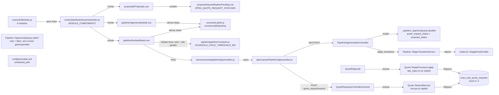
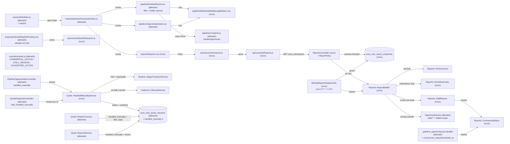

# Implementation Plan

## Request Summary
- Objective: entregar o painel **Relatórios** (semana/mês) do ScanSOLO, a regra única de situação comercial (`commercial_status`), a regra única de "parado" com motivo e ação sugerida por lead, o snapshot semanal persistido e a ação humana "Marcar proposta enviada manualmente" (unitária e em lote), conforme SPEC v1.3 (aprovada, 0 marcadores; Clarifications Log é autoritativo).
- Scope: **in** = itens 1–7 do input (RF-01..RF-20, UI-01..UI-11, CT-01..CT-07, RNF-01..RNF-07). **out** = mudar agente/cadências/templates, enviar qualquer mensagem (exceto a cadência pós-proposta existente da ação unitária), `escalado_wa`, bloquear arrasto para `proposta_enviada`, exportação, relatório diário/customizado, snapshot mensal.
- Tier: complete
- Architecture references: `AGENTS.md` (= `CLAUDE.md`), `docs/agents/architecture.md` ("Layer responsibilities", "Macro flow: quote → proposal", "scheduled jobs"), `docs/agents/domain_rules.md` ("Pipeline stages and transitions", "Quote request", "Commercial reply parsing", "Cadence engine"). `enterprise/` sem código ScanSolo (nada a espelhar).

Regras de arquitetura preservadas nas tasks:
- Controllers: só gate 404 (`BaseController#ensure_scansolo_enabled`), Pundit `authorize` (→ 403) e validação de forma → 422. Toda mudança de estado em service.
- `ScanSolo::Pipeline::StageTransitionService` é o caminho único de mudança de etapa (grava `PipelineStageEvent`, depois `StopRecalculatePolicy` e `StageEntryEnroller`).
- `ScanSolo::Cadence::LifecycleService.cancel!` é o caminho único de cancelamento de inscrição.
- jbuilder só monta forma, sem consultas além das associações pré-carregadas.
- Migrações só aditivas; i18n só em `app/javascript/dashboard/i18n/locale/en/scansolo.json` (pt-BR) e `config/locales/en.yml`; Vue `<script setup>` + Tailwind + `components-next/`; specs com `scan_solo`/`scansolo` no caminho; `./scripts/ralph-test.sh` verde ao fim de cada fase.

## AS IS — Componentes impactados

Hoje a situação comercial é deduzida no cliente por `commercialStatusKey` (Kanban, detalhe e Proposals); a regra de "parado" existe em duas cópias divergentes (`OpportunityQuery.stale?`, sem chamadores em `app/`, e `isStale` do Kanban), ambas ignorando lead sem interação e sem excluir `ganho`/`perdido`. Não há relatório, snapshot nem ação manual; `ReplyProcessor` e `ResendService` só reconhecem `replied` como fechado.

## TO BE — Componentes propostos

Nós novos/alterados por task: migrações e modelos `QuoteRequest`/`ReportSnapshot` (T01), `Period` (T02), `OpportunityQuery` (T03), `CommercialStatus` (T04), `PeriodSummary` (T05), `StallReason` (T06), jbuilder CT-02 (T07), `ReportBuilder` (T08), `ReportsController`/`ReportPolicy` (T09), job + `schedule.yml` (T10), `HandledManuallyService` (T11), `ReplyProcessor`/`ResendService` (T12), ações CT-03/CT-04 (T13), labels/i18n (T14), APIs/stores (T15), `Reports.vue` + módulo (T16), Kanban/detalhe/botão/`pipelineConstants` (T17), `QuoteRepliesPending` em lote (T18).

## Tasks

### T01 — Migrações aditivas e modelos (handled_manually + report snapshots)
- **Files**: `db/migrate/<ts>_add_handled_manually_to_scan_solo_quote_requests.rb` (novo), `db/migrate/<ts>_create_scan_solo_report_snapshots.rb` (novo), `db/schema.rb`, `app/models/scan_solo/quote_request.rb`, `app/models/scan_solo/report_snapshot.rb` (novo), `spec/models/scan_solo/report_snapshot_spec.rb` (novo), `spec/models/scan_solo/quote_request_spec.rb` (novo ou alterado)
- **Change**: (a) `add_column :scan_solo_quote_requests, :handled_manually_at, :datetime` e `add_reference ... :handled_manually_by, foreign_key: { to_table: :users }, null: true` (sem índice novo além do da referência). (b) `create_table :scan_solo_report_snapshots` com `account` (FK accounts, not null), `week_start date not null`, `payload jsonb not null`, `generated_at datetime not null`, timestamps e índice único `(account_id, week_start)`. (c) `QuoteRequest`: enum passa a `{ awaiting_reply: 0, correction_requested: 1, replied: 2, handled_manually: 3 }` (nenhuma renumeração), `belongs_to :handled_manually_by, class_name: 'User', optional: true`; `open?` inalterado (handled_manually fica fechado para `UpdateScheduler`, `UpdateService`, `PendingReplyResolution`, `ResendService.available?` — verificado por grep). (d) `ScanSolo::ReportSnapshot` (`self.table_name`, `belongs_to :account`, validações de presença, uniqueness de `week_start` por conta). Nenhum `remove_*`/`rename_*`/`change_column` (RNF-04). Atualizar annotate dos modelos.
- **Covers**: CT-05, RF-13 (persistência), RF-16 (colunas), RNF-04
- **Tests**: `spec/models/scan_solo/report_snapshot_spec.rb` — unicidade (conta, week_start); `spec/models/scan_solo/quote_request_spec.rb` — `handled_manually` = 3, valores 0..2 preservados, `open?` false para `handled_manually`
- **Risk**: Medium — migração em produção (tabela pequena, aditiva); `db:migrate` no banco de teste pode duplicar `installation_configs` (memória do projeto) — usar `db:test:prepare` do ralph-test
- **Dependencies**: none

### T02 — `ScanSolo::Reports::Period` (resolução de período em America/Sao_Paulo)
- **Files**: `app/services/scan_solo/reports/period.rb` (novo), `spec/services/scan_solo/reports/period_spec.rb` (novo)
- **Change**: objeto puro `Period.resolve(period:, anchor:)` → struct com `period`, `anchor` (Date), `starts_at`, `ends_at` (exclusivo, início do período seguinte), `previous` (mesmo tipo, imediatamente anterior), calculados em `ActiveSupport::TimeZone['America/Sao_Paulo']` (`beginning_of_week(:monday)` / `beginning_of_month`), e `closed?(now)` (`ends_at <= now`). Constante `TIMEZONE = 'America/Sao_Paulo'`, `PERIODS = %w[week month]`. Sem validação de entrada (fica no controller, T09).
- **Covers**: RF-07, RF-09 (período anterior), RNF-07
- **Tests**: `spec/services/scan_solo/reports/period_spec.rb` — `anchor=2026-11-08` week → `2026-11-02T00:00-03:00`..`2026-11-09T00:00-03:00`; mês de fevereiro; anterior de week/month; rodando com `Time.zone` UTC
- **Risk**: Low — puro
- **Dependencies**: none

### T03 — Regra única de "parado" no backend (`OpportunityQuery`)
- **Files**: `app/services/scan_solo/pipeline/opportunity_query.rb`, `spec/services/scan_solo/pipeline/opportunity_query_spec.rb`
- **Change**: `stale?(opportunity, now: Time.current)` passa a: `false` se etapa ∈ `StageTransitionService::TERMINAL_STAGES` (`ganho`/`perdido`); senão `COALESCE(last_customer_interaction_at, created_at) <= now - PIPELINE_STALE_THRESHOLD`. Novo `self.stalled_scope(scope, as_of:)` com o mesmo `COALESCE` em SQL e `stage NOT IN (ganho, perdido)`; `filter_by_stale` reutiliza `stalled_scope` (e seu complemento) para não haver 2 cópias. Manter o comentário RF-12/RF-13 atualizado com Q-01.
- **Covers**: RF-04 (backend), RF-10 (base do funil)
- **Tests**: `spec/services/scan_solo/pipeline/opportunity_query_spec.rb` — 47h59 / 48h00 com interação; nulo + `created_at` 48h00 → parada, 47h59 → não; `ganho`/`perdido` 30 dias → não; `stalled_scope` devolve o mesmo conjunto que `stale?` para os mesmos casos (substitui o caso antigo "nulo = não parado")
- **Risk**: Medium — muda semântica do filtro `stale` (sem chamadores em `app/` hoje; verificado por grep)
- **Dependencies**: none

### T04 — `ScanSolo::Reports::CommercialStatus` (classificador puro)
- **Files**: `app/services/scan_solo/reports/commercial_status.rb` (novo), `spec/services/scan_solo/reports/commercial_status_spec.rb` (novo)
- **Change**: `CommercialStatus.call(quote_request:, current_version:)` com a tabela do RF-01 na ordem exata (sem pedido → `nao_encaminhado`; `handled_manually` → `proposta_enviada_manual`; versão `sent` → `proposta_enviada`; `awaiting_approval` → `proposta_em_aprovacao`; `awaiting_reply`/`correction_requested` → `aguardando_artur`; `replied` → `resposta_recebida`). Constante `VALUES` (6). `forwarded_at(quote_request)` → `quote_request&.sent_at` (RF-02). Único arquivo Ruby com a tabela (RF-03 c). Sem I/O.
- **Covers**: RF-01, RF-02, RF-03 (c), RNF-03
- **Tests**: `spec/services/scan_solo/reports/commercial_status_spec.rb` — 6 linhas; `replied` + `generating`/`approved`/`failed` → `resposta_recebida`; `awaiting_reply` + `rejected` → `aguardando_artur`; assert 0 `INSERT/UPDATE/DELETE` via `ActiveSupport::Notifications.subscribed('sql.active_record')`
- **Risk**: Low
- **Dependencies**: T01

### T05 — `ScanSolo::Reports::PeriodSummary` (indicadores SQL só leitura)
- **Files**: `app/services/scan_solo/reports/period_summary.rb` (novo), `spec/services/scan_solo/reports/period_summary_spec.rb` (novo)
- **Change**: `PeriodSummary.call(account:, range:)` (range = `starts_at...ends_at` em UTC) devolve o hash `summary` do CT-01 com chaves completas (zeros para grupos ausentes): `new_leads` (total + `by_source` com `website`/`manual`/`nao_informada`), `responded`, `first_response_minutes` (`percentile_cont(0.5/0.9) WITHIN GROUP`, `null` se amostra vazia), `ai_turns.by_status` (JOIN `conversations.account_id`), `ai_turns.by_reason` (normalização `split_part`/`position(': ')` ou `nao_informado`), `inbound_without_turn`, `cadence_attempts.by_result` (6 valores) e `by_block_reason` (`last_checked_at` no período), `qualified` (UNION distinta de `PipelineStageEvent.to_stage='qualificado'` + audit `pipeline.opportunity_created` manual em `qualificado`), `forwarded` (`sent_at`), `proposals.by_status` (7 valores). Só `SELECT` via `ActiveRecord::Base.connection.select_all`/`sanitize_sql` ou relações AR com `group.count`; nenhum conteúdo de mensagem selecionado. Uma consulta por indicador (contagem fixa).
- **Covers**: RF-08, RF-09 (reuso para o anterior), RNF-01 (sem conteúdo), RNF-03
- **Tests**: `spec/services/scan_solo/reports/period_summary_spec.rb` — cada indicador confere com a SQL de referência do RF-08 executada no mesmo banco; exemplos dedicados para leads novos, respondidos, qualificados; casos obrigatórios: respondido só por cadência, lead manual sem incoming, coorte da semana anterior, manual criado em `qualificado`, 2 eventos `to_stage='qualificado'` → 1; fronteira `2026-11-09T02:59:59Z` dentro / `03:00:00Z` fora; 0 escritas
- **Risk**: Medium — SQL de percentil/coorte; precisão das fronteiras
- **Dependencies**: T02

### T06 — `ScanSolo::Reports::StallReason` + tabela motivo → ação sugerida
- **Files**: `app/services/scan_solo/reports/stall_reason.rb` (novo), `spec/services/scan_solo/reports/stall_reason_spec.rb` (novo)
- **Change**: `StallReason.call(opportunity:, now:, commercial_status:, legacy_bulk:)` puro, que lê só associações pré-carregadas (`conversation_extension`, `cadence_enrollments` com `cadence_definition` e `attempts`). "Inscrição da etapa atual" = enrollment mais recente (`created_at`, desempate por `id`) cuja `cadence_definition.stage == opportunity.stage`, filtrada em Ruby (`to_a`/`max_by`, sem consultar). Avalia os 10 motivos na precedência do RF-05; `legacy_bulk` (boolean pré-calculado pelo chamador a partir do audit `quote_request.handled_manually` com `payload.cadence_skipped = 'legacy_bulk'`) só ativa o motivo 5 junto com `commercial_status == 'proposta_enviada_manual'`. Etapas com cadência = `Cadence::StageEntryEnroller::STAGES` (não duplicar a lista); motivos de bloqueio = `%w[template_missing params_mismatch]` (de `TemplateAvailabilityGuard`, citar). Constantes `REASONS` (10, em ordem) e `SUGGESTED_ACTIONS` (`reason => "SCANSOLO.REPORTS.SUGGESTED_ACTIONS.#{reason.upcase}"`, 10 entradas). Devolve `{ stall_reason:, suggested_action: }`.
- **Covers**: RF-05, RF-06, RNF-03
- **Tests**: `spec/services/scan_solo/reports/stall_reason_spec.rb` — 10 casos (1 por motivo, só a condição esperada e as de precedência menor verdadeiras) + 3 de precedência: (i) humano + bloqueio → `em_atendimento_humano`; (ii) legado do lote em `proposta_enviada` com inscrição `cancelled` e `legacy_bulk: true` → `proposta_manual_sem_cadencia`; (iii) unitária (`legacy_bulk: false`, inscrição `completed`) → `cadencia_concluida_sem_resposta`; `SUGGESTED_ACTIONS.size == 10`; com objetos pré-carregados, 0 consultas SQL durante `call`
- **Risk**: Medium — precedência e "inscrição da etapa atual"
- **Dependencies**: T03, T04

### T07 — CT-02: `commercial_status` e `commercial_forwarded_at` no JSON da oportunidade
- **Files**: `app/views/api/v1/accounts/scan_solo/pipeline_opportunities/_pipeline_opportunity.json.jbuilder`, `spec/requests/api/v1/accounts/scan_solo/pipeline_opportunities_spec.rb`
- **Change**: acrescentar `json.commercial_status ScanSolo::Reports::CommercialStatus.call(quote_request: resource.quote_request, current_version: resource.proposal&.current_version)` e `json.commercial_forwarded_at ScanSolo::Reports::CommercialStatus.forwarded_at(resource.quote_request)` logo após `proposal_status` (que permanece, aditivo). Index e `set_opportunity` já pré-carregam `quote_request` e `proposal: :current_version` (verificado em `pipeline_opportunities_controller.rb:31,94`), então index/show/update/stage_transitions/create herdam o campo sem N+1.
- **Covers**: CT-02, RF-02, RF-03 (b), RNF-02 (index)
- **Tests**: `spec/requests/api/v1/accounts/scan_solo/pipeline_opportunities_spec.rb` — index e show devolvem `commercial_status` igual ao classificador; `commercial_forwarded_at` = `sent_at` ISO 8601 ou `null`; contagem de consultas do index igual com 2 e 6 oportunidades com pedido/proposta
- **Risk**: Low
- **Dependencies**: T04

### T08 — `ScanSolo::Reports::ReportBuilder` (corpo CT-01: resumo, anterior, funil, parados)
- **Files**: `app/services/scan_solo/reports/report_builder.rb` (novo), `spec/services/scan_solo/reports/report_builder_spec.rb` (novo)
- **Change**: `ReportBuilder.call(account:, period:, now: Time.current, source: 'live')` → Hash com exatamente as chaves do CT-01 (`period`, `anchor`, `timezone`, `starts_at`/`ends_at` ISO 8601 com offset SP, `source`, `generated_at`, `as_of`, `summary`, `previous { starts_at, ends_at, summary }`, `funnel`, `stalled`). Funil: 1 `GROUP BY stage` total + contagem de `OpportunityQuery.stalled_scope(as_of: now)`, 8 linhas na ordem do enum, `active = total - stalled`. Lista: `stalled_scope.includes(:contact, :quote_request, :conversation_extension, proposal: :current_version, cadence_enrollments: %i[cadence_definition attempts])` + **1 única consulta** `ScanSolo::AuditEvent.where(subject_type: 'ScanSolo::PipelineOpportunity', subject_id: ids, event_type: 'quote_request.handled_manually').where("payload->>'cadence_skipped' = 'legacy_bulk'").distinct.pluck(:subject_id)` → `Set`, passado a `StallReason` como `legacy_bulk:`; item = `opportunity_id`, `contact_name`, `stage`, `last_customer_interaction_at`, `created_at` (UI-05, ver OQ-01), `commercial_status` (de `CommercialStatus`), `stall_reason`, `suggested_action`. Nunca inclui telefone, e-mail ou conteúdo. Só leitura.
- **Covers**: RF-09, RF-10, RF-14 (corpo reutilizável pelo snapshot), RNF-01, RNF-02, RNF-03
- **Tests**: `spec/services/scan_solo/reports/report_builder_spec.rb` — funil confere com a SQL de referência do RF-10 (`ganho`/`perdido` com `stalled = 0`); soma de `stalled` = tamanho da lista; cada parado 1 vez com `stall_reason` do classificador; lead legado do lote em `proposta_enviada` com `proposta_manual_sem_cadencia`; `previous.summary.new_leads.total` (3 vs 5); contagem de consultas igual com 3 e 30 parados; 0 escritas; JSON serializado sem `@`, `+55` nem conteúdo de mensagem de fixture
- **Risk**: Medium — N+1 e cópia da regra de parado; mitigado por reuso de `stalled_scope` e assert de contagem
- **Dependencies**: T03, T04, T05, T06

### T09 — CT-01: `ReportsController#index` + `ReportPolicy` + rota
- **Files**: `app/controllers/api/v1/accounts/scan_solo/reports_controller.rb` (novo), `app/policies/scan_solo/report_policy.rb` (novo), `config/routes.rb` (`namespace :scan_solo`: `get 'reports', to: 'reports#index'`), `spec/requests/api/v1/accounts/scan_solo/reports_spec.rb` (novo)
- **Change**: herda `ScanSolo::BaseController` (gate 404 antes da autenticação). `authorize(::ScanSolo::ReportSnapshot, :index?)` com `ReportPolicy#index? → true` (como `ExecutionPolicy`). Validação no controller: `period` ∉ `Period::PERIODS` → 422 `invalid_period`; `anchor` presente e não `\A\d{4}-\d{2}-\d{2}\z` ou `Date.strptime` inválida (`2026-02-30`) → 422 `invalid_anchor`; ausente → `Time.current.in_time_zone(Period::TIMEZONE).to_date`. Se `period == 'week'`, `Period#closed?(Time.current)` e existe `ReportSnapshot` (conta, `week_start = starts_at.to_date`) → `render json: snapshot.payload`; senão `render json: ReportBuilder.call(...)` (`source: 'live'`). Nunca grava (nem snapshot na leitura).
- **Covers**: RF-11, RF-12, RF-14, CT-01, RNF-01, RNF-02
- **Tests**: `spec/requests/api/v1/accounts/scan_solo/reports_spec.rb` — conta desabilitada 404; sem token 401; administrador 200; agente 200; `period=day` 422 `invalid_period`; `anchor=2026-02-30` 422 `invalid_anchor`; sem anchor → período da data atual em SP (com `travel_to`); semana passada com snapshot → `source = snapshot` e corpo = `payload`; semana corrente → `live`; semana passada sem snapshot → `live` e 0 linhas criadas; contagem de linhas de todas as tabelas `scan_solo_*` igual antes/depois; contagem de consultas igual com 3 e 30 parados; corpo sem `@`/`+55`/conteúdo
- **Risk**: Low
- **Dependencies**: T01, T02, T08

### T10 — Snapshot semanal: `WeeklyReportSnapshotJob` + `schedule.yml`
- **Files**: `app/jobs/scan_solo/weekly_report_snapshot_job.rb` (novo), `config/schedule.yml`, `spec/jobs/scan_solo/weekly_report_snapshot_job_spec.rb` (novo)
- **Change**: `queue_as :scheduled_jobs`. `perform`: `week_start = Time.current.in_time_zone(Period::TIMEZONE).prev_week(:monday).to_date`; para cada conta com `scansolo_enabled` (escopo do flag_shih_tzu, ver A-03), `body = ReportBuilder.call(account:, period: Period.resolve(period: 'week', anchor: week_start), now: Time.current, source: 'snapshot')` e `ScanSolo::ReportSnapshot.upsert({ account_id:, week_start:, payload: body, generated_at: Time.current, created_at:, updated_at: }, unique_by: %i[account_id week_start], update_only: %i[payload generated_at updated_at])` (sem `update_only`, usar `on_duplicate` equivalente — a 2ª execução sobrescreve payload/generated_at/updated_at). Entrada em `config/schedule.yml`: `scan_solo_weekly_report_snapshot_job`, `cron: '0 9 * * 1'`, `class: 'ScanSolo::WeeklyReportSnapshotJob'`, `queue: scheduled_jobs`, com comentário "segunda 06:00 America/Sao_Paulo (UTC−3), RF-13/CT-06".
- **Covers**: RF-13, CT-05 (upsert), CT-06, RNF-01, RNF-07
- **Tests**: `spec/jobs/scan_solo/weekly_report_snapshot_job_spec.rb` — `travel_to 2026-11-09T09:00Z` grava `week_start = 2026-11-02`; 2 execuções → 1 linha com `payload`/`generated_at` da 2ª; conta desabilitada sem linha; payload sem `@`/`+55`/conteúdo; payload com `source = snapshot`; `config/schedule.yml` contém a entrada com cron `0 9 * * 1`
- **Risk**: Medium — cron em UTC (servidor sem `config.time_zone`); erro aqui só atrasa o congelamento (leitura cai para `live`)
- **Dependencies**: T01, T02, T08

### T11 — `ScanSolo::Quote::HandledManuallyService` (ação manual unitária/lote)
- **Files**: `app/services/scan_solo/quote/handled_manually_service.rb` (novo), `lib/custom_exceptions/scan_solo.rb` (nova `HandledManuallyRejected` com `code`), `spec/services/scan_solo/quote/handled_manually_service_spec.rb` (novo)
- **Change**: `HandledManuallyService.call(opportunity:, actor:, mode:)` (`mode` ∈ `%w[single bulk]`). Ordem dos códigos: sem pedido → `quote_request_missing`; dentro de `quote_request.with_lock` (recarrega a linha): não `open?` → `quote_request_closed` (RF-20); etapa ∉ `%w[qualificado proposta_enviada]` → `invalid_stage`. Na mesma transação (o `with_lock` abre a transação; a do `StageTransitionService` aninha): (a) se etapa ≠ `proposta_enviada`, `StageTransitionService.new(opportunity:, target_stage: 'proposta_enviada', actor:).call` (enfileira `StopRecalculatePolicy` + `StageEntryEnroller` dentro da mesma transação); (b) `quote_request.update!(status: :handled_manually, handled_manually_at: Time.current, handled_manually_by: actor)`; (c) se `bulk`, `opportunity.cadence_enrollments.joins(:cadence_definition).where(status: %i[active paused], cadence_definition: { stage: 'proposta_enviada' }).find_each { LifecycleService.cancel!(_1) }`; (d) `AuditLogger.record!(subject: opportunity, actor:, event_type: 'quote_request.handled_manually', correlation_id: quote_request.correlation_id, payload: { quote_request_id:, previous_status:, from_stage:, to_stage: 'proposta_enviada', mode: } + (bulk ? { cadence_skipped: 'legacy_bulk' } : {}))`. Exceção levanta e desfaz tudo (RF-17 e). Não cria `Message`, e-mail, `MakeRequest` nem `ProposalVersion` (não chama `RequestService`, `LeadNoticeService` nem `GenerateService`). Payload sem conteúdo/contato.
- **Covers**: RF-15, RF-16, RF-17, RF-20, CT-07
- **Tests**: `spec/services/scan_solo/quote/handled_manually_service_spec.rb` — 3 códigos sem alterar linhas; aceito em `qualificado`: 1 `PipelineStageEvent` `qualificado → proposta_enviada` com actor, pedido `handled_manually` com at/by, 1 audit; já em `proposta_enviada`: 0 eventos; `Message.count`/`MakeRequest.count`/`ProposalVersion.count`/jobs de e-mail inalterados nos 2 modos; single: inscrição de `proposta_enviada` `active` com tentativas `scheduled` futuras; bulk com transição: inscrição criada `cancelled`, 0 `scheduled`, `cadence_skipped = legacy_bulk`; bulk sem transição com 1 `active` + 1 `paused` → ambas `cancelled`; falha forçada em `LifecycleService.cancel!` → nada persistido; concorrência (2 threads, `use_transactional_tests` desligado no exemplo ou `ActiveRecord::Base.connection_pool.with_connection`) → 1 sucesso + 1 `quote_request_closed`, 1 audit, ≤ 1 evento
- **Risk**: High — transação com efeitos de cadência e lock; regressão de envio indevido
- **Dependencies**: T01

### T12 — RF-19: `ReplyProcessor` e `ResendService` tratam `handled_manually` como fechado
- **Files**: `app/services/scan_solo/quote/reply_processor.rb`, `app/services/scan_solo/quote/resend_service.rb`, `spec/services/scan_solo/quote/reply_processor_spec.rb`, `spec/requests/api/v1/accounts/scan_solo/quote_request_resend_spec.rb`
- **Change**: em `ReplyProcessor.apply`, dentro do `with_lock`: `next(:late_reply) if quote_request.handled_manually?` antes do ramo `replied?` (mantém `:retry` só para `replied` com o mesmo `reply_message_id`); resultado `late_reply` `pending` via `record_pending!`, sem mudar status nem chamar `request_generation!`. Em `ResendService#reusable_request`: `reject!('quote_request_closed') if quote_request.replied? || quote_request.handled_manually?` (ou `unless quote_request.open?` se equivalente aos estados atuais — usar a forma explícita para não alterar `correction_requested`). Atualizar a linha de `docs/agents/domain_rules.md` é tarefa do `/ai-context`, não desta task.
- **Covers**: RF-19
- **Tests**: `spec/services/scan_solo/quote/reply_processor_spec.rb` — e-mail com bloco CT-04 válido na thread de pedido `handled_manually` → 1 `QuoteReply` `late_reply` `pending`, status inalterado, 0 `ProposalVersion`; `quote_request_resend_spec.rb` — pedido `handled_manually` → 422 `quote_request_closed`
- **Risk**: Medium — caminho de e-mail comercial em produção
- **Dependencies**: T01

### T13 — CT-03 e CT-04: endpoints da ação manual + policies + rotas
- **Files**: `app/controllers/api/v1/accounts/scan_solo/pipeline_opportunities_controller.rb` (ação `handled_manually`), `app/controllers/api/v1/accounts/scan_solo/quote_requests_controller.rb` (ação `bulk_handled_manually`), `app/policies/scan_solo/pipeline_opportunity_policy.rb` (`handled_manually?` → `account_user.present?`), `app/policies/scan_solo/quote_request_policy.rb` (`bulk_handled_manually?` → `account_user.present?`), `config/routes.rb`, `spec/requests/api/v1/accounts/scan_solo/quote_request_handled_manually_spec.rb` (novo)
- **Change**: rotas: membro `post 'quote_request/handled_manually', to: 'pipeline_opportunities#handled_manually'` (irmã de `quote_request/resend`) e `post 'quote_requests/handled_manually', to: 'quote_requests#bulk_handled_manually'`. CT-03 em `PipelineOpportunitiesController` (reusa `set_opportunity` + `project_lead_state` + `render :show`, como `stage_transitions`; ver A-05): `authorize(@opportunity)`, `HandledManuallyService.call(mode: 'single')`, recarregar associações, rescue `HandledManuallyRejected` → 422 `{ error: code }`. CT-04 em `QuoteRequestsController`: `authorize(::ScanSolo::QuoteRequest, :bulk_handled_manually?)`; validar `params[:opportunity_ids]` = array não vazio de inteiros (`Integer`/string numérica não aceita? ver A-06) → senão 422 `invalid_opportunity_ids`; para cada id (ordem do pedido): `where(account_id: Current.account.id).find_by(id:)` → `not_found`, senão `call(mode: 'bulk')` → `handled` ou o `code` da exceção; cada id em sua própria transação; 200 `{ results: [...] }`.
- **Covers**: CT-03, CT-04, RF-15, RF-16, RF-18, RF-20, UI-08/UI-09 (backend)
- **Tests**: `spec/requests/api/v1/accounts/scan_solo/quote_request_handled_manually_spec.rb` — CT-03: aceito (agente e admin) → 200 com `commercial_status = proposta_enviada_manual`; 3 códigos 422 sem alterar linhas; outra conta 404; conta desabilitada 404; sem token 401. CT-04: lote (elegível, já `handled_manually`, outra conta) → 200 com `handled`, `quote_request_closed`, `not_found`; só o elegível muda e termina sem inscrição pós-proposta `active`/`paused`; `[]`, ausente ou `["x"]` → 422 `invalid_opportunity_ids`
- **Risk**: Medium — ClassLength do controller (109 linhas de código hoje, limite 175)
- **Dependencies**: T07, T11

### T14 — Frontend: mapas de rótulo e i18n pt-BR
- **Files**: `app/javascript/dashboard/routes/dashboard/scansolo/scansoloLabels.js`, `app/javascript/dashboard/i18n/locale/en/scansolo.json`, `app/javascript/dashboard/routes/dashboard/scansolo/specs/i18nCompleteness.spec.js`
- **Change**: em `scansoloLabels.js`: `COMMERCIAL_STATUSES` (6), `COMMERCIAL_STATUS_LABELS` (`SCANSOLO.COMMERCIAL_STATUS.<UPPER>`), `STALL_REASONS` (10) e `STALL_REASON_LABELS` (`SCANSOLO.REPORTS.STALL_REASONS.<UPPER>`), `SUGGESTED_ACTION_LABELS` (chave = `SCANSOLO.REPORTS.SUGGESTED_ACTIONS.<UPPER>`, igual ao backend), `HANDLED_MANUALLY_ERROR_LABELS` (`quote_request_missing`, `quote_request_closed`, `invalid_stage`, `not_found`, `invalid_opportunity_ids`); `handled_manually` em `QUOTE_REQUEST_COMMERCIAL_STATUS_LABELS` (Proposals.vue continua usando `commercialStatusKey` só para status de versão/pedido). Em `scansolo.json`: `SIDEBAR.REPORTS`, `MODULES.REPORTS.TITLE/DESCRIPTION`, os 6 rótulos de situação, os 10 motivos, as 10 ações (sugestões do FLEXIBLE: "Assumir ou devolver à IA", "Cobrar resposta do Artur", "Corrigir template na Meta", "Verificar envio da cadência", "Acompanhar com o Artur", "Reinscrever na cadência da etapa", "Decidir: novo contato ou perdido", "Aguardar próximo follow-up", "Conferir pedido de orçamento", "Revisar manualmente"), textos da tela Relatórios (abas, seletor, KPIs, anterior, aviso "dados congelados em {date}", funil, tabela, estados), do filtro do Kanban ("Todas"), do botão/diálogo unitário e em lote, "Encaminhado ao Artur em {date}", e mensagens de erro. Nenhum "Luciano", nenhum telefone. `i18nCompleteness`: acrescentar ao `enumKeys` os 3 mapas (6/10/10 chaves).
- **Covers**: UI-11, RF-06 (chaves), RNF-05
- **Tests**: `app/javascript/dashboard/routes/dashboard/scansolo/specs/i18nCompleteness.spec.js` — passa com os mapas novos no `enumKeys`; `grep -i luciano` vazio em `scansolo.json` e `config/locales/en.yml`
- **Risk**: Low
- **Dependencies**: none (lógica); agendada após T13 para refletir códigos finais

### T15 — Frontend: clientes de API e stores Pinia
- **Files**: `app/javascript/dashboard/api/scansoloReports.js` (novo), `app/javascript/dashboard/api/scansoloQuoteRequests.js` (novo), `app/javascript/dashboard/api/scansoloPipelineOpportunities.js`, `app/javascript/dashboard/store/scansolo/reports.js` (novo), `app/javascript/dashboard/store/scansolo/pipelineOpportunities.js`, `app/javascript/dashboard/api/specs/scansoloReports.spec.js` (novo), `app/javascript/dashboard/store/scansolo/specs/reports.spec.js` (novo), `app/javascript/dashboard/store/scansolo/specs/pipelineOpportunities.spec.js`
- **Change**: `scansoloReports.js` (`ApiClient` `scan_solo/reports`, `accountScoped`, `get({ period, anchor })`). `scansoloQuoteRequests.js` (`scan_solo/quote_requests`, `bulkMarkHandledManually(ids)` → POST `handled_manually` com `{ opportunity_ids }`). `scansoloPipelineOpportunities.js`: `markHandledManually(id)` → POST `${url}/${id}/quote_request/handled_manually`. Store `reports.js` (`fetchReport({ period, anchor })`, estado `report`, `uiFlags.fetching`, `error`, camelcase profundo, cancelamento com o utilitário compartilhado de request-cancellation se existir no repo). Store de oportunidades: `markHandledManually(id)` faz `upsertOpportunity` com a resposta camelizada; 422 propaga.
- **Covers**: CT-01, CT-03, CT-04 (consumo), UI-02, UI-08, UI-09 (dados)
- **Tests**: `api/specs/scansoloReports.spec.js` — URL/params; `store/scansolo/specs/reports.spec.js` — sucesso, erro; `store/scansolo/specs/pipelineOpportunities.spec.js` — `markHandledManually` substitui o card
- **Risk**: Low
- **Dependencies**: T09, T13 (contratos)

### T16 — Tela Relatórios + módulo `reports` no menu
- **Files**: `app/javascript/dashboard/routes/dashboard/scansolo/scansoloModules.js`, `app/javascript/dashboard/routes/dashboard/scansolo/index.js`, `app/javascript/dashboard/routes/dashboard/scansolo/reports/Reports.vue` (novo), `app/javascript/dashboard/routes/dashboard/scansolo/reports/reportPeriods.js` (novo), `app/javascript/dashboard/routes/dashboard/scansolo/reports/ReportKpiCard.vue` (novo), `app/javascript/dashboard/routes/dashboard/scansolo/reports/ReportFunnel.vue` (novo), `app/javascript/dashboard/routes/dashboard/scansolo/reports/ReportStalledTable.vue` (novo), `app/javascript/dashboard/routes/dashboard/scansolo/reports/specs/Reports.spec.js` (novo), `app/javascript/dashboard/routes/dashboard/scansolo/reports/specs/reportPeriods.spec.js` (novo), `app/javascript/dashboard/routes/dashboard/scansolo/specs/navigation.spec.js`
- **Change**: módulo `{ key: 'reports', path: 'reports', name: 'scansolo_reports_index', icon: 'i-lucide-bar-chart-3' }` em `SCANSOLO_MODULES` (comentário "6" → "7"); `MODULE_COMPONENTS.reports = Reports` (mesma guarda e `meta`). `reportPeriods.js`: opções a partir da data atual em `America/Sao_Paulo` (`date-fns-tz`): semana atual + 2 anteriores (anchor = segunda), mês atual + anterior (anchor = dia 1), rótulo de intervalo pt-BR. `Reports.vue` (`<script setup>`, `ScanSoloPageLayout`, `components-next/tabbar` Semana|Mês, `components-next/select` de período; abre na semana atual; troca → `fetchReport`). KPIs (UI-03) com valor anterior e aviso de snapshot só com `source = snapshot`; funil 8 linhas na ordem `SCANSOLO_PIPELINE_STAGES` com `STAGE_LABELS`; tabela de parados agrupada por etapa com link `scansolo_pipeline_opportunity_detail`, dias desde `lastCustomerInteractionAt || createdAt`, situação/motivo/ação por rótulo i18n, sem telefone/e-mail/conteúdo; estados com `ScanSoloListState` (carregando, erro + tentar de novo, vazio). Tailwind apenas, utilitários lógicos.
- **Covers**: UI-01, UI-02, UI-03, UI-04, UI-05, UI-10
- **Tests**: `reports/specs/Reports.spec.js` — 3 opções Semana / 2 Mês; semana anterior chama API com `period=week` e anchor = segunda; cada KPI e anterior; aviso só com snapshot; 8 linhas de funil; linha por parado com motivo/ação traduzidos (inclusive `proposta_manual_sem_cadencia` e `outro`), dias a partir de `createdAt` quando interação nula, link de detalhe; 3 estados. `reportPeriods.spec.js` — fronteiras com `TZ=UTC`. `navigation.spec.js` — 7 módulos e `scansolo_reports_index` não resolve para `ScanSoloComingSoonPage`
- **Risk**: Medium — cálculo de datas no cliente em fuso fixo
- **Dependencies**: T14, T15

### T17 — Kanban e detalhe: `commercial_status`, filtro, regra de parado e ação unitária
- **Files**: `app/javascript/dashboard/routes/dashboard/scansolo/pipeline/KanbanBoard.vue`, `app/javascript/dashboard/routes/dashboard/scansolo/pipeline/OpportunityDetail.vue`, `app/javascript/dashboard/routes/dashboard/scansolo/pipeline/pipelineConstants.js`, `app/javascript/dashboard/routes/dashboard/scansolo/pipeline/MarkHandledManuallyButton.vue` (novo), `app/javascript/dashboard/routes/dashboard/scansolo/pipeline/specs/KanbanBoard.spec.js`, `app/javascript/dashboard/routes/dashboard/scansolo/pipeline/specs/OpportunityDetail.spec.js`, `app/javascript/dashboard/routes/dashboard/scansolo/pipeline/specs/MarkHandledManuallyButton.spec.js` (novo), `app/javascript/dashboard/routes/dashboard/scansolo/pipeline/specs/pipelineConstants.spec.js` (novo)
- **Change**: `pipelineConstants.js`: `TERMINAL_STAGES = ['ganho','perdido']` e `isStaleOpportunity(opportunity, now)` = não terminal e `now - (lastCustomerInteractionAt || createdAt) >= SCANSOLO_STALE_THRESHOLD_MS` (espelha T03). Kanban: `isStale` local substituído; rótulo por `COMMERCIAL_STATUS_LABELS[opportunity.commercialStatus]`; filtro de situação comercial (`components-next/select`, padrão "Todas") que filtra `opportunitiesByStage`; botão unitário. Detalhe: rótulo por `commercialStatus`; "Encaminhado ao Artur em <data>" só com `commercialForwardedAt`; botão unitário. `quoteRequestStatusLabel` do detalhe continua mostrando o status do pedido (incl. `handled_manually`). Remover `commercialStatusKey` de KanbanBoard.vue e OpportunityDetail.vue (RF-03 a). `MarkHandledManuallyButton.vue`: visível só com `commercialStatus === 'aguardando_artur'` e etapa `qualificado`/`proposta_enviada`; `ScanSoloConfirmDialog` dizendo que nenhuma mensagem é enviada agora e que a cadência pós-proposta seguirá normalmente; confirmar → `store.markHandledManually`; 422 → `useAlert(t(HANDLED_MANUALLY_ERROR_LABELS[code]))`; emite `updated` para o detalhe atualizar com a resposta.
- **Covers**: RF-03 (a), RF-04 (cliente), UI-06, UI-07, UI-08
- **Tests**: `KanbanBoard.spec.js` — 3 oportunidades, filtro `aguardando_artur` → 1 card, "Todas" → 3; rótulo `proposta_enviada_manual`; selo Inativo segue `isStaleOpportunity`. `OpportunityDetail.spec.js` — rótulo e data de encaminhamento só quando não nulo. `MarkHandledManuallyButton.spec.js` — visível só no elegível; cancelar não chama API; confirmar chama CT-03; 422 `quote_request_closed` mostra mensagem. `pipelineConstants.spec.js` — casos (a)–(c) do RF-04 iguais ao spec Ruby de T03
- **Risk**: Medium — maior arquivo de UI; specs existentes do Kanban mudam (fixtures precisam de `commercialStatus`)
- **Dependencies**: T14, T15

### T18 — Lista em lote dos pedidos aguardando o Artur
- **Files**: `app/javascript/dashboard/routes/dashboard/scansolo/proposals/QuoteRepliesPending.vue`, `app/javascript/dashboard/routes/dashboard/scansolo/proposals/specs/QuoteRepliesPending.spec.js`
- **Change**: nova seção na tela Propostas (reaproveita `pipelineStore.fetchOpportunities()` já feito): lista das oportunidades com `commercialStatus === 'aguardando_artur'`, `components-next/checkbox` por item e "selecionar todos", botão "Marcar selecionados como proposta enviada manualmente", `ScanSoloConfirmDialog` com a quantidade e o aviso de que nenhuma mensagem será enviada e nenhuma cadência pós-proposta será iniciada; confirmar → `ScanSoloQuoteRequestsAPI.bulkMarkHandledManually(ids)`; renderiza o resultado por item (`handled` ou rótulo do código) e recarrega as oportunidades. Sem telefone/e-mail.
- **Covers**: UI-09, RF-18 (consumo)
- **Tests**: `QuoteRepliesPending.spec.js` — selecionar 2 de 3 envia `opportunity_ids` com os 2 ids; resultado por item renderizado; cancelar não chama API
- **Risk**: Low
- **Dependencies**: T14, T15

## Execution Phases
| Phase | Tasks | Parallel-safe? |
|-------|-------|----------------|
| 1 — Fundações (schema, período, regra de parado) | T01, T02, T03 | Sim — arquivos disjuntos |
| 2 — Classificador comercial e indicadores | T04, T05 | Sim — arquivos disjuntos |
| 3 — Motivo de parada e JSON da oportunidade | T06, T07 | Sim — T06 só cria service; T07 só jbuilder/spec |
| 4 — Montagem do relatório | T08 | Sequencial — depende de T03..T06 |
| 5 — API de relatório e snapshot semanal | T09, T10 | Sim — T09 toca `routes.rb`, T10 `schedule.yml`; ambos só consomem T08 |
| 6 — Ação manual (service) e guarda RF-19 | T11, T12 | Sim — `handled_manually_service.rb` vs `reply_processor.rb`/`resend_service.rb` |
| 7 — Endpoints da ação manual | T13 | Sequencial — `routes.rb` e controllers; depende de T07, T11 |
| 8 — Base do frontend (i18n, APIs, stores) | T14, T15 | Sim — `scansoloLabels.js`/`scansolo.json` vs `api/`/`store/` |
| 9 — Telas | T16, T17, T18 | Sim — arquivos disjuntos; todo i18n já entrou em T14 |

## Contracts emitted
| Artifact | Path | RFs covered | Compatibility |
|---|---|---|---|
| OpenAPI 3.1 (delta v1.8.0 sobre `scansolo-operacao-centralizada` v1.7.0) | `.spec/features/scansolo-relatorios-fonte-unica/openapi.yaml` | CT-01 (RF-07..RF-12, RF-14), CT-02 (RF-01..RF-03), CT-03 (RF-15..RF-17, RF-20), CT-04 (RF-17, RF-18, RF-20) | Compatível, aditivo. `PipelineOpportunity` redefinido por completo (allOf não amplia enum); `QuoteRequestStatus` ganha `handled_manually` (valor novo em campo de resposta — único cliente é o dashboard interno, atualizado em T14/T17). `StalledOpportunity.created_at` opcional, ver OQ-01 |

CT-05 (migrações), CT-06 (cron) e CT-07 (auditoria) não são interfaces de rede: ficam em T01, T10 e T11. Não há eventos assíncronos novos (sem AsyncAPI).

## Risks
| Risk | Blast radius | Mitigation | Rollback |
|------|-------------|------------|----------|
| Ação em lote envia follow-up a lead legado (cancelamento parcial) ou unitária perde a cadência | Leads reais em `qualificado`/`proposta_enviada` (≈20 legados) | T11: cancelamento dentro do mesmo `with_lock`/transação via `LifecycleService.cancel!`; specs (b)–(e) do RF-17; ação em lote só via seleção explícita com confirmação | Reverter deploy; inscrições canceladas não reativam sozinhas — reinscrição manual pelo módulo Follow-ups se necessário |
| Ação manual concorrente com resposta comercial por e-mail | 1 pedido | `quote_request.with_lock` no service e no `ReplyProcessor`; RF-19 trata `handled_manually` como `late_reply` | Pedido pode voltar a `awaiting_reply` por console; `late_reply` pendente fica para resolução manual |
| `ResendService` reenvia e-mail para pedido `handled_manually` se T12 atrasar | E-mail ao comercial | T11 e T12 na mesma fase; T13 (que expõe a ação) só na fase seguinte | — |
| Mudança da regra de "parado" (nulo passa a contar de `created_at`, terminais excluídos) altera o selo "Inativo" | Kanban de todos os usuários | Regra única (T03 + T17) com specs espelhados; comportamento definido na Q-01 | Reverter T17/T03 |
| N+1 na lista de parados / index | Latência do GET reports e do Kanban | Preload por associação + 1 consulta de audit; specs de contagem 3×30 (T08/T09) e index (T07) | — |
| Fronteiras de fuso (servidor UTC, navegador qualquer) | Números do painel | `Period` em `America/Sao_Paulo` (T02), `date-fns-tz` no cliente (T16), specs com `TZ=UTC` | — |
| Migração em produção | `scan_solo_quote_requests` | Só `add_column`/`add_reference`/`create_table` (RNF-04); tabela pequena | `rails db:rollback` das 2 migrações (reversíveis) |
| Vazamento de PII em snapshot/JSON/log | LGPD | Builder seleciona só campos listados; spec RNF-01 em T08/T09/T10 | Apagar linhas de `scan_solo_report_snapshots` |
| Job semanal falha ou não roda | Semana passada sem snapshot | RF-14 cai para `live` | Rodar `ScanSolo::WeeklyReportSnapshotJob.perform_now` |

## Open Questions
- OQ-01 (contrato, UI-05 × CT-01): UI-05 exige dias sem interação contados de `created_at` quando `last_customer_interaction_at` é `null`, mas o item de `stalled` no exemplo do CT-01 não traz `created_at`. O plano acrescenta `created_at` ao item (aditivo, opcional no `openapi.yaml`). Alternativa sem campo novo: o backend expor `days_without_interaction`. Impacto: baixo; decidir antes de T08/T16.
- OQ-02 (UI-07): o card hoje oculta o rótulo quando não há pedido/proposta. Com 6 valores de `commercial_status`, o plano exibe rótulo também para `nao_encaminhado`, conforme a letra de UI-07. Se a preferência for ocultar `nao_encaminhado` no card, muda só T17. Impacto: visual.
- OQ-03 (CT-04) — **RESOLVIDA (desenvolvedor, 08/11/2026): sem limite de tamanho do lote.** O endpoint em lote não valida quantidade de `opportunity_ids` (legado ≈ 20 pedidos); nenhum 422 por tamanho. Risco aceito: com centenas de ids a requisição fica longa (1 transação por id).
- OQ-04 (docs): `docs/agents/domain_rules.md` ("Quote request", "Commercial reply parsing") e `api_contracts.md` estão modificados no working tree e são gerados por `/ai-context` ("Manual edits are overwritten"). O plano não os edita; recomenda reexecutar `/ai-context` após a entrega para registrar `handled_manually`, CT-01/CT-03/CT-04 e o novo job.
- OQ-05 (policy) — **RESOLVIDA (desenvolvedor, 08/11/2026): qualquer membro da conta.** A ação manual unitária (CT-03) e em lote (CT-04) usa o mesmo guard dos demais módulos ScanSolo (`account_user.present?`), não o admin-only do reenvio (`domain_rules.md` "Manual resend: admin only"). A auditoria `quote_request.handled_manually` registra o usuário que executou.

## Assumptions
- A-01: `StageTransitionService#call` usa `ActiveRecord::Base.transaction`, que aninha na transação aberta por `quote_request.with_lock` em T11; `StopRecalculatePolicy`/`StageEntryEnroller`/`EnrollmentService` não têm `after_commit` nem enfileiram jobs (verificado por grep de `after_`/`perform_later` nos modelos e services envolvidos), então um erro desfaz tudo (RF-17 e).
- A-02: `handled_manually` fica fechado para `UpdateScheduler`, `UpdateService`, `PendingReplyResolution`, `GenerateService` e `ResendService.available?`, porque todos usam `open?`/`replied?`/`awaiting_reply?` (verificado em `app/services/scan_solo/quote/*.rb` e `proposal/generate_service.rb:51`). Só `ReplyProcessor.apply` e `ResendService#reusable_request` precisam mudar (T12).
- A-03: [UNVERIFIED] `flag_shih_tzu` com `flag_query_mode: :bit_operator` gera o escopo `Account.scansolo_enabled` (padrão da gem com `named_scopes`). T10 deve confirmar; se não existir, usar `Account.where('scansolo_feature_flags & 1 = 1')` via o helper da gem (`Account.scansolo_enabled_condition`).
- A-04: o corpo do CT-01 é montado como Hash por `ReportBuilder` e renderizado com `render json:` (como `QuoteRequestsController#resend`), para que o `payload` do snapshot seja byte a byte o corpo da resposta (RF-14). A view jbuilder não é usada para este endpoint; sem consulta na camada de view.
- A-05: CT-03 fica em `PipelineOpportunitiesController#handled_manually` (não no `QuoteRequestsController` sugerido no FLEXIBLE) para reutilizar `set_opportunity`, `project_lead_state` e `render :show`, igual a `stage_transitions`; a rota continua a do CT-03.
- A-06: `opportunity_ids` aceita só inteiros JSON (strings numéricas → 422 `invalid_opportunity_ids`), seguindo "Accept only the documented type" do `AGENTS.md`.
- A-07: `OpportunityQuery.stale?` não tem chamadores em `app/` (só o próprio spec; verificado por grep), logo a mudança de semântica não afeta outro fluxo backend.
- A-08: `cadence_definitions.stage` guarda o nome da etapa como string (comparado com `opportunity.stage` em `StageEntryEnroller`/`CadenceDefinition.current_for`). [UNVERIFIED] quanto ao tipo exato da coluna; T06/T11 confirmam.
- A-09: o i18nCompleteness gera automaticamente `SIDEBAR.REPORTS` e `MODULES.REPORTS.*` a partir de `SCANSOLO_MODULES`; as chaves entram em T14 (fase 8) antes do módulo (T16, fase 9), mantendo o spec verde em cada fase.
