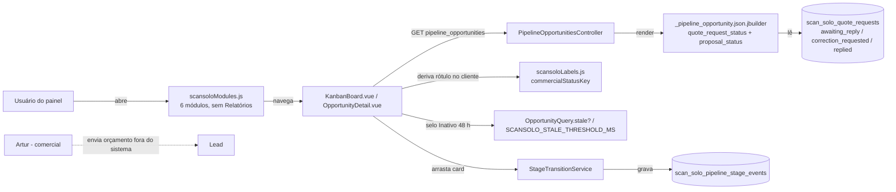
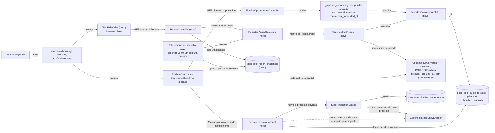

# SPEC: scansolo-relatorios-fonte-unica

## Metadata
- Source: developer description via /plan. Fonte de verdade: `.spec/inputs/scansolo-fatia1-relatorios.md` (itens 1–7 do escopo, "Atenção técnica", "Regras fixas") e os 7 critérios de aceite confirmados pelo desenvolvedor (todos os 7 itens em 1 SPEC). Base: commit `fe558ba18e` (produção em 07/11/2026).
- Service: ss-aiagentsystem (fork do Chatwoot, monólito Rails 7.2 + Vue 3, namespace `ScanSolo::`)
- Tier: complete
- Version: 1.3
- Architecture references: `AGENTS.md` (mesmo conteúdo de `CLAUDE.md`), `docs/agents/architecture.md`, `docs/agents/domain_rules.md`
- Init chain: ausente
- Enterprise overlay: `enterprise/` não tem código ScanSolo (confirmado por grep e por `docs/agents/architecture.md`, "Directory layout"). Nada a espelhar.

### Regras de arquitetura aplicadas (citadas)
- `docs/agents/architecture.md`, "Layer responsibilities": os controllers cuidam do gate `scansolo_enabled` (404), do Pundit `authorize` (→ 403) e da "request-shape validation → 422 codes". Os services cuidam de "Every state change". As views jbuilder cuidam só do "JSON shape", sem consultas além das associações pré-carregadas. Por isso CT-01, CT-03 e CT-04 validam a entrada no controller e delegam a escrita a 1 service, e o `commercial_status` é calculado por um objeto puro, não pela view nem pelo cliente.
- `docs/agents/domain_rules.md`, "Pipeline stages and transitions": "Sole path: `ScanSolo::Pipeline::StageTransitionService`", e cada transição grava 1 `PipelineStageEvent` e depois passa por `Cadence::StopRecalculatePolicy` e `Cadence::StageEntryEnroller`. O RF-16 usa esse caminho único.
- `docs/agents/domain_rules.md`, "Quote request": os status são `awaiting_reply` 0, `correction_requested` 1 e `replied` 2. O RF-16 acrescenta `handled_manually` 3 sem renumerar nada.
- `docs/agents/domain_rules.md`, "Commercial reply parsing": "Request already `replied` → `QuoteReply` kind `late_reply`, `pending`". O RF-19 estende essa regra a `handled_manually`.
- `AGENTS.md`, "General Guidelines": "Validate request parameters at the controller or request boundary … `422`", "Enforce eligibility and exclusivity rules at the earliest shared entry point" e "Do not add speculative guards". Por isso a elegibilidade da ação manual fica no service, sob lock da linha (RF-15, RF-20), e a validação de `period`/`anchor` fica no controller (RF-12).
- `AGENTS.md`, "Project-Specific → Translations": textos só em `en.yml`/`en.json`. Conforme as regras fixas do input, isso quer dizer `config/locales/en.yml` e `app/javascript/dashboard/i18n/locale/en/scansolo.json` (pt-BR), verificado em `app/javascript/dashboard/i18n/locale/en/scansolo.json:3`.

## Context

O menu ScanSOLO tem hoje 6 módulos (verified at `app/javascript/dashboard/routes/dashboard/scansolo/scansoloModules.js:5`: `pipeline`, `agent`, `knowledge`, `followups`, `proposals`, `executions`) e nenhuma métrica. A feature entrega o painel **Relatórios** (semanal e mensal), cria uma regra única de "situação comercial" (encaminhado ao Artur ou não) e explica por que cada lead parado está parado. Também entrega a ação humana de transição "Marcar proposta enviada manualmente", porque hoje o Artur recebe o pedido por e-mail e envia o orçamento pessoalmente, fora do sistema.

Estado atual verificado no código:
1. **Situação comercial calculada no cliente.** O JSON da oportunidade expõe `quote_request_status` e `proposal_status` em separado (verified at `app/views/api/v1/accounts/scan_solo/pipeline_opportunities/_pipeline_opportunity.json.jbuilder:36-37`). O rótulo é calculado no navegador por `commercialStatusKey`, em que o status da proposta vence o do pedido (verified at `app/javascript/dashboard/routes/dashboard/scansolo/scansoloLabels.js:236`). Ele é consumido pelo Kanban (`KanbanBoard.vue:17,68`) e pelo detalhe (`OpportunityDetail.vue:135`). O Kanban não tem filtro de situação comercial.
2. **Pedido de orçamento.** São 1 por oportunidade (`opportunity_id` UNIQUE). O enum é `awaiting_reply 0, correction_requested 1, replied 2` (verified at `app/models/scan_solo/quote_request.rb:54`), e a data de envio ao comercial fica em `sent_at`. Uma resposta de e-mail num pedido que não está `replied` é lida como resposta comercial válida ou como correção (verified at `app/services/scan_solo/quote/reply_processor.rb:44-46`). O reenvio só recusa pedido `replied` (verified at `app/services/scan_solo/quote/resend_service.rb:71`).
3. **Regra de "parado".** `ScanSolo::PIPELINE_STALE_THRESHOLD = 48.hours` (verified at `config/initializers/scansolo_constants.rb:13`). `OpportunityQuery.stale?` devolve `false` quando `last_customer_interaction_at` é nulo (verified at `app/services/scan_solo/pipeline/opportunity_query.rb:5-9`). O selo "Inativo" do Kanban segue a mesma regra (`KanbanBoard.vue:50`, `pipelineConstants.js:32-33`, `scansolo.json:49`).
4. **Etapas e eventos.** `PipelineOpportunity.stage` é enum inteiro (verified at `app/models/scan_solo/pipeline_opportunity.rb:77`). `PipelineStageEvent.from_stage/to_stage` são string (verified at `db/schema.rb:1697`). O lead manual criado direto numa etapa inicial não grava `PipelineStageEvent` (`app/services/scan_solo/pipeline/manual_lead_service.rb`, sem chamada ao `StageTransitionService`).
5. **Cadência.** O enum de `CadenceAttempt.result` é `scheduled 0, sent 1, skipped 2, failed 3, cancelled 4, dispatched 5` (verified at `app/models/scan_solo/cadence_attempt.rb:44`). O de `CadenceEnrollment.status` é `active 0, paused 1, cancelled 2, completed 3` (verified at `app/models/scan_solo/cadence_enrollment.rb:35`). As etapas com cadência são `novo_lead em_contato em_qualificacao proposta_enviada` (verified at `app/services/scan_solo/cadence/stage_entry_enroller.rb:9`). O bloqueio por template grava `last_block_reason` com `template_missing` ou `params_mismatch` (verified at `app/services/scan_solo/cadence/template_availability_guard.rb:39,54`).
6. **Turnos de IA.** O enum de `AiTurn.invocation_status` é `pending 0, suppressed 1, succeeded 2, failed 3` (verified at `app/models/scan_solo/ai_turn.rb:39`). O motivo fica em `failure_reason` (texto livre, que às vezes vem como `"<Classe>: <mensagem redigida>"`, verified at `app/services/scan_solo/ai_turn/turn_orchestrator.rb:175,180,186`). A tabela não tem `account_id`, então o vínculo com a conta passa por `conversation_id`.
7. **Permissões.** `ScanSolo::ExecutionPolicy#index?` e `PipelineOpportunityPolicy#index?` liberam qualquer membro autenticado da conta (verified at `app/policies/scan_solo/execution_policy.rb:4`). `PipelineOpportunityPolicy#create?` exige `account_user.present?`. O gate de 404 está em `BaseController#ensure_scansolo_enabled`. As rotas SPA usam `permissions: ['administrator', 'agent', 'custom_role']` (verified at `app/javascript/dashboard/routes/dashboard/scansolo/index.js:15`).
8. **Agendamento.** `config/schedule.yml` (sidekiq-cron) roda em UTC, porque `config.time_zone` não está definido em `config/application.rb`. Os jobs ScanSolo usam a fila `scheduled_jobs` (verified at `config/schedule.yml:81-90`).

Nome público do contato comercial: **Artur**. "Luciano" só aparece em código ou documento interno, nunca em texto exibido. Nenhum telefone entra no Git.

## AS IS — Estado atual



Hoje a situação comercial é deduzida no navegador a partir de dois campos soltos. Não há painel de métricas nem motivo de parada. O pedido atendido pessoalmente pelo Artur continua `awaiting_reply` e o lead fica em `qualificado`.

## TO BE — Estado proposto



`Reports::CommercialStatus` vira a única regra de situação comercial (RF-01..RF-03, CT-02). A tela Relatórios e seu endpoint (UI-01..UI-05, CT-01) usam `PeriodSummary` e `StallReason` (RF-04..RF-10) e leem o snapshot semanal nas semanas passadas (RF-13, RF-14, CT-05, CT-06). A regra de "parado" passa a ser uma só para o relatório e para o selo "Inativo" do Kanban (RF-04). A ação manual (RF-15..RF-20, UI-08, UI-09, CT-03, CT-04, CT-07) passa pelo `StageTransitionService` e fecha o pedido como `handled_manually`. A ação unitária mantém a cadência pós-proposta; a ação em lote a cancela na mesma transação (RF-17).

## Scope
- **In**:
  - Regra pura de situação comercial e sua exposição no JSON da oportunidade, no filtro do Kanban, no detalhe e no relatório (item 1).
  - Classificador puro do motivo de parada, com tabela estática de motivo → ação sugerida (item 2).
  - Regra única de "parado", compartilhada pelo relatório e pelo selo "Inativo" do Kanban (`OpportunityQuery.stale?` e `pipelineConstants.js`), que passa a contar lead sem interação a partir de `created_at` e a excluir `ganho`/`perdido` (Q-01).
  - Resumo de período, puro e só leitura: leads novos, respondidos, tempo até a 1ª resposta, turnos de IA, inbound sem turno, cadências, funil, qualificados, encaminhados, propostas e comparação com o período anterior (item 3).
  - Endpoint `GET .../scan_solo/reports` (item 4).
  - Tabela e job de snapshot semanal (item 5).
  - Módulo de UI `reports` (item 6).
  - Ação manual unitária e em lote "Marcar proposta enviada manualmente", com novo status aditivo `handled_manually` (item 7).
- **Out**:
  - Mudar o comportamento do agente de IA, das cadências (definições, offsets, precheck) ou dos templates.
  - Enviar mensagem de qualquer tipo a lead, comercial ou outro destinatário como efeito das ações desta feature. Única exceção: as tentativas da cadência pós-proposta existente inscritas pela transição da ação **unitária**, enviadas depois, pelas regras de cadência atuais (RF-17).
  - O valor `escalado_wa` de `CommercialStatus`, que fica para a Fatia 2.
  - Bloquear o arrasto manual de card para `proposta_enviada` sem proposta real (pendência já registrada, fora desta fatia).
  - Exportação (CSV/PDF), relatório de dia ou de período customizado e snapshot mensal.

## RIGID (Non-Negotiable)

### Functional Requirements

#### Situação comercial (item 1)

- RF-01 [Ubiquitous]: O sistema deve classificar cada oportunidade em exatamente 1 `commercial_status` do conjunto `nao_encaminhado | aguardando_artur | resposta_recebida | proposta_em_aprovacao | proposta_enviada | proposta_enviada_manual`. A classificação vem do pedido de orçamento da oportunidade e da versão atual da proposta, nesta ordem de avaliação (a primeira linha verdadeira vence):

  | # | Condição | `commercial_status` |
  |---|---|---|
  | 1 | sem pedido de orçamento | `nao_encaminhado` |
  | 2 | pedido `handled_manually` | `proposta_enviada_manual` |
  | 3 | versão atual da proposta `sent` | `proposta_enviada` |
  | 4 | versão atual da proposta `awaiting_approval` | `proposta_em_aprovacao` |
  | 5 | pedido `awaiting_reply` ou `correction_requested` | `aguardando_artur` |
  | 6 | pedido `replied` | `resposta_recebida` |

  O valor `escalado_wa` não é produzido nesta feature.
  - AC: uma spec do classificador cobre cada uma das 6 linhas e mais o caso "pedido `replied` + versão `generating`/`approved`/`failed`" (→ `resposta_recebida`) e "pedido `awaiting_reply` + versão atual `rejected`" (→ `aguardando_artur`). Cada caso devolve exatamente o valor da tabela.

- RF-02 [Ubiquitous]: O sistema deve expor `commercial_forwarded_at` = instante de envio do pedido de orçamento ao comercial (`scan_solo_quote_requests.sent_at`). Sem pedido, ou com `sent_at` nulo, o valor é `null`.
  - AC: oportunidade com pedido de `sent_at` = T devolve `commercial_forwarded_at` = T (ISO 8601). Sem pedido, devolve `null`.

- RF-03 [Ubiquitous]: A regra do RF-01 deve existir num único ponto do código. O JSON da oportunidade (index, show, update, stage_transitions, create), a lista de parados do relatório e o resumo de período devem obter o valor desse ponto único. O Kanban e o detalhe do lead devem exibir a situação comercial a partir do campo `commercial_status` recebido, sem derivar a situação de `quote_request_status`/`proposal_status` no cliente.
  - AC: (a) grep por `commercialStatusKey` em `KanbanBoard.vue` e `OpportunityDetail.vue` não encontra nada. (b) Os request specs de index e show mostram `commercial_status` igual ao valor do classificador para a mesma oportunidade. (c) Nenhum outro arquivo Ruby fora do classificador contém a tabela do RF-01.

#### Motivo de parada (item 2)

- RF-04 [State-Driven]: Enquanto uma oportunidade estiver **parada**, o sistema deve atribuir a ela exatamente 1 motivo de parada. **Parada** = etapa ∉ {`ganho`, `perdido`} e `COALESCE(last_customer_interaction_at, created_at)` ≤ instante de avaliação − `ScanSolo::PIPELINE_STALE_THRESHOLD` (48 h). Essa regra deve existir num único ponto do backend (`OpportunityQuery.stale?`, hoje em `app/services/scan_solo/pipeline/opportunity_query.rb:5-9`, alterado) e é a mesma usada pelo selo "Inativo" do Kanban, cujo cálculo no cliente (`pipelineConstants.js`/`KanbanBoard.vue:50`) passa a aplicar a mesma regra. `ganho`/`perdido` nunca estão parados (Q-01).
  - AC: (a) última interação há 47 h 59 min → não parada; há 48 h 00 min → parada. (b) `last_customer_interaction_at` nulo e `created_at` há 48 h 00 min → parada; nulo e `created_at` há 47 h 59 min → não parada. (c) `ganho` ou `perdido` com última interação há 30 dias → não parada. (d) `OpportunityQuery.stale?` e o selo "Inativo" do Kanban (Vitest) devolvem o mesmo resultado nos casos (a)–(c).

- RF-05 [Ubiquitous]: O motivo deve ser o primeiro da lista abaixo cuja condição for verdadeira (precedência fixa do input, item 2). "Inscrição da etapa atual" = a inscrição de cadência mais recente da oportunidade cuja definição tem `stage` igual à etapa atual.

  | Precedência | Motivo | Condição |
  |---|---|---|
  | 1 | `em_atendimento_humano` | `ai_control_state` da conversa ≠ `ai_active` |
  | 2 | `aguardando_artur` | `commercial_status` (RF-01) = `aguardando_artur` |
  | 3 | `cadencia_bloqueada_template_meta` | inscrição da etapa atual `active` com ≥ 1 tentativa `scheduled` cujo `last_block_reason` ∈ {`template_missing`, `params_mismatch`} |
  | 4 | `followup_vencido_nao_enviado` | inscrição da etapa atual `active` com ≥ 1 tentativa `scheduled` cujo `scheduled_at` < instante de avaliação |
  | 5 | `proposta_manual_sem_cadencia` | `commercial_status` (RF-01) = `proposta_enviada_manual` **e** a cadência pós-proposta foi cancelada pela ação em lote, identificada por um `ScanSolo::AuditEvent` `quote_request.handled_manually` da oportunidade com `payload.cadence_skipped = "legacy_bulk"` (CT-07). Lead da ação unitária não entra aqui e segue a precedência normal (Q-05, rodada 3) |
  | 6 | `sem_followup_agendado` | etapa atual ∈ {`novo_lead`, `em_contato`, `em_qualificacao`, `proposta_enviada`} e a inscrição da etapa atual não existe, ou está `cancelled`, ou está `active`/`paused` sem tentativa `scheduled` |
  | 7 | `cadencia_concluida_sem_resposta` | inscrição da etapa atual `completed` |
  | 8 | `aguardando_resposta_do_lead` | inscrição da etapa atual `active` com ≥ 1 tentativa `scheduled` de `scheduled_at` ≥ instante de avaliação |
  | 9 | `qualificado_sem_encaminhamento` | etapa atual = `qualificado` e `commercial_status` = `nao_encaminhado` |
  | 10 | `outro` | nenhuma das condições 1–9 é verdadeira (ex.: `qualificado` com `resposta_recebida`/`proposta_em_aprovacao`, `negociacao` com IA ativa) |

  - AC: a spec do classificador tem 1 caso por motivo (10 casos), em que só a condição do motivo esperado e as de precedência menor são verdadeiras, e mais 3 casos de precedência: (i) condições 1 e 3 verdadeiras → `em_atendimento_humano`; (ii) lead legado do lote (`proposta_enviada_manual`, etapa `proposta_enviada`, inscrição de `proposta_enviada` `cancelled`, audit `quote_request.handled_manually` com `cadence_skipped = "legacy_bulk"`) → `proposta_manual_sem_cadencia`, nunca `sem_followup_agendado`; (iii) lead da ação unitária (`proposta_enviada_manual`, audit com `mode = "single"` e sem `cadence_skipped`, inscrição de `proposta_enviada` `completed`) → `cadencia_concluida_sem_resposta`, nunca `proposta_manual_sem_cadencia`. Todos passam. Nenhuma oportunidade parada fica sem motivo.

- RF-06 [Ubiquitous]: O sistema deve manter uma tabela estática que associa cada um dos 10 motivos a exatamente 1 ação sugerida (chave i18n), devolvida junto com o motivo. A ação do motivo `proposta_manual_sem_cadencia` é "Acompanhar com o Artur" e a do motivo `outro` é "Revisar manualmente".
  - AC: a tabela tem 10 entradas, uma por motivo do RF-05, e cada chave existe em `scansolo.json` (garantido pelo `i18nCompleteness`, com `STALL_REASON_LABELS` e `SUGGESTED_ACTION_LABELS` de 10 chaves no `enumKeys`).

#### Resumo de período (item 3)

- RF-07 [Ubiquitous]: O sistema deve calcular os períodos no fuso `America/Sao_Paulo`. Semana = segunda 00:00:00 até o fim de domingo 23:59:59.999 da semana que contém `anchor`. Mês = dia 1 00:00 até o último dia do mês civil que contém `anchor`. O intervalo é semiaberto `[início, início do período seguinte)`.
  - AC: `anchor=2026-11-08` (domingo) com `period=week` dá início `2026-11-02T00:00:00-03:00` e fim exclusivo `2026-11-09T00:00:00-03:00`. Uma oportunidade criada em `2026-11-09T02:59:59Z` (domingo 23:59:59 em SP) conta na semana. Uma criada em `2026-11-09T03:00:00Z` não conta.

- RF-08 [Ubiquitous]: Para o período e a conta, o resumo deve devolver os indicadores abaixo, cada um igual à sua consulta SQL de referência (só leitura) aplicada ao mesmo banco. `:a` = conta, `[:s, :e)` = período em UTC.

  | Indicador | Definição de referência |
  |---|---|
  | `new_leads.total` e `new_leads.by_source` | `SELECT COALESCE(lead_source,'nao_informada'), COUNT(*) FROM scan_solo_pipeline_opportunities WHERE account_id=:a AND created_at >= :s AND created_at < :e GROUP BY 1` |
  | `responded.total` | Coorte = oportunidades da conta `:a` com `created_at` em `[:s,:e)`. Para cada uma, `I` = 1ª mensagem `message_type = 0` (incoming), `private = false`, da conversa da oportunidade (`conversation_id`). `responded.total` = nº de oportunidades da coorte com `I` existente e com ≥ 1 mensagem `message_type = 1` (outgoing), `private = false`, na mesma conversa e `created_at` > `I.created_at`. Conta resposta da IA, humana e de cadência/template (todas gravadas como `outgoing`). Oportunidade sem `I` (ex.: lead manual que nunca escreveu) fica fora (Q-02) |
  | `first_response_minutes.median` / `.p90` | Amostra = as oportunidades contadas em `responded.total`. Valor por oportunidade = (`created_at` da 1ª `outgoing` não privada depois de `I`) − `I.created_at`, em minutos. Mediana e percentil 90 (`percentile_cont(0.5)`/`(0.9)`). `null` quando a amostra é vazia (Q-02) |
  | `ai_turns.by_status` | contagem de `scan_solo_ai_turns` (JOIN `conversations` com `account_id=:a`) com `created_at` em `[:s,:e)`, agrupada por `invocation_status` (`pending`, `suppressed`, `succeeded`, `failed`) |
  | `ai_turns.by_reason` | mesmo conjunto, `invocation_status` ∈ {`suppressed`, `failed`}, agrupado por (`invocation_status`, motivo normalizado). Motivo normalizado = `failure_reason` até o primeiro `": "` (exclusive), ou `failure_reason` inteiro quando não há `": "`, ou `nao_informado` quando nulo |
  | `inbound_without_turn.total` | mensagens `message_type = 0` (incoming), `private = false`, `created_at` em `[:s,:e)`, de conversas que têm oportunidade na conta `:a`, sem linha em `scan_solo_ai_turns` com o mesmo `message_id` |
  | `cadence_attempts.by_result` | `scan_solo_cadence_attempts` JOIN enrollment JOIN oportunidade (`account_id=:a`) com `scheduled_at` em `[:s,:e)`, agrupado por `result` (os 6 valores) |
  | `cadence_attempts.by_block_reason` | mesmo JOIN, `last_block_reason IS NOT NULL` e `last_checked_at` em `[:s,:e)`, agrupado por `last_block_reason` |
  | `qualified.total` | nº de oportunidades distintas da conta `:a` na união de: (1) `scan_solo_pipeline_stage_events` com `to_stage = 'qualificado'` e `created_at` em `[:s,:e)`; (2) leads manuais criados em `qualificado` no período = `scan_solo_audit_events` (sem `account_id`; vínculo por `subject_type = 'ScanSolo::PipelineOpportunity'` + `subject_id` JOIN oportunidade da conta `:a`) `event_type = 'pipeline.opportunity_created'` com `payload->>'source' = 'manual'`, `payload->>'initial_stage' = 'qualificado'` e `created_at` em `[:s,:e)` (verified at `app/services/scan_solo/pipeline/manual_lead_service.rb:100-107`, que não grava `PipelineStageEvent`). Uma oportunidade nas duas fontes conta 1 vez (Q-02) |
  | `forwarded.total` | `SELECT COUNT(*) FROM scan_solo_quote_requests WHERE account_id=:a AND sent_at >= :s AND sent_at < :e` |
  | `proposals.by_status` | `scan_solo_proposal_versions` das propostas de oportunidades da conta com `created_at` em `[:s,:e)`, agrupado pelo `status` atual |

  - AC: um spec de serviço com fixtures dentro e fora do período, e na fronteira (RF-07), confere cada indicador contra a consulta de referência executada no mesmo banco de teste. Os 4 indicadores do AC confirmado nº 1 (leads novos, respondidos, funil e qualificados) têm cada um ≥ 1 exemplo dedicado. Casos obrigatórios: lead do período respondido só por mensagem de cadência (conta em `responded`); lead manual sem `incoming` (fora de `responded` e da amostra de tempo); lead criado na semana anterior respondido nesta semana (fora da coorte); lead manual criado em `qualificado` (conta em `qualified`); oportunidade com evento `to_stage = 'qualificado'` duas vezes no período (conta 1).

- RF-09 [Ubiquitous]: O resumo deve trazer, para cada indicador de período do RF-08, o valor do período imediatamente anterior e de mesmo tipo: a semana anterior para `week` e o mês anterior para `month`.
  - AC: com 3 leads na semana W e 5 na semana W−1, `new_leads.total` = 3 e `previous.new_leads.total` = 5.

- RF-10 [Ubiquitous]: O funil e a lista de parados devem refletir o estado no instante de cálculo (`as_of`), não o período. O funil devolve as 8 etapas na ordem do enum, cada uma com `active` e `stalled`. `stalled` conta as oportunidades paradas (RF-04) da etapa, e `active` = total da etapa − `stalled`. A lista de parados traz, por oportunidade parada: `opportunity_id`, `contact_name`, `stage`, `last_customer_interaction_at`, `commercial_status`, `stall_reason`, `suggested_action`.
  - AC: o funil confere com `SELECT stage, COUNT(*) FILTER (WHERE stage NOT IN (6, 7) AND COALESCE(last_customer_interaction_at, created_at) <= :as_of - interval '48 hours'), COUNT(*) FROM scan_solo_pipeline_opportunities WHERE account_id=:a GROUP BY stage` (`6 = ganho`, `7 = perdido`, verified at `app/models/scan_solo/pipeline_opportunity.rb:77-86`), logo `ganho`/`perdido` têm sempre `stalled = 0`. Toda oportunidade parada aparece exatamente 1 vez na lista, com `stall_reason` igual ao do classificador (inclusive `proposta_manual_sem_cadencia` e `outro`), e a soma de `stalled` do funil = tamanho da lista. Um lead legado do lote parado em `proposta_enviada` conta em `stalled` dessa etapa e aparece na lista com `proposta_manual_sem_cadencia`.

#### API (item 4)

- RF-11 [Event-Driven]: Quando um membro autenticado de uma conta com `scansolo_enabled` pedir `GET /api/v1/accounts/:account_id/scan_solo/reports`, o sistema deve devolver o relatório do período (CT-01) sem escrever no banco. A autorização é a mesma dos módulos de leitura ScanSolo: conta desabilitada → 404 (antes da autenticação), não autenticado → 401, usuário de outra conta → 401/404 conforme a base nativa, e qualquer membro da conta (administrador ou agente) → 200.
  - AC: o request spec cobre conta desabilitada (404), sem token (401), administrador (200) e agente (200). A contagem de linhas de todas as tabelas `scan_solo_*` é a mesma antes e depois do GET.

- RF-12 [Unwanted]: Se `period` não for `week` nem `month`, o sistema deve responder 422 `{ "error": "invalid_period" }`. Se `anchor` estiver presente e não for uma data `YYYY-MM-DD` válida, deve responder 422 `{ "error": "invalid_anchor" }`. Sem `anchor`, vale a data atual em `America/Sao_Paulo`.
  - AC: `period=day` → 422 `invalid_period`. `anchor=2026-02-30` → 422 `invalid_anchor`. Sem `anchor` → 200 com o período que contém a data atual em SP.

#### Snapshot semanal (item 5)

- RF-13 [Event-Driven]: Quando o job semanal agendado rodar (segunda-feira 06:00 `America/Sao_Paulo`, CT-06), o sistema deve gravar, para cada conta com `scansolo_enabled = true`, 1 snapshot da **semana anterior completa** (segunda 00:00 → domingo 23:59:59.999 em SP, RF-07), com o mesmo conteúdo do CT-01 para `period=week` e `anchor` = segunda-feira dessa semana, em `scan_solo_report_snapshots`. `as_of` = instante da execução. Deve haver no máximo 1 linha por (conta, `week_start`): uma 2ª execução para a mesma (conta, `week_start`) sobrescreve a linha (upsert, a última vence). Isso substitui o "sexta de manhã" do input (Q-03).
  - AC: (a) rodar o job na segunda `2026-11-09T06:00-03:00` grava `week_start = 2026-11-02`. (b) Rodar 2 vezes para a mesma conta e semana deixa exatamente 1 linha, com `payload`/`generated_at` da 2ª execução. (c) Conta com `scansolo_enabled = false` não ganha linha.

- RF-14 [State-Driven]: Enquanto o período pedido for uma semana já encerrada (fim exclusivo ≤ instante atual) com snapshot gravado, o sistema deve devolver o conteúdo do snapshot com `source = "snapshot"`. Para a semana corrente, para qualquer mês e para semana encerrada sem snapshot, deve calcular ao vivo com `source = "live"`, sem gravar snapshot na leitura.
  - AC: semana passada com snapshot → `source = "snapshot"` e o corpo igual ao `payload` gravado. Semana corrente → `source = "live"`. Semana passada sem snapshot → `source = "live"`, e nenhuma linha é criada.

#### Envio manual, fase de transição (item 7)

- RF-15 [Conditional]: Se um membro autenticado da conta pedir "Marcar proposta enviada manualmente" para uma oportunidade, o sistema deve aceitar só quando o pedido de orçamento estiver `awaiting_reply` ou `correction_requested` e a etapa for `qualificado` ou `proposta_enviada`. Fora disso responde 422 com um destes códigos: `quote_request_missing` (sem pedido), `quote_request_closed` (pedido `replied` ou `handled_manually`, código já existente, verified at `app/services/scan_solo/quote/resend_service.rb:71`) e `invalid_stage` (outra etapa).
  - AC: o request spec cobre os 3 códigos de 422 e o caso aceito, e os 422 não alteram nenhuma linha.

- RF-16 [Event-Driven]: Quando a ação manual for aceita, o sistema deve, numa única transação: (a) mudar a oportunidade para `proposta_enviada` pelo `ScanSolo::Pipeline::StageTransitionService` com o usuário como ator (verified at `app/services/scan_solo/pipeline/stage_transition_service.rb:11`), ou não fazer transição se ela já estiver em `proposta_enviada`; (b) gravar no pedido `status = handled_manually`, `handled_manually_at` = agora e `handled_manually_by_id` = usuário; (c) registrar 1 `ScanSolo::AuditEvent` `quote_request.handled_manually` (CT-07). A partir daí, `commercial_status` = `proposta_enviada_manual`.
  - AC: depois da ação há 1 `PipelineStageEvent` `qualificado → proposta_enviada` com `actor` = usuário (0 eventos se já estava em `proposta_enviada`), o pedido está `handled_manually` com `at`/`by` preenchidos, há 1 audit `quote_request.handled_manually`, e o GET da oportunidade devolve `commercial_status = "proposta_enviada_manual"`.

- RF-17 [Unwanted]: Se a ação manual (unitária ou em lote) for executada, o sistema não deve criar `Message`, e-mail, `MakeRequest`, `ProposalVersion` nem aviso ao lead no momento da ação. Quanto à cadência pós-proposta (Q-04):
  - **Unitária (`mode = "single"`, CT-03):** a inscrição criada pelo `Cadence::StageEntryEnroller` na transição para `proposta_enviada` permanece, e suas tentativas seguem as regras de cadência existentes, sem mudança (input item 7: "o que enrola a cadência pós-proposta existente").
  - **Em lote (`mode = "bulk"`, CT-04):** na mesma transação do RF-16, o sistema deve cancelar **toda** inscrição `active` ou `paused` de cadência pós-proposta da oportunidade (definição com `stage = proposta_enviada`), tanto a criada pelo `StageEntryEnroller` nessa transição quanto uma já existente quando a oportunidade já estava em `proposta_enviada` (sem transição, RF-16 (a)), pelo caminho de cancelamento existente (`ScanSolo::Cadence::LifecycleService.cancel!`, verified at `app/services/scan_solo/cadence/lifecycle_service.rb:50-59`), e gravar `cadence_skipped: "legacy_bulk"` no `payload` da auditoria (CT-07). Nenhum lead legado recebe follow-up, nem depois (Q-05).
  - AC: (a) para os 2 modos, o spec confere que `Message.count`, `ScanSolo::MakeRequest.count`, `ScanSolo::ProposalVersion.count` e os jobs de e-mail enfileirados não mudam. (b) Unitária com transição: a inscrição de `proposta_enviada` está `active` e suas tentativas têm `result = scheduled` e `scheduled_at` > instante da ação. (c) Lote com transição: a inscrição de `proposta_enviada` criada na ação está `cancelled`, 0 tentativas dela estão `scheduled`, e a auditoria tem `cadence_skipped = "legacy_bulk"`. (d) Lote sem transição (já em `proposta_enviada`, com inscrição pós-proposta `active` com tentativas `scheduled` e outra `paused`): as duas ficam `cancelled`, 0 tentativas `scheduled`, auditoria com `cadence_skipped = "legacy_bulk"`. (e) Se o cancelamento falhar, nada do RF-16 é persistido para aquele id.

- RF-18 [Event-Driven]: Quando um membro autenticado enviar a ação em lote com uma lista de `opportunity_ids`, o sistema deve processar cada id de forma independente, com as mesmas regras e efeitos dos RF-15..RF-16, o tratamento de cadência do modo em lote do RF-17 (cancelamento + `cadence_skipped: "legacy_bulk"`) e a auditoria marcada `mode = "bulk"`. Deve devolver um resultado por id, e a falha de um id não desfaz os outros. Um id de outra conta ou inexistente devolve `not_found` naquele item.
  - AC: um lote com 1 id elegível, 1 já `handled_manually` e 1 de outra conta devolve 200 com 3 itens (`handled`, `quote_request_closed`, `not_found`). Só o elegível muda de estado, e ele termina sem nenhuma inscrição de cadência pós-proposta `active` ou `paused`.

- RF-19 [State-Driven]: Enquanto um pedido de orçamento estiver `handled_manually`, o sistema deve: (a) tratar um e-mail recebido na thread do pedido como `QuoteReply` `late_reply` `pending`, sem mudar o status do pedido nem pedir geração de proposta (mesma regra hoje aplicada a `replied`, `docs/agents/domain_rules.md` "Commercial reply parsing"); (b) recusar o reenvio manual do pedido com 422 `quote_request_closed`.
  - AC: um e-mail com bloco CT-04 válido na thread de um pedido `handled_manually` cria 1 `QuoteReply` `late_reply`, o pedido continua `handled_manually` e 0 `ProposalVersion` são criadas. `POST .../quote_request/resend` devolve 422 `quote_request_closed`.

- RF-20 [Unwanted]: Se o pedido deixar de estar `awaiting_reply`/`correction_requested` entre a leitura e a escrita (resposta comercial concorrente ou outra ação manual), o sistema não deve aplicar nenhum efeito do RF-16 e deve devolver `quote_request_closed`. A elegibilidade é conferida sob lock da linha do pedido.
  - AC: duas ações manuais concorrentes sobre o mesmo pedido resultam em exatamente 1 `handled` e 1 `quote_request_closed`, com 1 audit e no máximo 1 `PipelineStageEvent`.

### UI Requirements

- UI-01 [Ubiquitous]: O menu ScanSOLO deve ganhar o módulo `reports` (key `reports`, path `reports`, rota `scansolo_reports_index`, ícone `i-lucide-bar-chart-3` (verified at `node_modules/@iconify-json/lucide/icons.json`, ícone `bar-chart-3`), rótulo `SCANSOLO.SIDEBAR.REPORTS`), registrado em `scansoloModules.js`, com a mesma guarda `redirectUnlessScanSoloEnabled` e as mesmas `meta.permissions` dos demais módulos.
  - AC: `routes/dashboard/scansolo/specs/navigation.spec.js` passa com 7 módulos, e `scansolo_reports_index` resolve para um componente real (não o `ScanSoloComingSoonPage`).

- UI-02 [Ubiquitous]: A tela Relatórios deve ter as abas **Semana | Mês** e um seletor de período: na aba Semana, a semana atual e as 2 anteriores; na aba Mês, o mês atual e o anterior. Cada opção mostra o intervalo de datas em pt-BR. Abrir a tela seleciona a semana atual. Trocar aba ou opção dispara um novo GET (CT-01) com `period` e `anchor` correspondentes.
  - AC: o Vitest da tela confere 3 opções na aba Semana e 2 na aba Mês, e que selecionar a semana anterior chama a API com `period=week` e `anchor` = segunda-feira daquela semana.

- UI-03 [Ubiquitous]: A tela deve mostrar cards de KPI para leads novos (com divisão por origem), respondidos, mediana/p90 até a 1ª resposta, qualificados, encaminhados ao Artur, turnos de IA por status, inbound sem turno, cadências por resultado e propostas por status. Cada card exibe o valor do período anterior (RF-09). Quando `source = "snapshot"`, exibe o aviso "dados congelados em <generated_at>" (o snapshot cobre a semana completa, gravado na segunda seguinte, RF-13). Os cards de respondidos e de tempo até a 1ª resposta referem-se aos leads criados no período (coorte do RF-08).
  - AC: o Vitest monta a tela com uma resposta fixa e confere cada valor e cada valor anterior renderizado, e que o aviso aparece só com `source = "snapshot"`.

- UI-04 [Ubiquitous]: A tela deve mostrar o funil com as 8 etapas na ordem do pipeline, cada uma com ativos e parados (RF-10), usando os rótulos de etapa existentes (`SCANSOLO.PIPELINE_BOARD.STAGES.*`).
  - AC: o Vitest confere 8 linhas na ordem de `SCANSOLO_PIPELINE_STAGES`, com os números da resposta.

- UI-05 [Ubiquitous]: A tela deve mostrar a tabela de parados agrupada por etapa, com nome do lead (link para o detalhe da oportunidade), dias sem interação (contados de `COALESCE(last_customer_interaction_at, created_at)`, RF-04), situação comercial, motivo (um dos 10, inclusive `proposta_manual_sem_cadencia` e `outro`) e ação sugerida, todos por rótulo i18n. `ganho`/`perdido` nunca aparecem. Não exibe telefone, e-mail nem conteúdo de mensagem.
  - AC: o Vitest confere uma linha por item da lista, com o motivo e a ação traduzidos (inclusive `proposta_manual_sem_cadencia` → "Acompanhar com o Artur" e `outro` → "Revisar manualmente"), os dias calculados a partir de `created_at` quando `last_customer_interaction_at` é `null`, e o link para `scansolo_pipeline_opportunity_detail`.

- UI-06 [Event-Driven]: Quando o usuário escolher uma situação comercial no filtro do Kanban, o quadro deve exibir só os cards cujo `commercial_status` é igual ao escolhido. A opção "Todas" (padrão) mostra todos.
  - AC: o Vitest do Kanban com 3 oportunidades de situações diferentes mostra 1 card depois de filtrar por `aguardando_artur` e 3 em "Todas".

- UI-07 [Ubiquitous]: O card do Kanban e o detalhe do lead devem exibir o rótulo da situação comercial a partir de `commercial_status` (RF-03). O detalhe também mostra `commercial_forwarded_at` como "Encaminhado ao Artur em <data>" quando não nulo.
  - AC: o Vitest confere o rótulo de `proposta_enviada_manual` no card e no detalhe, e o texto da data de encaminhamento só quando o campo não é nulo.

- UI-08 [Event-Driven]: Quando o usuário acionar "Marcar proposta enviada manualmente" no card do Kanban ou no detalhe (botão visível só com `commercial_status = aguardando_artur` e etapa `qualificado` ou `proposta_enviada`), a UI deve abrir um diálogo de confirmação dizendo que nenhuma mensagem é enviada agora e que a cadência pós-proposta existente seguirá normalmente (RF-17, modo unitário). Ao confirmar, chama o CT-03. No sucesso, atualiza o card ou o detalhe com a resposta. No 422, mostra a mensagem i18n do código.
  - AC: o Vitest confere que o botão aparece só no estado elegível, que cancelar não chama a API, que confirmar chama o CT-03 e que um 422 `quote_request_closed` mostra a mensagem correspondente.

- UI-09 [Event-Driven]: Quando o usuário abrir a lista de pedidos aguardando o Artur (`commercial_status = aguardando_artur`), a UI deve permitir selecionar itens individualmente ou todos de uma vez e acionar "Marcar selecionados como proposta enviada manualmente", com confirmação que mostra a quantidade e diz que nenhuma mensagem será enviada e nenhuma cadência pós-proposta será iniciada (RF-17, modo em lote). Depois da resposta do CT-04, mostra por item o resultado (`handled` ou o código de erro).
  - AC: o Vitest confere que selecionar 2 de 3 itens envia `opportunity_ids` com os 2 ids e que o resultado por item é renderizado.

- UI-10 [State-Driven]: Enquanto o GET do relatório estiver em andamento, falhar ou vier sem dados, a tela deve mostrar o estado de carregamento, de erro com opção de tentar de novo, ou de vazio, respectivamente.
  - AC: o Vitest confere os 3 estados.

- UI-11 [Ubiquitous]: Todo texto novo deve existir em `app/javascript/dashboard/i18n/locale/en/scansolo.json` (pt-BR), inclusive `SCANSOLO.SIDEBAR.REPORTS`, `SCANSOLO.MODULES.REPORTS.TITLE/DESCRIPTION`, os 6 rótulos de situação comercial, os 10 motivos e as 10 ações sugeridas (inclusive `proposta_manual_sem_cadencia` / "Acompanhar com o Artur" e `outro` / "Revisar manualmente"). Nenhum texto exibido contém "Luciano" nem número de telefone.
  - AC: `routes/dashboard/scansolo/specs/i18nCompleteness.spec.js` passa com as enumerações novas incluídas no `enumKeys`. `grep -i luciano` no `scansolo.json` não encontra nada.

### Contracts

- CT-01 (novo): `GET /api/v1/accounts/:account_id/scan_solo/reports?period=week|month&anchor=YYYY-MM-DD`
  - 200:
    ```json
    {
      "period": "week",
      "anchor": "2026-11-07",
      "timezone": "America/Sao_Paulo",
      "starts_at": "2026-11-02T00:00:00-03:00",
      "ends_at": "2026-11-09T00:00:00-03:00",
      "source": "live",
      "generated_at": "2026-11-07T10:00:00-03:00",
      "as_of": "2026-11-07T10:00:00-03:00",
      "summary": {
        "new_leads": { "total": 0, "by_source": { "website": 0, "manual": 0, "nao_informada": 0 } },
        "responded": { "total": 0 },
        "first_response_minutes": { "median": null, "p90": null },
        "ai_turns": { "by_status": { "pending": 0, "suppressed": 0, "succeeded": 0, "failed": 0 },
                      "by_reason": [{ "status": "failed", "reason": "stale_pending", "count": 0 }] },
        "inbound_without_turn": { "total": 0 },
        "cadence_attempts": { "by_result": { "scheduled": 0, "dispatched": 0, "sent": 0, "skipped": 0, "failed": 0, "cancelled": 0 },
                              "by_block_reason": [{ "reason": "template_missing", "count": 0 }] },
        "qualified": { "total": 0 },
        "forwarded": { "total": 0 },
        "proposals": { "by_status": { "generating": 0, "generated": 0, "approved": 0, "sent": 0, "failed": 0, "awaiting_approval": 0, "rejected": 0 } }
      },
      "previous": { "starts_at": "...", "ends_at": "...", "summary": { "...": "mesma forma de summary" } },
      "funnel": [{ "stage": "novo_lead", "active": 0, "stalled": 0 }],
      "stalled": [{ "opportunity_id": 1, "contact_name": "...", "stage": "qualificado",
                    "last_customer_interaction_at": "...", "commercial_status": "aguardando_artur",
                    "stall_reason": "aguardando_artur", "suggested_action": "SCANSOLO.REPORTS.SUGGESTED_ACTIONS.AGUARDANDO_ARTUR" }]
    }
    ```
  - 404: conta sem `scansolo_enabled`. 401: não autenticado. 422: `invalid_period` | `invalid_anchor`.
  - O corpo nunca contém conteúdo de mensagem, telefone, e-mail nem `failure_reason` bruto (só o motivo normalizado do RF-08).

- CT-02 (alterado): o JSON da oportunidade (`_pipeline_opportunity.json.jbuilder`, verified at `app/views/api/v1/accounts/scan_solo/pipeline_opportunities/_pipeline_opportunity.json.jbuilder:36-37`) ganha `commercial_status` (string, RF-01) e `commercial_forwarded_at` (ISO 8601 ou `null`, RF-02). Os campos `quote_request_status` e `proposal_status` continuam (aditivo) e `quote_request_status` pode valer `handled_manually`.

- CT-03 (novo): `POST /api/v1/accounts/:account_id/scan_solo/pipeline_opportunities/:id/quote_request/handled_manually` (irmão da rota existente `quote_request/resend`, verified at `config/routes.rb:466`). Sem corpo. 200 → JSON da oportunidade (mesma forma do `show`). 422 → `{ "error": "quote_request_missing" | "quote_request_closed" | "invalid_stage" }`. 404 para oportunidade de outra conta ou conta desabilitada. Política: membro da conta (`account_user.present?`).

- CT-04 (novo): `POST /api/v1/accounts/:account_id/scan_solo/quote_requests/handled_manually`. Corpo `{ "opportunity_ids": [1, 2] }` (array não vazio de inteiros, senão 422 `invalid_opportunity_ids`). 200 → `{ "results": [{ "opportunity_id": 1, "result": "handled" }, { "opportunity_id": 2, "result": "quote_request_closed" }] }`, com `result` ∈ {`handled`, `quote_request_missing`, `quote_request_closed`, `invalid_stage`, `not_found`}. Mesma política do CT-03.

- CT-05 (novo, migrações aditivas):
  - Tabela `scan_solo_report_snapshots`: `account_id bigint not null` (FK accounts), `week_start date not null` (segunda-feira em SP da semana congelada, ou seja, a semana anterior à execução), `payload jsonb not null` (corpo do CT-01 para `period=week`), `generated_at datetime not null`, `created_at`, `updated_at`. Índice único `(account_id, week_start)`, alvo do upsert do RF-13 (2ª execução sobrescreve `payload`, `generated_at` e `updated_at`).
  - `scan_solo_quote_requests`: novas colunas `handled_manually_at datetime null` e `handled_manually_by_id bigint null` (FK users). Novo valor de enum `handled_manually: 3`, sem renumerar `awaiting_reply 0, correction_requested 1, replied 2`.
  - Nenhuma coluna, índice ou tabela existente é removido ou renomeado.

- CT-06 (novo): entrada em `config/schedule.yml` para o job do snapshot semanal, fila `scheduled_jobs`, cron `'0 9 * * 1'` (UTC) = segunda-feira 06:00 em `America/Sao_Paulo` (UTC−3, sem horário de verão), porque o servidor roda em UTC (Q-03).

- CT-07 (novo): `ScanSolo::AuditEvent` `event_type = "quote_request.handled_manually"`, `subject` = oportunidade, `actor` = usuário, `correlation_id` = `quote_request.correlation_id`, `payload = { quote_request_id, previous_status, from_stage, to_stage, mode: "single" | "bulk" }`, e, no modo `bulk` (com ou sem transição, RF-17), também `cadence_skipped: "legacy_bulk"`. O payload não contém conteúdo de e-mail nem dado de contato.

### Non-Functional Requirements

- RNF-01 (privacidade): Nenhuma resposta de CT-01, CT-03 ou CT-04, nenhum `payload` de snapshot ou de auditoria e nenhuma linha de log gerada por esta feature contém conteúdo de mensagem, telefone ou e-mail. Verificação: spec que procura `@`, `+55` e o conteúdo das mensagens de fixture no JSON serializado de CT-01 e de um snapshot, com 0 ocorrências.
- RNF-02 (desempenho por contagem de consultas): o número de consultas SQL de 1 GET do CT-01 não cresce com o número de oportunidades. Verificação: spec que mede consultas com 3 e com 30 oportunidades paradas e exige contagem igual. O index de oportunidades mantém a mesma propriedade com `commercial_status` (sem N+1).
- RNF-03 (pureza): `CommercialStatus` e `StallReason` não fazem escrita nem acesso de rede. `PeriodSummary` só executa `SELECT`. Verificação: os specs desses objetos rodam com uma assertion de 0 `INSERT`/`UPDATE`/`DELETE` em `sql.active_record`.
- RNF-04 (migrações): todas as migrações desta feature são aditivas (CT-05). Verificação: revisão do diff das migrações sem `remove_*`, `rename_*` nem `change_column` em coluna existente.
- RNF-05 (nome público): "Artur" é o único nome do contato comercial em texto exibido (i18n). Verificação: `grep -i luciano` em `app/javascript/dashboard/i18n/locale/en/scansolo.json` e `config/locales/en.yml` não encontra nada.
- RNF-06 (testes): specs Ruby com `scan_solo` no caminho (services puros com fixtures por motivo, request specs de CT-01/CT-03/CT-04 com permissões, spec do job de snapshot). Vitest da tela, do Kanban, do `navigation` e do `i18nCompleteness`. `./scripts/ralph-test.sh` verde (verified at `scripts/ralph-test.sh`).
- RNF-07 (fuso): todas as fronteiras de período e o `week_start` do snapshot são calculados em `America/Sao_Paulo`. Verificação: os casos de fronteira do RF-07 passam com o servidor em UTC.

## Clarifications Log

Respostas do desenvolvedor (v1.0 → v1.1, fonte: `.handoff/clarifier-answers.md`):

- **Q-01 (M-04) → opção A.** Parado = `COALESCE(last_customer_interaction_at, created_at)` ≤ agora − 48 h, numa regra única usada também pelo selo "Inativo" do Kanban (`OpportunityQuery.stale?` + `pipelineConstants.js`). `ganho`/`perdido` nunca estão parados (funil `stalled = 0`). 9º motivo `outro` → "Revisar manualmente". Aplicado em: Scope In, TO BE, RF-04, RF-05, RF-06, RF-10, UI-05, UI-11.
- **Q-02 (M-02 + M-03) → opção A.** Coorte = leads criados no período. Respondido = ≥ 1 `outgoing` não privada (IA, humana, cadência/template) depois da 1ª `incoming` não privada. Tempo = essa `outgoing` − 1ª `incoming`. Leads sem `incoming` ficam fora. Qualificados = oportunidades distintas com `PipelineStageEvent.to_stage = 'qualificado'` no período ∪ leads manuais criados em `qualificado` no período. Aplicado em: RF-08, UI-03.
- **Q-03 (M-01) → opção A.** Job segunda 06:00 SP (`'0 9 * * 1'` UTC) congela a semana anterior completa. 2ª execução para a mesma (conta, `week_start`) sobrescreve (upsert, última vence). Substitui o "sexta de manhã" do input. Aplicado em: TO BE, RF-13, UI-03, CT-05, CT-06, FLEXIBLE.
- **Q-04 (contradição do input) → opção A.** A ação unitária inscreve a cadência pós-proposta. A ação em lote cancela, na mesma transação, a inscrição criada pelo `StageEntryEnroller` e grava `cadence_skipped: "legacy_bulk"` na auditoria. Aplicado em: Scope Out, TO BE, RF-17, RF-18, UI-08, UI-09, CT-07.

Rodada 2 (v1.1 → v1.2, seção "Round 2" de `.handoff/clarifier-answers.md`):

- **M-05 → cancelar também.** Na ação em lote, toda inscrição `active`/`paused` de cadência pós-proposta da oportunidade é cancelada (`LifecycleService.cancel!`) na mesma transação, inclusive quando a oportunidade já está em `proposta_enviada` (sem transição). A auditoria grava `cadence_skipped: "legacy_bulk"`. Nenhum lead legado recebe follow-up. Aplicado em: TO BE, RF-17, RF-18, CT-07, FLEXIBLE.
- **Q-05 (efeito colateral: lead legado recebia "Reinscrever na cadência") → novo motivo.** 10º motivo `proposta_manual_sem_cadencia` → "Acompanhar com o Artur", quando `commercial_status = proposta_enviada_manual` e não há inscrição de cadência `active`. Fica na precedência antes de `sem_followup_agendado`. Aplicado em: RF-05, RF-06, RF-10, UI-05, UI-11, FLEXIBLE.

Rodada 3 (v1.2 → v1.3, decisões do desenvolvedor via coordenador):

- **CT-07 confirmado.** Toda auditoria do modo `bulk` grava `cadence_skipped: "legacy_bulk"`, com ou sem inscrição para cancelar.
- **Q-05 restringido.** `proposta_manual_sem_cadencia` vale só quando `commercial_status = proposta_enviada_manual` e a cadência pós-proposta foi cancelada pela ação em lote (audit `quote_request.handled_manually` com `cadence_skipped = "legacy_bulk"`). Leads da ação unitária seguem a precedência normal (ex.: `cadencia_concluida_sem_resposta`). Aplicado em: RF-05 (condição 5 + caso de precedência (iii)), resumo de AC.

## Marcadores abertos

Nenhum.

## FLEXIBLE (Implementation Suggestions)
- Objetos puros: `ScanSolo::Reports::CommercialStatus.call(quote_request:, current_version:)`, `ScanSolo::Reports::StallReason.call(opportunity:, now:, commercial_status:, enrollments:)` e `ScanSolo::Reports::PeriodSummary.call(account:, range:)`. Um `ScanSolo::Reports::Period` resolve `period`/`anchor` para `Range` em `ActiveSupport::TimeZone['America/Sao_Paulo']` (`beginning_of_week(:monday)`).
- Lista de parados e funil: pré-carregar enrollments, attempts, `quote_request`, `proposal.current_version` e `conversation_extension` numa única consulta por associação (atende o RNF-02). Calcular o mediano/p90 com `percentile_cont(0.5/0.9) WITHIN GROUP` no Postgres.
- Controller `Api::V1::Accounts::ScanSolo::ReportsController#index` + `ScanSolo::ReportPolicy#index?` (true, como `ExecutionPolicy`) + view `reports/index.json.jbuilder`. Model `ScanSolo::ReportSnapshot`. Job `ScanSolo::WeeklyReportSnapshotJob` com `upsert` por `(account_id, week_start)`. O job resolve a semana anterior com `Time.current.in_time_zone('America/Sao_Paulo').prev_week(:monday).to_date` e usa `upsert(..., unique_by: %i[account_id week_start])` (cron `'0 9 * * 1'` UTC, CT-06).
- Ação manual: `ScanSolo::Quote::HandledManuallyService.call(opportunity:, actor:, mode:)` com `quote_request.with_lock`. Ações no `QuoteRequestsController` (`handled_manually` membro + `bulk_handled_manually` coleção) e um método de policy próprio (`handled_manually?` → `account_user.present?`). O `ReplyProcessor.apply` trata `handled_manually?` como `replied?` (RF-19). O `ResendService` recusa `handled_manually` como já faz com `replied`.
- Frontend: `api/scansoloReports.js` (ApiClient `accountScoped`), `store/scansolo/reports.js` (Pinia), `routes/dashboard/scansolo/reports/Reports.vue` registrada em `MODULE_COMPONENTS`. Abas e seletor com `components-next`. Estados com `ScanSoloListState.vue`. Diálogo com `components/ScanSoloConfirmDialog.vue`. Atualizar o comentário de `scansoloModules.js` ("6 net-new modules" → 7).
- Lista em lote (UI-09): reaproveitar `proposals/QuoteRepliesPending.vue`, que já filtra pedidos abertos (`OPEN_QUOTE_REQUEST_STATUSES`), acrescentando a seleção, ou um painel no Kanban filtrado por `aguardando_artur`.
- Mapas de rótulo: `COMMERCIAL_STATUS_LABELS`, `STALL_REASON_LABELS` e `SUGGESTED_ACTION_LABELS` em `scansoloLabels.js`, incluídos no `enumKeys` do `i18nCompleteness`. Sugestão de texto das ações (pt-BR): "Assumir ou devolver à IA", "Cobrar resposta do Artur", "Corrigir template na Meta", "Verificar envio da cadência", "Acompanhar com o Artur", "Reinscrever na cadência da etapa", "Decidir: novo contato ou perdido", "Aguardar próximo follow-up", "Conferir pedido de orçamento", "Revisar manualmente".
- Regra de parado: um escopo/método único (ex.: `OpportunityQuery.stale?` + um `scope :stalled_at` com o mesmo `COALESCE`) reaproveitado pelo filtro `stale` do Kanban, pelo funil e pela lista. No cliente, uma função `isStale(opportunity, now)` em `pipelineConstants.js` com a mesma regra, ou o backend expõe o booleano no JSON da oportunidade.
- Ação em lote: o service recebe `mode:` e, quando `bulk`, chama `ScanSolo::Cadence::LifecycleService.cancel!` em cada inscrição pós-proposta `active`/`paused` da oportunidade (criada pela transição ou já existente), dentro do mesmo `with_lock`/transação.
- O `commercialStatusKey` pode continuar só onde exibe status de **versão** de proposta (`Proposals.vue`), sem decidir situação comercial.

## Acceptance Criteria Summary
| ID | Criterion | Testable? |
|----|-----------|-----------|
| RF-01 | 6 linhas da tabela + 2 combinações de borda devolvem o valor esperado | Sim (spec do service puro) |
| RF-02 | `commercial_forwarded_at` = `sent_at` ou `null` | Sim (request spec) |
| RF-03 | sem `commercialStatusKey` em Kanban/detalhe; JSON = classificador | Sim (grep + request spec) |
| RF-04 | fronteira de 48 h; `created_at` quando interação nula; `ganho`/`perdido` nunca parados; Kanban = backend | Sim (spec puro + Vitest) |
| RF-05 | 10 casos, 1 por motivo (inclusive `proposta_manual_sem_cadencia` e `outro`), + 3 de precedência (lote vs. unitária) | Sim (spec puro) |
| RF-06 | 10 entradas motivo → ação, chaves i18n existentes | Sim (spec + Vitest i18n) |
| RF-07 | fronteiras de domingo 23:59:59 SP | Sim (spec) |
| RF-08 | cada indicador = SQL de referência, com os casos de coorte/manual/duplicidade | Sim (spec de serviço) |
| RF-09 | valores do período anterior | Sim (spec) |
| RF-10 | funil = SQL de referência (COALESCE, sem terminais); parados únicos; soma `stalled` = lista | Sim (spec) |
| RF-11 | 404/401/200 por papel; 0 escritas | Sim (request spec) |
| RF-12 | 422 `invalid_period`/`invalid_anchor` | Sim (request spec) |
| RF-13 | segunda → semana anterior; 2 execuções → 1 linha com a 2ª; conta desabilitada sem linha | Sim (spec do job) |
| RF-14 | `source` snapshot/live; leitura não grava | Sim (request spec) |
| RF-15 | 3 códigos 422 sem efeito | Sim (request spec) |
| RF-16 | evento de etapa + status + audit + `proposta_enviada_manual` | Sim (spec) |
| RF-17 | 0 mensagens/e-mails/Make/versões; unitária mantém cadência; lote cancela toda inscrição pós-proposta (com ou sem transição) + `legacy_bulk` | Sim (spec) |
| RF-18 | lote com resultado por item, independente; sem inscrição pós-proposta ativa/pausada | Sim (request spec) |
| RF-19 | `late_reply` e resend 422 para `handled_manually` | Sim (spec) |
| RF-20 | concorrência → 1 aplicado, 1 recusado | Sim (spec) |
| UI-01 | módulo `reports` navegável | Sim (Vitest `navigation`) |
| UI-02 | 3 semanas / 2 meses; GET com período certo | Sim (Vitest) |
| UI-03 | KPIs + anterior + aviso de snapshot | Sim (Vitest) |
| UI-04 | funil 8 etapas | Sim (Vitest) |
| UI-05 | tabela de parados com motivo/ação/link | Sim (Vitest) |
| UI-06 | filtro de situação comercial no Kanban | Sim (Vitest) |
| UI-07 | rótulo a partir de `commercial_status`; data de encaminhamento | Sim (Vitest) |
| UI-08 | botão só elegível; confirmação; 422 tratado | Sim (Vitest) |
| UI-09 | seleção em lote e resultado por item | Sim (Vitest) |
| UI-10 | estados carregando/erro/vazio | Sim (Vitest) |
| UI-11 | i18n completo; sem "Luciano" | Sim (Vitest `i18nCompleteness` + grep) |
| RNF-01 | 0 ocorrências de PII/conteúdo | Sim (spec) |
| RNF-02 | consultas constantes 3 × 30 | Sim (spec) |
| RNF-03 | 0 escritas nos objetos puros | Sim (spec) |
| RNF-04 | migrações aditivas | Sim (revisão de diff) |
| RNF-05 | sem "Luciano" em i18n | Sim (grep) |
| RNF-06 | `ralph-test.sh` verde | Sim (script) |
| RNF-07 | fronteiras em SP com servidor UTC | Sim (spec) |

## Distribution by Repo
| Repo | RFs | Contracts |
|------|-----|-----------|
| ss-aiagentsystem (backend Rails) | RF-01..RF-20 | CT-01, CT-02, CT-03, CT-04, CT-05, CT-06, CT-07 |
| ss-aiagentsystem (frontend Vue, mesmo repo) | RF-03 (consumo), UI-01..UI-11 | CT-01, CT-02, CT-03, CT-04 (consumo) |
