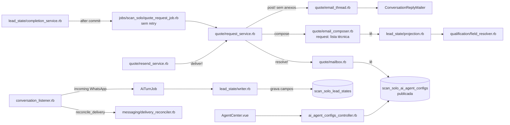
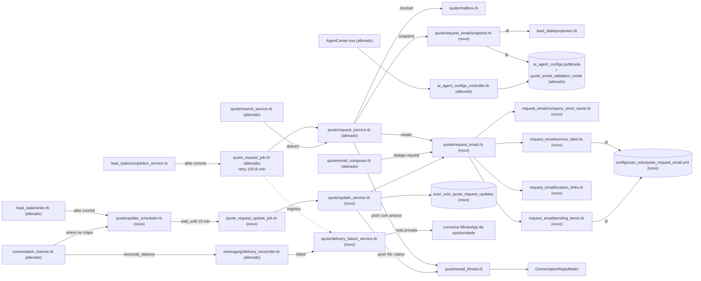

# Implementation Plan

## Request Summary
- Objective: trocar o assunto e o corpo do e-mail de solicitação de orçamento ao comercial (OC/CT-03) pelo modelo aprovado (CT-01), montado de forma determinística no Rails. Entram: assunto curto e pesquisável (`Solicitação de orçamento | {empresa_curta} | {servico_label}[ | {cidade}/{uf}]`), seções com omissão de campos vazios, telefone só do contato, pendências por tipo de serviço (CT-07), localização deduplicada, anexos do lead até 15 MB, parágrafo de modo validação controlado por uma flag nova da config publicada (com toggle na tela existente), e-mail de atualização mínimo no mesmo thread (janela fixa de 10 min, só antes da resposta processada), retry 1/5/15 min antes de a mensagem existir, nota privada + auditoria em falha, e auditoria com `template_version`. O bloco OC/CT-04, o `ResponseBlockParser` e o `ReplyProcessor` não mudam.
- Scope in: RF-01..RF-21, UI-01, CT-01..CT-07, RNF-01..RNF-08.
- Scope out: geração de PDF/template de proposta (feature futura `scansolo-proposta-template-local`), Make, Gotenberg; mudanças no bloco OC/CT-04, no parser, no `ReplyProcessor` e no e-mail de correção; gatilho da solicitação, aviso ao cliente (OC/RF-53) e contrato HTTP do reenvio (OC/CT-12); Reply-To novo; LLM, Receita, Google ou qualquer HTTP na montagem.
- Tier: standard
- SPEC: v1.2 (0 marcadores). Feature alterada: `.spec/features/scansolo-operacao-centralizada/` (OC, SPEC v1.3).
- Architecture references: `AGENTS.md` (= `CLAUDE.md`), `docs/agents/architecture.md`, `docs/agents/domain_rules.md`, `docs/agents/coding_guidelines.md`, `docs/agents/data_model.md` (consultado também `docs/agents/api_contracts.md`). Contratos base: `.spec/features/scansolo-operacao-centralizada/openapi.yaml` (v1.7.0) e `asyncapi.yaml` (v1.5.0).

### Regras de arquitetura preservadas (valem para todas as tasks)
- Base de comparação da feature: o commit `docs(spec)` que adiciona este plano (último commit só de `.spec/` antes do 1º commit de código). Até ele existir, `832721a15c`. Todo `git diff <base>` das tasks usa esse commit.
- `docs/agents/architecture.md` "Layer responsibilities":
  - Services (`services/scan_solo/*`): toda escrita e regra, 1 service por transição. `Quote::RequestService` continua o único caminho de envio da solicitação (verified at `app/services/scan_solo/quote/request_service.rb:43`); `Quote::UpdateService` (novo) é o único caminho do e-mail de atualização; `Quote::DeliveryFailureService` (novo) é o único caminho da nota privada + `quote_request.delivery_failed`.
  - Jobs (`jobs/scan_solo/*`): fronteira assíncrona, retry e espera (`QuoteRequestJob`, `QuoteRequestUpdateJob`).
  - Models: associações, enums, validações e invariantes de índice único (`scan_solo_quote_request_updates`, índice único `(quote_request_id, version_digest)`).
  - `ConversationListener`: só classifica e delega (T15 e T17 só acrescentam origens e uma delegação ao agendador).
  - Montagem do e-mail: objetos puros (`ScanSolo::Quote::RequestEmail` e colaboradores), sem escrita, sem HTTP e sem LLM (RF-01, RNF-01). A leitura do banco fica concentrada no `RequestEmail::Snapshot` (T11).
- `docs/agents/domain_rules.md` "Quote request and reply": inbox e destinatário vêm do `Quote::Mailbox` publicado; e-mail só depois do commit com auditoria `quote_request.sent`; `ResponseBlockParser` determinístico e intocado (RF-11). Regras de config: `PublishService` copia `AiAgentConfig::FIELDS` para o snapshot publicado (verified at `app/services/scan_solo/ai_agent/publish_service.rb:34`), então a flag nova entra em `FIELDS` (RF-21).
- Precedência de valor (`docs/agents/domain_rules.md`): lead state não `faltante` → coluna nativa → `custom_attributes` (verified at `app/services/scan_solo/qualification/field_resolver.rb:102`), exceto o telefone, que vem só de `contact.phone_number` (RF-07).
- RNF-04 (OC/RNF-01): e-mail e nota privada só fora de transação aberta. `Quote::EmailThread.post!` já levanta `CustomExceptions::ScanSolo::DeliveryInsideTransaction` (verified at `app/services/scan_solo/quote/email_thread.rb:29`); agendamentos a partir de escrita usam `ActiveRecord.after_all_transactions_commit` (padrão de `lead_state/completion_service.rb:74`).
- `AGENTS.md` "General Guidelines": falha alta em configuração impossível (arquivo versionado inválido levanta na carga; inbox mal configurado segue `QuoteInboxMisconfigured`); validação de parâmetro na borda (422 para `quote_email_validation_mode` não booleano); reuso do nativo (`ConversationReplyMailer`, `Attachment` nativo via `EmailThread.post!(attachments:)`, `Messages::MessageBuilder` com `private: true` como em `handoff_service.rb:75`, threading `Re: <mail_subject>` em `conversation_reply_mailer.rb:121-129`, nome do remetente pelo inbox em `conversation_reply_mailer.rb:92-102`); sem helpers de uso único; sem specs de helper customizado.
- `AGENTS.md` Enterprise: `docs/agents/architecture.md` declara `enterprise/` sem uso pelo ScanSolo; nenhum arquivo alterado tem par em `enterprise/` (T20 confere com `grep -rnE "enterprise/|Captain::"`).
- i18n (`AGENTS.md`): backend só em `config/locales/en.yml` (seção `scan_solo.quote.request_email.*`, textos em pt-BR como no resto do módulo); frontend só em `app/javascript/dashboard/i18n/locale/en/scansolo.json`. `scan_solo.quote.email.*` (instruções, bloco, `to_confirm`) não muda.
- Estilo (`docs/agents/coding_guidelines.md`): `class ScanSolo::…` compacta, 1 classe por arquivo, ≤ 150 colunas, header comment com RF/CT/RNF. Vue com `\r\nBcc: a@b.c` → `&lt;script&gt;` e assunto sem CR/LF (RF-17); 2 renderizações → texto, HTML e assunto idênticos (RF-01). `render_update`: 1ª linha `Atualização:`, linha de Profundidade com `não informado → 3 m`, resumo completo e bloco ao fim.
  - `email_composer_spec.rb`: a seção `.request` muda de expectativa (OC/RF-13 substituído por RF-02..RF-13, citado no `describe`); as demais seções e `empty_block` passam sem mudança.
  - `spec/services/scan_solo/quote/response_block_parser_spec.rb` e `reply_processor_spec.rb` passam sem mudança (RF-11).
- **Risk**: Medium — maior peça de lógica; mitigada pelos casos-limite da lista do RNF-08 e pelo parser rodando sobre a saída.
- **Dependencies**: T04, T05, T06, T07, T08, T11

### T13 — `RequestService`/`ResendService`: modelo novo, anexos, snapshot e auditoria (RF-01, RF-13, RF-19, RF-20)
- **Files**: `app/services/scan_solo/quote/request_service.rb`, `app/services/scan_solo/quote/resend_service.rb`, `spec/services/scan_solo/quote/request_service_spec.rb`, `spec/services/scan_solo/quote/resend_service_spec.rb`
- **Change**:
  - `compose` passa a ser `render(opportunity)`: `snapshot = RequestEmail::Snapshot.call(opportunity:, config: AiAgentConfig.published_for(account))` e `RequestEmail.render(snapshot:)`. `create_request!` usa o assunto novo como `mail_subject` do thread (OC/CT-03 alterado).
  - `deliver!` (usado também pelo reenvio): `EmailThread.post!(…, attachments: Attachment.where(id: result.attachment_ids).order(:id).map { _1.file.blob }, additional_attributes: { 'scansolo_origin' => 'quote_request_email' })`; depois, `quote_request.update!(request_message_id:, sent_at:, rendered_snapshot: snapshot, rendered_digest: Digest::SHA256.hexdigest(snapshot.to_json), update_window_ends_at: nil)` — o reenvio passa a ser a base das próximas atualizações (RF-20). `request_message_id` segue o comportamento atual (gravado a cada envio, inclusive no reenvio).
  - Auditoria `quote_request.sent` (envio e reenvio): payload `{ quote_request_id, opportunity_id, template_version: RequestEmail::TEMPLATE_VERSION, recipient, message_id, result: 'sent' }` com o `correlation_id` da solicitação (RF-19, CT-06). Sem corpo nem dados pessoais além do destinatário.
  - Gatilho, `Mailbox`, unicidade, thread, aviso ao cliente (`post_customer_notice!`) e `record_misconfigured!` inalterados (RF-01, RF-20).
- **Covers**: RF-01, RF-13, RF-15, RF-19, RF-20, CT-01, CT-06, RNF-03, RNF-04
- **Tests**: `request_service_spec.rb` (ActionMailer `:test`, `perform_enqueued_jobs`): 1 mensagem com o assunto/corpo novos e 1 anexo de 2 MB (mesmo checksum do blob do lead); `rendered_digest` gravado; 1 `quote_request.sent` com os 5 campos do RF-19; WebMock sem requisições e um double de LLM que levanta se chamado → passa (RF-01); dentro de transação → `DeliveryInsideTransaction` (RNF-04). `resend_service_spec.rb`: 2 reenvios → 2 mensagens no mesmo thread com o formato novo, 1 solicitação, 0 avisos novos ao cliente, 0 `QuoteRequestUpdate`, `rendered_digest` do último envio (RF-20); expectativas antigas de corpo (OC/RF-13) substituídas citando RF-20.
- **Risk**: Medium — caminho central da solicitação; contrato de gatilho e unicidade preservado.
- **Dependencies**: T12

### T14 — `DeliveryFailureService` e retry 1/5/15 min do `QuoteRequestJob` (RF-18 caso A)
- **Files**: `app/services/scan_solo/quote/delivery_failure_service.rb` (novo), `app/jobs/scan_solo/quote_request_job.rb`, `spec/services/scan_solo/quote/delivery_failure_service_spec.rb` (novo), `spec/jobs/scan_solo/quote_request_job_spec.rb` (novo)
- **Change**:
  - `DeliveryFailureService.call(opportunity:, reason:, message: nil)` (fora de transação, RNF-04): idempotente por mensagem quando `message` existe (não repete se já há `quote_request.delivery_failed` com o mesmo `message_id` no payload); cria 1 nota privada na conversa WhatsApp da oportunidade com `Messages::MessageBuilder.new(nil, opportunity.conversation, { content: I18n.t('scan_solo.quote.request_email.failure_note', reason:, link:), private: true }).perform` (padrão de `handoff_service.rb:75`), com `link` = `EmailComposer.conversation_url` da conversa de e-mail da solicitação; grava 1 `AuditEvent` `quote_request.delivery_failed` com o `correlation_id` da solicitação e payload do CT-06 (`result` = motivo). `reason` = nome da classe da exceção (caso A) ou `external_error` truncado em 200 caracteres (caso B); nunca credenciais. Não muda etapa, status nem handoff.
  - `QuoteRequestJob`: `WAITS = [1.minute, 5.minutes, 15.minutes].freeze`; `retry_on StandardError, attempts: 4, wait: ->(executions) { WAITS.fetch(executions - 1) }` com bloco de esgotamento que chama `DeliveryFailureService` só se a solicitação continua sem `request_message_id` (falha antes de a mensagem existir). A reexecução reaproveita a solicitação sem `request_message_id` (comportamento atual, `request_service.rb:85-91`), então nunca cria 2ª solicitação nem thread.
- **Covers**: RF-18, RF-19, CT-06, RNF-04
- **Tests**: `quote_request_job_spec.rb` com `EmailThread.post!` levantando sempre e `perform_enqueued_jobs` + `travel`: exatamente 4 execuções, esperas de 1, 5 e 15 min (`have_been_enqueued.at`), depois 1 nota `private: true` na conversa WhatsApp, 1 `quote_request.delivery_failed`, 0 solicitações novas, 1 thread; exceção só na 1ª → 1 e-mail, 0 notas, 0 `delivery_failed`; durante a falha, `ScanSolo::Handoff::HandoffService.call` leva a conversa a `awaiting_human`. `delivery_failure_service_spec.rb`: 2 chamadas com a mesma mensagem → 1 nota e 1 auditoria; payload sem corpo do e-mail.
- **Risk**: Medium — `retry_on StandardError` amplo; limitado a 4 tentativas e à ausência de `request_message_id` para a nota.
- **Dependencies**: T04, T13

### T15 — Falha assíncrona da mensagem de e-mail: nota + auditoria na hora, sem retry (RF-18 caso B)
- **Files**: `app/services/scan_solo/messaging/delivery_reconciler.rb`, `app/services/scan_solo/conversation_listener.rb`, `spec/services/scan_solo/messaging/delivery_reconciler_spec.rb`, `spec/services/scan_solo/conversation_listener_spec.rb`
- **Change**: listener: `TEMPLATE_ORIGINS` ganha `quote_request_email` e `quote_request_update` (só classificação; o reconciliador já é chamado em `message_created`/`message_updated`). `DeliveryReconciler#call`: com `outcome == :failed` e origem de e-mail de solicitação/atualização, localiza a solicitação pela conversa de e-mail (`QuoteRequest.find_by(email_conversation_id: message.conversation_id)`) e chama `Quote::DeliveryFailureService.call(opportunity:, reason: external_error, message:)` (T14). Nenhuma nova mensagem no thread, nenhum retry (M-11). Os outros caminhos do reconciliador não mudam.
- **Covers**: RF-18, RNF-04
- **Tests**: `delivery_reconciler_spec.rb`: mensagem `quote_request_email` atualizada para `failed` com `external_error` → 0 mensagens novas no thread, 1 nota privada, 1 `delivery_failed`; 2º `message_updated` igual → continua 1; aceita (`source_id`) → nada. `conversation_listener_spec.rb`: `message_updated` de mensagem `quote_request_update` chama o reconciliador.
- **Risk**: Low.
- **Dependencies**: T14

### T16 — `UpdateService` + `QuoteRequestUpdateJob`: e-mail de atualização no mesmo thread (RF-14, CT-03)
- **Files**: `app/services/scan_solo/quote/update_service.rb` (novo), `app/jobs/scan_solo/quote_request_update_job.rb` (novo), `spec/services/scan_solo/quote/update_service_spec.rb` (novo), `spec/jobs/scan_solo/quote_request_update_job_spec.rb` (novo)
- **Change**:
  - `UpdateService.call(quote_request:)`:
    1. Sob `quote_request.with_lock`: `update_window_ends_at = nil` (fecha a janela; mudanças depois disso abrem outra); retorna se a solicitação não está `awaiting_reply`/`correction_requested` (RF-14 (a), checado no envio) ou não tem `request_message_id`/`rendered_snapshot`.
    2. `snapshot = Snapshot.call(...)`; `RequestEmail.changed?(snapshot, quote_request.rendered_snapshot)` falso → retorna (0 e-mails).
    3. Reivindica `QuoteRequestUpdate.create!(quote_request:, account:, version_digest: SHA256(snapshot.to_json))` numa transação; `RecordNotUnique` com mensagem já gravada → retorna; linha existente sem `message_id` (retry) → segue para o envio.
    4. Fora de transação: `settings = Mailbox.resolve!`; `EmailThread.post!(conversation: email_conversation, recipient: settings.recipient, email: RequestEmail.render_update(...).email, attachments: <blobs dos anexos novos até 15 MB>, additional_attributes: { 'scansolo_origin' => 'quote_request_update' })`; grava `message_id`/`sent_at` na linha e `rendered_snapshot`/`rendered_digest` na solicitação; 1 `AuditEvent` `quote_request.update_sent` (payload CT-06, `template_version`, `result: 'sent'`).
    - Não cria solicitação nem thread, não muda status, não posta aviso ao cliente (OC/RF-53).
  - `QuoteRequestUpdateJob` (`queue_as :medium`): `perform(quote_request_id)` chama o service; mesmo `retry_on` 1/5/15 min do T14 e, no esgotamento sem `message_id`, `DeliveryFailureService` (RF-18 vale para "solicitação ou atualização").
- **Covers**: RF-14, RF-18, RF-19, CT-03, CT-06, RNF-03, RNF-04, RNF-05
- **Tests**: `update_service_spec.rb` (ActionMailer `:test`): `profundidade` informada depois do envio → 1 mensagem no thread, assunto entregue `Re: <mail_subject>`, 1ª linha `Atualização:`, linha de Profundidade, resumo completo e bloco; reexecutar → continua 1; mudança que não altera nada renderizado → 0; status `replied` → 0; anexo novo de 2 MB → `Novo anexo:` e 1 anexo; 2 threads concorrentes → 1 e-mail (RNF-05); `quote_request.update_sent` com os 5 campos; 0 avisos ao cliente, status inalterado. `quote_request_update_job_spec.rb`: falha em todas → 4 tentativas e 1 nota no fim.
- **Risk**: Medium — e-mail extra ao comercial; limitado a 1 por versão (índice único) e por janela.
- **Dependencies**: T12, T13, T14

### T17 — `UpdateScheduler`: janela fixa de 10 min e ganchos de mudança (RF-14 (b))
- **Files**: `app/services/scan_solo/quote/update_scheduler.rb` (novo), `app/services/scan_solo/lead_state/writer.rb`, `app/services/scan_solo/conversation_listener.rb`, `spec/services/scan_solo/quote/update_scheduler_spec.rb` (novo), `spec/services/scan_solo/lead_state/writer_spec.rb`, `spec/services/scan_solo/conversation_listener_spec.rb`
- **Change**:
  - `UpdateScheduler.call(opportunity:)` (`WINDOW = 10.minutes`): retorna sem query extra se não há solicitação com `request_message_id` ou ela não está aberta; sob `quote_request.with_lock`, só quando `update_window_ends_at` é nulo grava `Time.current + WINDOW` e enfileira `QuoteRequestUpdateJob.set(wait_until:).perform_later(id)`. Janela aberta → nada (mudanças seguintes não reiniciam nem estendem).
  - `LeadState::Writer#write_field!`: `ActiveRecord.after_all_transactions_commit { ScanSolo::Quote::UpdateScheduler.call(opportunity: lead_state.opportunity) }` (só quando um campo muda de fato; transação revertida não agenda).
  - `ConversationListener#handle_incoming`: depois do fluxo atual, delega `UpdateScheduler.call(opportunity:)` só quando a mensagem tem anexo (`image`/`audio`/`video`/`file`/`location`) ou URL que casa `MAP_URL_PATTERN` (anexo e localização novos não passam pelo `Writer`). Sem outra lógica no listener.
- **Covers**: RF-14, RNF-04, RNF-05
- **Tests**: `update_scheduler_spec.rb` com `travel_to`: mudanças em t=0, t=2 e t=9 min → 1 job em t=10 min (janela não estendida); job executado em t=10 e mudança em t=11 → 2º job em t=21; solicitação `replied` ou sem `request_message_id` → 0 jobs; 2 chamadas concorrentes → 1 job. `writer_spec.rb`: `apply_field!` aplicado dentro de transação revertida → 0 jobs; aplicado e confirmado após o envio → 1 job; `:unchanged` → 0. `conversation_listener_spec.rb`: incoming com anexo `file` → agendador chamado; só texto sem mapa → não chamado. Fluxo AC do RF-14 (3 mudanças em 2 min → 1 e-mail com as 3) coberto em T18.
- **Risk**: Medium — gancho no `Writer` (único escritor do lead state) e no listener; ambos só agendam depois do commit e saem cedo sem solicitação enviada.
- **Dependencies**: T15, T16

### T18 — Provas ponta a ponta da feature (RNF-08)
- **Files**: `spec/services/scan_solo/quote/request_email_flow_spec.rb` (novo)
- **Change**: spec de integração (ActionMailer `:test`, WebMock, `perform_enqueued_jobs`, `travel_to`) cobrindo a lista do RNF-08 de ponta a ponta: conclusão → `QuoteRequestJob` → e-mail AMAGGI entregue com `From` = `Atendimento Comercial ScanSolo <atendimento.comercial@scansolo.com.br>` (inbox com `business_name` e `sender_name_type: professional`) e sem `Reply-To` diferente do nativo atual (RF-15); `empresa` maliciosa → e-mail entregue sem cabeçalho `Bcc` vindo do valor (RF-17); resposta do Luciano com bloco preenchido acima do e-mail novo citado → `ReplyProcessor` lê como hoje (RF-11); 3 mudanças em 2 min depois do envio → 1 atualização com as 3 ao fim da janela; `replied` no fim → 0; 1 envio + 1 atualização → busca por `correlation_id` devolve 1 `quote_request.sent` e 1 `quote_request.update_sent` com os 5 campos (RF-19); modo validação desligado e publicado → 0 parágrafos. Nenhum envio real.
- **Covers**: RF-11, RF-14, RF-15, RF-17, RF-19, RNF-07, RNF-08
- **Tests**: o próprio spec verde no container.
- **Risk**: Low.
- **Dependencies**: T09, T13, T14, T15, T16, T17

### T19 — Documentação de arquitetura e contratos
- **Files**: `docs/agents/domain_rules.md`, `docs/agents/architecture.md`, `docs/agents/data_model.md`, `docs/agents/api_contracts.md`
- **Change**: `domain_rules.md` "Quote request and reply" (modelo CT-01 determinístico, `template_version`, anexos ≤ 15 MB, atualização com janela fixa de 10 min só em `awaiting_reply`/`correction_requested`, retry 1/5/15 min e nota + `delivery_failed`, arquivo versionado `config/scan_solo/quote_request_email.yml`); `architecture.md` "Macro flow: quote to proposal" (Writer/listener → `UpdateScheduler` → `QuoteRequestUpdateJob` → `UpdateService`; reconciliador → `DeliveryFailureService`) e "Layer responsibilities" (origens novas no listener); `data_model.md` (colunas de `scan_solo_quote_requests`, tabela `scan_solo_quote_request_updates`, `quote_email_validation_mode`); `api_contracts.md` (campo novo do `ai_agent_config` e 422) com ponteiros para `.spec/features/scansolo-solicitacao-orcamento-email/openapi.yaml` e `asyncapi.yaml`. Editar só as seções citadas, preservando alterações locais existentes. Os docs operacionais citados no SPEC (`BACKLOG.md`, `DECISOES.md`, `STATUS_ATUAL.md`, `CHANGELOG.md`, `SYSTEM_MAP.md`, `claude/PLANO_AGENTE_E_PROPOSTAS.md`) não existem no repositório hoje: atualizar só os que existirem no momento da execução (`test -f`), sem criá-los.
- **Covers**: documentação de CT-01..CT-07
- **Tests**: `grep -n "quote_request.update_sent\|quote_request_email.v2\|quote_email_validation_mode" docs/agents/*.md` com ≥ 1 ocorrência em cada um dos 4 arquivos onde o tópico se aplica; `api_contracts.md` aponta os 2 contratos.
- **Risk**: Low.
- **Dependencies**: T09, T16, T17

### T20 — Gates de qualidade e regressão
- **Files**: nenhum arquivo novo; só corrige quebras residuais nos arquivos já alterados.
- **Change**: rodar e corrigir:
  - `bundle exec rubocop --force-exclusion` nos `.rb` alterados (container); `pnpm eslint` nos `.js/.vue` alterados (`.vue` explícitos); `pnpm test app/javascript/dashboard/routes/dashboard/scansolo/agent/specs`; `./scripts/ralph-test.sh`.
  - RF-11: `git diff <base> --stat -- app/services/scan_solo/quote/response_block_parser.rb app/services/scan_solo/quote/reply_processor.rb spec/services/scan_solo/quote/response_block_parser_spec.rb spec/services/scan_solo/quote/reply_processor_spec.rb` vazio; nenhuma linha de `scan_solo.quote.email`/`scan_solo.quote.block` alterada no `en.yml`.
  - RF-01/RNF-01: `grep -rnE "Net::HTTP|Faraday|HTTParty|SafeFetch|Llm|LLM|RubyLLM|OpenAI|\.save|\.update|\.create" app/services/scan_solo/quote/request_email.rb app/services/scan_solo/quote/request_email/` vazio.
  - RF-07: `git diff <base> -- app/services/scan_solo/ai_turn/ app/services/scan_solo/qualification/` vazio (prompt e lista de campos exigidos intactos).
  - OC/RF-53 / RF-14: `grep -n "post_customer_notice" app/services/scan_solo/quote/update_service.rb` vazio.
  - Sem `skip`/`pending`/`xit`: `git diff <base> -- spec app/javascript | grep -E '^\+\s*(skip|pending|xit|xdescribe|xcontext)\b|\b(it|describe|test)\.(skip|todo)\('` vazio.
  - Enterprise: `git diff <base> --name-only | xargs grep -lnE "enterprise/|Captain::"` vazio.
  - RNF-07: `grep -rnE "Bearer|api_access_token|password" config/scan_solo/quote_request_email.yml config/locales/en.yml | grep request_email` vazio.
- **Covers**: RF-01, RF-07, RF-11, RNF-01, RNF-06, RNF-07, RNF-08
- **Tests**: rubocop 0 offenses; eslint 0 erros; vitest verde; `./scripts/ralph-test.sh` exit 0.
- **Risk**: Low.
- **Dependencies**: T01..T19

### T21 — GATE HUMANO: nome de exibição do inbox de orçamento (RF-15)

> 2026-10-10: tarefa operacional movida do `PHASES.md` para `OPERADOR.md` (o ralph executa só as fases 1–10). PHASES.md tem 20 checkboxes para 21 tasks por isso. O envio de teste vai para o próprio e-mail do agente (ver `OPERADOR.md`).
- **Files**: `.spec/features/scansolo-operacao-centralizada/make/REGISTRO.md`
- **Change**: tarefa de operador, não executada pelo `ralph.sh` e sem nenhum envio de e-mail. Na instância de produção, no inbox publicado como `quote_inbox_id` (`atendimento.comercial@scansolo.com.br`), configurar `business_name` = `Atendimento Comercial ScanSolo` e `sender_name_type` = `professional` (Configurações do inbox → Nome do remetente). Conferir e registrar data, id do inbox e os 2 valores. Conferir também que a flag `quote_email_validation_mode` está publicada como `true` depois do deploy.
- **Covers**: RF-15, RF-21
- **Tests**: `GET /api/v1/accounts/<id>/inboxes/<quote_inbox_id>` → `business_name` e `sender_name_type` esperados; `GET .../scan_solo/ai_agent_config` → `published.quote_email_validation_mode = true`; linha datada no `REGISTRO.md`.
- **Risk**: Low.
- **Dependencies**: T20

## Execution Phases
| Phase | Tasks | Parallel-safe? |
|-------|-------|----------------|
| 1 — Fundação de dados: migrações | T01 | No (única; `db/schema.rb`) |
| 2 — Modelos, arquivo versionado e textos | T02, T03, T04 | Yes (modelos × YAML/loader × `en.yml`; arquivos disjuntos) |
| 3 — Colaboradores puros e configuração | T05, T06, T07, T08, T09, T10 | Yes (1 arquivo novo por colaborador; controller/jbuilder × frontend disjuntos) |
| 4 — Leitura das fontes (Snapshot) | T11 | No (única; fixa o formato usado por T12–T17) |
| 5 — Renderização CT-01/CT-03 | T12 | No (única; depende de T05–T08 e T11) |
| 6 — Envio: modelo novo e falha antes da mensagem | T13, T14 | No (T14 depende do `deliver!` de T13 e o job chama o service alterado) |
| 7 — Falha assíncrona e serviço de atualização | T15, T16 | Yes (reconciliador/listener × update service/job; arquivos disjuntos, ambos sobre T14) |
| 8 — Agendamento da janela de atualização | T17 | No (única; altera `conversation_listener.rb`, já tocado em T15) |
| 9 — Provas ponta a ponta e documentação | T18, T19 | Yes (spec × docs) |
| 10 — Gates de qualidade | T20 | No (depende de todo o código) |
| 11 — GATE HUMANO: nome de exibição do inbox — fora do `ralph.sh` | T21 | No (operacional) |

Deployabilidade:
- Phases 1–3 são aditivas: a flag nasce `true`, o toggle aparece e nada no envio muda ainda.
- Phases 4–8 devem ir juntas no mesmo deploy: a Phase 6 já envia o modelo novo e grava o snapshot que as Phases 7–8 usam como base; um deploy só até a Phase 6 é seguro (sem atualização, sem falha assíncrona tratada), mas não cumpre RF-14/RF-18 B.
- Phase 11 (operador) pode ser feita antes ou depois do deploy; sem ela o From sai com o nome padrão do inbox (não bloqueia o envio).

## Contracts emitted
| Artifact | Path | RFs covered | Compatibility |
|---|---|---|---|
| OpenAPI 3.1 (delta), v1.0.0 sobre OC v1.7.0 | `.spec/features/scansolo-solicitacao-orcamento-email/openapi.yaml` | CT-05 (1) → RF-21, UI-01 (`GET /ai_agent_config`, `PUT /ai_agent_config/draft`, `quote_email_validation_mode`); reenvio OC/CT-12 → RF-20 (sem mudança, referenciado) | Aditivo: campo booleano novo, padrão `true`, no rascunho e na publicada; valor não booleano → 422 com o corpo atual do `RecordInvalid` (`{ message, attributes }`). Nenhum campo existente muda nome, tipo ou sentido. O contrato do reenvio (OC/CT-12) é inalterado. |
| AsyncAPI 3.0 (delta), v1.0.0 sobre OC v1.5.0 | `.spec/features/scansolo-solicitacao-orcamento-email/asyncapi.yaml` | CT-01 → RF-01..RF-13, RF-15..RF-17, RF-20; CT-03 → RF-14; nota de falha → RF-18; CT-06 (auditoria) → RF-18, RF-19 | **Mudança intencional, sinalizada:** `QuoteRequestEmailPayload` do OC (CT-03) tinha `subject` com `pattern: '^Solicitação de orçamento #\d+ — .+$'` e corpo "identificação → todos os campos → bloco"; o SPEC (OC/RF-13 e OC/CT-03 alterados) troca o assunto para `Solicitação de orçamento | … | …` e o corpo para as seções do CT-01. O único consumidor é o comercial humano; o bloco OC/CT-04 e o `ResponseBlockParser` não mudam, então a leitura da resposta continua compatível. Canal novo de atualização (CT-03) no mesmo thread; `scansolo_origin` ganha `quote_request_email` e `quote_request_update` (aditivo); eventos de auditoria `quote_request.update_sent` e `quote_request.delivery_failed` novos e `quote_request.sent` com payload estendido (aditivo). |

Validação cruzada:
- Rastreabilidade: cada operação/canal cita RF/UI/CT na `description`. O arquivo versionado (CT-05 (2)) não é interface externa e não entra em contrato.
- Erros documentados: 422 de `quote_email_validation_mode` (CT-05); falhas de envio (RF-18 A/B) como nota + auditoria; 401/403/404 herdados do `BaseController`/Pundit.
- Nenhum campo sem RF: `quote_request_id` no payload de auditoria vem do CT-06.

## Risks
| Risk | Blast radius | Mitigation | Rollback |
|------|-------------|------------|----------|
| Assunto novo quebra filtros/regras de e-mail do comercial que procuravam `#<id>` | Caixa do Luciano | Assunto do CT-01 aprovado pelo desenvolvedor; avisar o comercial no deploy | Reverter T12/T13 (volta ao composer anterior) |
| Linha do lead neutralizada com `- ` continuaria lida pelo parser (Q1) | Leitura da resposta do comercial | Prefixo neutro que o parser não remove + spec do parser sobre a saída (T12) | Ajustar o prefixo; parser intocado |
| E-mails de atualização excessivos | Caixa do comercial | Só depois do envio, só em `awaiting_reply`/`correction_requested`, 1 por janela fixa de 10 min e por versão (índice único), 0 sem diferença renderizada | Remover os ganchos de T17 (o resto fica inerte) |
| Gancho no `Writer` (único escritor do lead state) | Todo turno do agente | Só `after_all_transactions_commit`, saída cedo sem solicitação enviada, spec de transação revertida | Reverter T17 |
| `retry_on StandardError` reexecuta um job que falhou depois de enviar | Solicitação | Reexecução reaproveita a solicitação; com `request_message_id` só retoma o aviso idempotente; nota só sem `request_message_id` | Reverter T14 |
| Anexos grandes atrasam o envio ou estouram o SMTP | Entrega do e-mail | Limite 15 MB por e-mail (RNF-03); o restante vai como link da conversa | Reduzir o limite (constante) |
| Solicitações enviadas antes do deploy não têm `rendered_snapshot` | Atualizações dessas solicitações | `UpdateService` não envia sem base (ver Assumptions); um reenvio manual grava a base | — |
| Nome de exibição não configurado no inbox | From do e-mail | T21 (operador), sem nome fixo no código | — |

Rollout:
1. Deploy das Phases 1–10 juntas (com `db:migrate`), conferindo no tracker e na auditoria o 1º `quote_request.sent` com `template_version = quote_request_email.v2`.
2. Phase 11 (operador): nome de exibição do inbox e flag publicada.
3. Avisar o comercial do assunto novo e do parágrafo de modo validação; desligar a flag pela tela quando o modelo estiver validado.

## Open Questions
- Q1 (SPEC × código, RF-11): o RF-11 manda prefixar com `- ` a linha de texto do lead que começa com um rótulo do OC/CT-04 + `:`, e o AC exige que o parser, rodando no e-mail sem resposta, devolva 0 valores. Mas o `ResponseBlockParser` remove marcadores iniciais `[\s*_\-•]+` antes de casar o rótulo (`LEADING_MARKERS`, verified at `app/services/scan_solo/quote/response_block_parser.rb:26,86,101`), então `- Valor total: 10` continua sendo lido como `total_value` — o prefixo literal não cumpre o AC, e o parser está fora do escopo. O plano segue o código e o AC: T12 usa um prefixo que o parser não remove nem trata como fronteira (default `» `, U+00BB), sem alterar o texto do lead. Confirmar o caractere (alternativas: `> `, que o parser trata como fronteira de citação; ou `(lead) `). Impacto: só linhas do lead que imitam o bloco.
- Q2 (nome da flag): o SPEC chama a flag de `modo_validacao` (RF-21, CT-05) e o FLEXIBLE sugere a coluna `quote_email_validation_mode`. O plano usa `quote_email_validation_mode` na coluna, no JSON da API e no `FIELDS` (padrão inglês das colunas `quote_*` da mesma config, `docs/agents/data_model.md`), tratando `modo_validacao` como o nome lógico do CT-02. Confirmar se o JSON da API deve expor literalmente `modo_validacao`.

## Assumptions
- O `ConversationReplyMailer` gera o From `"%{business_name} <%{from_email}>"` com `sender_name_type: professional` (verified at `app/mailers/conversation_reply_mailer.rb:92-102`) e não muda o Reply-To atual (`reply+<uuid>@<inbound_email_domain>` quando configurado, `conversation_reply_mailer.rb:136`); RF-15 é só configuração do inbox (T21) + spec (T18).
- O `deliver!` atual grava `request_message_id` com a mensagem de cada envio, inclusive no reenvio (verified at `app/services/scan_solo/quote/request_service.rb:47`); T13 mantém esse comportamento. O RF-14 só depende de o campo estar presente, e `rendered_snapshot`/`rendered_digest` passam a refletir o último e-mail enviado (RF-20).
- Solicitações enviadas antes do deploy (`rendered_snapshot` nulo) não recebem e-mail de atualização até um reenvio manual gravar a base; o SPEC trata a atualização como caso de borda mínimo.
- Mudanças só de coluna nativa do contato (nome, e-mail, telefone editados por um humano) não abrem janela de atualização: os gatilhos são o `Writer` (lead state) e mensagens `incoming` com anexo/localização/URL de mapa (T17). [UNVERIFIED se o SPEC espera esse caso; o RF-14 cita "campo do CT-02, pendência, localização ou anexo novo do lead".]
- A falha de reenvio manual síncrona (exceção no `ResendService`) continua devolvida ao administrador pela API, sem retry automático; o caso B (mensagem criada e depois `failed`) vale para envio, reenvio e atualização pelo reconciliador (T15).
- O motivo na nota privada é o nome da classe da exceção (caso A) ou o `external_error` nativo truncado (caso B); nenhum deles carrega credenciais do SMTP [UNVERIFIED para todos os provedores SMTP].
- `Messages::MessageBuilder` aceita `user = nil` para nota privada, como o `HandoffService` já usa com `actor` opcional (`handoff_service.rb:75`).
- Docs operacionais citados no SPEC não existem hoje (`test -f` falhou para os 6); T19 só os atualiza se existirem na execução.
- `db:migrate` no banco de teste pode gravar `installation_configs` e causar duplicate-key em specs (memória do projeto); se acontecer, recriar o banco de teste antes da suíte.
