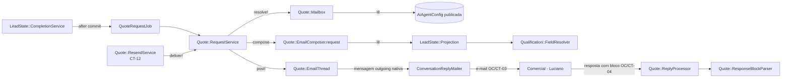
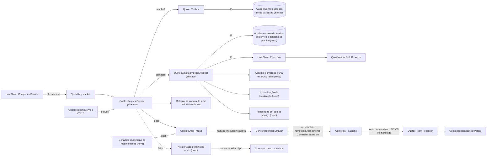

# SPEC: scansolo-solicitacao-orcamento-email

## Metadata
- Source: developer description via /plan. Fonte de verdade: `.spec/features/scansolo-solicitacao-orcamento-email/.handoff/input.md` (modelo de e-mail aprovado em 2026-10-09, exemplo AMAGGI com dados fictícios, 10 ACs confirmados no checkpoint do /plan, decisões do desenvolvedor de 2026-10-09).
- Service: ss-aiagentsystem (fork do Chatwoot, monólito Rails 7.2 + Vue 3, namespace `ScanSolo::`)
- Tier: standard
- Version: 1.2
- Changelog:
  - 1.0 (2026-10-09): versão inicial com 9 marcadores (M-01..M-09).
  - 1.1 (2026-10-10): respostas do desenvolvedor aplicadas a M-01..M-09 (`.handoff/clarifier-answers.md`). `unidade` = `cliente_final`; rótulo "Serviço não informado"; seção OUTRAS INFORMAÇÕES; fontes das pendências 4 e 8; atualização só sem resposta processada, com janela de 10 min; retry 1/5/15 min; só a flag na config publicada, tabela e mapa de rótulos em arquivo versionado; sem resumo por LLM; "Atualização:" no corpo. Novos marcadores M-10 e M-11.
  - 1.2 (2026-10-10): rodada 2 (`.handoff/clarifier-answers.md`, "Round 2"). M-10: janela fixa de 10 min aberta pela 1ª mudança depois do envio. M-11: falha assíncrona (mensagem criada e depois `failed`) sem retry automático; nota + auditoria na hora; retry 1/5/15 min só antes da mensagem existir. Linha `Cidade/UF:` no corpo (LOCAL DO SERVIÇO). Confirmados: status de M-05 checados no envio e rótulo de M-01. Contexto: o e-mail principal sai 1 vez, no fim da coleta; a atualização é caso de borda e fica mínima. 0 marcadores em aberto.
- Feature alterada: `.spec/features/scansolo-operacao-centralizada/SPEC.md` v1.3 (abreviada aqui como **OC**). Os ids dessa feature aparecem com o prefixo `OC/`. Os ids sem prefixo são desta feature.
- Architecture references: `AGENTS.md` (idêntico a `CLAUDE.md`), `docs/agents/architecture.md`, `docs/agents/domain_rules.md`, `docs/agents/data_model.md`
- Init chain: ausente

### Requisitos da OC alterados ou preservados

| Id OC | Situação | Onde |
|---|---|---|
| `OC/RF-12` (disparo, inbox, destinatário, 1 conversa por solicitação) | **Preservado.** Gatilho (`concluida` + próxima ação `proposta`), canal, destinatário publicado e thread próprio não mudam. Muda só o conteúdo do e-mail. | RF-01 |
| `OC/RF-13` (conteúdo do e-mail) | **Substituído.** A ordem identificação → todos os campos → bloco dá lugar às seções do modelo aprovado. Saem do corpo: id da oportunidade, origem, responsável e etapa. Ficam: link da conversa e bloco OC/CT-04. | RF-02 a RF-13, CT-01, CT-02 |
| `OC/RF-14` (inbox mal configurado) | **Preservado sem mudança.** | — |
| `OC/RF-15` / `OC/RNF-02` (≤ 1 solicitação por conclusão) | **Preservado.** O e-mail de atualização (RF-14) não cria solicitação nem thread. | RF-14, RF-20 |
| `OC/RF-16`..`OC/RF-23` (leitura da resposta, pendentes, correlação) | **Preservados.** O bloco OC/CT-04 e o parser não mudam. | RF-11 |
| `OC/RF-53` (aviso único ao cliente) | **Preservado.** O e-mail de atualização nunca gera novo aviso. | RF-14 |
| `OC/RF-54` (3 campos da config publicada) | **Preservado e estendido.** Entra 1 configuração nova (modo validação). A tabela de pendências por tipo de serviço e o mapa de rótulos de serviço ficam num arquivo de configuração versionado no código, fora da config publicada. | RF-21, CT-05 |
| `OC/RF-56` / `OC/CT-12` (reenvio manual) | **Preservado.** O reenvio passa a usar o modelo novo. Contrato HTTP inalterado. | RF-20 |
| `OC/CT-03` (e-mail de solicitação) | **Alterado.** Muda o assunto e o corpo. From, To, HTML com quebras preservadas, 1 conversa por solicitação e threading pelo Message-ID nativo continuam. | CT-01 |
| `OC/CT-04` (bloco de resposta) | **Preservado sem mudança** (rótulos, delimitadores, gramática). | RF-11 |
| `OC/RNF-01`, `OC/RNF-04`, `OC/RNF-07`, `OC/RNF-08`, `OC/RNF-09` | **Preservados** e aplicados aos e-mails desta feature. | RNF-04 a RNF-07 |

### Regras de arquitetura aplicadas (citadas)
- `docs/agents/architecture.md`, "Layer responsibilities": `services/scan_solo/*` são donos de "Every write and business rule; one 'sole path' service per state change". `jobs/scan_solo/*` são donos de "Async boundary, locking". Os models só cuidam de "Associations, enums, validations, unique-index invariants". Por isso a montagem do e-mail continua num componente puro (sem escrita), chamado pelo `ScanSolo::Quote::RequestService`, que segue como o único caminho de envio (verified at `app/services/scan_solo/quote/request_service.rb:43,95`). A idempotência da atualização (RF-14) é garantida por índice único.
- `docs/agents/architecture.md`, "Macro flow: quote to proposal": `CompletionService (next_action proposta) ─after commit─> QuoteRequestJob ─> Quote::RequestService ─> email thread to commercial recipient`. Esta feature mantém o fluxo e troca o conteúdo do e-mail.
- `docs/agents/domain_rules.md`, "Quote request and reply": "Inbox and recipient come from the published config (`Quote::Mailbox`)", "The email is posted after commit, with audit `quote_request.sent`" e "`Quote::ResponseBlockParser` is deterministic (no LLM)". O RF-11 preserva o parser, e o RF-01 proíbe LLM na montagem.
- `docs/agents/domain_rules.md`, regras de config (seção de `AiAgentConfig`): "`PublishService` copies `FIELDS` into a new `published` row" e "`published_for(account)` returns `draft.published_version`". A configuração nova de modo validação (RF-21) segue o snapshot de publicação, como `OC/RF-54`.
- `docs/agents/domain_rules.md`, "Value precedence: lead state (non-`faltante`) → native Contact column (`nome`/`email`/`telefone`) → `custom_attributes`" (verified at `app/services/scan_solo/qualification/field_resolver.rb:102`). O CT-02 usa essa precedência, com uma exceção: o telefone vem só do contato (RF-07).
- `AGENTS.md`, "General Guidelines": "When an impossible or misconfigured state would indicate a setup/deployment bug, let it fail loudly" e "Prefer existing repo dependencies". O e-mail continua no canal nativo (`ScanSolo::Quote::EmailThread.post!` → `ConversationReplyMailer`, com anexos nativos, verified at `app/services/scan_solo/quote/email_thread.rb:26,36`). O nome do remetente vem da configuração nativa do inbox (verified at `app/mailers/conversation_reply_mailer.rb:92-102`).

## Context
Hoje, quando a qualificação de um lead termina com próxima ação `proposta`, o `ScanSolo::Quote::RequestService` envia ao comercial (Luciano) o e-mail montado por `ScanSolo::Quote::EmailComposer.request` (verified at `app/services/scan_solo/quote/email_composer.rb:18`). O assunto é `Solicitação de orçamento #<id> — <empresa>` (verified at `config/locales/en.yml:697`). O corpo despeja, em ordem, a identificação e todos os campos do catálogo (`ScanSolo::Qualification::FieldResolver::CATALOG`, 34 chaves, verified at `app/services/scan_solo/qualification/field_resolver.rb:24`) não `faltante`, e termina com o bloco OC/CT-04. O resultado é uma lista técnica, longa e pouco legível para o comercial. Ela não aponta o que falta perguntar ao cliente, não anexa os documentos do lead, não trata localizações duplicadas e não avisa quando o lead complementa dados depois do envio.

O desenvolvedor aprovou um modelo de e-mail em linguagem natural (seções DADOS DO CLIENTE, LOCAL DO SERVIÇO, SERVIÇO SOLICITADO, OBJETIVO DO LEVANTAMENTO, DETALHES TÉCNICOS INFORMADOS, DOCUMENTAÇÃO RECEBIDA, INFORMAÇÕES AINDA NÃO CONFIRMADAS), com assunto curto e pesquisável, montado de forma determinística no Rails. Esta feature troca só o e-mail (Fase A). A geração local da proposta (.docx + Gotenberg) fica para a feature futura `scansolo-proposta-template-local`. Se a proposta automática não ficar boa, o Luciano usa os dados do e-mail e envia a proposta manualmente.

Achados do código usados no SPEC:
- O valor de um campo segue a precedência do `FieldResolver` (lead state não `faltante` → coluna nativa do contato → `custom_attributes`), e a `ScanSolo::LeadState::Projection` expõe os campos com status `confirmado`/`inferido`/`faltante` (verified at `app/services/scan_solo/lead_state/projection.rb:51-60`).
- O catálogo tem `cidade_uf` como um único campo "Cidade / UF" (verified at `field_resolver.rb:37`) e `link_local` como um único link (verified at `field_resolver.rb:40`). Uma localização do WhatsApp vira link `https://www.google.com/maps?q=<lat>,<long>` ou o `external_url` do anexo (verified at `app/services/scan_solo/ai_turn/attachment_reader.rb:37-38`). Os hosts de mapa reconhecidos estão em `MAP_URL_PATTERN` (verified at `attachment_reader.rb:20`).
- `EmailThread.post!` já aceita blobs do ActiveStorage como anexos e recusa envio dentro de transação aberta (verified at `email_thread.rb:26-36`).
- O nome de exibição do remetente vem do inbox: `business_name` + `sender_name_type` (`professional` → `"%{business_name} <%{from_email}>"`) (verified at `db/schema.rb:1157-1158`, `config/locales/en.yml:393`, `conversation_reply_mailer.rb:92-102`).
- O assunto da thread fica em `additional_attributes.mail_subject` da conversa. A partir da 2ª mensagem, o mailer nativo usa `Re: <mail_subject>` (verified at `conversation_reply_mailer.rb:121-129`).
- O `ResponseBlockParser` lê o primeiro bloco, de cima para baixo, que tenha algum rótulo OC/CT-04 preenchido. Uma linha casa um rótulo quando começa (normalizada) por `Valor total`, `Prazo/cronograma`, `Escopo/atividades`, `Condições de pagamento` ou `Observações comerciais` seguido de `:` (verified at `app/services/scan_solo/quote/response_block_parser.rb:38` e `config/locales/en.yml:726-731`).

## AS IS — Estado atual



Hoje o e-mail ao comercial é montado pelo `EmailComposer.request` a partir da projeção do lead state. Ele lista identificação e todos os campos não faltantes, sem anexos, sem pendências e sem atualização posterior. A resposta do Luciano é lida pelo parser determinístico do bloco OC/CT-04.

## TO BE — Estado proposto



No estado proposto, o mesmo fluxo de envio usa o modelo aprovado: assunto curto (RF-02 a RF-04), seções com omissão de campos vazios (RF-05 a RF-07, CT-01, CT-02), pendências por tipo de serviço (RF-08, RF-09, RF-21), localização deduplicada (RF-10), anexos até 15 MB (RF-13) e modo validação configurável (RF-12, UI-01). O e-mail principal sai 1 vez, depois que a coleta termina (o agente pergunta até o lead mandar tudo ou dizer que não tem), com o que houver. Complementos depois do envio são caso de borda: geram um e-mail de atualização mínimo no mesmo thread (RF-14, CT-03). Uma falha de envio gera nota privada sem travar o handoff (RF-18). O bloco OC/CT-04 e o parser não mudam (RF-11).

## Scope
- **In**:
  - Assunto e corpo novos do e-mail de solicitação de orçamento (envio automático e reenvio manual `OC/RF-56`).
  - Mapeamento dos campos lógicos do modelo para chaves do catálogo e atributos do contato (CT-02).
  - Pendências por tipo de serviço, parágrafo final variável e parágrafo de modo validação.
  - Normalização e deduplicação de links de localização.
  - Anexos do lead no e-mail, com limite total de 15 MB.
  - E-mail de atualização no mesmo thread quando o lead complementa dados depois do envio.
  - Nome de exibição do remetente e regras de conteúdo proibido.
  - Nota privada e retry limitado em falha de envio.
  - Auditoria com versão do template.
  - 1 configuração nova na config publicada (modo validação) com o controle na tela de configuração existente, e 1 arquivo de configuração versionado no código (mapa de rótulos de serviço e pendências por tipo de serviço), sem UI.
- **Out**:
  - Geração de PDF/template de proposta, Make e Gotenberg (feature futura `scansolo-proposta-template-local`).
  - Mudanças no bloco OC/CT-04, no `ResponseBlockParser`, no `ReplyProcessor` e no e-mail de correção (`OC/RF-18`).
  - Mudanças no gatilho da solicitação, no aviso ao cliente (`OC/RF-53`) e no contrato HTTP do reenvio (`OC/CT-12`).
  - Reply-To novo, consulta a fontes externas (Receita, Google) e LLM na montagem do e-mail.
  - Atualização dos docs operacionais (BACKLOG.md, DECISOES.md, STATUS_ATUAL.md, CHANGELOG.md, SYSTEM_MAP.md, claude/PLANO_AGENTE_E_PROPOSTAS.md). Isso fica para a implementação, quando os arquivos existirem.

## RIGID (Non-Negotiable)

### Functional Requirements

- RF-01 [Evento] (AC2, altera `OC/RF-13`): QUANDO o envio de uma solicitação de orçamento for disparado (`OC/RF-12`, ou reenvio `OC/RF-56`), O SISTEMA DEVE montar o e-mail pelo modelo do CT-01 de forma determinística. A montagem usa só a configuração publicada, o lead state, os campos nativos e `custom_attributes` do contato e os anexos e mensagens da conversa WhatsApp da oportunidade. Nenhum LLM nem chamada HTTP entra na montagem. Gatilho, inbox, destinatário (`OC/RF-54`), unicidade (`OC/RF-15`), thread próprio e aviso ao cliente (`OC/RF-53`) continuam como na OC.
  - AC: com o mesmo estado de entrada, 2 montagens produzem assunto, texto e HTML idênticos byte a byte. Uma spec com WebMock e um double de LLM que falha se chamado passa.

- RF-02 [Ubíquo] (AC1): O assunto DEVE seguir `Solicitação de orçamento | {empresa_curta} | {servico_label} | {cidade}/{uf}`. Regras: (a) `{cidade}/{uf}` vem de `cidade_uf` quando o valor termina numa sigla de UF brasileira válida (27 siglas) separada da cidade por `/`, `-`, `,` ou espaço. Sem `cidade_uf`, ou sem cidade ou UF identificável, o trecho ` | {cidade}/{uf}` inteiro é omitido, sem `|` solto no fim. (b) Todo CR, LF e caractere de controle dos valores é trocado por espaço, e espaços repetidos viram 1. (c) O assunto tem no máximo 120 caracteres. Se passar, `{empresa_curta}` é truncada primeiro, terminando em `…`. Só se `{empresa_curta}` já estiver com 1 caractere + `…` os demais trechos são truncados, do fim para o começo.
  - AC: o exemplo do CT-01 gera exatamente `Solicitação de orçamento | AMAGGI | GeoRadar | Lucas do Rio Verde/MT`. Sem `cidade_uf`, gera `Solicitação de orçamento | AMAGGI | GeoRadar`. Com valores de 300 caracteres, o assunto tem ≤ 120 caracteres e 0 `\r`/`\n`, e o rótulo do serviço fica inteiro.

- RF-03 [Ubíquo] (AC1): `{empresa_curta}` DEVE ser derivada de `empresa` (razão social) só por regra local, sem fonte externa. Os sufixos societários e de atividade de uma lista fixa (no mínimo `Ltda.`, `Ltda`, `S.A.`, `S/A`, `SA`, `EIRELI`, `ME`, `EPP`, `MEI`, `Exportação e Importação`, `Importação e Exportação`, `Comércio`, `Indústria`), mais a pontuação e os espaços que sobrarem, são removidos do fim do nome repetidamente, sem diferenciar maiúsculas e acentos. Se o resultado ficar com menos de 2 caracteres, usa-se a razão social inteira (caso ambíguo). Sem `empresa`, usa-se o nome do contato.
  - AC: `AMAGGI Exportação e Importação Ltda.` → `AMAGGI`. `ME Ltda.` → `ME Ltda.` (inteira). `Construtora Alfa S.A.` → `Construtora Alfa`.

- RF-04 [Ubíquo] (AC1): `{servico_label}` DEVE ser derivado do texto normalizado (sem diferenciar maiúsculas e acentos) de `tipo_servico` e `tecnologia`, pelo mapa de rótulos do arquivo de configuração versionado (RF-21), cujo conteúdo inicial é: termos `georadar`, `geo radar`, `gpr` → `GeoRadar`; termos `pipe locator`, `pipelocator`, `localizador de tubulação` → `Pipe Locator`; termos dos 2 grupos → `GeoRadar + Pipe Locator`. Sem termo reconhecido, o rótulo é o texto livre coletado em `tipo_servico` (ou, sem ele, em `tecnologia`), sem alteração além do RF-02(b). O rótulo nunca é vazio: sem `tipo_servico` e sem `tecnologia`, o rótulo é o texto fixo do i18n `Serviço não informado`, usado no assunto e no corpo (CT-01), e a pendência `Tipo de serviço` entra na lista do RF-08 (M-02, resolvido em 2026-10-10).
  - AC: `tecnologia` = "GPR" → `GeoRadar`. `tipo_servico` = "Georadar e pipe locator" → `GeoRadar + Pipe Locator`. `tipo_servico` = "Sondagem SPT" → `Sondagem SPT`. `tipo_servico` e `tecnologia` vazios → assunto `Solicitação de orçamento | AMAGGI | Serviço não informado | Lucas do Rio Verde/MT`, a seção SERVIÇO SOLICITADO começa com `Serviço não informado` e a lista de pendências tem `Tipo de serviço;`.

- RF-05 [Ubíquo] (AC2): O corpo DEVE seguir as seções e a ordem do CT-01. Uma linha opcional cujo campo não tem valor é omitida inteira (rótulo incluído). A seção DETALHES TÉCNICOS INFORMADOS só aparece com pelo menos 1 de seus campos preenchido. A seção DOCUMENTAÇÃO RECEBIDA sempre aparece (lista ou texto "Nenhum documento recebido até o momento."). A seção INFORMAÇÕES AINDA NÃO CONFIRMADAS só aparece com pendências (RF-08). Os campos lógicos usam as fontes do CT-02. A seção OUTRAS INFORMAÇÕES, logo antes de DOCUMENTAÇÃO RECEBIDA, lista na ordem do catálogo, com o rótulo do catálogo (`Rótulo: valor`), só as chaves de `outras_informacoes` do CT-02 que têm valor. Sem nenhuma preenchida, a seção não aparece (M-03, resolvido em 2026-10-10).
  - AC: um lead sem `cnpj`, `cliente_final`, `nome` e os 4 detalhes técnicos gera 0 linhas `CNPJ:`, `Unidade / cliente final:` e `Contato:` e 0 títulos `DETALHES TÉCNICOS INFORMADOS`. Nenhuma linha termina com `:` vazio. Um lead com `metragem` = "200 m" e `condicoes_especiais` = "NF até dia 20" gera a seção OUTRAS INFORMAÇÕES com `Metragem: 200 m` e `Condições especiais: NF até dia 20`, nessa ordem, antes de DOCUMENTAÇÃO RECEBIDA. Sem nenhuma dessas chaves, 0 títulos `OUTRAS INFORMAÇÕES`. `cidade_uf` = "Lucas do Rio Verde/MT" → a linha `Cidade/UF: Lucas do Rio Verde/MT` logo abaixo de `Endereço informado:`. `cidade_uf` vazio → 0 linhas `Cidade/UF:`. `cidade_uf` = "Zona rural" (sem UF identificável) → assunto sem o trecho de cidade/UF (RF-02) e a linha `Cidade/UF: Zona rural` no corpo.

- RF-06 [Ubíquo] (AC2): Valores de texto livre do lead (objetivo, unidade, endereço, descrição do serviço e os demais campos do CT-02) DEVEM ser citados exatamente como estão na fonte do CT-02, sem reescrever, resumir nem completar. Só se aplicam o escape do RF-17 e o `strip`. Um valor com status `inferido` leva o sufixo `(a confirmar)` do i18n atual (`scan_solo.quote.email.to_confirm`, verified at `config/locales/en.yml:714`), como no `OC/RF-13`. Não há resumo por LLM nem o marcador "(extraído da conversa)": a regra do input que previa isso foi removida pelo desenvolvedor. Um campo sem valor na fonte do CT-02 é omitido (ou mostra `não informado`, nos obrigatórios do CT-01) e, quando tem condição no CT-07 ou está em `required_qualification_fields`, vira pendência (RF-08). A renderização é 100% determinística a partir dos dados coletados (M-08, resolvido em 2026-10-10).
  - AC: `tipo_intervencao` = "localizar tubulações enterradas <b>antes</b> da escavação" aparece no texto exatamente assim e no HTML escapado (RF-17). Um valor `inferido` termina com `(a confirmar)`. Um lead com `tipo_intervencao` vazio e o objetivo escrito só nas mensagens da conversa gera `OBJETIVO DO LEVANTAMENTO` com `não informado` e 0 ocorrências de `(extraído da conversa)`.

- RF-07 [Ubíquo] (AC2): `Telefone/WhatsApp do solicitante` DEVE ser o `phone_number` do contato Chatwoot da oportunidade (coluna nativa), sem consultar o lead state `telefone`. Sem número no contato, a linha mostra `não informado`. O agente nunca pergunta o telefone por causa deste e-mail (nenhuma mudança em prompt nem na lista de campos exigidos).
  - AC: contato com `phone_number` `+5565999990000` → a linha mostra esse valor. Contato sem `phone_number` → `Telefone/WhatsApp do solicitante: não informado`.

- RF-08 [Ubíquo] (AC3): A lista INFORMAÇÕES AINDA NÃO CONFIRMADAS DEVE ser a união, sem repetição e na ordem do CT-07 seguida da ordem da config, de (1) os rótulos da config de `required_qualification_fields` cujo campo não está satisfeito (`FieldResolver#missing_labels`), mais o rótulo do catálogo `Tipo de serviço` quando `tipo_servico` e `tecnologia` estão os 2 vazios (RF-04), no fim do grupo (1) se ainda não estiver nele, e (2) os itens opcionais do arquivo de pendências por tipo de serviço (RF-21) para o rótulo de serviço da solicitação cuja condição de "informado" do CT-07 não é atendida. A lista é calculada por regra fixa, nunca por LLM, e cada item termina com `;`. As condições dos itens 4 e 8 do CT-07 foram definidas em 2026-10-10 (M-04, resolvido).
  - AC: o exemplo do CT-01 (sem área, profundidade, prazo, integração, fotos, KMZ, liberações e requisitos, com os 8 itens configurados para GeoRadar) lista os 8 rótulos fixos, nessa ordem. Com todos informados, a seção não aparece. Só `documentacoes_necessarias` preenchida (sem `restricoes_acesso`) → o item 4 não aparece. `observacoes_tecnicas` preenchida e `condicoes_especiais` vazia → o item 8 aparece.

- RF-09 [Estado] (AC3): ENQUANTO houver pelo menos 1 pendência (RF-08), o parágrafo final DEVE ser o texto "com pendências" do CT-01. Sem pendências, DEVE ser o texto "sem pendências". Exatamente 1 dos 2 aparece.
  - AC: com pendências, o corpo contém o parágrafo "Peço, por favor, que avalie a documentação e as informações disponíveis…" e não contém "Os dados obrigatórios estão completos". Sem pendências, o inverso.

- RF-10 [Ubíquo] (AC4): A linha de localização DEVE listar links Google Maps obtidos das fontes de localização do CT-02 (o `link_local` do lead state, os anexos `location` das mensagens `incoming` da conversa WhatsApp e as URLs de mapa nas mensagens `incoming`), em ordem cronológica de recebimento. Regras: (a) um link do qual dá para tirar latitude e longitude (anexo `location`, `q=`/`query=`/`ll=` ou `@lat,lng`) é normalizado para `https://www.google.com/maps?q={lat},{lng}`, com 6 a 7 casas decimais (ponto decimal, sinal preservado); (b) dois pontos a menos de 50 m (distância geodésica) contam como o mesmo ponto, e só o primeiro recebido fica; (c) pontos distintos (≥ 50 m) ficam todos, rotulados `Ponto 1`, `Ponto 2`… na ordem de recebimento; com 1 ponto só, não há rótulo; (d) um link `https` de host reconhecido por `MAP_URL_PATTERN` (verified at `app/services/scan_solo/ai_turn/attachment_reader.rb:20`) sem coordenadas extraíveis (ex.: `maps.app.goo.gl/...`) entra como está, sem deduplicar e sem acesso HTTP para expandir; (e) URL que não é `https`, ou de host fora do padrão, nunca vira link clicável nem entra na linha; (f) `Endereço informado` e o link de localização aparecem os 2, em linhas separadas.
  - AC: 2 links `-13.0053596,-55.9400673` e `-13.00536,-55.94007` geram 1 linha com 1 link `https://www.google.com/maps?q=-13.0053596,-55.9400673`. 2 pontos a 2 km um do outro geram 2 links rotulados. `http://evil.example/maps?q=1,1` não aparece.

- RF-11 [Ubíquo] (AC5, preserva `OC/CT-04`, `OC/RF-17`, `OC/RF-18`): Todo e-mail desta feature no thread da solicitação (CT-01 e CT-03) DEVE terminar com as instruções e o bloco vazio do OC/CT-04 atuais (`scan_solo.quote.email.instructions` e `ScanSolo::Quote::EmailComposer.empty_block`, verified at `app/services/scan_solo/quote/email_composer.rb:109`), byte a byte iguais aos de hoje. Nenhuma linha do corpo fora do bloco pode começar (depois da normalização do parser) com um rótulo do OC/CT-04 seguido de `:`, nem ser igual a um delimitador do bloco. Uma linha de texto do lead que se encaixe nisso recebe o prefixo `- ` no início, sem alterar o texto.
  - AC: a suíte atual do `ResponseBlockParser`/`ReplyProcessor` passa sem mudar expectativas. Uma resposta do Luciano com o bloco preenchido acima do e-mail novo citado é lida como hoje. Um lead cujo objetivo contém a linha `Valor total: 10` gera um e-mail cujo parser, rodando no e-mail sem resposta, devolve 0 valores preenchidos.

- RF-12 [Estado] (AC6): ENQUANTO a configuração de modo validação da config publicada estiver ligada (padrão: ligada, RF-21), o e-mail DEVE ter, logo após o parágrafo de abertura, o parágrafo exato: "Nesse primeiro momento estou aprendendo como automatizar a construção deste template, então você pode olhar como está ficando para irmos validando." Com a configuração desligada, o parágrafo não aparece.
  - AC: config publicada com o modo ligado → 1 ocorrência do parágrafo. Desligado e publicado → 0 ocorrências. Uma mudança só no rascunho não altera o e-mail.

- RF-13 [Ubíquo] (AC7): Os anexos de arquivo das mensagens `incoming` da conversa WhatsApp da oportunidade (tipos `image`, `audio`, `video` e `file`; `location` vai para o RF-10) DEVEM ser considerados em ordem cronológica. Cada anexo entra no e-mail enquanto a soma acumulada dos tamanhos ficar ≤ 15 MB (15 × 1024 × 1024 bytes). Cada um vira a linha `- {nome_arquivo} ({tipo}) — anexado a este e-mail.`, em que `{tipo}` é a extensão em maiúsculas (sem extensão: o `file_type`). Um anexo que passaria o limite, e todos os seguintes, não é anexado e vira a linha `- {nome_arquivo} ({tipo}) — disponível na conversa: {link da conversa}`. Sem anexos, a seção mostra "Nenhum documento recebido até o momento.". Nenhum arquivo é baixado de URL externa.
  - AC: 1 PDF de 2 MB → 1 anexo na mensagem de e-mail e a linha "anexado a este e-mail". Anexos de 10 MB + 8 MB → o 1º anexado e o 2º listado com o link da conversa. Total anexado ≤ 15 MB em todos os casos.

- RF-14 [Evento] (AC8): QUANDO, depois que a solicitação tiver `request_message_id`, uma transação confirmada mudar algum valor renderizado do CT-01 (campo do CT-02, pendência, localização ou anexo novo do lead), O SISTEMA DEVE enviar, no mesmo thread de e-mail da solicitação, 1 e-mail de atualização (CT-03). Ele lista só os itens que mudaram (rótulo, valor anterior e valor novo, ou "novo anexo") e traz em seguida o resumo completo atual no formato do CT-01, terminando com o bloco do RF-11. Uma "versão da qualificação" é o conjunto de valores renderizados. É enviado no máximo 1 e-mail de atualização por versão, com garantia no banco, e uma versão sem diferença renderizada em relação ao último e-mail enviado não gera e-mail. O e-mail de atualização não cria solicitação nem thread, não muda o status da solicitação e não gera aviso ao cliente (`OC/RF-53`). Regras resolvidas em 2026-10-10 (M-05, M-09): (a) a atualização só sai enquanto o Luciano ainda não respondeu com o bloco processado, ou seja, com a solicitação em `awaiting_reply` ou `correction_requested` (enum verified at `app/models/scan_solo/quote_request.rb:48`), verificado no momento do envio; em `replied`, nenhuma atualização sai, e as mudanças desse período não são enviadas depois; (b) as mudanças são agrupadas numa janela fixa de 10 minutos: a 1ª mudança ainda não enviada, depois do último e-mail enviado, abre a janela; mudanças seguintes não reiniciam nem estendem a janela; ao fim dos 10 min sai no máximo 1 e-mail de atualização, montado com o estado nesse momento; uma mudança depois disso abre uma nova janela (M-10, resolvido em 2026-10-10); (c) a idempotência é por oportunidade + versão da qualificação; (d) o assunto segue o threading nativo, `Re: <mail_subject>` (verified at `app/mailers/conversation_reply_mailer.rb:121-129`), e `Atualização:` é a 1ª linha do corpo (CT-03). Contexto do desenvolvedor: o e-mail principal sai 1 vez, depois que a coleta termina; complementos depois do envio são caso de borda, e este caminho fica mínimo (sem regras além das listadas aqui).
  - AC: o lead informa `profundidade` depois do envio → exatamente 1 e-mail de atualização no thread da solicitação, ao fim da janela de 10 min, com a mudança de Profundidade e o resumo completo. Reprocessar o mesmo job → continua 1. Uma alteração que não muda nada renderizado → 0 e-mails. 3 mudanças em 2 minutos → 1 e-mail com as 3. Mudanças em t=0 e t=9 min → 1 e-mail em t=10 min com as 2; uma mudança em t=11 min → nova janela, 2º e-mail em t=21 min. Solicitação em `replied` no fim da janela → 0 e-mails. O assunto do e-mail de atualização entregue é `Re: <mail_subject>`, e a 1ª linha do corpo é `Atualização:`.

- RF-15 [Ubíquo] (AC9): Os e-mails desta feature DEVEM sair com o nome de exibição `Atendimento Comercial ScanSolo` e o endereço do canal `atendimento.comercial@scansolo.com.br`. O nome de exibição vem da configuração nativa do inbox de orçamento (`business_name` = `Atendimento Comercial ScanSolo` com `sender_name_type` = `professional`, verified at `db/schema.rb:1157-1158` e `app/models/inbox.rb:81`), sem nome fixado no código. Nenhum Reply-To novo é definido, e a resposta volta ao thread da caixa de cotação.
  - AC: com o inbox configurado assim, o cabeçalho `From` do e-mail entregue (ActionMailer `:test`) é `Atendimento Comercial ScanSolo <atendimento.comercial@scansolo.com.br>`, e não há cabeçalho Reply-To diferente do padrão nativo atual.

- RF-16 [Indesejado] (AC9): SE algum texto fixo do modelo ou valor renderizado for preço, estimativa de valor, desconto, prazo prometido pela ScanSolo, link não vindo das fontes do CT-02 ou do link da conversa, menção a IA, sistema, automação interna ou falha técnica, ou um segredo (token, credencial, URL interna de API), ENTÃO O SISTEMA NÃO DEVE incluí-lo no e-mail. Os textos fixos do i18n desta feature não têm nenhum desses itens, com exceção do parágrafo de modo validação (RF-12), aprovado literalmente pelo desenvolvedor. Valores do lead (ex.: o prazo desejado pelo cliente) são citados como dado do cliente, nunca como compromisso. Os únicos links clicáveis permitidos são os do RF-10 e o link da conversa no ScanSOLO.
  - AC: uma spec percorre os textos fixos de `scan_solo.quote.request_email.*` e não acha `R$`, `IA`, `inteligência artificial`, `sistema`, `token` nem `http` fora do link da conversa. O HTML gerado tem só `href` do RF-10 e do link da conversa.

- RF-17 [Indesejado] (AC2, segurança): SE um valor do lead tiver HTML, caracteres especiais ou quebras de linha, ENTÃO O SISTEMA DEVE escapar o HTML de todo valor do lead no corpo HTML (nenhuma tag do lead é interpretada), manter as quebras de linha do corpo como `<br>` (regra atual do `OC/CT-03`) e tirar as quebras de linha dos valores do assunto (RF-02(b), anti header-injection).
  - AC: `empresa` = `<script>x</script>\r\nBcc: a@b.c` → HTML com `&lt;script&gt;`, assunto sem `\r`/`\n` e e-mail entregue sem cabeçalho `Bcc` vindo do valor.

- RF-18 [Indesejado] (AC10): SE a criação ou a entrega do e-mail de solicitação ou de atualização falhar, ENTÃO O SISTEMA DEVE tratar 2 casos. (A) Falha antes de a mensagem nativa existir (exceção ao criar a mensagem): (1) tentar de novo de forma automática 3 vezes, 1, 5 e 15 minutos depois de cada falha anterior (no máximo 4 tentativas no total, contando a original), sem nunca criar 2ª solicitação nem 2º thread (`OC/RF-15`); (2) quando as 3 novas tentativas se esgotarem, criar 1 nota privada na conversa WhatsApp da oportunidade (a conversa do lead), com o motivo e o link da conversa de e-mail, sem expor segredos; (3) nesse mesmo momento, gravar 1 `AuditEvent` `quote_request.delivery_failed` com o `correlation_id` da solicitação (RNF-09 da OC). Uma tentativa que dá certo encerra o ciclo, sem nota nem `delivery_failed`. (B) Falha depois de a mensagem nativa ser criada (mensagem marcada `failed` com `external_error` pelo envio nativo): nenhuma nova tentativa automática (evita 2 cópias ao Luciano); na hora, 1 nota privada e 1 `delivery_failed`, como em (A)(2) e (A)(3) (M-11, resolvido em 2026-10-10). Nos 2 casos, o reenvio manual (`OC/RF-56`) continua disponível, e a falha não muda a etapa, não bloqueia o handoff humano (`awaiting_human`/`human_active` seguem possíveis) e não reverte a qualificação (M-06, resolvido em 2026-10-10).
  - AC: uma exceção simulada em todas as tentativas gera exatamente 4 tentativas (a original + 3, agendadas a 1, 5 e 15 min), depois 1 nota privada (`private: true`) na conversa WhatsApp, 1 auditoria `quote_request.delivery_failed` e 0 solicitações novas. Uma exceção só na 1ª tentativa e sucesso na 2ª → 1 e-mail, 0 notas e 0 `delivery_failed`. Uma mensagem já criada e depois marcada `failed` com `external_error` → 0 novas mensagens no thread, 1 nota privada e 1 `delivery_failed` na hora. Um handoff pedido durante a falha leva a conversa a `awaiting_human` normalmente.

- RF-19 [Evento] (AC5, AC8, estende `OC/RNF-09`): QUANDO um e-mail desta feature for criado, O SISTEMA DEVE gravar 1 `AuditEvent` (`quote_request.sent` para solicitação e reenvio, como hoje; `quote_request.update_sent` para atualização) com o `correlation_id` da solicitação e, no payload: `opportunity_id`, `template_version` (string fixa do modelo, inicial `quote_request_email.v2`), `recipient`, `message_id` e `result` (`sent` ou o motivo da falha do RF-18). O payload não leva o corpo do e-mail nem dados pessoais além do destinatário.
  - AC: depois de 1 envio e 1 atualização, a busca por `correlation_id` devolve 1 `quote_request.sent` e 1 `quote_request.update_sent`, os 2 com os 5 campos preenchidos.

- RF-20 [Evento] (preserva `OC/RF-56`, `OC/CT-12`): QUANDO um administrador acionar o reenvio manual, O SISTEMA DEVE reenviar o e-mail no formato do CT-01, montado com os dados atuais, mantendo as regras do `OC/RF-56` (mesma solicitação, mesmo thread, mesmo `correlation_id`, status inalterado, aviso ao cliente nunca repetido) e o contrato HTTP do `OC/CT-12`. O reenvio não conta como e-mail de atualização (RF-14) e passa a ser a base de comparação das próximas atualizações.
  - AC: 2 reenvios seguidos geram 2 mensagens no mesmo thread, 1 solicitação, 0 avisos novos ao cliente e 0 e-mails de atualização.

- RF-21 [Ubíquo] (AC3, AC6, estende `OC/RF-54`): (1) A configuração ScanSolo publicada da conta DEVE ganhar a flag `modo_validacao` (modo validação do e-mail de solicitação), booleana, ligada por padrão e na migração, na mesma config publicada do destinatário comercial (`OC/RF-54`) e com o mesmo snapshot de publicação, editável pela UI-01. (2) O mapa de rótulos de serviço (RF-04) e a tabela de pendências opcionais por tipo de serviço DEVEM ficar num arquivo de configuração versionado no código (não secreto), sem UI e fora da config publicada. A tabela mapeia cada rótulo de serviço (`GeoRadar`, `Pipe Locator`, `GeoRadar + Pipe Locator`) e um padrão `outro` (texto livre e `Serviço não informado`) a um subconjunto ordenado dos 8 rótulos fixos do CT-07. O conteúdo inicial são os 8 rótulos para todos os tipos. Mudar o arquivo exige deploy. Valores existentes da config não mudam na migração (`OC/RNF-05`) (M-07, resolvido em 2026-10-10).
  - AC: depois da migração, a config publicada tem `modo_validacao` = `true`, e os demais campos ficam idênticos aos de antes. Uma spec carrega o arquivo versionado e confere que ele só tem as 4 chaves de serviço (`GeoRadar`, `Pipe Locator`, `GeoRadar + Pipe Locator`, `outro`) e índices de 1 a 8 do CT-07. A config publicada e o rascunho não têm campo de tabela de pendências.

### UI Requirements

- UI-01 [Opcional] (AC6, M-07 resolvido): ONDE a tela de configuração ScanSolo existente (`AgentCenter`, verified at `app/javascript/dashboard/routes/dashboard/scansolo/agent/AgentCenter.vue`, campos em `agentCenterFields.js:145`) mostrar os campos de orçamento do `OC/RF-54`, a interface DEVE mostrar 1 controle liga/desliga "Modo validação do e-mail de solicitação", com texto do i18n (`en.json`) e o valor do rascunho, padrão ligado. Ele segue o fluxo atual de salvar e publicar. Sem tela nem item de menu novos, e sem controle para a tabela de pendências (arquivo versionado, RF-21).
  - AC: alternar, salvar e publicar muda o valor da config publicada. O componente tem 0 strings soltas (ESLint `vue/no-bare-strings-in-template`).

### Contracts

- CT-01 (substitui assunto e corpo do `OC/CT-03`; transporte, From/To, HTML com `<br>`, thread e Message-ID nativos inalterados): e-mail de solicitação de orçamento. Os textos fixos vêm de `scan_solo.quote.request_email.*` (en.yml). `[[SE x]]` = só aparece se `x` tiver valor; uma linha marcada "omitir se vazio" some sem valor.

  ```
  Assunto: Solicitação de orçamento | {empresa_curta} | {servico_label}[ | {cidade}/{uf}]

  Olá, Luciano.

  Segue uma nova solicitação de orçamento recebida pelo atendimento comercial da ScanSolo.
  [[SE modo_validacao]]Nesse primeiro momento estou aprendendo como automatizar a construção deste template, então você pode olhar como está ficando para irmos validando.[[/SE]]
  No geral, seguem os dados coletados do lead:

  DADOS DO CLIENTE
  Empresa: {empresa_razao_social}
  [[SE cnpj]]CNPJ: {cnpj}[[/SE]]
  [[SE nome_contato]]Contato: {nome_contato}[[/SE]]
  E-mail do solicitante: {email}
  Telefone/WhatsApp do solicitante: {telefone | "não informado"}

  LOCAL DO SERVIÇO
  [[SE unidade]]Unidade / cliente final: {unidade}[[/SE]]
  Endereço informado: {endereco_obra}
  [[SE cidade_uf]]Cidade/UF: {cidade_uf}[[/SE]]
  [[SE localizacao_url]]Localização informada pelo cliente (Google Maps): {localizacao_url}[[/SE]]

  SERVIÇO SOLICITADO
  [[SE NÃO tipo_servico E NÃO tecnologia]]Serviço não informado[[/SE]]
  {servico_descricao}

  OBJETIVO DO LEVANTAMENTO
  {objetivo_servico}

  [[SE area_extensao OU profundidade OU prazo OU integracao_seguranca]]
  DETALHES TÉCNICOS INFORMADOS
  [[SE area_extensao]]Área/extensão: {area_extensao}[[/SE]]
  [[SE profundidade]]Profundidade de interesse: {profundidade}[[/SE]]
  [[SE prazo]]Prazo desejado: {prazo}[[/SE]]
  [[SE integracao_seguranca]]Integração de segurança: {integracao_seguranca}[[/SE]]
  [[/SE]]

  [[SE outras_informacoes]]
  OUTRAS INFORMAÇÕES
  {Rótulo do catálogo}: {valor}   (1 linha por chave preenchida, na ordem do catálogo)
  [[/SE]]

  DOCUMENTAÇÃO RECEBIDA
  {linhas do RF-13 | "Nenhum documento recebido até o momento."}

  [[SE pendencias]]
  INFORMAÇÕES AINDA NÃO CONFIRMADAS
  * {item};
  [[/SE]]

  [[SE pendencias]]Peço, por favor, que avalie a documentação e as informações disponíveis para verificarmos se já é possível estruturar o orçamento ou se precisamos retornar ao cliente solicitando algum dado técnico adicional.
  [[SENÃO]]Os dados obrigatórios estão completos. Peço, por favor, que avalie a documentação para estruturarmos o orçamento.[[/SE]]

  Conversa no ScanSOLO: {link da conversa}

  Atenciosamente,
  Comercial ScanSolo

  {instruções de resposta + bloco vazio OC/CT-04, inalterados}
  ```

  - Campo obrigatório do modelo sem valor (`Empresa`, `E-mail do solicitante`, `Endereço informado`, `OBJETIVO DO LEVANTAMENTO`): o valor é `não informado` (i18n). Nunca se inventa um valor. A seção `SERVIÇO SOLICITADO` sem `tipo_servico` e sem `tecnologia` começa com `Serviço não informado` (RF-04), seguida da linha de `interferencias_buscadas`, se houver.
  - `{link da conversa}` = `ScanSolo::Quote::EmailComposer.conversation_url` (verified at `email_composer.rb:99`), mantido da OC.
  - Exemplo de referência (fictício, caso AMAGGI): empresa `AMAGGI Exportação e Importação Ltda.`, `cidade_uf` `Lucas do Rio Verde/MT`, `tecnologia` `GPR`, telefone do contato vazio, 2 links do mesmo ponto `-13.0053596,-55.9400673`, 1 anexo (planta executiva), sem área/profundidade/prazo/integração/fotos/KMZ. Saída: assunto `Solicitação de orçamento | AMAGGI | GeoRadar | Lucas do Rio Verde/MT`, `Telefone/WhatsApp do solicitante: não informado`, `Cidade/UF: Lucas do Rio Verde/MT` logo abaixo de `Endereço informado:`, 1 link de mapa, 1 linha "anexado a este e-mail", sem DETALHES TÉCNICOS, 8 pendências e o parágrafo "com pendências".

- CT-02 (mapeamento campo lógico → fonte; valor pela precedência do `FieldResolver`: lead state não `faltante` → coluna nativa → `custom_attributes`, salvo indicação). Chaves verified at `app/services/scan_solo/qualification/field_resolver.rb:24-58`.

  | Campo lógico | Fonte | Observação |
  |---|---|---|
  | `empresa_razao_social` | `empresa` | — |
  | `empresa_curta` | derivado de `empresa` (RF-03) | sem chave própria |
  | `cnpj` | `cnpj` | opcional |
  | `nome_contato` | `nome` (lead state → `contact.name`) | omitido se vazio |
  | `email` | `email` (lead state → `contact.email`) | — |
  | `telefone` | só `contact.phone_number` (RF-07) | não usa o lead state `telefone` |
  | `cidade`/`uf` | `cidade_uf`, separado pelo RF-02(a) | só no assunto |
  | `cidade_uf` | `cidade_uf` (verified at `field_resolver.rb:37`), na linha `Cidade/UF:` do LOCAL DO SERVIÇO, logo abaixo de `Endereço informado` | omitido se vazio; texto citado (RF-06), sem a separação do RF-02(a) |
  | `unidade` | `cliente_final` (verified at `field_resolver.rb:36`), na linha `Unidade / cliente final`; sem chave nova no catálogo (M-01, resolvido em 2026-10-10) | opcional; texto citado (RF-06) |
  | `endereco_obra` | `endereco_obra`; quando `bairro` existe e não está contido no texto de `endereco_obra` (sem diferenciar maiúsculas e acentos), entra no fim, separado por `, ` | texto citado (RF-06) |
  | `localizacao_url` | `link_local` + anexos `location` e URLs de mapa das mensagens `incoming` da conversa WhatsApp (RF-10) | `MAP_URL_PATTERN` |
  | `servico_label` | `tipo_servico` + `tecnologia` (RF-04) | — |
  | `servico_descricao` | `tipo_servico`, `tecnologia` e `interferencias_buscadas`, cada um preenchido numa linha `Rótulo do catálogo: valor` | — |
  | `objetivo_servico` | `tipo_intervencao` (rótulo "Objetivo") | texto citado (RF-06) |
  | `area_extensao` | `area` | `metragem`/`quantidade_pontos` vão em `outras_informacoes` |
  | `profundidade` | `profundidade` | — |
  | `prazo` | `prazo_desejado` | `data_desejada` vai em `outras_informacoes` |
  | `integracao_seguranca` | `integracao_seguranca` | — |
  | `outras_informacoes` | as 16 chaves do catálogo sem lugar no modelo, na ordem do catálogo: `cargo`, `emails_copia`, `metragem`, `quantidade_pontos`, `profundidade_intervencao`, `superficie`, `observacoes_tecnicas`, `data_desejada`, `diarias`, `tempo_integracao`, `restricoes_acesso`, `documentacoes_necessarias`, `prazo_proposta`, `email_envio_proposta`, `emails_copia_proposta`, `condicoes_especiais` | só as preenchidas, com o rótulo do catálogo (RF-05); texto citado (RF-06) |
  | `anexos` | anexos `image`/`audio`/`video`/`file` das mensagens `incoming` da conversa WhatsApp (RF-13) | — |
  | `pendencias` | RF-08 + condições do CT-07 abaixo | — |
  | `modo_validacao` | config publicada (RF-21) | — |

  O lead state `telefone` fica de fora de propósito (RF-07). `cidade_uf` aparece no assunto (RF-02, separado em cidade/UF) e no corpo (linha `Cidade/UF:`, valor citado). O corpo leva todas as informações coletadas.

- CT-03 (e-mail de atualização, RF-14): mesmo inbox, destinatário publicado, conversa e mailer nativo do CT-01. Assunto: o do threading nativo, `Re: <mail_subject>`, sem mudar o mailer nem o `mail_subject` (M-09, resolvido em 2026-10-10). Corpo: 1ª linha `Atualização:` (i18n), 1 linha por item alterado (`{rótulo}: {valor anterior | "não informado"} → {valor novo}`, ou `Novo anexo: {nome} ({tipo})`), uma linha em branco, o resumo completo do CT-01 (de "DADOS DO CLIENTE" até a assinatura) com os dados atuais, e as instruções + bloco vazio do `OC/CT-04`. Os anexos novos seguem o RF-13, considerando o limite de 15 MB só para os anexos deste e-mail.

- CT-05 (configurações, RF-21): (1) config publicada: 1 campo novo no snapshot de publicação, `modo_validacao` (booleano, padrão `true`), editável pela UI-01; um valor não booleano na fronteira do controller de configuração → 422 com o padrão de erro atual da tela. (2) Arquivo de configuração versionado no código, sem UI: mapa de termos → rótulo de serviço (conteúdo inicial do RF-04) e `pendências por tipo de serviço` (mapa de `GeoRadar`, `Pipe Locator`, `GeoRadar + Pipe Locator` e `outro` para lista ordenada de índices 1–8 do CT-07; inicial: os 8 em todos).

- CT-06 (auditoria, RF-18/RF-19): `quote_request.sent` (existente, payload estendido), `quote_request.update_sent` (novo), `quote_request.delivery_failed` (novo). Payload: `{ quote_request_id, opportunity_id, template_version, recipient, message_id, result }`. Os 3 levam o `correlation_id` da solicitação.

- CT-07 (pendências: rótulos fixos e condição de "informado"; textos fixos do i18n, nesta ordem):

  | # | Rótulo | Informado quando |
  |---|---|---|
  | 1 | Área/trecho exato e dimensões a serem varridas | `area` ou `metragem` com valor |
  | 2 | Profundidade-alvo de investigação | `profundidade` com valor |
  | 3 | Necessidade e condições de integração de segurança | `integracao_seguranca` com valor |
  | 4 | Liberações necessárias para acesso e execução | `restricoes_acesso` ou `documentacoes_necessarias` com valor (M-04) |
  | 5 | Prazo/urgência | `prazo_desejado` ou `data_desejada` com valor |
  | 6 | Fotos atuais do local | ≥ 1 anexo `image` do lead na conversa |
  | 7 | KMZ/KML da área, se disponível | ≥ 1 anexo do lead com extensão `.kmz` ou `.kml` |
  | 8 | Requisitos específicos de entrega | `condicoes_especiais` com valor (M-04) |

  O CT-07 é desta feature e não se confunde com o bloco de resposta `OC/CT-04`, que não muda.

### Non-Functional Requirements
- RNF-01: Determinismo. A montagem do CT-01/CT-03 faz 0 chamadas a LLM, 0 requisições HTTP e 0 escritas no banco. Spec: 2 montagens com o mesmo estado dão saída idêntica byte a byte.
- RNF-02: Assunto com ≤ 120 caracteres e 0 caracteres de controle (CR, LF, TAB) em 100% dos casos. Spec com valores de 0, 1 e 500 caracteres e com `\r\n`.
- RNF-03: A soma dos anexos de cada e-mail desta feature é ≤ 15 × 1024 × 1024 bytes. Spec com anexos de 10 MB + 8 MB e com 1 anexo de 16 MB (este nunca é anexado).
- RNF-04 (`OC/RNF-01`): 0 criações de mensagem de e-mail e 0 notas privadas dentro de transação aberta (o `EmailThread.post!` já falha com `DeliveryInsideTransaction`, verified at `email_thread.rb:28`).
- RNF-05 (`OC/RNF-02`): Em spec de concorrência (2 threads), cada versão gera ≤ 1 e-mail de atualização, e cada conclusão gera ≤ 1 solicitação.
- RNF-06 (`OC/RNF-08`): 100% dos textos fixos novos vêm do i18n (`en.yml` no backend, `en.json` no frontend), com 0 strings soltas.
- RNF-07 (`OC/RNF-04`, `OC/RNF-07`): As specs rodam com 0 HTTP externo real (WebMock), 0 SMTP real (ActionMailer `:test`), 0 LLM real e 0 segredos no corpo, no assunto ou no payload de auditoria.
- RNF-08: Cobertura mínima, de acordo com a lista de testes do input: assunto sem cidade/UF; sem pendências; com e sem anexos; acima do limite de anexos; campo com HTML e quebra de linha; 2 links de mapa iguais e 2 distintos; reenvio idempotente; e-mail de atualização; modo validação ligado e desligado; leitura do bloco OC/CT-04 inalterada. Itens da versão 1.1: serviço não informado; seção OUTRAS INFORMAÇÕES com e sem chaves; condições dos itens 4 e 8 do CT-07; agrupamento de atualizações na janela de 10 min; 0 atualizações em `replied`; retry esgotado (4 tentativas, nota e auditoria só no fim). Itens da versão 1.2: janela fixa (mudança em t=9 min não estende a janela); falha assíncrona sem retry; linha `Cidade/UF:` presente e omitida. Cada item tem ≥ 1 exemplo RSpec.

## FLEXIBLE (Implementation Suggestions)
- Manter `ScanSolo::Quote::EmailComposer.request` como ponto de entrada e extrair a montagem nova para um objeto puro (ex.: `ScanSolo::Quote::RequestEmail`), com colaboradores pequenos: `CompanyShortName` (RF-03), `ServiceLabel` (RF-04), `LocationLinks` (RF-10, com haversine para os 50 m), `PendingItems` (RF-08). Evitar helpers de uso único (regra do `AGENTS.md`).
- Seleção de anexos (RF-13) no `RequestService` (que já faz I/O), passando os blobs ao `EmailThread.post!(attachments:)`, que já cria `Attachment` nativo.
- Versão da qualificação (RF-14): guardar na `scan_solo_quote_requests` um snapshot jsonb dos valores renderizados do último e-mail enviado (ex.: `rendered_snapshot`) e criar a tabela `scan_solo_quote_request_updates` com índice único `(quote_request_id, version_digest)`, em que `version_digest` = SHA-256 do snapshot canônico. Gatilho sugerido: após o commit do turno do agente que aplicou mudança no lead state ou recebeu anexo/localização (ex.: um `QuoteRequestUpdateJob` enfileirado como o `QuoteRequestJob`).
- Config (RF-21): coluna `quote_email_validation_mode boolean default true` adicionada a `ScanSolo::AiAgentConfig::FIELDS` para entrar no `PublishService`. Mapa de rótulos e pendências por tipo de serviço num YAML versionado (ex.: `config/scan_solo/quote_request_email.yml`), carregado uma vez e com falha alta se tiver chave ou índice inválido.
- Nova chave i18n `scan_solo.quote.request_email.*`, mantendo `scan_solo.quote.email.*` para o bloco/instruções e para os e-mails de correção e negociação.
- Atualização (RF-14): o job de atualização pode ser enfileirado com `wait: 10.minutes` na 1ª mudança não enviada, ignorando enfileiramentos enquanto já houver um pendente (janela fixa, M-10).
- Retry (RF-18): `retry_on` no job com `attempts: 4` e espera 1/5/15 min (ex.: `wait: ->(executions) { [1, 5, 15][executions - 1].minutes }`), mais um bloco final de esgotamento que cria a nota privada via `Messages::MessageBuilder` com `private: true` (padrão de `ScanSolo::Handoff::HandoffService#create_private_note!`). Falha assíncrona (RF-18 caso B, sem retry): tratar no `ConversationListener#message_updated`/`DeliveryReconciler` para mensagens com `scansolo_thread = quote_request`, criando só a nota e o `delivery_failed`.
- Operacional: configurar o inbox de orçamento com `business_name` = "Atendimento Comercial ScanSolo" e `sender_name_type` = `professional` (RF-15), registrado no checklist de deploy.
- `template_version` como constante no renderizador, incrementada a cada mudança de layout.

## Acceptance Criteria Summary
| ID | Criterion | Testable? |
|----|-----------|-----------|
| RF-01 | Montagem idêntica byte a byte para o mesmo estado; 0 LLM/HTTP | Sim |
| RF-02 | Assunto do exemplo exato; sem cidade/UF sem `|` solto; ≤ 120 chars, empresa truncada primeiro | Sim |
| RF-03 | `AMAGGI Exportação e Importação Ltda.` → `AMAGGI`; caso ambíguo → razão social inteira | Sim |
| RF-04 | GPR → GeoRadar; combinado; texto livre; ambos vazios → `Serviço não informado` + pendência `Tipo de serviço` | Sim |
| RF-05 | Linhas e seções opcionais omitidas sem valor; 0 linhas com rótulo vazio; OUTRAS INFORMAÇÕES só com chaves preenchidas, antes de DOCUMENTAÇÃO RECEBIDA; `Cidade/UF:` abaixo do endereço ou omitida | Sim |
| RF-06 | Texto do lead citado sem alteração; `inferido` com "(a confirmar)"; 0 resumos por LLM / "(extraído da conversa)" | Sim |
| RF-07 | Telefone do contato ou "não informado" | Sim |
| RF-08 | 8 pendências no exemplo; 0 com tudo informado; itens 4 e 8 pelas fontes do CT-07 | Sim |
| RF-09 | Exatamente 1 dos 2 parágrafos finais | Sim |
| RF-10 | Links do mesmo ponto (< 50 m) deduplicados; pontos distintos rotulados; só https de mapa conhecido | Sim |
| RF-11 | Bloco OC/CT-04 igual ao atual; specs do parser passam sem mudança; texto do lead não vira rótulo | Sim |
| RF-12 | Parágrafo de validação só com a flag publicada ligada | Sim |
| RF-13 | Anexos ≤ 15 MB anexados; o resto listado com link da conversa | Sim |
| RF-14 | 1 atualização por versão e por janela fixa de 10 min (aberta pela 1ª mudança) no mesmo thread; 0 sem diferença; 0 em `replied`; assunto `Re:` nativo e `Atualização:` na 1ª linha | Sim |
| RF-15 | From = `Atendimento Comercial ScanSolo <atendimento.comercial@scansolo.com.br>`; sem Reply-To novo | Sim |
| RF-16 | 0 preço/IA/sistema/segredo nos textos fixos; só links permitidos | Sim |
| RF-17 | HTML escapado; assunto sem CR/LF; sem injeção de cabeçalho | Sim |
| RF-18 | Falha antes da mensagem → retry 1/5/15 min (4 tentativas), esgotado → 1 nota + 1 auditoria; mensagem `failed` depois → sem retry, nota + auditoria na hora; handoff livre | Sim |
| RF-19 | Auditoria com `opportunity_id`, `template_version`, `recipient`, `message_id`, `result` | Sim |
| RF-20 | Reenvio no formato novo, idempotente, sem aviso repetido | Sim |
| RF-21 | `modo_validacao` padrão ligado na config publicada; tabela e mapa de rótulos válidos no arquivo versionado | Sim |
| UI-01 | Toggle na tela existente; salva e publica; 0 strings soltas | Sim |
| RNF-01..RNF-08 | Limites quantificados acima | Sim |

## Marcadores em aberto (0)

## Marcadores resolvidos (v1.2, 2026-10-10)
| Id | Onde | Resolução |
|---|---|---|
| M-10 | RF-14 | Janela fixa de 10 min aberta pela 1ª mudança depois do envio (sem reiniciar); 1 e-mail por janela; só em `awaiting_reply`/`correction_requested`. Caminho mínimo (caso de borda). |
| M-11 | RF-18 | Mensagem criada e depois `failed`: sem retry automático; nota privada + `delivery_failed` na hora; reenvio manual disponível. Retry 1/5/15 min só para falhas antes de a mensagem existir. |
| M-05 (confirmação) | RF-14 | Status `awaiting_reply` ou `correction_requested`, checados no momento do envio. |
| M-01 (confirmação) | CT-01, CT-02 | Rótulo da linha: `Unidade / cliente final:`. |
| Cidade/UF no corpo | CT-01, CT-02, RF-05 | Linha `Cidade/UF: {cidade_uf}` no LOCAL DO SERVIÇO, abaixo do endereço, omitida se vazia; o assunto mantém cidade/UF. |

## Marcadores resolvidos (v1.1, 2026-10-10)
| Id | Onde | Resolução |
|---|---|---|
| M-01 | CT-01, CT-02 | `unidade` = `cliente_final`, linha `Unidade / cliente final`. |
| M-02 | RF-04, RF-08, CT-01 | `Serviço não informado` no assunto e no corpo + pendência `Tipo de serviço`. |
| M-03 | RF-05, CT-01, CT-02 | Seção OUTRAS INFORMAÇÕES antes de DOCUMENTAÇÃO RECEBIDA, só chaves preenchidas, rótulo do catálogo. |
| M-04 | RF-08, CT-07 | Item 4: `restricoes_acesso` ou `documentacoes_necessarias`. Item 8: `condicoes_especiais`. |
| M-05 | RF-14 | Só sem resposta processada (`awaiting_reply`/`correction_requested`); janela de 10 min; idempotente por oportunidade + versão. |
| M-06 | RF-18 | 3 novas tentativas após 1, 5 e 15 min; esgotadas → nota privada + auditoria. |
| M-07 | RF-21, UI-01, CT-05 | `modo_validacao` na config publicada com toggle; tabela e mapa de rótulos em arquivo versionado, sem UI. |
| M-08 | RF-06 | Sem resumo por LLM; renderização 100% determinística. |
| M-09 | RF-14, CT-03 | Assunto `Re: <mail_subject>` nativo; `Atualização:` na 1ª linha do corpo. |
